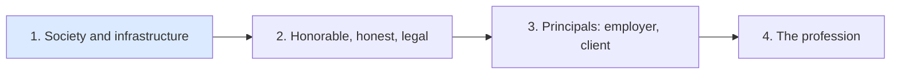

Domain 1 opens with two things that colour every other answer on the exam: how a security
professional is expected to *behave*, and the vocabulary of what we are protecting. Get these
right and a surprising number of later questions become easy, because the "best" answer is
usually the one that is ethical, legal, and protects the right property.

## 1.1 Professional ethics

### The ISC2 Code of Ethics

Every CISSP agrees to the ISC2 Code of Ethics. It has a short **preamble** (the safety and
welfare of society and the common good, duty to principals and to each other, require that
we adhere to the highest ethical standards) and **four canons**. Learn them *in order*, because
the order is the tie-breaker when they conflict:

| # | Canon (paraphrased) | Who it protects | Memory hook |
|---|---|---|---|
| 1 | Protect society, the common good, necessary public trust and confidence, and the infrastructure | Society | **S**ociety |
| 2 | Act honorably, honestly, justly, responsibly and legally | Everyone, through your conduct | **H**onor |
| 3 | Provide diligent and competent service to principals | Employers and clients | **P**rincipals |
| 4 | Advance and protect the profession | The profession | **P**rofession |

A memory aid: **"Society Has Principal Professions"**, broadest to narrowest.

> [!IMPORTANT]
> When two canons pull in different directions, the **lower-numbered canon wins**. Protecting the
> public beats loyalty to your employer; acting legally beats doing what the client asked.

### Complaints

ISC2 accepts ethics complaints only from people who can show they were affected by the breach,
and the canon matters:

- Canons 1 and 2: anyone in the public may complain.
- Canon 3: only the principals (the employer or client who received the service).
- Canon 4: other professionals (people who hold or are bound by the code).

Complaints go through ISC2's Ethics Committee and can end in revocation of the certification.
Knowingly failing to report a breach of the code by another member is itself a breach, so
"say nothing" is rarely the right exam answer.

### Organisational codes of ethics

The outline separates the ISC2 code from your **organisation's** code of ethics. The
organisational code is written by the employer, applies to all its staff (not just
security), is usually signed at onboarding and enforced by HR, and covers things like
conflicts of interest, gifts, acceptable use and reporting channels. As a security leader you
help *write* it, *train* people on it and *model* it.

A classic example of a community code is **RFC 1087, "Ethics and the Internet"** (1989), where
the Internet Activities Board called unethical any activity that seeks unauthorised access,
disrupts the intended use of the Internet, wastes resources, destroys the integrity of
computer-based information, or compromises users' privacy.

| | ISC2 Code of Ethics | Organisational code |
|---|---|---|
| Who wrote it | ISC2 | Your employer |
| Applies to | Certified members and candidates | All employees (often contractors) |
| Enforced by | ISC2 Ethics Committee (loss of certification) | HR and management (discipline, dismissal) |
| Scope | Profession-wide duties | Company-specific conduct |

### Worked example: an ethics dilemma

> Your CFO asks you to delay reporting a breach of customer payment data until after the
> quarterly earnings call next week "to avoid panic". The law in your jurisdiction requires
> prompt notification.

Walk the canons in order:

1. **Society**: customers whose card data was exposed need to act (cancel cards). Delaying harms them.
2. **Honorable and legal**: the law requires prompt notification; delaying is illegal and dishonest.
3. **Principals**: the CFO is a principal, but canon 3 is lower than 1 and 2.

**Answer:** advise the CFO, in writing, that notification is legally required and the delay
is not acceptable; escalate through the proper channel (general counsel, CEO, audit committee)
if the instruction stands. You do not leak it to the press yourself (that is not the proper
channel and can breach your duty to the principal unnecessarily), and you do not comply.

> [!TIP]
> On ethics questions the CISSP rarely wants you to act unilaterally (go to the press, hack
> back, quit on the spot). It wants you to refuse the unethical act, document, and **escalate
> through proper channels**, with public safety and legality ahead of employer loyalty.

## 1.2 Security concepts

The outline lists five: **confidentiality, integrity, availability, authenticity and
nonrepudiation**. The first three are the CIA triad; the last two extend it.

### The CIA triad

| Property | Means | Typical threats | Typical controls |
|---|---|---|---|
| **Confidentiality** | Information is disclosed only to authorised people, processes and devices | Eavesdropping, shoulder surfing, data leaks, misdirected email | Encryption, access control, classification and labelling, data loss prevention |
| **Integrity** | Information and systems are protected from unauthorised or undetected change; data is accurate and complete | Tampering, malware, unauthorised changes, transmission errors | Hashing and MACs, digital signatures, change control, input validation, least privilege |
| **Availability** | Timely, reliable access for authorised users | DoS/DDoS, hardware failure, ransomware, disasters | Redundancy, backups, clustering, capacity planning, BCP/DR |

FIPS 199 defines a loss of each property in impact terms: an unauthorised **disclosure**
(confidentiality), unauthorised **modification or destruction** (integrity), and a
**disruption** of access or use (availability).

The opposites are remembered as **DAD**: **D**isclosure, **A**lteration, **D**estruction (or
denial). Disclosure attacks confidentiality, alteration attacks integrity, destruction and
denial attack availability.

> [!NOTE]
> Integrity has three goals that exam questions sometimes split apart: prevent unauthorised
> users from making changes, prevent authorised users from making unauthorised changes, and
> keep data internally and externally consistent.

### Authenticity

**Authenticity** is the property of being genuine and verifiable: the data or message really
came from the claimed source and has not been substituted. Authentication of users, digital
signatures and certificates provide it. It overlaps integrity (an altered message is no
longer authentic) but answers a different question: *is this from who it says?* rather than
*has this changed?*

### Nonrepudiation

**Nonrepudiation** means the sender (or actor) cannot credibly deny having performed an
action, and the recipient cannot deny receipt. It requires **proof tied to a single
identity**:

- A **digital signature** made with a private key only the signer controls gives
  nonrepudiation of origin.
- A **symmetric MAC** does **not**: both parties hold the key, so either could have made it.
- **Shared accounts** destroy nonrepudiation: if five admins use `root`, logs cannot prove
  which one acted. Unique IDs plus audit logging restore it.

> [!WARNING]
> A frequent trap: "Which provides nonrepudiation?" with HMAC as a distractor. HMAC gives
> integrity and authenticity between two parties who share a key, but not nonrepudiation,
> because a third party cannot tell which key holder created it.

### Related concepts you will see in scenarios

| Term | Meaning |
|---|---|
| Identification, authentication, authorisation, accounting (IAAA) | Claim an identity, prove it, get permissions, and be held accountable through logs |
| Accountability | Tracing actions to an individual; depends on unique identity and auditing |
| Privacy | The individual's right to control how their personal data is collected and used; confidentiality is one tool for it, not the same thing |
| Least privilege, need to know | Minimum access to do the job; access to specific information only when the job requires it |
| Defence in depth | Layered, independent controls so one failure is not fatal |

### Worked example: name the property

| Scenario | Property threatened | Why |
|---|---|---|
| An attacker changes the bank account number on a supplier invoice in transit | Integrity (and authenticity) | Data was altered; the invoice no longer genuinely reflects the supplier |
| A ransomware gang encrypts the file server and also threatens to publish the files | Availability **and** confidentiality | Encryption denies access; publication discloses |
| An engineer denies having pushed a malicious commit, and commits are made from a shared deploy account | Nonrepudiation (and accountability) | No proof ties the action to one person |
| A hospital's patient portal is down during a DDoS | Availability | Authorised users cannot get timely access |
| An email appears to come from the CEO but was sent from a look-alike domain | Authenticity | The message is not from the claimed source |

### How the concepts balance

The three properties trade off. Maximum confidentiality (everything encrypted, few people
with access) can hurt availability; maximum availability (data everywhere, open access)
hurts confidentiality. The business's priorities decide the balance: a stock exchange values
integrity and availability above all, a defence contractor confidentiality, a hospital
availability and integrity of patient data (wrong dosage data can kill). Expect questions that
ask which property matters **most** for a described business.

> [!TIP]
> When a scenario involves **human safety** (medical devices, industrial control, vehicles),
> integrity and availability usually outrank confidentiality, and protecting life outranks
> everything.

## Check yourself

1. An ISC2 member discovers that her employer is selling a medical device with a known flaw
   that could harm patients, and her manager orders her to keep quiet. Which canon takes
   precedence, and what should she do?
2. A partner company signs purchase orders with an HMAC key that both companies share. Later
   it disputes an order. Why can't the HMAC settle the dispute, and what would?
3. Which property does each attack primarily threaten: a SYN flood; a SQL injection that
   changes prices; a stolen laptop with an unencrypted drive?

Answers

1. Canon 1 (protect society) outranks canon 3 (service to principals). She should refuse to
   conceal it, document the issue and escalate through proper channels (management above her
   manager, legal or compliance, and regulators if internal escalation fails), rather than
   staying silent or leaking it publicly first.
2. Both parties hold the HMAC key, so either could have produced the tag; it proves integrity
   between them but not who created it. A digital signature made with the sender's private key
   gives nonrepudiation of origin.
3. SYN flood: availability. Price-changing SQL injection: integrity. Stolen unencrypted laptop:
   confidentiality.

## Sources

ISC2 CISSP Exam Outline (objectives 1.1 and 1.2) and ISC2 Code of Ethics (canons, preamble and
complaint rules); RFC 1087 for an example community code; NIST SP 800-12 Rev. 1, FIPS 199 and
the NIST CSRC Glossary for the definitions of confidentiality, integrity, availability,
authenticity and non-repudiation.
