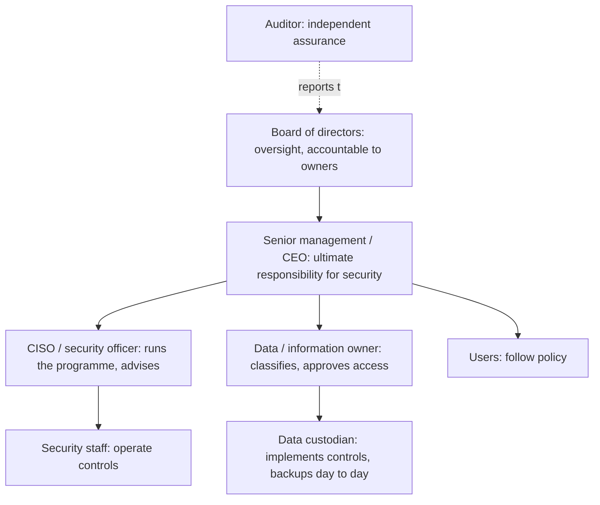
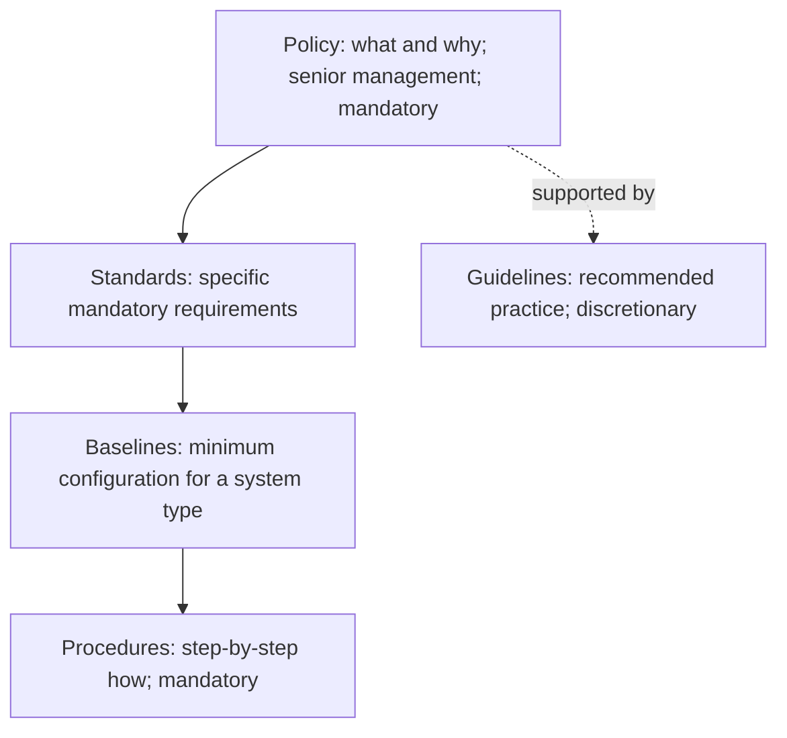

Governance is how the organisation's leaders direct and control security so it serves the
business. Management *runs* security day to day; governance *sets direction, allocates
resources and checks results*. The exam expects you to think from the governance seat.

## Alignment with the business (1.3)

Security exists to enable the **mission** (why the organisation exists), **goals** (long-term
aims), **objectives** (measurable steps) and **strategy** (how it will get there). A security
programme that is technically excellent but unaligned with these is a failure.

| Planning horizon | Typical span | Security example |
|---|---|---|
| Strategic plan | 3–5 years, reviewed yearly | "Support expansion into the EU while meeting GDPR" |
| Tactical plan | ~1 year | "Deploy DLP and a privacy programme this year" |
| Operational plan | Weeks to months | "Roll out DLP policies to finance in Q2" |

> [!TIP]
> Questions that ask what the security manager should do **FIRST** when starting a programme
> almost always want: understand the business (mission, objectives, risk appetite) and get
> **senior management support**. Without executive sponsorship, nothing else sticks.

### Organisational processes: acquisitions, divestitures, committees

- **Acquisitions and mergers**: before the deal, perform security due diligence on the target
  (its incidents, compliance gaps, contracts, technical debt). After it, do not connect
  networks until the target is assessed; harmonise policies; manage the people risk of
  unhappy staff.
- **Divestitures**: decide which data and assets go with the divested unit, remove its access
  to retained systems, sanitise media and revoke shared credentials and certificates. The
  departing staff are an insider risk during the transition.
- **Governance committees**: a security steering committee (business heads, legal, HR, IT,
  security) sets priorities and approves policy; the board or its audit/risk committee
  provides oversight. Committees make security a business decision rather than an IT one.

## Roles and responsibilities

| Role | Responsibility |
|---|---|
| Senior management | **Ultimate** responsibility and accountability for protecting assets; sets risk appetite; approves policy; can't delegate accountability |
| CISO / security officer | Designs and manages the programme, advises management, reports risk |
| Data (information) owner | Usually a business manager; classifies data, decides who gets access, is accountable for it |
| System owner | Accountable for a system that processes the data; ensures controls are in place |
| Data custodian | IT staff who implement and maintain the owner's decisions (backups, permissions, patching) |
| Users | Follow policy and procedure; report incidents |
| Auditor | Independent review that controls exist and work; reports to the board/audit committee |

> [!WARNING]
> "Who is ultimately responsible for security?" Senior management (or the board for
> oversight), **not** the CISO. "Who classifies the data?" The data **owner**, not the custodian.

### Due care and due diligence

These two terms are tested often and defined inconsistently across books. Use this framing,
which matches ISC2's usage:

- **Due diligence** is the *knowing and investigating*: researching risks, assessing vendors,
  establishing the plans, policies and processes a reasonable organisation would have.
  "Do your homework."
- **Due care** is the *doing*: actually carrying out and maintaining those protections, the
  way a prudent person would. "Do the right thing, continually."

A simple test: assessing a cloud provider's controls before signing is due diligence;
patching servers every month per policy is due care. Failing to exercise due care is the
basis of **negligence**, which is why due care protects management from liability.

## Security control frameworks (1.3)

A framework gives you a structured, defensible set of controls and a common language with
auditors and regulators. Know what each one is *for*.

| Framework | Owner | What it is | Use it when |
|---|---|---|---|
| **ISO/IEC 27001:2022** | ISO/IEC | Requirements for an information security management system (ISMS); certifiable | You need an externally certified, management-system approach |
| **ISO/IEC 27002:2022** | ISO/IEC | Guidance for 93 controls in 4 themes (organisational, people, physical, technological) | Implementing 27001 Annex A controls |
| **NIST CSF 2.0** (2024) | NIST | Outcome framework: **Govern**, Identify, Protect, Detect, Respond, Recover; profiles and tiers | Communicating posture and target state to executives, any sector |
| **NIST RMF** (SP 800-37) | NIST | Seven steps: Prepare, Categorize, Select, Implement, Assess, Authorize, Monitor | US federal systems; formal authorisation to operate |
| **NIST SP 800-53 Rev. 5** | NIST | Catalogue of security and privacy controls in families | Selecting specific controls (used by RMF and FedRAMP) |
| **COBIT 2019** | ISACA | Governance and management of enterprise IT; links IT goals to business goals | Board-level IT governance, audit |
| **SABSA** | SABSA Institute | Business-driven security architecture as a layered matrix | Designing enterprise security architecture from business attributes |
| **PCI DSS v4.0.1** | PCI SSC | Industry standard for cardholder data; enforced by contract | Anyone who stores, processes or transmits card data |
| **FedRAMP** | US GSA | Standardised authorisation of cloud services for US federal use, based on 800-53 | Selling cloud services to US federal agencies |

> [!NOTE]
> CSF 2.0 (February 2024) added **Govern** as a sixth function at the centre of the others. If
> an older study source lists five functions, it predates 2.0.

## Policy hierarchy (1.6)

Security documentation forms a hierarchy. Higher documents are broad and change rarely;
lower ones are specific and change often.

| Document | Purpose | Mandatory? | Example |
|---|---|---|---|
| **Policy** | High-level statement of management intent, scope, roles and consequences; technology-neutral | Yes | "All sensitive data must be protected in transit and at rest." |
| **Standard** | Specific, measurable requirement that makes the policy concrete | Yes | "Use AES-256 for data at rest; TLS 1.2 or later in transit." |
| **Baseline** | Minimum security configuration for a class of system | Yes | "Windows Server build per CIS Level 1 benchmark." |
| **Procedure** | Detailed step-by-step instructions | Yes | "How to enable disk encryption on a new laptop: steps 1–12." |
| **Guideline** | Recommendation or advice where flexibility is allowed | **No** | "Consider a password manager for long passphrases." |

Policy types you may meet: an **organisational (programme) policy** sets up the security
programme and assigns roles; **issue-specific policies** address one topic (acceptable use,
email, remote work); **system-specific policies** cover one system's rules.

### Develop, document, implement

1. **Develop** with stakeholders (legal, HR, business owners) so the policy is enforceable.
2. **Approve** by senior management, which gives it authority.
3. **Document** and publish where people can find it; version-control it.
4. **Implement**: communicate, train, have users acknowledge, and enforce with consequences.
5. **Review** at least annually and whenever the business, law or threat landscape changes.

### Worked example: classify the document

> A security team writes: (a) "Remote access requires MFA"; (b) "Use FIDO2 security keys or
> the approved authenticator app for MFA"; (c) "1. Open the VPN client. 2. Insert the key...";
> (d) "Staff travelling abroad may want to carry a loaner laptop."

- (a) is a **policy** statement: management intent, technology-neutral.
- (b) is a **standard**: names the specific, mandatory technologies.
- (c) is a **procedure**: steps.
- (d) is a **guideline**: "may want to" signals it is optional.

> [!TIP]
> Policies should say **what** and **why**, not **how** and not name products. If a choice names a
> product or a version number, it is a standard or baseline, not a policy.

## Check yourself

1. A new CISO has budget approval but finds that business units ignore the security policy.
   What was most likely missing, and what should the CISO do first?
2. Before acquiring a smaller company, your firm reviews its breach history and compliance
   reports. Is that due care or due diligence? What would be the due care after the merger?
3. Which document type would you update when a new OS version needs a different hardening
   setting, and why not the policy?

Answers

1. Senior management sponsorship and alignment with business objectives. The CISO should secure
   visible executive support (ideally through a steering committee with the business units) so
   the policy is seen as management's, then communicate and enforce it.
2. Due diligence (investigating before acting). Due care would be maintaining the protections
   afterwards, such as assessing and remediating the acquired network before connecting it and
   keeping it patched.
3. The baseline (or standard). The policy states intent and is technology-neutral; settings for
   a specific OS change often and belong lower in the hierarchy.

## Sources

ISC2 CISSP Exam Outline (objectives 1.3 and 1.6); NIST SP 800-12 Rev. 1 and SP 800-39 for roles,
governance and policy types; NIST CSF 2.0, SP 800-37 Rev. 2 and SP 800-53 Rev. 5; ISO/IEC
27001:2022 and 27002:2022; ISACA COBIT; The SABSA Institute; PCI SSC for PCI DSS v4.0.1.
