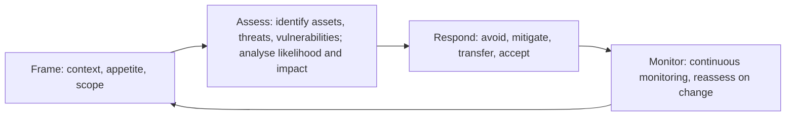

Risk management is the heart of Domain 1 and of the CISSP mindset. The exam's model security
professional does not try to eliminate risk; they help the business **understand** risk and
bring it within the organisation's **risk appetite** at a cost that makes sense.

## The vocabulary

| Term | Meaning |
|---|---|
| **Asset** | Anything of value: data, systems, people, reputation, facilities |
| **Threat** | Any potential cause of an unwanted event (a threat **agent/actor** carries it out: hacker, insider, flood) |
| **Vulnerability** | A weakness that a threat could exploit (unpatched software, no fire suppression, untrained staff) |
| **Exposure** | Being susceptible to loss because a vulnerability can be exploited |
| **Risk** | The likelihood that a threat exploits a vulnerability, combined with the impact if it does |
| **Safeguard / countermeasure / control** | A measure that reduces risk (safeguard is often used before the event, countermeasure in response) |
| **Total risk** | Risk before controls |
| **Residual risk** | Risk remaining after controls; must be within appetite and formally accepted |
| **Risk appetite / tolerance** | How much risk the organisation is willing to pursue or accept (appetite), and the acceptable variation around it (tolerance) |

A conceptual formula you will see: **risk = threat × vulnerability × impact (asset value)**.
Remove either the threat or the vulnerability and there is no risk.

> [!NOTE]
> Residual risk can never be zero. "Total risk − controls gap = residual risk" is a useful
> mental model: the controls gap is the amount of protection the controls fail to provide.

## The risk management process

NIST SP 800-39 describes four components that run continuously: **frame** (set assumptions,
constraints, appetite), **assess**, **respond**, **monitor**. ISO 31000 uses identify, analyse,
evaluate, treat, with communication and monitoring throughout.

### Scoping the assessment

Before analysing, define **scope** (which business units, systems, processes), the
**methodology** (quantitative, qualitative or hybrid), the **asset inventory and valuation**
(with owners), and who must accept the results. An assessment without management-agreed
scope produces numbers nobody acts on.

**Threat identification** draws on threat intelligence, incident history, and frameworks
such as MITRE ATT&CK. **Vulnerability identification** uses scans, penetration tests, audits,
process reviews and interviews (vulnerabilities aren't only technical: a missing procedure is
a vulnerability).

## Quantitative analysis

Quantitative analysis puts money on risk so it can be compared with the cost of controls.

| Term | Formula | Meaning |
|---|---|---|
| **AV**: asset value | n/a | Monetary value of the asset (replacement cost, revenue, liability) |
| **EF**: exposure factor | 0–100% | Percentage of the asset lost in one occurrence |
| **SLE**: single loss expectancy | $$SLE = AV \times EF$$ | Loss from one occurrence |
| **ARO**: annualised rate of occurrence | n/a | Expected occurrences per year (once in 10 years = 0.1) |
| **ALE**: annualised loss expectancy | $$ALE = SLE \times ARO$$ | Expected loss per year |

A safeguard is worth buying when it reduces the ALE by more than it costs per year:

$$\text{Value of safeguard} = ALE_{before} - ALE_{after} - \text{annual cost of safeguard}$$

A positive value means the safeguard is cost-justified. The annual cost includes purchase
(spread over its life), licences, staffing and maintenance, and any productivity cost.

### Worked example: a flood-prone data centre

> A regional data centre is valued at \$4,000,000. Engineers estimate a major flood would
> destroy 25% of its value. Historical records show such a flood once every 20 years. A flood
> barrier costs \$30,000 per year (amortised plus maintenance) and would reduce the expected
> damage of a flood to 5% of the value.

**Step 1: SLE before.** $$SLE = 4{,}000{,}000 \times 0.25 = \$1{,}000{,}000$$.

**Step 2: ARO.** Once in 20 years, so $$ARO = 1/20 = 0.05$$.

**Step 3: ALE before.** $$ALE = 1{,}000{,}000 \times 0.05 = \$50{,}000$$ per year.

**Step 4: ALE after the barrier.** The EF drops to 5%: $$SLE = 4{,}000{,}000 \times 0.05 = \$200{,}000$$;
$$ALE = 200{,}000 \times 0.05 = \$10{,}000$$.

**Step 5: value of the safeguard.** $$50{,}000 - 10{,}000 - 30{,}000 = \$10{,}000$$ per year.

The barrier is cost-justified: it saves \$10,000 a year more than it costs. If the barrier cost
\$45,000 a year the value would be −\$5,000 and, on money alone, accepting or transferring the
risk would be better.

> [!WARNING]
> Common exam errors: forgetting to convert "once every N years" into ARO = 1/N; using the asset
> value instead of SLE in the ALE; and comparing a control's **purchase price** with ALE without
> annualising it. Also note: the cost of a safeguard should not normally exceed the value of the
> asset it protects.

## Qualitative analysis

Qualitative analysis ranks risks on scales (low/medium/high, or 1–5) for likelihood and
impact, often in a **heat map** or risk matrix. Techniques include interviews, workshops,
surveys, checklists and the **Delphi technique** (anonymous rounds of expert opinion until
consensus, which avoids groupthink and dominant voices).

| | Quantitative | Qualitative |
|---|---|---|
| Output | Money (ALE, safeguard value) | Ranks, ratings, heat maps |
| Strength | Objective-looking, supports cost/benefit | Fast, handles intangibles (reputation, morale), easy to communicate |
| Weakness | Needs reliable data; slow; false precision | Subjective; hard to justify spend precisely |

Most organisations use a **hybrid**: qualitative to triage the whole estate, quantitative
on the top risks. NIST SP 800-30 also describes semi-quantitative scales (e.g. 0–100 bins).

## Risk response (treatment)

| Response | What it means | Example |
|---|---|---|
| **Mitigate (reduce)** | Implement controls to reduce likelihood or impact | Patch, add MFA, install the flood barrier |
| **Transfer (share)** | Shift financial impact to a third party | **Cyber insurance**, outsourcing with contractual liability |
| **Avoid** | Stop the activity that causes the risk | Don't launch the product in that market; decommission the legacy app |
| **Accept** | Consciously take the risk, usually because control cost exceeds benefit or it's within appetite | Management signs a documented risk acceptance |

**Rejecting (ignoring) risk is not a valid response.** Pretending a risk doesn't exist leaves
the organisation negligent.

> [!IMPORTANT]
> **Accountability cannot be transferred.** Insurance moves some financial loss, but the
> organisation still answers to regulators and customers, and reputational damage stays. Cyber
> insurance policies also carry conditions (MFA, backups, timely notice) that can void a claim if
> not met. Risk **acceptance** must be made by someone with authority (an asset owner or senior
> manager), documented, and revisited.

## Control types and functions

Controls are classified two ways: **by type** (how they're implemented) and **by function**
(what they do). A single control has one of each.

**Types:** administrative (managerial: policies, procedures, training, background checks),
technical (logical: firewalls, encryption, access control lists), physical (locks, guards,
fences, CCTV).

| Function | Purpose | Administrative | Technical | Physical |
|---|---|---|---|---|
| **Directive** | Tell people what to do | Policy, AUP | Login banner | "Authorised personnel only" sign |
| **Deterrent** | Discourage the attempt | Published sanctions | Warning banner | Visible cameras, guard dogs |
| **Preventive** | Stop it happening | Separation of duties | Firewall, encryption, MFA | Locks, mantrap |
| **Detective** | Find it during or after | Audit log review, job rotation | IDS, SIEM alerts | CCTV recording, motion sensors |
| **Corrective** | Fix the immediate effect | Incident response plan | Antivirus quarantine, patching | Fire extinguisher |
| **Recovery** | Restore normal operations | DR plan | Restoring from backup | Rebuilding a damaged site |
| **Compensating** | Alternative when the primary control isn't feasible | Extra review where SoD can't be done | Network isolation for an unpatchable system | Extra guard |

The outline names preventive, detective and corrective explicitly; know the others too.

> [!TIP]
> Job rotation and mandatory vacations are **detective** (they reveal fraud when someone else
> does the job). Separation of duties is **preventive**. CCTV that someone watches live can be
> detective; a visible camera nobody watches is mainly a **deterrent**.

## Control assessment, monitoring and reporting

- **Control assessments (security and privacy)**: test whether controls are implemented
  correctly, operating as intended, and producing the desired outcome (NIST's three
  questions in SP 800-53A style assessment). Assessors should be independent of the people
  who run the control.
- **Continuous monitoring**: ongoing awareness of controls, threats and vulnerabilities to
  support risk decisions (RMF's Monitor step); automated where possible, with metrics (KRIs
  and KPIs).
- **Reporting**: **internal** reporting to management and the board in business terms (risk
  register, dashboards, trends against appetite); **external** reporting to regulators,
  auditors, customers and, where required, shareholders.
- **Continuous improvement and risk maturity modelling**: maturity models describe how
  repeatable and optimised risk management is, typically from ad hoc → preliminary/repeatable
  → defined → integrated/managed → optimised. NIST CSF 2.0 tiers (Partial, Risk Informed,
  Repeatable, Adaptive) describe the rigour of governance and risk practices in a similar way.

## Risk frameworks

| Framework | Character |
|---|---|
| **NIST RMF (SP 800-37 Rev. 2)** | Prepare → Categorize (FIPS 199) → Select (800-53) → Implement → Assess → **Authorize** (an authorising official accepts residual risk) → Monitor |
| **NIST SP 800-30 / 800-39** | How to assess risk; organisation-wide risk management in three tiers |
| **ISO 31000:2018** | Generic enterprise risk management principles and process (not security-specific) |
| **ISO/IEC 27005** | Information security risk management, supporting the 27001 ISMS |
| **COBIT 2019** | IT governance; risk optimisation is one of its governance objectives |
| **SABSA** | Risk-driven security architecture traced from business attributes |
| **PCI DSS** | Prescriptive requirements for card data; v4.0 allows a customised approach and targeted risk analyses |
| **NIST CSF 2.0** | Outcome-based; profiles describe current and target risk posture |

## Check yourself

1. A \$500,000 web platform suffers an outage costing 10% of its value each time, about four
   times a year. A DDoS protection service at \$120,000 a year would cut that to once a year.
   What is the value of the service, and should you buy it on cost alone?
2. Management declines to fund a control and tells IT to "just not record" the risk. What is
   wrong with that, and what should happen instead?
3. Classify by type and function: a mandatory two-week vacation policy; a mantrap at the data
   centre entrance; restoring a VM from last night's snapshot.

Answers

1. SLE = 500,000 × 0.10 = \$50,000. ALE before = 50,000 × 4 = \$200,000; ALE after = 50,000 × 1 =
   \$50,000. Value = 200,000 − 50,000 − 120,000 = **\$30,000** per year, positive, so it is
   cost-justified.
2. That is risk rejection (ignoring), which is not a valid response and leaves the organisation
   negligent. Management may **accept** the risk, but it must be documented in the risk register
   and signed by an accountable owner, then reviewed.
3. Mandatory vacation: administrative, detective. Mantrap: physical, preventive. Restoring from a
   snapshot: technical, recovery.

## Sources

ISC2 CISSP Exam Outline (1.9); NIST SP 800-30 Rev. 1, SP 800-39, SP 800-37 Rev. 2 and SP 800-53
Rev. 5; NIST CSRC Glossary and FIPS 199 for definitions and categorisation; ISO 31000:2018 and
ISO/IEC 27001:2022; NIST CSF 2.0 for tiers and profiles; ISACA COBIT, SABSA and PCI DSS v4.0.1.
