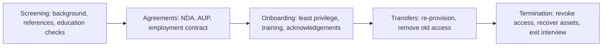

This lesson covers four objectives that share one idea: risk doesn't only live in your
servers. It lives in your design decisions (threat modeling), your suppliers (supply chain),
your staff (personnel security), and their habits (awareness).

## 1.10 Threat modeling

Threat modeling is a structured way to find what can go wrong with a system **while it's still
cheap to fix**, ideally during design, and to revisit it when the system changes. The Threat
Modeling Manifesto reduces it to four questions:

1. **What are we working on?** (model the system: data flow diagram, trust boundaries)
2. **What can go wrong?** (enumerate threats)
3. **What are we going to do about it?** (mitigate, eliminate, transfer, accept)
4. **Did we do a good enough job?** (validate)

### Methods

| Method | Focus | Notes |
|---|---|---|
| **STRIDE** (Microsoft) | Threat categories per element of a data flow diagram | Developer-friendly; each category maps to a violated property (below) |
| **PASTA** (Process for Attack Simulation and Threat Analysis) | **Risk-centric**, seven stages from business objectives to attack simulation and risk analysis | Aligns threats with business impact; heavier weight |
| **Attack trees** | Root = attacker's goal; branches = ways to reach it (AND/OR) | Good for analysing one high-value goal in depth |
| **VAST** (Visual, Agile and Simple Threat modeling) | Scales across agile teams; separate application and operational models | Built for automation in large organisations |
| **Trike** | Risk-based, from a requirements model of acceptable actions per actor | Stakeholder-defined acceptable risk |
| **LINDDUN** | **Privacy** threats: linking, identifying, non-repudiation, detecting, data disclosure, unawareness, non-compliance | Use when the asset is personal data |
| **DREAD** | Scoring (damage, reproducibility, exploitability, affected users, discoverability) | Ranking only; criticised as subjective; Microsoft no longer uses it |

**STRIDE** maps cleanly to the security concepts of lesson 1, which is how the exam likes to
test it:

| Threat | Violates | Example | Typical mitigation |
|---|---|---|---|
| **S**poofing | Authenticity / authentication | Using stolen credentials | Strong authentication, MFA |
| **T**ampering | Integrity | Modifying a request in transit | Hashes, signatures, TLS |
| **R**epudiation | Nonrepudiation | "I never placed that order" with no logs | Audit logging, digital signatures |
| **I**nformation disclosure | Confidentiality | Verbose error leaking data | Encryption, access control |
| **D**enial of service | Availability | Flooding an API | Rate limiting, redundancy |
| **E**levation of privilege | Authorisation | User becomes admin via a flaw | Least privilege, input validation |

Threat intelligence such as **MITRE ATT&CK** grounds question 2 in what real adversaries do.

### Worked example: STRIDE on a login flow

> A mobile app sends a username and password to an API, which checks a database and returns a
> session token.

Walking the trust boundary between app and API: **Spoofing** (credential stuffing → MFA,
rate limits), **Tampering** (altered requests → TLS, server-side validation), **Repudiation**
(user denies a transaction → log authenticated actions with unique IDs), **Information
disclosure** (token in URL or logs → keep tokens in headers, scrub logs), **DoS** (login
flood → throttling, WAF), **Elevation** (role parameter trusted from client → authorise on the
server). Each finding becomes a backlog item with an owner, which answers question 3.

## 1.11 Supply chain risk management

Every product and service you buy brings its supplier's risks with it. NIST SP 800-161 Rev. 1
(C-SCRM) frames this across the lifecycle: identify critical suppliers, assess them, set
contract requirements, monitor, and plan for supplier failure.

### Risks by category

| Category | Example risks |
|---|---|
| **Hardware** | Counterfeit parts, tampering in transit or manufacture, implants, end-of-life parts without firmware updates |
| **Software** | Compromised build pipelines or updates, malicious or vulnerable open-source dependencies, abandoned libraries |
| **Services** | Cloud or managed-service providers with excessive access, outages, insolvency, fourth parties (your supplier's suppliers) |

### Hardware trust anchors

- **Silicon root of trust**: an immutable component in hardware (for example boot ROM code
  and keys in a security chip such as OpenTitan-based designs) that verifies the firmware
  before it runs, so every later stage can be measured from something that can't be modified
  in the field.
- **Physically unclonable function (PUF)**: a circuit that exploits tiny, uncontrollable
  manufacturing variations to produce a device-unique response to a challenge. It works like
  a hardware fingerprint for device identity and key generation, without storing a key that
  could be read out, and helps detect counterfeit parts.

### Software Bill of Materials (SBOM)

An **SBOM** is a formal, machine-readable inventory of a software product's components and
their dependency relationships (common formats: SPDX and CycloneDX). When a new vulnerability
appears in a widely used library, an SBOM lets you answer "are we affected, and where?" in
minutes instead of weeks. Ask suppliers for SBOMs and keep them current per release.

### Third-party assessment and monitoring

- **Before contract**: due diligence through questionnaires, certifications (ISO 27001,
  SOC 2 Type II reports), right-to-audit, penetration test results, financial health.
- **In the contract**: **minimum security requirements** (encryption, MFA, breach notification
  within a set time, subcontractor approval, data return and destruction at exit) and
  **service-level requirements (SLRs)**, the customer's stated needs that become **SLAs** with
  measurable targets and penalties.
- **During the relationship**: continuous monitoring (security ratings, re-assessment cycles,
  incident reports), and review when the service or risk changes.
- **At exit**: return or verified destruction of data, revoked access.

> [!TIP]
> SOC 2 **Type II** reports test controls over a period; Type I only says controls were designed
> as of a date. For vendor assurance, Type II is stronger.

## 1.8 Personnel security

People are both the most valuable asset and a leading source of incidents. Personnel controls
follow the employment lifecycle:

| Stage | Key controls |
|---|---|
| **Candidate screening and hiring** | Job descriptions defining security responsibilities and sensitivity; background, criminal, credit (where lawful and relevant), reference and credential checks proportional to the role's risk |
| **Employment agreements and policies** | NDAs, acceptable use, conflict of interest, non-compete where lawful; signed acknowledgement of policies |
| **Onboarding** | Account provisioning on least privilege, security awareness training before access |
| **Transfers** | Grant new access **and remove** old access to prevent **privilege creep**; periodic access reviews catch what slips |
| **Termination** | Disable access at the time the person is notified (for hostile terminations, before or during the meeting); collect badges, devices and keys; exit interview reminding them of NDA obligations; escort if needed |
| **Vendors, consultants, contractors** | Contractual security requirements, NDAs, sponsor accountability, time-limited access, same screening where they have equivalent access |
| **Policy requirements (ongoing)** | Separation of duties, job rotation, mandatory vacation, least privilege, need to know, two-person control |

> [!WARNING]
> Separation of duties **prevents** one person from completing a sensitive task alone (fraud
> then needs **collusion**). Job rotation and mandatory vacations **detect** fraud by forcing
> someone else to do the work. Expect a question that hinges on preventive vs detective.

## 1.12 Security awareness, education and training

NIST distinguishes three levels on a continuum:

| Level | Goal | Audience | Example |
|---|---|---|---|
| **Awareness** | Change attention and behaviour; "what" | Everyone | Posters, phishing simulations, short videos |
| **Training** | Build skills for a role; "how" | Role-based (developers, admins, help desk) | Secure coding course, incident handler training |
| **Education** | Build understanding and judgement; "why" | Security professionals | Degrees, certifications such as the CISSP |

**Methods** named in the outline: **social engineering** awareness, **phishing** simulations,
**security champions** (volunteers embedded in teams who carry security practice and act as
a two-way channel), and **gamification** (points, leaderboards, capture-the-flag) to drive
engagement.

**Periodic content reviews** keep material current, including emerging technology such as
cryptography changes (post-quantum migration), **artificial intelligence** (deepfake voice
and video used in fraud, data pasted into AI tools) and **blockchain** (crypto scams, wallet
theft).

**Programme effectiveness** must be measured, not assumed. Good metrics measure **behaviour**,
not attendance: phishing click rate **and report rate** over time, time-to-report, reduction
in incidents caused by user error, policy violation trends. Completion percentages alone
prove only that people clicked through a course. NIST SP 800-50 Rev. 1 treats evaluation and
improvement as a stage of the learning-program lifecycle.

### Worked example: fix a failing programme

> Annual training completion is 99%, but phishing simulation click rates haven't moved in two
> years and few people report suspicious email.

Diagnosis: the programme measures attendance, not behaviour. Actions: switch to short,
frequent, role-relevant modules; make reporting easy (one-click report button) and reward
it; add just-in-time teaching when someone clicks a simulation; recruit security champions in
high-risk teams (finance, help desk); track report rate and time-to-report as the headline
metrics; refresh content with current lures, including AI-generated voice fraud.

## Check yourself

1. A threat modeling session finds that an API accepts a `role=admin` parameter from the
   client. Which STRIDE category is this, and which property is violated?
2. A critical open-source library vulnerability is announced. Which supply chain artefact lets
   you determine quickly which of your products include it?
3. An accounts payable clerk transfers to marketing and keeps her payment-approval rights for
   a year. What is this called, and which two controls should have caught it?

Answers

1. Elevation of privilege; it violates authorisation.
2. A software bill of materials (SBOM) for each product.
3. Privilege creep (access aggregation). The transfer process should have removed the old
   access when new access was granted, and periodic access reviews (recertification) should
   have detected it.

## Sources

ISC2 CISSP Exam Outline (1.8, 1.10–1.12); Threat Modeling Manifesto, OWASP Threat Modeling and
Microsoft's STRIDE definitions; MITRE ATT&CK; NIST SP 800-161 Rev. 1, CISA SBOM resources and
OpenTitan for supply chain and hardware roots of trust, with the NIST glossary for PUF; NIST SP
800-53 Rev. 5 (PS, AT, SR families) and ISO/IEC 27002:2022 people controls; CISA insider threat
guidance; NIST SP 800-50 Rev. 1 and SP 800-12 Rev. 1 for awareness, training and education.
