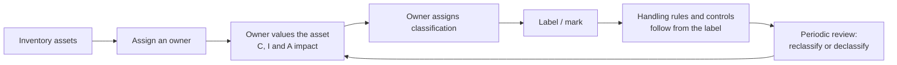

Asset Security is about one idea: **protection should be proportional to value, and someone
accountable must decide what that value is.** Classification is how an organisation writes that
decision down so everyone else can act on it without re-deciding it every time. Objective 2.1
asks you to identify and classify information and assets; the data roles sit alongside it (and in
2.4), because a classification is only as good as the person who owns it.

## Why classify at all?

Without classification, an organisation has two bad options: protect everything at the highest
level (expensive, and people work around it) or protect everything at the lowest level (cheap,
and the crown jewels leak). Classification lets you apply **the right amount of control to the
right asset**, which is the CISSP's idea of due care in one sentence.

The sequence the exam expects is:

You cannot classify what you do not know you have, so **inventory comes first**, and you cannot
classify without an accountable **owner**, so ownership comes second. ISO/IEC 27001 Annex A puts
these as neighbouring controls: 5.9 (inventory, with owners), 5.12 (classification) and 5.13
(labelling).

## Classification criteria

The owner judges the impact of losing confidentiality, integrity or availability. Common inputs:

| Criterion | Question to ask |
|---|---|
| Value | What would it cost to recreate or replace, and what is it worth to a competitor? |
| Sensitivity / impact | How much harm if disclosed, altered or unavailable? (FIPS 199: low, moderate, high) |
| Legal and regulatory | Does a law, contract or regulation (privacy, PCI DSS, export control) set a floor? |
| Age and usefulness | Does the value decay? (Quarterly results are secret until they are published.) |
| Who must access it | How widely does it need to be shared to be useful? |

> [!TIP]
> Classification is usually driven by **confidentiality**, but a good scheme considers all three.
> ISO/IEC 27002 says classification should reflect confidentiality, integrity and availability
> needs. A safety system's configuration may be public but have **high integrity** value.

## Classification schemes

### Government (U.S.)

Executive Order 13526 defines three classified levels by the damage unauthorized disclosure could
reasonably be expected to cause to national security:

| Level | Damage |
|---|---|
| Top Secret | Exceptionally grave damage |
| Secret | Serious damage |
| Confidential | Damage |

Below these sits **unclassified** information, some of which is **Controlled Unclassified
Information (CUI)**: information that a law, regulation or government-wide policy says needs
safeguarding or dissemination controls (32 CFR Part 2002). "Sensitive but unclassified" and
"For Official Use Only" are older labels that CUI replaced in the federal executive branch.

A **clearance** is necessary but not sufficient: access to classified information also needs
**need to know** (and a signed non-disclosure agreement). Exam questions love a cleared person
with no need to know; the answer is that they do not get access.

### Commercial

There is no mandated commercial scheme. A typical four-level scheme:

| Level | Typical content | Rough government analogue |
|---|---|---|
| Confidential / Proprietary / Restricted | Trade secrets, M&A plans, source code | Secret / Top Secret |
| Private | Personal data about staff and customers | (privacy-driven) |
| Sensitive / Internal | Internal procedures, org charts, project plans | Confidential |
| Public | Marketing material, published reports | Unclassified |

The names vary between organisations and textbooks; the exam tests the **ordering idea** and the
**principle**, not a particular vendor's labels. Keep schemes small: three to five levels is
typical, because each extra level adds handling rules people must remember.

> [!WARNING]
> "Private" is about **people's** data (privacy), not about secrecy of the business. Questions
> sometimes use "private" to mean PII, so read the scenario.

### The high-water mark

FIPS 199 categorises each information type for confidentiality, integrity and availability, then
categorises a system that holds several types at the **highest impact value for each objective**
across them. NIST SP 800-60 walks through mapping information types to these levels. The
practical rule for assets: **a container takes the classification of the most sensitive data it
holds** (an e-mail thread, a backup tape, a laptop, a database server).

## The data roles

The exam names the roles in the outline and tests **who decides what**. The single most tested
idea: **the owner is accountable and decides; the custodian implements and operates.**

| Role | Who it usually is | Does |
|---|---|---|
| **Data owner** (information owner) | A senior business manager accountable for the data | Classifies it, sets handling and access rules, approves access, decides retention with legal; accountable if it is mishandled |
| **System / asset owner** | Manager of the system that processes data | Ensures the system protects data to the owner's requirements; system security plan |
| **Data custodian** | IT and operations staff | Implements the owner's decisions day to day: backups, access configuration, patching, restores |
| **Data steward** | Business or data-governance role | Data **quality**, metadata and definitions; ensures data is fit for use and used per policy |
| **Data controller** (privacy) | The organisation that decides **why and how** personal data is processed | Legally responsible under privacy law (GDPR Art. 4(7)) |
| **Data processor** (privacy) | An organisation processing personal data **on behalf of** the controller | Acts only on documented instructions under a contract (GDPR Art. 28) |
| **Data subject** | The person the personal data is about | Holds privacy rights (access, rectification, erasure…) |
| **User** | Anyone authorised to use the data | Follows acceptable use and handling rules |

NIST SP 800-18 describes the information owner as the official with authority over specified
information who establishes the rules for its use and protection, and SP 800-37 Appendix D lists
the information owner/steward and system owner among the RMF roles.

> [!IMPORTANT]
> **Senior management** holds ultimate responsibility for security in the organisation.
> **Data owners** are accountable for their specific data. **Custodians** are responsible for
> carrying out the owner's instructions. If an option says "the database administrator should
> decide the classification", it is wrong: the DBA is a custodian.

### Controller versus processor in practice

GDPR defines the controller as the party that "determines the purposes and means" of processing,
and the processor as one that processes personal data "on behalf of the controller". A payroll
SaaS that runs payroll only on your instructions is your **processor**; you are the
**controller**. A processor that starts using the data for its own purposes (for example to train
a product for other customers) becomes a controller for that processing and takes on the
controller's obligations.

A controller remains accountable when it outsources: it must use processors that provide
sufficient guarantees and bind them by contract (Art. 28). In CISSP terms, **you can outsource the
work but not the accountability**.

### Data owner versus data steward

Stewards are often confused with custodians. The custodian looks after the **container** (servers,
backups, permissions); the steward looks after the **content** (definitions, quality, lineage,
consistent use). In large organisations the owner delegates day-to-day governance decisions to
stewards, but accountability stays with the owner.

## Worked example: classifying an HR analytics platform

**Scenario.** A retailer is building an HR analytics platform. It will hold (1) published job
adverts, (2) internal salary bands, (3) employee performance reviews and home addresses, and (4)
aggregate head-count reports for the board. The CISO asks you to propose classification and
roles.

**Step 1: inventory and owners.** List the four information types and name an owner for each: the
Head of Talent for adverts, the Reward Director for salary bands, the HR Director for reviews and
personal data, and the CFO for board reports.

**Step 2: impact per objective** (using FIPS 199 language):

| Information type | Confidentiality | Integrity | Availability |
|---|---|---|---|
| Job adverts | Low (public) | Moderate (wrong pay advertised) | Low |
| Salary bands | Moderate | Moderate | Low |
| Reviews and addresses (PII) | High | Moderate | Low |
| Board head-count reports | Moderate (until published) | High (board decisions rely on it) | Low |

**Step 3: high-water mark.** The platform is **High** for confidentiality, **High** for integrity
and **Low** for availability, so the platform as a whole is categorised High, and the analytics
database, its backups and any analyst laptop holding an extract inherit the "Private/Confidential"
handling.

**Step 4: roles.** The retailer is the **controller** for employee personal data. The cloud
analytics vendor processing it under contract is a **processor**. The platform team are
**custodians**. A data steward in HR owns field definitions ("what counts as head-count?").

**Step 5: reduce scope.** Ask whether analysts really need home addresses. Removing them
(data minimisation, as NIST SP 800-122 and GDPR Art. 5 both recommend) lowers the
confidentiality impact of most of the platform and narrows what must be protected at the top level.

## Reclassification and declassification

Classification is not permanent. Value decays (a product launch becomes public), regulations
change, and data is aggregated. Owners should review classifications on a schedule and at trigger
events. Two traps:

- **Aggregation**: individually low-value items can become sensitive when combined (a staff list
  plus building plans plus shift rotas). Classify the aggregate at its own level.
- **Over-classification** wastes money and trains people to ignore labels;
  **under-classification** leaves data exposed. Both are failures of due care.

Declassifying media for re-use requires **sanitisation appropriate to the original
classification** (lesson 3), not just relabelling.

> [!TIP]
> When the exam asks for the **first** step in a classification programme, look for "identify and
> inventory the assets" or "identify the data owners" before "choose labels" or "buy a DLP tool".
> Policy and ownership come before technology.

## Memory aid

**O**wner decides, **C**ustodian carries out, **S**teward keeps it sound, **C**ontroller says why,
**P**rocessor does as told, **S**ubject is who it is about. ("Owners Command, Custodians Serve;
Controllers Purpose, Processors Serve.")

## Check yourself

1. A database administrator proposes downgrading a customer table from Confidential to Internal to
   simplify backups. Who should make this decision?
2. A system holds information types rated (C, I, A) = (Low, High, Low) and (Moderate, Low, Low).
   What is the system's categorisation per objective?
3. A marketing agency uses your customer list only to send campaigns you design, under your
   instructions. Under GDPR, what are you and what is the agency?

Answers

1. The **data owner**. The DBA is a custodian and may recommend, but classification is the owner's
   decision because the owner is accountable for the data's protection.
2. Confidentiality **Moderate**, integrity **High**, availability **Low** (the high-water mark per
   objective), so the system overall is High.
3. You are the **controller** (you decide purposes and means); the agency is the **processor**,
   and Art. 28 requires a contract binding it to act only on your instructions.

## Sources

ISC2 CISSP outline (2.1, 2.4); FIPS 199 and NIST SP 800-60 (impact categorisation, high-water
mark); EO 13526 and 32 CFR 2002 (government levels, CUI); NIST SP 800-37 Rev. 2 and SP 800-18
(ownership roles); GDPR Arts. 4, 5 and 28 (controller, processor, minimisation); ISO/IEC 27001
and 27002 controls 5.9, 5.12, 5.13; NIST SP 800-122 (PII minimisation).
