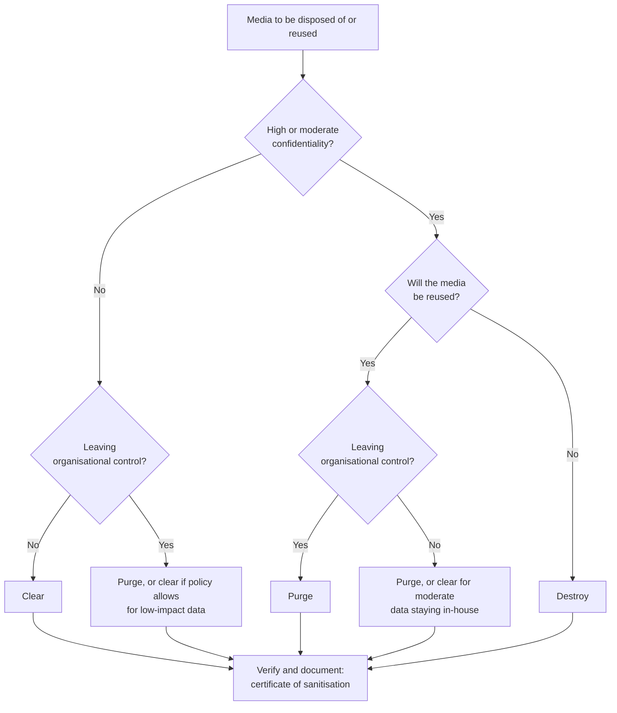

Objective 2.4 lists the parts of data lifecycle management the exam expects you to know: **data
roles, data collection, data location, data maintenance, data retention, data remanence and data
destruction**. Objective 2.5 adds **asset retention**, including end of life (EOL) and end of
support (EOS). The theme is simple: **keep data only as long as there is a reason to, protect it
the whole time, and when it goes, make sure it is really gone.**

## The data lifecycle

The Cloud Security Alliance describes a six-phase data security lifecycle. Other models use
different names, but the security questions are the same.

| Phase | Key security decision | Typical controls |
|---|---|---|
| Create / collect | Do we need this data at all? Classify at creation | Minimisation, privacy notice, classification at source |
| Store | Where may it live and how is it protected? | Encryption at rest, access control, backups, data location rules |
| Use | Who may process it, and how? | Least privilege, monitoring, DLP, masking |
| Share | Who may receive it outside the original context? | Owner approval, contracts, encryption in transit, DRM |
| Archive | How long, and can we still read it? | Retention schedule, integrity checks, format and key management |
| Destroy | Is it irrecoverable, and can we prove it? | Sanitisation per NIST SP 800-88, certificates, records of disposition |

> [!TIP]
> Classification should be assigned **at creation or collection**, not when the data is
> first stored or first shared. The earlier the label exists, the more controls can use it.

## Collection and minimisation

The cheapest data to protect is data you never collected. GDPR Article 5 requires personal data to
be "adequate, relevant and limited to what is necessary" (data minimisation) and kept no longer
than necessary (storage limitation). NIST SP 800-122 likewise recommends minimising the collection
and retention of PII. For the exam: **when a scenario offers "stop collecting the field" versus
"protect the field harder", stopping collection is usually the better answer** if the business does
not need it.

PCI DSS takes the same line for payment data: keep account data only as long as needed under a
documented retention policy, and never store sensitive authentication data (such as full track
data or the card verification code) after authorisation.

## Data location

Where data physically and legally sits affects which laws apply. Concepts to separate:

- **Data residency**: where the data is stored, often a business or contractual choice.
- **Data sovereignty**: the data is subject to the laws of the country where it is located (and
  possibly also of the provider's home jurisdiction).
- **Cross-border transfer rules**: GDPR Chapter V (Articles 44–49) restricts transfers of personal
  data outside the EEA unless there is an adequacy decision or appropriate safeguards.

Cloud makes location an active decision: choose regions, check where backups and support staff
are, and record the location in the asset inventory.

## Data maintenance

Maintenance keeps data accurate, available and protected while it is in use: integrity checks,
backups and restore tests, re-classification reviews, key rotation for encrypted stores,
migration off obsolete formats, and correcting personal data when the subject asks. Data that is
no longer accurate may be a legal liability as well as a quality problem.

## Retention (2.4, 2.5)

A **retention policy** says how long each category of record must be kept and what happens at the
end. ISO 15489 calls this disposition authority; the U.S. National Archives' General Records
Schedules are a public example of what a retention schedule looks like: record series, retention
period and disposition instruction.

Retention is set by the **data owner together with legal counsel**, from:

1. **Legal and regulatory minimums** (tax records, health records, financial audit trails).
2. **Contractual requirements** (a customer contract may require deletion after termination).
3. **Business need** (how long does the data remain useful?).
4. **Privacy maximums** (storage limitation: do not keep personal data longer than the purpose
   requires).

> [!WARNING]
> **Keeping everything forever is not "safe".** Over-retention raises breach impact, storage cost
> and **e-discovery** cost, and may breach privacy law. Under-retention can breach record-keeping
> law. Both are failures.

### Legal hold

A **legal hold** (litigation hold) suspends normal destruction for records relevant to actual or
reasonably anticipated litigation or investigation. It overrides the retention schedule for those
records only, until legal counsel releases it. Destroying held records can be spoliation of
evidence. If a scenario says "the retention period has passed, but litigation is pending", the
answer is to **keep** the records.

### Asset retention: end of life and end of support

Objective 2.5 also applies retention thinking to **assets**:

| Term | Meaning | Security consequence |
|---|---|---|
| End of life (EOL) | The vendor stops selling or manufacturing the product | Plan replacement; spares get scarce |
| End of support (EOS) / end of service life | The vendor stops patches, fixes and support | New vulnerabilities stay open: highest risk |

NIST SP 800-53 control SA-22 (unsupported system components) asks organisations to replace
components when support is no longer available, or to document a justification and provide
alternative sources of support. A CISSP's job is to make this a **planned** decision: track
EOL/EOS dates in the inventory, budget replacement, and where a system must stay (an embedded
controller, a regulated medical device), document the risk acceptance by the owner and add
**compensating controls** such as isolation, strict network segmentation and enhanced monitoring.

Retention also applies to the **ability to read archived data**: if records must be kept ten
years, you must also keep the software, formats and **encryption keys** needed to read them for
ten years.

## Data remanence

**Remanence** is the residual data left on media after an attempt to remove it. Deleting a file
usually removes only the pointer; formatting usually rewrites only file-system structures. The data
remains recoverable with simple tools.

Media matters:

- **Magnetic hard drives (HDD)**: overwriting every addressable sector is effective; degaussing
  destroys the data and normally the drive's usability too.
- **Solid-state drives and flash**: wear levelling, spare (over-provisioned) blocks and remapped
  bad blocks mean that **overwriting through the normal interface may miss data**. NIST SP 800-88
  recommends using the device's built-in sanitise commands (block erase, cryptographic erase) or
  destruction. **Degaussing does not work on flash**.
- **Optical media**: cannot be overwritten reliably; destroy it.
- **Paper**: cross-cut shredding, pulping or incineration.
- **Cloud storage**: you cannot touch the physical media, so rely on **cryptographic erasure**
  (destroying the keys) plus the provider's contractual and audited sanitisation of failed drives.

## Destruction: clear, purge, destroy (NIST SP 800-88)

NIST SP 800-88 defines three categories of sanitisation. Revision 1 (2014) and the current
Revision 2 (2025) both use them; Revision 2 frames them inside an organisational sanitisation
program and refers to media-specific technique standards rather than listing every technique.

| Category | What it does | Protects against | Examples | Media reusable? |
|---|---|---|---|---|
| **Clear** | Logical techniques on all user-addressable storage | Simple, non-invasive recovery (keyboard tools, file-recovery software) | Overwrite with standard write commands; factory reset | Yes |
| **Purge** | Physical or logical techniques that make recovery infeasible even with state-of-the-art laboratory techniques | Laboratory attack | Device sanitise commands (block erase, secure erase), cryptographic erase, degaussing (magnetic media) | Usually yes (not after degaussing a modern HDD) |
| **Destroy** | Makes recovery infeasible with state-of-the-art laboratory techniques **and** the media can no longer store data | Laboratory attack | Shred, disintegrate, pulverise, melt, incinerate | No |

The choice depends on the **confidentiality of the data**, **whether the media will be reused**,
and **whether it will leave organisational control**. As a working rule:

The diagram is a study simplification of the idea in SP 800-88; your organisation's standard sets
the exact rule. Every path ends with **verification and documentation**: SP 800-88 recommends
verifying the result and recording it (a certificate of sanitisation naming the media, method,
person and date). ISO/IEC 27001 controls 7.14 (secure disposal or re-use of equipment) and 8.10
(information deletion) require the same outcome.

### Cryptographic erase

Cryptographic erase (CE) sanitises by destroying the key that encrypts the data, leaving only
ciphertext. It is fast and works where physical access is impossible (cloud, self-encrypting
drives). It is only as strong as the conditions behind it: the data must have been **encrypted from
the start** with a strong algorithm, and **every copy of the key** (including escrow and backups)
must be destroyed. If either is in doubt, SP 800-88 advises using another purge method too.

> [!IMPORTANT]
> Overwriting is a **clear** technique. Many older books treat a multi-pass overwrite as the gold
> standard; NIST no longer does, and on SSDs it is not reliable. On the exam, "the drives are SSDs
> and will be sold" points to **purge** with the drive's sanitise command or cryptographic erase,
> or to **destroy**.

## Worked example: decommissioning a data centre

**Scenario.** A hospital is closing a data centre. Inventory shows: 200 HDDs from a SAN holding
patient records (High confidentiality) that will be returned to the leasing company; 60 SSDs in
servers that will be reused in the new site; a pallet of old backup tapes past their retention
period; and an old radiology system past end of support that a clinical team wants to keep.

| Asset | Decision | Why |
|---|---|---|
| Leased SAN HDDs | **Purge** (or negotiate to keep and **destroy** the drives), verify, certificate per drive | High confidentiality and leaving organisational control |
| SSDs reused in-house | **Purge** with the device's sanitise or cryptographic erase command, then verify | High confidentiality; overwriting is unreliable on SSDs |
| Backup tapes past retention | First confirm with legal that **no legal hold** applies; then degauss or **destroy**, and record disposition | Retention ended, but a hold would override it |
| EOS radiology system | Owner documents risk acceptance; isolate on its own segment, restrict access, monitor; budget replacement | No more patches; compensating controls reduce risk |

## Check yourself

1. The retention schedule says to destroy invoices after seven years. Some eight-year-old invoices
   relate to a dispute that legal says will probably go to court. What should happen to them?
2. Which NIST SP 800-88 category protects only against simple, non-invasive recovery?
3. Why is overwriting not the preferred way to sanitise an SSD?

Answers

1. Place them under **legal hold** and keep them until counsel releases the hold; the hold
   overrides the schedule for those records only.
2. **Clear**.
3. Wear levelling, over-provisioned spare blocks and remapping mean the normal write interface
   cannot reach every physical location, so remnants can survive. Use the device's purge commands
   (block erase or cryptographic erase) or destroy the media.

## Sources

ISC2 CISSP outline (2.4, 2.5); CSA Security Guidance (data security lifecycle); GDPR Arts. 5 and
44–49 (minimisation, storage limitation, transfers); NIST SP 800-122 (PII minimisation); ISO 15489
and NARA General Records Schedules (retention and disposition); PCI DSS v4.0.1 Requirement 3
(retention of account data); NIST SP 800-53 SA-22 and SI-12 (unsupported components, retention);
NIST SP 800-88 Rev. 1 and Rev. 2 (clear, purge, destroy, cryptographic erase, verification);
ISO/IEC 27001 controls 7.14 and 8.10.
