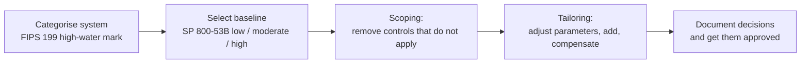

Objective 2.6, **determine data security controls and compliance requirements**, covers four
things: the **data states**, **scoping and tailoring**, **standards selection**, and **data
protection methods** (the outline names DRM, DLP and CASB). The skill tested is choosing the right
control for the situation, then adjusting a standard set of controls to fit the business.

## Data states

| State | Where the data is | Main threats | Typical controls |
|---|---|---|---|
| **At rest** | Disks, databases, backups, removable media, cloud object storage | Lost or stolen media, unauthorised access to storage, backup theft | Encryption (full-disk, volume, file, database/TDE), access control, key management, physical security |
| **In transit** (in motion) | Crossing a network: internal, internet, between clouds | Eavesdropping, interception, tampering, man-in-the-middle | TLS 1.2/1.3, IPsec VPNs, SSH, mutual authentication, network segmentation |
| **In use** | Being processed in memory or displayed to a user | Memory scraping, malicious insiders, screen capture, compromised host | Access control, least privilege, process isolation, **trusted execution environments** (confidential computing), masking on screen, DLP on endpoints |

NIST SP 800-111 covers storage encryption for end-user devices (full-disk encryption with
pre-boot authentication protects a lost laptop; file encryption protects files when the device is
running). NIST SP 800-52 Rev. 2 sets the baseline for TLS: TLS 1.2 at minimum, with TLS 1.3
support. The Confidential Computing Consortium defines confidential computing as protecting data
**in use** by computing in a hardware-based, attested trusted execution environment.

> [!TIP]
> Full-disk encryption protects data at rest **when the device is off or locked**. Once the user
> has logged in, the operating system decrypts transparently, so FDE does nothing against malware
> or an insider on a running machine. That is a classic distractor.

Data in use is the hardest state: to compute on data you normally must decrypt it. Expect exam
answers about data in use to centre on **access control, isolation and monitoring**, and newer
answers to mention TEEs or homomorphic encryption.

## Standards selection

An organisation chooses a control framework, then adopts a baseline from it. The choice is driven
by **law, regulation, contract and industry**: a U.S. federal system uses NIST SP 800-53; a company
taking card payments must meet PCI DSS; one seeking certification of its ISMS uses ISO/IEC 27001
with ISO/IEC 27002 guidance; a small business may start from the CIS Controls. Mandatory
requirements come first; voluntary frameworks fill the gaps.

## Baselines, scoping and tailoring

A **baseline** is a minimum set of controls for a given impact level. NIST SP 800-53B provides low,
moderate and high baselines; the FIPS 199 categorisation (high-water mark, lesson 1) picks which
one applies. A baseline is a starting point, not the finished answer.

- **Scoping** decides **which** baseline controls apply to this system. A control about wireless
  access is out of scope for a system with no wireless capability; controls for a technology the
  system does not use, or that a common control provider already covers, are scoped out.
- **Tailoring** modifies the controls that remain **to fit the organisation's mission and
  environment**: assigning organisation-defined parameter values (for example, a lockout after
  five failed attempts), selecting **compensating controls** where a control cannot be implemented,
  and **supplementing** the baseline with extra controls where risk demands it.

SP 800-53B describes tailoring as a set of activities that includes scoping, so **scoping is part
of tailoring**. The exam distinction: scoping removes what does not apply; tailoring adjusts what
remains. Every scoping and tailoring decision should be **justified, documented and approved**
(in RMF terms, by the authorising official based on risk), not quietly dropped by an engineer.

> [!WARNING]
> "This control is expensive" is not a scoping justification. If a required control cannot be
> implemented, the answer is a **compensating control** with documented risk acceptance, not
> silently removing it.

### Scope reduction

PCI DSS shows a related, very practical idea: reduce the **amount of the environment** that must
meet a standard. Network segmentation can take systems out of the cardholder data environment;
tokenisation can remove card numbers from systems that only need a reference. Less in scope means
fewer systems to protect and audit.

## Data protection methods

### Data Loss Prevention (DLP)

DLP finds sensitive data and enforces policy on its movement. It works by **content inspection**
(pattern matching such as card-number formats with checksum validation, keywords, exact data
matching, document fingerprinting, machine-learning classifiers) and by **context** (sender,
destination, channel, label). ISO/IEC 27002 control 8.12 and CIS Control 3 both list it.

| Deployment | Watches | Example action |
|---|---|---|
| Network DLP | Traffic leaving the network (e-mail, web uploads) | Block or quarantine an e-mail with 500 card numbers |
| Endpoint DLP | Activity on the device (USB copies, print, clipboard, uploads) | Block copying a Restricted file to a USB stick |
| Storage / discovery DLP | Data at rest on file shares, databases, cloud stores | Find unencrypted PII on a share and report or move it |
| Cloud DLP | SaaS and cloud storage, often via CASB or APIs | Remove a public link to a Confidential file |

**Limits**: network DLP cannot inspect what it cannot decrypt, so encrypted traffic needs TLS
inspection or endpoint DLP; DLP needs good **classification and labels** to be accurate, and
tuning to avoid false positives. DLP depends on Domain 2 basics: you must know what is sensitive
and where it lives (**data discovery first**) before you can stop it leaving.

### Digital Rights Management (DRM)

DRM (in the enterprise often called information rights management, IRM) protects the **data
itself**: the file is encrypted and carries a policy that says who may open it and what they may
do (view, edit, print, copy, forward), sometimes with expiry and the ability to **revoke** access
later. The policy is enforced wherever the file goes, because opening it requires a licence from
the rights server. Sensitivity labels that apply encryption and usage rights (for example in
Microsoft Purview) are a common implementation.

**Limits**: DRM cannot stop someone photographing a screen or retyping content; it needs
compatible software to open files; and it adds key and licence management.

> [!TIP]
> Distinguish them by **where the control lives**. DLP watches the **channels** and stops data
> leaving. DRM travels with the **file** and keeps controlling it **after** it has left. If a
> scenario says "we must control what a partner can do with the document after we send it", the
> answer is DRM.

### Cloud Access Security Broker (CASB)

A CASB is a policy enforcement point between users and cloud services. Gartner describes it as
interjecting enterprise security policies as cloud resources are accessed. Typical functions:

- **Visibility**: discovering which cloud services are in use (**shadow IT**), often from proxy and
  firewall logs.
- **Data security**: DLP for cloud services, encryption or tokenisation of data sent to SaaS.
- **Threat protection**: detecting compromised accounts and anomalous behaviour.
- **Compliance and access control**: enforcing policy by user, device and location.

Deployment modes: **API-based** (out of band, connecting to the SaaS provider's APIs to scan data
and settings at rest) and **proxy-based** (inline, forward or reverse proxy, which can block in real
time). Many products combine both. The CSA Security Guidance lists CASB among cloud data security
controls.

### Masking, tokenisation, pseudonymisation and anonymisation

| Method | What it does | Reversible? | Typical use |
|---|---|---|---|
| Masking | Hides part of a value (`****-****-****-1234`), statically in a copy or dynamically on display | Static: no. Dynamic: original remains in the database | Call centres, test data |
| Tokenisation | Replaces a value with a random token; the mapping is kept in a secured token vault | Yes, via the vault | Card payments, reducing PCI DSS scope |
| Pseudonymisation | Replaces identifiers so data cannot be attributed to a person **without additional information kept separately** | Yes, with that information | Analytics; GDPR still treats it as personal data |
| Anonymisation | Irreversibly removes the link to a person | No | Open data, research release; out of GDPR scope if truly anonymous |

GDPR Article 4(5) defines pseudonymisation and makes clear pseudonymised data is still personal
data. Anonymisation is hard to do well: combining "anonymous" datasets can re-identify people.

## Worked example: a consultancy shares client reports

**Scenario.** A consultancy e-mails confidential reports to clients and stores them in a SaaS file
platform. Last quarter a client forwarded a report to a competitor, and staff were found using two
unapproved file-sharing services. The board wants to (1) stop accidental e-mailing of client data
to the wrong people, (2) control reports after they reach clients, (3) find and govern unapproved
cloud services, and (4) choose a control baseline for the new reporting system, which is rated
moderate and has no wireless components.

| Need | Control | Why not the others |
|---|---|---|
| Stop accidental sends | **DLP** on e-mail and endpoints, keyed to labels | DRM doesn't stop the send; CASB doesn't see SMTP |
| Control after delivery | **DRM/IRM**: encrypted reports, view-only, no forwarding, revocable | DLP has no reach once the file has left |
| Unapproved cloud services | **CASB** discovery, then sanctioned-service policy | DLP alone won't inventory SaaS use |
| Baseline | SP 800-53B **moderate** baseline, **scope out** wireless controls, **tailor** parameters (session timeouts, retention) | Starting from high wastes money; starting from nothing ignores the standard |

All four depend on what earlier lessons established: **classification and labels** that DLP, DRM
and CASB can act on, owners who approve the policies, and an inventory of where data lives.

## Check yourself

1. A laptop with full-disk encryption is stolen while powered off. Another is infected with
   malware while the user is logged in. In which case does FDE protect the data?
2. A system has no wireless interfaces, so the team removes the wireless controls from its
   baseline. They also change the password lockout threshold to fit corporate policy. Which action
   is scoping and which is tailoring?
3. Legal wants to be able to revoke access to a merger document even after it has been sent to the
   other party's lawyers. Which control fits?

Answers

1. Only the **stolen, powered-off** laptop. On a running, unlocked machine the OS decrypts data
   transparently, so malware can read it.
2. Removing inapplicable wireless controls is **scoping**; setting the lockout value is
   **tailoring** (assigning a parameter). Scoping is one of the tailoring activities in SP 800-53B.
3. **DRM / information rights management**: the policy travels with the encrypted document and
   access can be revoked centrally.

## Sources

ISC2 CISSP outline (2.6); NIST SP 800-111 (storage encryption); NIST SP 800-52 Rev. 2 (TLS);
Confidential Computing Consortium (data in use); NIST SP 800-53 Rev. 5, SP 800-53B and SP 800-37
Rev. 2 (baselines, scoping, tailoring, compensating controls); FIPS 199 (categorisation); PCI DSS
v4.0.1 (scope reduction, tokenisation); GDPR Art. 4(5) (pseudonymisation); NIST SP 1800-28 (DLP and
data protection architecture); ISO/IEC 27002 control 8.12 and CIS Controls v8 Control 3 (DLP); CSA
Security Guidance and Gartner glossary (CASB); Microsoft Purview documentation (labels that apply
rights management).
