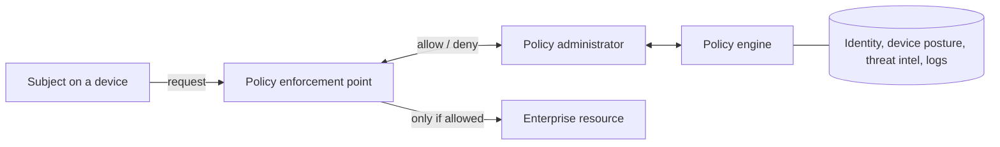
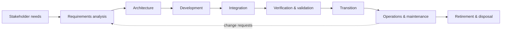

## Why principles come first

Domain 3 opens with principles because controls bolted on after a design is fixed are expensive and
partial. NIST SP 800-160 calls this *systems security engineering*: security is a property you engineer
into a system across its whole life, the same way you engineer reliability or safety. On the exam, when a
question asks what should have happened, the answer is often "it should have been designed in", that is,
security requirements captured early in the lifecycle rather than a tool added later.

Most of these principles go back to Saltzer and Schroeder's 1975 paper, *The Protection of Information in
Computer Systems*. Their eight principles (economy of mechanism, fail-safe defaults, complete mediation,
open design, separation of privilege, least privilege, least common mechanism, psychological
acceptability) still underpin the 2024 outline list.

## The 3.1 principles

| Principle | What it means | Design example |
|---|---|---|
| **Threat modeling** | Systematically ask what can go wrong, for whom, and what you will do about it, *before* building | STRIDE workshop on a new payments API; data-flow diagram with trust boundaries |
| **Least privilege** | Every subject gets only the rights it needs, for only as long as it needs them | A reporting service gets read-only access to one schema, not `db_owner` |
| **Defence in depth** | Layered, diverse controls, so one failure is not a breach | MFA + network segmentation + EDR + encryption at rest + logging |
| **Secure defaults** | The out-of-the-box state is the secure state; insecurity requires a deliberate choice | New storage buckets are private; admin console disabled until configured |
| **Fail securely** | When a component fails, it fails into a state that does not grant access or leak data | Authorization service unreachable → deny, not allow |
| **Segregation (separation) of duties** | No single person can complete a sensitive task end to end | One person raises a vendor, another approves payment |
| **Keep it simple and small** | Smaller, simpler mechanisms have fewer flaws and can be verified | A small reference monitor; fewer exposed services |
| **Zero trust / trust but verify** | No implicit trust from network location; authenticate and authorise every request | Per-request policy check for an internal app, even from the office LAN |
| **Privacy by design** | Privacy is a default, embedded, end-to-end property, not an add-on | Collect date of birth only as an "over 18" flag |
| **Shared responsibility** | In cloud or outsourced services, each party owns defined controls | In IaaS the customer patches the guest OS; the provider secures the hypervisor |
| **SASE** | Secure access service edge: network and security functions delivered together from the cloud edge | SD-WAN plus secure web gateway, CASB, ZTNA and FWaaS from one cloud service |

### Least privilege and its neighbours

Least privilege is about the *amount* of access. Related ideas you must keep separate:

- **Need to know** narrows access to specific information even within a clearance. A SECRET-cleared
  analyst still sees only the SECRET files for their project.
- **Least functionality** (NIST's term) removes unneeded services, ports and features from the system.
- **Separation of privilege** (Saltzer and Schroeder) requires two conditions to unlock something, which
  is the technical cousin of **segregation of duties** (a people and process control).
- **Dual control** needs two people present at the same time (two keys for a vault). **Split
  knowledge** means no one person knows the whole secret (each holds half a key). Both reappear in key
  management in lesson 4.

### Defence in depth is not "more of the same"

Two firewalls from the same vendor with the same rule set are one control twice. Depth means
**different** control types (administrative, technical, physical) and **different** functions
(deter, prevent, detect, correct, recover) so that one exploit does not defeat every layer.

### Fail securely versus fail safe

These are the most-tested pair in this objective.

- **Fail secure (fail closed):** on failure, the system protects the asset. A firewall that crashes
  drops all traffic. A server-room door with a fail-secure lock stays locked on power loss.
- **Fail safe (fail open):** on failure, the system protects *people*. A fire-exit door unlocks on power
  loss or alarm so people can get out.

> [!WARNING]
> The CISSP rule is that **human safety always comes first**. If a question asks how doors on an
> evacuation route should behave in a fire, the answer is fail safe, even though it weakens security.
> For a door into a data hall that is *not* an egress route, fail secure is right. Read which doors the
> question is talking about.

In software, failing securely means handling exceptions so that the error path does not grant access,
skip a check, or print a stack trace with secrets. "Default deny" in an authorisation decision is the
same idea expressed as a rule.

### Zero trust

NIST SP 800-207 defines zero trust as moving defences from static network perimeters to users, assets
and resources. Its tenets include: all data sources and services are resources; all communication is
secured regardless of network location; access is granted **per session**; access is decided by **dynamic
policy** using identity, device state and behaviour; and the enterprise monitors the integrity of all
assets.

The logical components:

- The **policy engine (PE)** makes the trust decision.
- The **policy administrator (PA)** carries it out by setting up or tearing down the session.
- The **policy enforcement point (PEP)** sits in the data path and enables, monitors and terminates the
  connection.

CISA's maturity model organises the work into five pillars: identity, devices, networks, applications
and workloads, and data, with visibility, automation and governance across all of them.

> [!TIP]
> "Trust but verify" is the older phrasing the outline keeps beside zero trust. On the exam, zero trust
> answers remove implicit trust based on location ("it's on the internal network, so it's trusted") and
> add continuous verification. A VPN that gives full network access once connected is **not** zero trust.

### SASE

Secure access service edge combines networking (SD-WAN) and security services (secure web gateway,
cloud access security broker, zero trust network access, firewall as a service) into one cloud-delivered
service, close to users wherever they are. It suits a distributed workforce where hair-pinning traffic
back to a head-office firewall adds latency. The design point to remember: SASE moves policy enforcement
to the **edge, near the user**, and it is one practical way to implement zero trust network access.

### Privacy by design

Privacy by design (Ann Cavoukian's seven foundational principles, now reflected in GDPR Article 25 as
"data protection by design and by default") asks for privacy to be proactive, the default setting,
embedded in design, positive-sum, end-to-end across the lifecycle, visible and transparent, and
user-centric. In practice: data minimisation, purpose limitation, pseudonymisation and short retention
built into the system rather than promised in a policy.

### Shared responsibility

The provider always owns the physical facility; the customer always owns their data, their identities
and who they grant access to. Everything between moves with the service model:

| Layer | IaaS | PaaS | SaaS |
|---|---|---|---|
| Data, user access | Customer | Customer | Customer |
| Application | Customer | Customer | Provider |
| Runtime, middleware | Customer | Provider | Provider |
| Guest OS | Customer | Provider | Provider |
| Hypervisor, hardware, facility | Provider | Provider | Provider |

Accountability for protecting the data never transfers, even when the responsibility for a control does.

## Worked example: applying the principles to a design review

**Scenario.** A hospital is building a web portal that lets clinicians view lab results from home. The
draft design: clinicians connect by VPN, then reach the portal, which runs under a service account with
`db_owner` on the lab database. If the identity provider is unreachable the portal falls back to a
local password table "so clinicians are never locked out". The portal logs full patient records for
debugging.

**Review, principle by principle:**

1. **Threat modeling.** Draw the data flow: clinician device → VPN → portal → database. Trust boundaries
   at the internet edge and between portal and database. STRIDE flags spoofing (credential theft),
   information disclosure (logs) and elevation of privilege (`db_owner`).
2. **Zero trust.** Replace "on the VPN, therefore trusted" with per-request authentication via the
   identity provider, device posture checks and a PEP in front of the portal (ZTNA).
3. **Least privilege.** The service account needs `SELECT` on results views only.
4. **Fail securely.** The fallback password table is a bypass. If the IdP is down, deny and use a
   documented break-glass procedure with separate, monitored accounts.
5. **Privacy by design.** Log request IDs and outcomes, not patient records.
6. **Defence in depth.** Add encryption in transit and at rest, database activity monitoring and
   alerting on bulk queries.
7. **Keep it simple.** Remove the second authentication path entirely, which also removes a whole class
   of bugs.

The most important change for the exam is item 4: a design that fails open for convenience is the
classic wrong answer.

## The information system lifecycle (3.10)

Objective 3.10 lists the stages of managing an information system's lifecycle. They follow ISO/IEC/IEEE
15288 and NIST SP 800-160:

| Stage | Security activity |
|---|---|
| **Stakeholder needs and requirements** | Identify protection needs, laws, data types and risk appetite; capture security requirements alongside functional ones |
| **Requirements analysis** | Turn needs into testable security requirements; trace each to a stakeholder need |
| **Architectural design** | Threat model; choose the security architecture, trust boundaries and patterns |
| **Development / implementation** | Secure coding, hardened components, supply chain checks |
| **Integration** | Verify interfaces between components keep the security properties |
| **Verification and validation** | Verification: "did we build it right?" against requirements. Validation: "did we build the right thing?" for the stakeholder's real need |
| **Transition / deployment** | Secure configuration baseline, authorisation to operate, handover |
| **Operations and maintenance / sustainment** | Patch, monitor, change control, periodic reassessment |
| **Retirement / disposal** | Data retention or sanitisation, revoke credentials and certificates, archive keys, update inventory |

> [!TIP]
> Memory aid for verification versus validation: **V**erification checks against the **spec**;
> **V**alidation checks against the **user**. The exam likes to ask which one catches a system that
> perfectly meets a badly written requirement: only validation does.

> [!IMPORTANT]
> Security is cheapest to add at the requirements stage. If a question asks *when* a security
> professional should first be involved in a new system, the answer is at initiation, with the
> stakeholders, not at testing or deployment.

Disposal is part of the lifecycle, not an afterthought: retiring a system without sanitising its storage
or revoking its service accounts and certificates leaves live attack paths.

## Check yourself

1. A badge reader on a stairwell door that is also a fire exit loses power. Should it fail secure or
   fail safe, and why?
2. Which zero trust component sits in the data path and actually allows or terminates the session?
3. A system passes every test in its requirements specification, but clinicians cannot use it for the
   task it was bought for. Which lifecycle activity should have caught this?

Answers

1. Fail safe (unlock). It is on an egress route, and life safety outranks asset protection.
2. The policy enforcement point (PEP). The policy engine decides; the policy administrator configures
   the PEP to carry out the decision.
3. Validation, which checks the system against the stakeholder's actual need. Verification only checks
   it against the written requirements, which were wrong.

## Sources

Principles: ISC2 CISSP outline 3.1 and 3.10; NIST SP 800-160 Vol. 1 Rev. 1 (Appendix E); Saltzer and
Schroeder (1975); OWASP Developer Guide; CISA Secure by Design. Zero trust: NIST SP 800-207 and the CISA
Zero Trust Maturity Model v2. Shared responsibility: CSA Security Guidance v5. Lifecycle: ISO/IEC/IEEE
15288:2023 and NIST SP 800-160.
