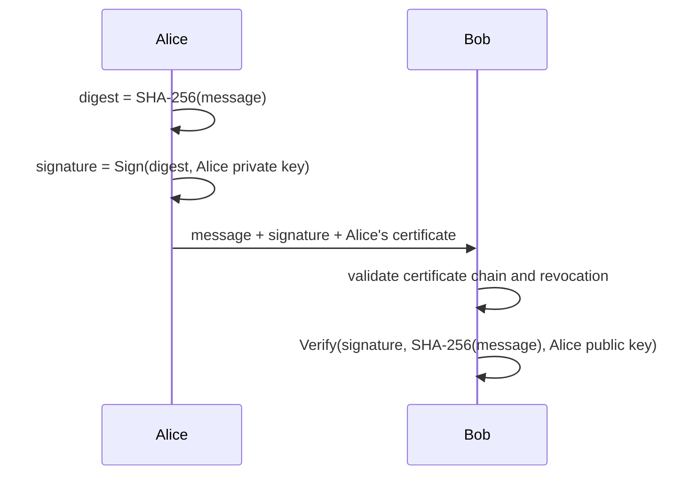
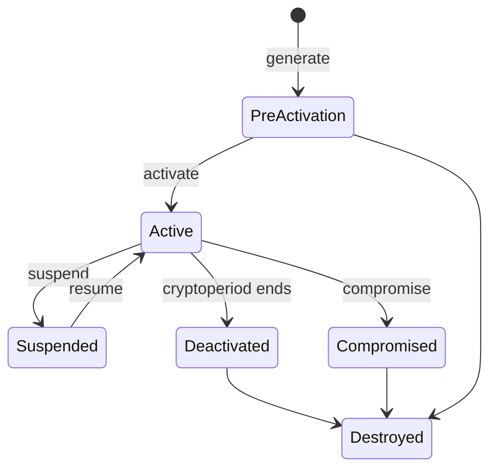

## What cryptography gives you

| Service | Provided by |
|---|---|
| **Confidentiality** | Encryption (symmetric or asymmetric) |
| **Integrity** | Hash functions, MACs, digital signatures |
| **Authenticity** (of origin) | MACs, digital signatures, certificates |
| **Non-repudiation** | Digital signatures only (a MAC uses a shared key, so either party could have made it) |

> [!TIP]
> Non-repudiation needs a key that **only one party** holds. That rules out symmetric keys and MACs, and
> it is why signing keys should never be escrowed.

## Symmetric cryptography

One shared secret key encrypts and decrypts. It is fast and suited to bulk data, but the key must be
distributed securely, and the number of keys grows quickly: **n(n − 1) / 2** keys for *n* parties who
each need a private pair-wise channel.

| Algorithm | Block | Key | Status |
|---|---|---|---|
| **AES** (Rijndael) | 128-bit | 128, 192, 256 | Current standard (FIPS 197) |
| **DES** | 64-bit | 56 effective | Broken by exhaustive search; withdrawn |
| **3DES / TDEA** | 64-bit | 112 or 168 nominal | Disallowed for encryption after 2023 (SP 800-131A Rev. 2) |
| **ChaCha20** | Stream | 256 | Modern stream cipher, common in TLS on mobile |
| **RC4** | Stream | Variable | Broken; prohibited in TLS |

**Block cipher modes** (SP 800-38A and later parts) decide how blocks are chained:

- **ECB** encrypts each block independently, so identical plaintext blocks give identical ciphertext and
  patterns show through. Never use it for data longer than one block.
- **CBC** chains each block to the previous ciphertext, using an IV; needs padding.
- **CTR** turns the block cipher into a stream; parallelisable; never reuse a counter with the same key.
- **GCM** is CTR plus authentication (**AEAD**: authenticated encryption with associated data), the
  default for TLS 1.3 alongside ChaCha20-Poly1305.

## Asymmetric cryptography

Each party has a **key pair**: a public key that anyone may hold and a private key that only the owner
holds. *n* parties need only **2n** keys. It solves key distribution and enables signatures, but it is
far slower than symmetric encryption.

| Algorithm | Hard problem | Use |
|---|---|---|
| **RSA** | Factoring large integers | Encryption, signatures, key transport |
| **Diffie-Hellman (DH)** | Discrete logarithm | Key **agreement** only (no encryption, no signatures) |
| **ElGamal** | Discrete logarithm | Encryption, signatures |
| **ECC** (ECDH, ECDSA, EdDSA) | Elliptic-curve discrete logarithm | Same strength as RSA with much smaller keys |

Plain DH has no authentication, so an attacker in the middle can run one exchange with each side. In
practice DH is authenticated with certificates or signatures.

**Comparable strengths (SP 800-57 Part 1):**

| Security strength | Symmetric | RSA / DH | ECC |
|---|---|---|---|
| 112 bits | 3TDEA | 2048 | 224–255 |
| 128 bits | AES-128 | 3072 | 256–383 |
| 192 bits | AES-192 | 7680 | 384–511 |
| 256 bits | AES-256 | 15360 | 512+ |

### Which key do I use?

| Goal | Key used by the sender |
|---|---|
| Send Bob something only Bob can read | **Bob's public key** to encrypt; Bob decrypts with his private key |
| Prove Alice sent it | **Alice's private key** to sign; anyone verifies with Alice's public key |
| Both | Sign with the sender's private key, then encrypt with the recipient's public key |

### Hybrid cryptography

Real protocols (TLS, S/MIME, PGP) combine both: asymmetric cryptography agrees or transports a random
**session key**, and symmetric encryption protects the bulk data with it. You get asymmetric key
distribution with symmetric speed.

## Hashing, MACs and signatures

A **hash function** maps any input to a fixed-length digest. It must be one-way (**preimage
resistant**), and it must be hard to find a second input with the same digest (**second-preimage
resistant**) or any two inputs with the same digest (**collision resistant**).

| Hash | Digest | Status |
|---|---|---|
| MD5 | 128 | Broken for collisions; do not use for security |
| SHA-1 | 160 | Practical collisions since 2017; disallowed for signatures; NIST plans full retirement by 2030 |
| SHA-2 (SHA-256, SHA-384, SHA-512) | 224–512 | Current (FIPS 180-4) |
| SHA-3 | 224–512 | Current (FIPS 202), different internal design (sponge) |

A hash alone proves nothing about **who** made it, since anyone can recompute it. Add a key:

- **HMAC** combines a hash with a shared secret key: integrity plus authenticity between the key holders.
- A **digital signature** hashes the message and signs the digest with the signer's private key.
  Verification uses the signer's public key. FIPS 186-5 approves RSA, ECDSA and EdDSA signatures; DSA is
  no longer approved for generating new signatures.

## Public key infrastructure

PKI binds public keys to identities through **certificates** (X.509 v3, RFC 5280) signed by a
**certificate authority (CA)**.

| Component | Role |
|---|---|
| **Root CA** | Trust anchor; self-signed; kept **offline** and used only to sign intermediates |
| **Intermediate / issuing CA** | Issues end-entity certificates; can be revoked without replacing the root |
| **Registration authority (RA)** | Verifies the requester's identity before the CA issues |
| **Certificate** | Subject, public key, issuer, validity dates, serial number, extensions (key usage, SAN), CA signature |
| **CRL** | A signed list of revoked serial numbers, published periodically |
| **OCSP** | Real-time status query for one certificate (RFC 6960) |
| **OCSP stapling** | The server fetches its own OCSP response and staples it to the TLS handshake, saving the client a lookup and protecting its privacy |

**Validating a certificate:** check the signature chain to a trusted root, the validity dates, the name
matches, key usage permits this use, and the certificate is not revoked. **Certificate pinning** makes an
application accept only a specific certificate or key, which defeats rogue CAs but makes rotation harder.

## Key management

Most real cryptographic failures are key-management failures, not broken algorithms. NIST SP 800-57
Part 1 defines the lifecycle.

| Practice | What it means |
|---|---|
| **Generation** | Use an approved random bit generator inside a validated module (FIPS 140-3) |
| **Distribution** | Out of band, wrapped by a key-encrypting key, or by key agreement |
| **Storage** | In an HSM, TPM or managed KMS; never in source code or configuration files |
| **Cryptoperiod** | The time a key is authorised for use; shorter for high-volume or high-risk keys |
| **Rotation** | Replace keys at the end of the cryptoperiod or on suspicion of compromise |
| **Key hierarchy** | Data-encrypting keys (DEKs) wrapped by key-encrypting keys (KEKs) wrapped by a master key in an HSM, so rotating the master does not mean re-encrypting all data |
| **Dual control** | Two people must act together (two administrators to unlock the HSM) |
| **Split knowledge** | No one person knows the whole key; often **M-of-N** key shares |
| **Escrow / recovery** | A copy of encryption keys held by a trusted party so data can be recovered; **never for signing keys** |
| **Destruction** | Zeroise keys and copies when no longer needed; data encrypted under them becomes unrecoverable (crypto-shredding) |

**Algorithm selection** is part of the lifecycle too: choose approved algorithms and key lengths for the
data's protection lifetime, and plan for **crypto agility** so you can swap algorithms without
redesigning the system.

## Quantum computing and cryptography

- **Shor's algorithm**, on a large enough quantum computer, would break RSA, DH and ECC.
- **Grover's algorithm** speeds up brute-force search quadratically, which roughly halves symmetric key
  strength. AES-256 remains strong; hashes with large outputs remain fine.
- **"Harvest now, decrypt later":** an adversary records encrypted traffic today to decrypt it once
  quantum computers exist. Data that must stay secret for many years is at risk now.
- **Post-quantum cryptography (PQC):** NIST published FIPS 203 (ML-KEM, key encapsulation), FIPS 204
  (ML-DSA, signatures) and FIPS 205 (SLH-DSA, hash-based signatures) in August 2024.
- **Quantum key distribution (QKD)** uses quantum properties of photons to detect eavesdropping on key
  exchange. It needs special hardware and dedicated links and does not authenticate the endpoints on its
  own; NSA recommends quantum-resistant algorithms over QKD.

## Worked example: designing for a requirement

**Requirement.** A pharmaceutical company must send clinical-trial results to a regulator. The regulator
needs to know the file is unchanged, that it came from the company, and the company must not be able to
deny sending it. The data must be secret in transit and for ten years.

1. **Non-repudiation and integrity** → digital signature with the company's **private** signing key
   (ECDSA P-384 or RSA-3072+), the key in an HSM, not escrowed.
2. **Confidentiality** → generate a random AES-256 session key, encrypt the file with AES-GCM, and wrap
   the session key with the regulator's **public** key (hybrid encryption).
3. **Ten-year secrecy** → harvest-now-decrypt-later applies; use a hybrid classical plus ML-KEM key
   exchange where supported, and AES-256 for the bulk data.
4. **Trust** → both certificates validated to a trusted root with OCSP checks.

Count of keys if 50 companies each exchanged files privately with each other using only symmetric keys:
50 × 49 / 2 = **1,225**. With asymmetric keys: 2 × 50 = **100**.

## Check yourself

1. Why does an HMAC not provide non-repudiation?
2. A CA must allow relying parties to check revocation in real time without each client contacting the
   CA. What should the web servers use?
3. Which key should be escrowed: a user's file-encryption key or the same user's signing key?

Answers

1. Both parties share the HMAC key, so either could have produced the tag; a third party cannot tell
   which one did.
2. OCSP stapling: the server attaches a recent, CA-signed OCSP response to its handshake.
3. The file-encryption key, so the organisation can recover data. Escrowing a signing key would let
   someone else sign as the user and destroy non-repudiation.

## Sources

FIPS 197, FIPS 180-4 and FIPS 186-5; NIST SP 800-57 Part 1 Rev. 5 (lifecycle, strengths); SP 800-131A
Rev. 2 (deprecations); SP 800-38A (modes); RFC 5280 and RFC 6960 (PKI and OCSP); NIST PQC project (FIPS
203–205) and the NSA quantum FAQ; FIPS 140-3 (modules); Menezes et al., *Handbook of Applied
Cryptography*.
