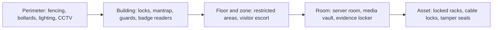

## Physical security is still security

Every logical control assumes an attacker cannot simply walk in, unplug the server and leave. Objective
3.8 asks you to apply security principles to **site and facility design**; 3.9 lists the specific areas
and systems: wiring closets and intermediate distribution facilities, server rooms and data centres,
media storage, evidence storage, restricted and work-area security, utilities and HVAC, environmental
issues (water, climate, weather), fire prevention, detection and suppression, and power.

Two rules drive every answer in this lesson:

1. **People's safety comes first.** Life safety beats asset protection, always.
2. **Layer it.** Deter, delay, detect, assess, respond, from the property line inwards.

## Site selection and design

Before building, a security professional should weigh: crime rates and visibility, proximity to
emergency services, natural-disaster exposure (flood plains, fault lines, storm paths), access to
redundant utilities and carriers, neighbours (an airport flight path, a chemical plant), and whether
the building can be made **unremarkable**: no sign saying "data centre".

### CPTED

**Crime Prevention Through Environmental Design** uses the built environment to discourage crime:

| Strategy | Meaning | Example |
|---|---|---|
| **Natural surveillance** | Make it easy for legitimate people to see what's happening | Clear sightlines, glass-fronted lobbies, good lighting, low shrubs |
| **Natural access control** | Guide people to controlled entrances | Landscaping, paths and bollards that funnel visitors to reception |
| **Territorial reinforcement** | Make ownership of the space obvious so intruders feel noticed | Fences, signage, distinct paving, defined boundaries |
| **Maintenance** | A cared-for space signals that someone is watching | Fix broken lights and graffiti quickly |

CPTED is cheap, passive and built in at design time, which makes it the "best" answer when a question
asks how to reduce crime around a new building **before** adding guards and cameras.

### Layers from the outside in

- **Perimeter:** fences, gates, bollards against vehicles, lighting, CCTV, and intrusion detection.
- **Entry:** a single controlled entrance, guards, badge readers, **mantraps** (access-control vestibules)
  to stop **piggybacking** and **tailgating**, visitor logs and escorts.
- **Interior zones:** badge-controlled doors, with access matching job need.
- **Assets:** locked racks and cages, tamper-evident seals.

> [!TIP]
> Guards are the most adaptable control because they can use judgement, which is why they appear in
> correct answers about unusual situations. Dogs deter but can't judge. CCTV mostly **detects** and
> records unless someone is watching it live.

## Specific areas (3.9)

| Area | Key controls |
|---|---|
| **Wiring closets / intermediate distribution facilities (IDFs)** | Locked, access logged, not shared with janitorial storage, environmental monitoring, no water pipes overhead |
| **Server rooms and data centres** | Interior room with no external windows, single entry with mantrap, multifactor access, raised floor or overhead cabling, hot/cold aisle containment, leak detection, fire detection and suppression, redundant power and cooling, emergency power-off (EPO) switch by the exit |
| **Media storage** | Locked, climate-controlled, inventoried, check-in/check-out logs, offsite copies for backups, secure transport |
| **Evidence storage** | Locked and access-limited, **chain of custody** documented for every transfer, tamper-evident bags, separate from general media |
| **Restricted and work areas** | Clean-desk policy, visitor escort, screen privacy filters, sensitive compartmented areas with stricter access |

## Fire: prevention, detection and suppression

Fire needs heat, fuel and oxygen (plus the chemical chain reaction: the **fire tetrahedron**). Suppression
works by removing one of them.

### Detection

| Detector | Senses | Notes |
|---|---|---|
| **Ionisation smoke** | Small particles from fast, flaming fires | Responds quickly to flaming fires |
| **Photoelectric smoke** | Larger particles from smouldering fires | Better for slow, smoky electrical fires |
| **Heat (fixed temperature or rate of rise)** | Temperature | Fewer false alarms, slower |
| **Flame** | Infrared or ultraviolet light from flames | Fast, expensive |
| **Very early smoke detection (aspirating)** | Samples air continuously | Common in data centres |

### Fire classes (US, NFPA / OSHA)

| Class | Fuel | Suppress with |
|---|---|---|
| **A** | Ordinary combustibles: paper, wood, cloth | Water, foam, multipurpose dry chemical |
| **B** | Flammable liquids and gases | CO₂, foam, dry chemical |
| **C** | Energised electrical equipment | Non-conductive agents: CO₂, clean agents, dry chemical. **Not water** while energised |
| **D** | Combustible metals (magnesium, sodium) | Dry powder |
| **K** | Cooking oils and fats | Wet chemical |

> [!NOTE]
> European classes differ (EN 2: A, B, C for gases, D, F for cooking oils; electrical is not a separate
> class). The exam uses the US letters.

### Suppression systems

| Water sprinkler type | How it works | Data-centre fit |
|---|---|---|
| **Wet pipe** | Pipes always full; each head opens when its fusible link melts | Cheapest, fastest; risk of leaks and accidental discharge |
| **Dry pipe** | Pipes full of pressurised air; water enters when a head opens | For freezing areas; delay before water flows |
| **Pre-action** | Dry pipe that fills only when a **detector** triggers, then discharges when a head opens | **Preferred for data centres**: two events before water hits equipment, time to cut power or stop a false alarm |
| **Deluge** | All heads open at once | Industrial hazards; never for IT rooms |

**Gaseous (clean-agent) systems** suppress without water damage. **Halon** was ideal but depletes ozone;
production ended in the US in 1994 under the Montreal Protocol. Replacements include **HFC-227ea
(FM-200)**, **FK-5-1-12** and **inert-gas blends (IG-541, Inergen)**. **CO₂** is effective but lethal at
suppression concentrations, so it is used only in unoccupied spaces, with pre-discharge alarms and
lock-outs.

> [!WARNING]
> Any suppression question involving people present: life safety first. Evacuation alarms, a delay
> before gaseous discharge, and doors on egress routes that fail safe. If you are choosing for an
> occupied data hall, prefer pre-action water plus a clean agent rated safe for occupied spaces over
> CO₂.

**Emergency power-off (EPO)** buttons cut power to the room so firefighters can use water safely; place
them by the exits and protect them from accidental presses.

## Power

| Problem | Meaning |
|---|---|
| **Fault** | Momentary loss of power |
| **Blackout** | Prolonged loss of power |
| **Sag (dip)** | Momentary low voltage |
| **Brownout** | Prolonged low voltage |
| **Spike** | Momentary high voltage |
| **Surge** | Prolonged high voltage |
| **Inrush** | The initial surge drawn when equipment switches on |
| **Noise** | Interference: EMI (electromagnetic) or RFI (radio frequency) |

> [!TIP]
> Memory aid: the **momentary** problem has the **short** name (fault, sag, spike); the **prolonged**
> one has the **longer** name (blackout, brownout, surge).

Protections:

- **Surge protectors** absorb spikes and surges.
- **Power line conditioners** clean noise and correct sags.
- **Uninterruptible power supply (UPS):** batteries bridge the seconds to minutes until the generator
  starts, and an online UPS conditions power continuously.
- **Generators** carry long outages; they need fuel contracts and regular load testing.
- **Redundant feeds** from separate substations, dual power distribution units and dual-corded servers.

The Uptime Institute **tiers** describe redundancy: Tier I basic capacity, Tier II redundant
components, Tier III concurrently maintainable (any component can be maintained without shutdown), Tier
IV fault tolerant.

Shield cabling from EMI by separating power and data runs, using shielded twisted pair or fibre, and
keeping cables away from fluorescent lights and motors.

## HVAC and environment

- **Temperature:** ASHRAE's recommended inlet range for IT equipment is **18–27 °C (64.4–80.6 °F)**.
- **Humidity:** too dry causes **static discharge**; too humid causes **condensation and corrosion**.
  ASHRAE now expresses the recommended envelope as a dew-point range with a relative-humidity ceiling;
  older guidance (and many exam questions) uses roughly **40–60% relative humidity**.
- **Positive pressurisation:** air flows **out** when doors open, keeping dust and smoke out.
- **Dedicated HVAC** for the data centre, with its own controls and shut-off, so it can be stopped in a
  fire to avoid spreading smoke.
- **Water:** leak detection under raised floors, no water or waste pipes above equipment, sited above
  flood level, shut-off valves known and accessible.
- **Weather and climate:** design for the site's local hazards (hurricane shutters, seismic bracing,
  snow loads).

## Worked example: securing a new regional data room

**Scenario.** A logistics company is converting a ground-floor storeroom with an external window into a
small server room. It sits under the staff kitchen. The budget allows one suppression system.

| Issue | Recommendation | Principle |
|---|---|---|
| External window | Choose an interior room, or brick up the window | Reduce exposure; no line of sight to assets |
| Kitchen above | Relocate if possible; otherwise drip trays, leak detection and sealed ceiling | Water above equipment |
| Single door | Badge plus PIN, door logged, CCTV on entry | Layered access control |
| Suppression | Pre-action sprinkler (code compliance, protects the building) with VESDA detection; add a clean agent if downtime cost justifies it | Avoid accidental water discharge |
| Power | Online UPS sized for generator start-up time, surge protection, EPO by the door | Availability and firefighter safety |
| HVAC | Dedicated cooling unit, temperature and humidity monitoring with alerts | Keep within ASHRAE envelope |

The first thing to raise with management is the location itself: moving to an interior room on an upper
floor, away from water, is a design fix that removes several risks at once.

## Check yourself

1. Which sprinkler type requires both a detector activation and a fused head before water reaches
   the equipment?
2. A server room has frequent static shocks in winter. What is the likely environmental cause?
3. What CPTED strategy uses lighting, glass walls and low landscaping?

Answers

1. Pre-action.
2. Humidity too low. Raise it into the recommended range.
3. Natural surveillance.

## Sources

ISC2 CISSP outline 3.8–3.9; International CPTED Association and CISA physical security guidance; NIST
SP 800-53 Rev. 5 PE (physical and environmental) family; NFPA 75 and OSHA 29 CFR 1910.157 (fire classes,
IT equipment protection); EPA on halon and the Montreal Protocol; ASHRAE TC 9.9 thermal guidelines;
Uptime Institute tier classification; Anderson, *Security Engineering* (physical protection).
