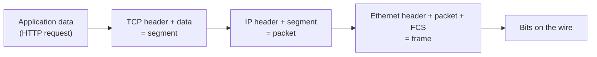

Outline objective **4.1** opens with "OSI and TCP/IP models" and "IPv4 and IPv6". This is the
vocabulary the rest of the domain is written in. When an exam question says "a layer 2 attack" or
"a control that works at the session layer", you need to translate instantly. The goal here isn't
to recite the layers. It's to use them as a diagnostic map: *where is this attack happening, so
which control can see it?*

## The two models side by side

The **OSI reference model** (ISO/IEC 7498-1) is a teaching and design model with seven layers. Each
layer provides services to the one above and uses services from the one below. The **TCP/IP
model** (RFC 1122) is what the internet actually runs. It has four layers.

| # | OSI layer | What it does | PDU | TCP/IP layer | Example protocols | Example devices |
|---|---|---|---|---|---|---|
| 7 | Application | Network services the user's application calls | Data | Application | HTTP, DNS, SMTP, SNMP, LDAP | Application proxy, WAF |
| 6 | Presentation | Data format, encoding, compression, encryption | Data | Application | MIME, ASCII/Unicode, JPEG | — |
| 5 | Session | Opens, manages and closes dialogues | Data | Application | RPC, NetBIOS session, SOCKS | Circuit-level proxy |
| 4 | Transport | End-to-end delivery, ports, reliability | Segment (TCP) / datagram (UDP) | Transport | TCP, UDP | Stateful firewall (tracks L4 state) |
| 3 | Network | Logical addressing and routing | Packet | Internet | IPv4, IPv6, ICMP, IPsec, OSPF | Router, packet filter |
| 2 | Data link | Framing, MAC addressing on one link | Frame | Link | Ethernet, 802.11, ARP, PPP | Switch, bridge, WAP |
| 1 | Physical | Bits as signals on a medium | Bits | Link | 1000BASE-T, fibre, radio | Hub, repeater, cable |

Data link splits into two sub-layers: **LLC** (logical link control, talks up to layer 3) and
**MAC** (media access control, talks down to the medium).

> [!TIP]
> Memory aid, top-down: **A**ll **P**eople **S**eem **T**o **N**eed **D**ata **P**rocessing
> (Application, Presentation, Session, Transport, Network, Data link, Physical). Bottom-up:
> **P**lease **D**o **N**ot **T**hrow **S**ausage **P**izza **A**way.

ARP is a frequent trap. It resolves layer-3 IP addresses to layer-2 MAC addresses, never leaves the
local broadcast domain and is attacked on the local link. Most CISSP material treats ARP attacks as
**layer 2**.

### Encapsulation

As data moves down the stack, each layer wraps what it gets from above in its own header (and, at
layer 2, a trailer). The receiver strips them in reverse.

Encapsulation matters for security because **a device can only enforce on headers it reads**. A
router reads layer 3. A packet filter reads layers 3 and 4. Only something that reads the payload,
like an application proxy, WAF or IPS, can see an SQL injection string in an HTTP body.

## TCP, UDP and the ports you should know

**TCP** (RFC 9293) is connection-oriented. It sets up a connection with the **three-way handshake**
(SYN → SYN-ACK → ACK), numbers every byte with sequence numbers, retransmits lost data and tears
down with FIN or RST. **UDP** (RFC 768) is connectionless: no handshake, no delivery guarantee, low
overhead. That suits DNS queries, VoIP media and streaming.

The absence of a handshake is a security property. A UDP server answers whatever source address a
request *claims*, which is why UDP services (DNS, NTP, memcached, SSDP) are the engines of
**reflection and amplification** DDoS (lesson 5).

| Port | Service | Secure alternative |
|---|---|---|
| 20/21 TCP | FTP | SFTP (over SSH, 22) or FTPS (990 implicit) |
| 22 TCP | SSH / SFTP / SCP | — |
| 23 TCP | Telnet (clear text) | SSH |
| 25 TCP | SMTP relay | STARTTLS on 25; 587 submission; 465 implicit TLS |
| 53 UDP/TCP | DNS | DNSSEC (integrity), DoT 853 / DoH 443 (confidentiality) |
| 80 TCP | HTTP | HTTPS 443 |
| 110 / 143 TCP | POP3 / IMAP | 995 / 993 |
| 161/162 UDP | SNMP | SNMPv3 (authentication and privacy) |
| 389 TCP | LDAP | LDAPS 636 or StartTLS |
| 445 TCP | SMB | SMB 3 encryption; never expose to the internet |
| 3389 TCP | RDP | Behind a VPN or gateway, with MFA |

## Attacks and defences, layer by layer

The exam likes to describe an attack and ask which layer it targets, or which control fits. Use
this table as your map.

| Layer | Attack | How it works | Layer-appropriate defence |
|---|---|---|---|
| 1 Physical | Wiretapping, cable cut, jamming | Physical access to the medium or the RF spectrum | Locked wiring closets, conduit, fibre, spectrum monitoring |
| 2 Data link | ARP spoofing / poisoning | Forged ARP replies map the gateway's IP to the attacker's MAC (man-in-the-middle) | Dynamic ARP Inspection, static ARP for key hosts, 802.1X |
| 2 | MAC flooding | Fill the switch CAM table so it floods frames out of every port like a hub | Port security (limit MACs per port) |
| 2 | VLAN hopping | Switch spoofing (negotiate a trunk) or double tagging (abuse the native VLAN) | Disable auto-trunking, use an unused native VLAN, tag the native VLAN |
| 2 | Rogue DHCP / DHCP starvation | Fake server hands out a malicious gateway or DNS | DHCP snooping |
| 3 Network | IP spoofing | Forged source address | Ingress/egress filtering (BCP 38), anti-spoofing ACLs |
| 3 | Smurf | ICMP echo to a broadcast address with the victim's spoofed source | Disable directed broadcast, filter ICMP |
| 3 | Teardrop / ping of death | Overlapping or oversized fragments crash reassembly | Patched stacks, fragment filtering |
| 3 | Route / BGP hijack | Announce someone else's prefix | RPKI origin validation, route filtering |
| 4 Transport | SYN flood | Many SYNs, never completing the handshake, exhaust the backlog | SYN cookies, rate limiting, DDoS scrubbing |
| 4 | Port scanning | Probe which ports answer | Default-deny firewall, IDS alerting |
| 4–5 | Session hijacking | Predict or steal sequence numbers or session tokens | Encrypted sessions (TLS, IPsec), random ISNs |
| 7 Application | DNS cache poisoning | Forged responses planted in a resolver's cache | DNSSEC validation, source port randomisation |
| 7 | SQL injection, XSS | Malicious input in the application payload | Input validation, WAF |

> [!WARNING]
> When a question asks which control **can** stop an attack, check whether the control reads the
> layer the attack lives in. A stateless packet filter can't stop SQL injection on port 443. It
> doesn't read HTTP, and it can't read inside TLS.

## IPv4 and IPv6

**IPv4** (RFC 791) uses 32-bit addresses. Address exhaustion led to **NAT** and the RFC 1918
private ranges: **10.0.0.0/8, 172.16.0.0/12 and 192.168.0.0/16**. NAT hides internal addressing.
That's a side benefit, but it is **not a security control**: it doesn't inspect or authorise
anything. A packet arriving at your internet edge with an RFC 1918 *source* address is spoofed and
should be dropped.

**IPv6** (RFC 8200) uses 128-bit addresses written as eight groups of hex (for example
`2001:db8::1`). Key differences:

| Topic | IPv4 | IPv6 |
|---|---|---|
| Address size | 32 bits | 128 bits |
| Header | Variable, with options and checksum | Fixed 40 bytes, extension headers, no header checksum |
| Fragmentation | Routers and hosts can fragment | Only the source host fragments |
| Address resolution | ARP (layer 2 broadcast) | Neighbor Discovery Protocol (ICMPv6) |
| Auto-configuration | DHCP | SLAAC from router advertisements, or DHCPv6 |
| Broadcast | Yes | **None**: multicast replaces it |
| IPsec | Optional add-on | Designed in; a SHOULD in current node requirements (RFC 8504) |

### Unicast, broadcast, multicast, anycast

The 2024 outline names all four delivery types:

- **Unicast:** one sender to one receiver.
- **Broadcast:** one to every host on the segment (IPv4 only). This is why broadcast amplification
  (smurf) is an IPv4 problem.
- **Multicast:** one to a subscribed group (224.0.0.0/4 in IPv4, ff00::/8 in IPv6).
- **Anycast:** one address announced from many places; routing delivers to the *nearest*.
  DNS root servers and CDNs use anycast, and it spreads DDoS load across sites.

### IPv6 security implications

IPv6 isn't more secure by default. It's *different*, and the differences create blind spots:

1. **Dual stack means two attack surfaces.** Hosts with IPv6 enabled may talk IPv6 past an IPv4-only
   firewall or IDS. If you aren't filtering and monitoring IPv6, disable it or bring it under control.
2. **Rogue router advertisements.** Any host can send an RA and become the default gateway (a
   man-in-the-middle). **RA Guard** (RFC 6105) on switches blocks this. It's the IPv6 equivalent of
   DHCP snooping.
3. **Tunnelling** (6to4, Teredo) can carry IPv6 inside IPv4 UDP and bypass controls.
4. **Huge subnets** (a /64 holds 2⁶⁴ addresses) make blind scanning impractical. Attackers turn to
   DNS, logs and neighbor caches instead.
5. **Extension headers** can be chained to hide the real upper-layer protocol from simple filters.

> [!TIP]
> "IPv6 requires IPsec, so IPv6 traffic is encrypted" is a myth on two counts. IPsec support was
> relaxed to a SHOULD, and even where it's implemented, nothing encrypts until someone configures
> security associations.

## Multilayer and converged protocols

**Multilayer protocols** span several layers or carry other protocols inside them. Industrial
**DNP3** (used in SCADA) carries its own transport functions over TCP/IP. The security point is that
**encapsulation hides content**. An inspection device that sees "TCP 443" can't tell what's tunnelled
inside without decryption. Covert channels and tunnelling (DNS tunnelling, SSH port forwarding)
exploit this.

**Converged protocols** carry specialised traffic over standard networks, so it shares the network's
risks and controls:

| Converged protocol | What it carries | Security note |
|---|---|---|
| FCoE (Fibre Channel over Ethernet) | Storage traffic over Ethernet, layer 2, not routable | Isolate on dedicated VLANs/fabric |
| iSCSI | SCSI storage commands over TCP/IP (routable) | Use CHAP, IPsec, and a separate storage network |
| VoIP | Voice over IP | Voice VLANs, SIP over TLS, SRTP (lesson 4) |
| MPLS | Label-switched paths across a provider network | Separation, but **no encryption** by itself |
| InfiniBand over Ethernet (RoCE) | Remote direct memory access over Ethernet | Bypasses the host OS stack, so segment it tightly |
| Compute Express Link (CXL) | Cache-coherent memory and accelerator interconnect | Physically local; protect at the platform level |

> [!IMPORTANT]
> MPLS is a frequent trap. It keeps customers' traffic separate inside the provider network, but it
> doesn't encrypt it. If the requirement is confidentiality across a carrier, add IPsec (or MACsec on
> the links) on top.

## Worked example: placing an incident on the map

**Scenario.** A help-desk analyst reports that on one office floor, users' sessions to the intranet
keep dropping. One workstation's ARP cache shows the default gateway's IP address mapped to the
MAC address of another user's laptop.

**Step 1: which layer?** IP-to-MAC mapping is ARP, attacked on the local link: **layer 2**. The
symptom is a man-in-the-middle. Traffic for the gateway flows through the laptop, and dropped
sessions come from the attacker's imperfect forwarding.

**Step 2: which controls can see it?** The perimeter firewall can't, because the traffic never
reaches it. A layer-3 ACL on the router can't either, because the forged frames stay on the
segment. You need a control on the **access switch**. **Dynamic ARP Inspection** checks ARP replies
against the DHCP snooping binding table and drops forged ones.

**Step 3: the risk-adviser answer.** Contain first: isolate the laptop's switch port and preserve
evidence. Then enable DHCP snooping and DAI across access switches, consider 802.1X so unknown
devices can't attach at all, and make sure intranet sessions use TLS. Even if a man-in-the-middle
happens again, the attacker sees ciphertext and certificate validation fails.

## Check yourself

1. A security engineer wants a control that can block a malicious command inside an FTP session
   while allowing other FTP commands. At which OSI layer must the control operate, and which device
   class fits?
2. Why is an inbound packet with source address 172.20.4.9 arriving at an internet-facing router
   treated as hostile?
3. A team says "our IPv4 firewall protects every host, so IPv6 isn't a concern". Give two reasons
   this is wrong.

Answers

1. Layer 7 (application). An application-level proxy or gateway, or an NGFW with FTP application
   awareness, parses FTP commands. A packet filter or stateful firewall sees only ports and state.
2. 172.16.0.0/12 is an RFC 1918 private range and is never routed on the internet, so the source is
   forged. Anti-spoofing ingress filtering drops it.
3. Dual-stack hosts can communicate over IPv6 paths that the IPv4 rule set doesn't see. Rogue
   router advertisements can make an attacker the IPv6 gateway, and tunnels such as Teredo can carry
   IPv6 through IPv4 controls. IPv6 must be filtered and monitored, or disabled.

## Sources

ISO/IEC 7498-1 and RFC 1122 for the two models; RFC 791, RFC 1918, RFC 8200, RFC 4291 and RFC 8504
for IPv4/IPv6 addressing and the IPsec requirement; RFC 6105 for RA Guard; RFC 9293, RFC 768 and
RFC 4987 for TCP, UDP and SYN flooding; the ISC2 outline for the 4.1 sub-topics (delivery types,
multilayer and converged protocols).
