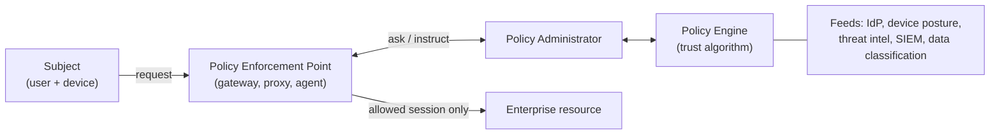

Objective **4.1** asks you to *apply secure design principles in network architectures*. The Domain 3
principles still apply here: defence in depth, least privilege, zero trust, secure defaults,
separation of duties. The question is how they turn into wires, VLANs, overlays and radio. The
exam's favourite architectural idea is simple: **limit what an attacker who gets in can reach.**

## Traffic flows and transport architecture

| Term | Meaning | Security note |
|---|---|---|
| **North-south** | Traffic entering or leaving the data centre or network | Classic perimeter controls (firewall, IPS, proxy) sit here |
| **East-west** | Traffic between systems inside the data centre | Where lateral movement happens; needs internal segmentation |
| **Data plane** | Forwards packets | Must be fast; attacks here are floods and spoofing |
| **Control plane** | Decides paths (routing protocols, SDN controller) | Compromise redirects traffic; protect routing adjacencies |
| **Management plane** | Configures and monitors devices (SSH, SNMP, APIs) | Highest-value target; isolate it out-of-band |
| **Store-and-forward** | Switch receives the whole frame and checks the FCS before forwarding | Drops corrupt frames, adds latency |
| **Cut-through** | Switch forwards once it has read the destination MAC | Lower latency, forwards corrupt frames |

Topologies (bus, star, ring, mesh) matter mostly for **availability**. A full mesh survives link loss.
A star has a single point of failure at the hub or switch.

The outline also lists **performance metrics**, which turn up in availability and VoIP questions:
**bandwidth** (capacity of the link), **throughput** (what you actually achieve), **latency** (delay),
**jitter** (variation in delay, the killer for voice and video) and **signal-to-noise ratio** (how
far the signal stands above interference, critical for wireless and copper).

## Segmentation: physical, logical, micro

Segmentation exists to **contain**. If a workstation is compromised, segmentation decides whether
the attacker reaches the payroll database or only the printer.

### Physical segmentation

- **Air gap.** No network connection at all between the networks. It's the strongest separation, but
  it's defeated by removable media and people (Stuxnet crossed one on USB), so media controls are
  part of the design.
- **Out-of-band (OOB) management.** A separate physical network (or console servers, cellular modems)
  for device management. If the production network is down or compromised, you can still reach
  devices, and management interfaces aren't exposed on production.
- **In-band management.** Management traffic shares the production network. It's cheaper but exposed,
  so at minimum put it in a dedicated management VLAN with ACLs.

### Logical segmentation

| Technique | Layer | What it does | Watch out for |
|---|---|---|---|
| **VLAN** (IEEE 802.1Q) | 2 | Splits one switch fabric into broadcast domains; a router or firewall must pass traffic between them | 12-bit ID, so 4,094 VLANs; VLAN hopping; a VLAN is not a firewall unless you filter at the inter-VLAN router |
| **VRF** (virtual routing and forwarding) | 3 | Multiple independent routing tables on one router | Leaks between VRFs must be deliberate |
| **VPN** | 3+ | An encrypted logical network over a shared one | Endpoint trust (lesson 4) |
| **Virtual domain / virtual systems** | Firewall | One firewall split into separate logical firewalls with their own policies | Shared hardware, so a bug can cross domains |

### Micro-segmentation

Micro-segmentation pushes policy down to the **individual workload**: per VM, container or
service, rather than per subnet. Two building blocks:

- **Overlays and encapsulation.** **VXLAN** (RFC 7348) wraps layer-2 frames in UDP (port 4789) with a
  24-bit identifier, giving about 16 million segments, so every tenant or application tier gets its
  own. Other overlays include Geneve and GRE.
- **Distributed enforcement.** Firewalls, routers and IDS/IPS run *in the hypervisor, host or
  sidecar* next to each workload, so east-west traffic is inspected without hair-pinning through a
  central box. NIST SP 800-207A describes a service mesh sidecar acting as the enforcement point
  for identity-based policies.

> [!TIP]
> If a question describes ransomware spreading **server-to-server inside a data centre** and asks
> for the BEST architectural control, the answer is usually micro-segmentation (east-west
> enforcement). More perimeter firewalling doesn't help, because the traffic never crosses the
> perimeter.

## Zero trust architecture

NIST SP 800-207 defines zero trust as removing **implicit trust based on network location**. Being
"inside" grants nothing. Every access request is authenticated, authorised and evaluated against
dynamic policy (identity, device health, behaviour, data sensitivity), per session, with least
privilege.

- **Policy engine (PE):** makes the decision.
- **Policy administrator (PA):** carries out the decision, setting up or tearing down the session
  path. PE and PA together form the **policy decision point**.
- **Policy enforcement point (PEP):** sits in the data path and allows, blocks or ends the
  connection.

NIST names three deployment approaches: **enhanced identity governance**, **micro-segmentation**
and **software-defined perimeters**. Zero trust is a strategy, not a product. The exam answer is
never "buy a zero-trust appliance".

## SDN, SD-WAN and NFV

**Software-defined networking** (RFC 7426) separates the **control plane** (a central controller that
computes forwarding decisions) from the **data plane** (switches that forward according to rules the
controller pushes, for example over OpenFlow). Applications program the controller through
**northbound APIs**. The controller programs devices through **southbound APIs**.

- **Benefits:** central, consistent policy; fast, automated segmentation; network-wide visibility.
- **Risks:** the controller is a single point of failure and a crown-jewel target, and the APIs need
  strong authentication, authorisation and TLS. A compromised controller can reroute or mirror the
  whole network.

**SD-WAN** applies the same idea to branch connectivity. A controller steers traffic across MPLS,
broadband and LTE links by policy, usually with IPsec tunnels between sites. **Network functions
virtualisation (NFV)** runs firewalls, load balancers and routers as software on commodity
hardware. That's fast to deploy, but the hypervisor becomes part of the network's trusted computing
base.

## Virtual private cloud (VPC)

A **VPC** is a logically isolated network inside a public cloud. You define its address ranges,
subnets, route tables and gateways. Security controls are typically **stateful security groups**
(attached to instances or interfaces) and **stateless network ACLs** (attached to subnets), plus
private endpoints so traffic to the provider's services never crosses the internet. Under shared
responsibility, the provider isolates VPCs from each other, and **you** are responsible for what
your rules allow.

## Edge networks, ingress/egress and CDNs

The **edge** is where your network meets others. Ingress filtering stops spoofed and unwanted inbound
traffic. **Egress filtering** is just as important: it stops malware calling home and stops your
network being used to attack others. **Peering** connects directly with other networks or ISPs.
It lowers cost and latency, but it means trusting routing announcements, which is why BGP security
matters (lesson 5).

A **content distribution (delivery) network** caches content at many points of presence near users,
usually behind anycast addresses. Security effects:

- **Availability:** the CDN absorbs volumetric DDoS across its global capacity and hides your origin.
  Lock the origin so it only accepts traffic from the CDN, or attackers will bypass it.
- **Confidentiality:** the CDN usually **terminates TLS**, so it sees plaintext. That's a third-party
  risk you manage by contract and assessment.
- **Integrity:** cache poisoning, and the risk that a compromised CDN serves malicious script to every
  visitor (use Subresource Integrity for third-party scripts).

## Wireless networks

### Wi-Fi (IEEE 802.11)

| Generation | Encryption / integrity | Status |
|---|---|---|
| WEP | RC4 with a static key and short IV | Broken; never use |
| WPA | TKIP (RC4-based stop-gap) | Deprecated |
| WPA2 | CCMP (AES) | Acceptable; Personal mode open to offline dictionary attacks on the captured handshake |
| WPA3 | CCMP/GCMP (AES); **SAE** replaces the pre-shared-key handshake; Protected Management Frames required | Current standard |

- **WPA3-Personal** uses **SAE** (Simultaneous Authentication of Equals). It resists offline
  dictionary attacks and gives **forward secrecy**.
- **WPA3-Enterprise** uses 802.1X/EAP with a RADIUS server, and offers a **192-bit security mode**
  for high-sensitivity networks.
- **Wi-Fi Enhanced Open (OWE)** encrypts open hotspots without a password. It protects against
  passive sniffing, but it doesn't authenticate the AP.
- **Personal vs Enterprise:** a shared passphrase can't identify individuals or be revoked per user.
  Enterprise mode gives per-user credentials, per-user keys and accountability.

Threats include **rogue APs** (an unauthorised AP plugged into the wired network), **evil twins** (an
attacker AP copying your SSID to harvest credentials), deauthentication floods (mitigated by
Protected Management Frames) and **WPS PIN** brute force (disable WPS). NIST SP 800-153 recommends a
**wireless IDS** for continuous rogue-AP detection.

### Bluetooth, Zigbee and other personal-area radio

| Technology | Notes | Classic attacks / controls |
|---|---|---|
| **Bluetooth** BR/EDR and Low Energy | Short range, pairing-based trust | **Bluejacking** (unsolicited messages), **bluesnarfing** (data theft), **bluebugging** (taking control). Controls: non-discoverable by default, Secure Connections pairing, patching, turn it off when unused |
| **Zigbee** (IEEE 802.15.4) | Low-power mesh for IoT and building automation, AES-128 | Key management on join; keep IoT on its own segment |
| **Satellite** | GEO has very high latency (roughly 600 ms round trip); LEO constellations are far lower | Wide-area broadcast footprint makes eavesdropping easy, so always encrypt end to end; plan for weather and jamming |

### Cellular (4G LTE and 5G)

LTE (NIST SP 800-187) gives mutual authentication between the SIM/USIM and the network, and
encryption over the air **to the base station**. Beyond that, traffic crosses the carrier's network,
so it's not end-to-end protection. Classic threats are **IMSI catchers** (fake base stations) and
**downgrade to 2G**, which has weak or no network authentication. **5G** (3GPP TS 33.501) conceals the
subscriber's permanent identifier (SUPI, sent as the encrypted **SUCI**), which defeats passive IMSI
catching. 5G also brings **network slicing**, where logical networks share infrastructure, so slice
isolation becomes a design concern. For enterprise use, private LTE/5G and carrier APNs can keep
devices off the public internet.

## Monitoring and management

The 2024 outline adds **network observability, traffic flow/shaping, capacity management and fault
detection and handling**. In practice: collect flow records (NetFlow/IPFIX) and logs centrally,
baseline normal behaviour, shape traffic so critical flows (voice, control traffic) get priority,
plan capacity so a traffic spike isn't a self-inflicted denial of service, and alert on faults
before users notice.

## Worked example: re-architecting a flat network

**Scenario.** A regional hospital runs one flat /16 network. Clinical workstations, infusion pumps,
guest Wi-Fi, the building management system (Zigbee gateways) and the EHR database servers all share
it. A phishing compromise on a reception PC was followed by scanning of the infusion pumps.

**Step 1: identify what must be contained.** Patient safety comes first, so the medical devices and
the EHR data are the priorities. The reception PC should never have been able to *reach* a pump.

**Step 2: design the zones.**

| Zone | Contents | Allowed flows |
|---|---|---|
| Guest | Guest Wi-Fi (Enhanced Open or captive portal) | Internet only; no internal routes |
| Corporate | Staff PCs (WPA3-Enterprise, 802.1X) | To EHR front ends over TLS; internet via proxy |
| Medical devices | Pumps, monitors | Only to their management servers; no internet |
| Building/IoT | Zigbee gateways, HVAC | Only to the BMS controller |
| Data centre | EHR servers | Micro-segmented per tier: web → app → DB |
| Management | Switch, firewall and server admin | Reached only from a hardened jump host, out-of-band where possible |

**Step 3: choose mechanisms.** VLANs with a firewall between every zone (not just a router: a VLAN
alone isn't a security boundary). Micro-segmentation in the data centre for east-west control. NAC
so unknown devices land in a quarantine VLAN. A wireless IDS for rogue APs.

**Step 4: the risk-adviser framing.** Present this to management as a reduction in **blast
radius**. A single phished PC can no longer reach life-safety devices. Phase the work with the
medical-device zone first, because that's where the impact is highest.

## Check yourself

1. An attacker on a compromised web server is moving to other servers in the same data centre. The
   perimeter IPS sees nothing. Why, and what architecture addresses it?
2. In NIST SP 800-207, which component actually allows or blocks the connection, and which decides?
3. A retail chain wants WPA2-Personal replaced because staff share the passphrase with friends. Which
   option gives per-user accountability, and why does WPA3-Personal alone not solve the problem?

Answers

1. The traffic is east-west and never crosses the north-south perimeter where the IPS sits.
   Micro-segmentation with distributed enforcement (host or hypervisor firewalls, overlays) inspects
   and limits server-to-server flows.
2. The policy enforcement point (PEP) allows or blocks. The policy engine decides, and the policy
   administrator carries out the decision by setting up or tearing down the path.
3. WPA3-Enterprise (802.1X/EAP with RADIUS) gives each user their own credentials, which can be
   revoked individually and logged. WPA3-Personal's SAE stops offline cracking of the passphrase,
   but it's still one shared secret with no individual accountability.

## Sources

ISC2 outline 4.1 for the sub-topic list; NIST SP 800-215 for the enterprise landscape; NIST SP 800-207
and 800-207A for zero trust and micro-segmentation; IEEE 802.1Q and RFC 7348 for VLANs and VXLAN;
RFC 7426 for planes and SDN; NIST SP 800-153, SP 800-97 and the Wi-Fi Alliance for Wi-Fi; NIST SP
800-121r2 for Bluetooth; the Connectivity Standards Alliance for Zigbee; NIST SP 800-187 and 3GPP TS
33.501 for cellular.
