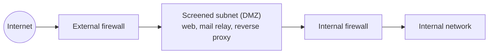
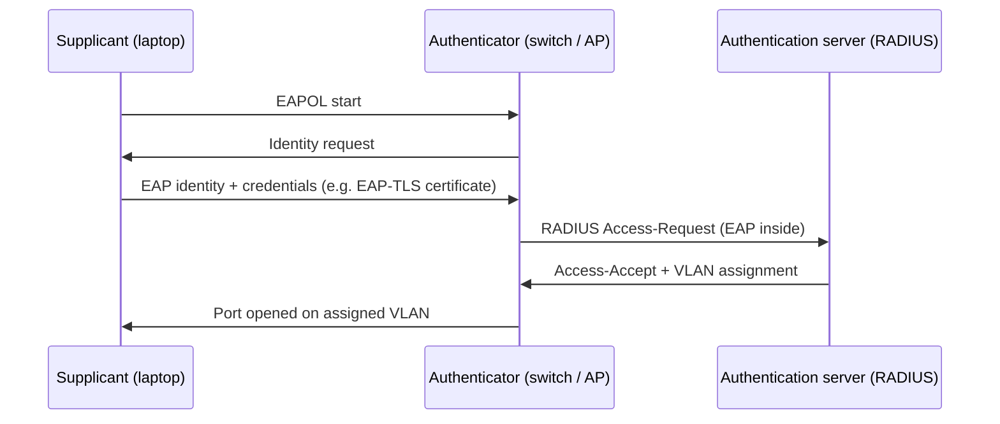

Objective **4.2 Secure network components** covers the *operation of infrastructure*, *transmission
media*, *network access control* and *endpoint security*. This lesson is also where the exam's
device questions live: firewalls, IDS/IPS and proxies. The thread through all of it is **what each
device can see, and where it sits**.

## Firewalls by capability

Textbooks number firewall "generations" differently, so don't memorise numbers. Memorise
**what each type inspects**. NIST SP 800-41 Rev. 1 describes the technologies.

| Type | OSI layers inspected | Decides on | Strengths | Weaknesses |
|---|---|---|---|---|
| **Static packet filter** (stateless) | 3–4 | Each packet alone: source/destination IP, port, protocol | Fast, cheap; router ACLs | No memory of connections; easily fooled by spoofed or crafted packets; can't see payload |
| **Stateful inspection** | 3–4 (+ state table) | Packet *and* whether it belongs to an established, allowed connection | Return traffic allowed automatically; blocks out-of-state packets | Still blind to application content |
| **Circuit-level gateway** (e.g. SOCKS) | 5 | Validates the session set-up, then relays without inspecting content | Hides internal hosts; protocol-agnostic | No content inspection |
| **Application-level gateway / proxy** | 7 | Understands the protocol (HTTP, FTP, SMTP); terminates and re-originates connections | Deep inspection, command filtering, authentication | One proxy per protocol; slower; higher overhead |
| **Next-generation firewall (NGFW)** | 3–7 | Application identification regardless of port, user identity, integrated IPS, often TLS inspection | One box, one policy, app-aware | Complexity; TLS inspection has privacy and trust implications |
| **Web application firewall (WAF)** | 7 (HTTP only) | Rules against web attacks (SQLi, XSS) in front of web apps | Protects apps you can't patch quickly | Tuning; doesn't fix the code |

> [!TIP]
> Questions often hinge on **stateless vs stateful**. If an ACK packet arrives with no matching
> handshake, a stateful firewall drops it. A stateless filter checks only its rule list and may pass
> it if the port is allowed. Scans that use crafted flags (ACK, FIN, Xmas) exploit stateless filters.

### Rule-base principles

- **Implicit deny / default deny.** Whatever isn't explicitly allowed is dropped (NIST SP 800-41r1;
  SP 800-53 SC-7 "deny by exception").
- **Most specific rules first**, because the first match wins on most firewalls.
- **Egress filtering.** Restrict outbound traffic too: only the mail server talks SMTP out, and only
  the proxy reaches the web. It cuts malware command and control and data exfiltration.
- **Anti-spoofing.** Drop inbound packets claiming internal or RFC 1918 sources.
- **Review and recertify** rules periodically. Orphaned "temporary" rules are a classic audit finding.

### Architectures

- **Bastion host:** a hardened system exposed to attack, stripped of everything it doesn't need.
- **Dual-homed host:** one system with two NICs, one per network, with routing disabled between them.
- **Screened host:** a packet-filtering router in front of a single bastion host.
- **Screened subnet (DMZ):** a buffer network between two firewalls (or the third leg of a
  three-legged firewall). Public-facing servers live there, so compromising one doesn't put the
  attacker on the internal LAN. This is the textbook best answer for hosting public services.

## IDS and IPS

NIST SP 800-94 groups the technology as IDPS. Two independent axes:

**Where it watches**

| Type | Sees | Blind to |
|---|---|---|
| **NIDS/NIPS** | Traffic on a segment (via SPAN port, tap, or inline) | Encrypted payloads; traffic on other segments; what happens on the host |
| **HIDS/HIPS** | Logs, file integrity, processes and system calls on one host; traffic after decryption | Anything on other hosts; can be disabled by an attacker with admin rights |
| **Wireless IDS** | RF: rogue APs, deauth floods | Wired traffic |
| **Network behaviour analysis** | Flow data: unusual volumes, new connections, scanning | Payload content |

**How it detects**

| Method | Works by | Good at | Weak at |
|---|---|---|---|
| **Signature / knowledge-based** | Matching known attack patterns | Known attacks, few false positives | Zero-days and variants (false negatives); needs updates |
| **Anomaly / behaviour-based** | Deviation from a learned baseline | Novel attacks, insider misuse | More false positives; a poisoned baseline treats attacks as normal |
| **Stateful protocol analysis** | Comparing traffic to the expected protocol state machine | Protocol abuse | Resource-heavy; vendor protocol models vary |

**IDS vs IPS.** An IDS is *passive*: it watches a copy of traffic and **alerts**. An IPS sits
**inline** and can **block**. The trade-off is availability. An inline IPS that fails closed, or
blocks a false positive, interrupts the business. Tuning decides where you land between the two
error types:

- **False positive:** an alert or block on legitimate traffic. It wastes analyst time and, with an
  IPS, causes outages.
- **False negative:** a missed attack. This is the more dangerous error, because nobody knows.

> [!WARNING]
> An IDS that only sees encrypted traffic is mostly blind. Answers that add TLS inspection at the
> proxy or NGFW, or move detection to the host (HIDS/EDR), fix this. Answers that "tune the
> signatures" don't.

## Proxies

- **Forward proxy:** sits in front of **clients** going out. It enforces acceptable use, caches,
  authenticates users, inspects downloads and logs who went where. A **transparent** proxy intercepts
  without client configuration.
- **Reverse proxy:** sits in front of **servers** taking requests in. It terminates TLS,
  load-balances, hides the back-end topology and is often combined with a WAF.
- **Anonymising/open proxy:** relays for anyone. In an enterprise it's a policy-evasion risk to block.

## Network access control (NAC)

NAC decides **whether a device may join the network, and where it lands**. The standard mechanism is
**IEEE 802.1X** port-based access control, with three roles:

Until authentication succeeds, the port passes only EAP. RADIUS can return a **VLAN assignment**
(RFC 3580), which is how NAC puts a non-compliant device in a **quarantine/remediation VLAN**.

- **Pre-admission NAC** checks identity and posture (patches, antimalware, disk encryption) before
  granting access. **Post-admission** NAC keeps checking and can revoke access.
- **Agent-based** NAC inspects posture deeply. **Agentless** NAC works for printers, IoT and guests,
  usually via MAC Authentication Bypass with profiling. MAC addresses are spoofable, so put those
  devices in restricted segments.
- NAC comes as **physical** appliances or **virtual** and cloud-delivered services. The outline lists
  both.

## Transmission media

| Medium | Characteristics | Security and reliability notes |
|---|---|---|
| **Twisted pair** (UTP/STP, Cat 5e/6/6A) | Cheap, ~100 m per segment | Emanations and crosstalk; easy to tap; STP resists EMI better |
| **Coaxial** | Better shielding than UTP | Legacy LANs; cable TV/broadband |
| **Fibre (single-mode)** | Laser, long distances (kilometres) | Immune to EMI, no electrical emanations, hard to tap undetected |
| **Fibre (multimode)** | LED/VCSEL, shorter runs in buildings and data centres | Same EMI immunity |
| **Wireless** | Radio | Anyone in range can receive it, so encryption is mandatory |

Signal problems you must recognise:

- **Attenuation:** loss of strength over distance. Fix it with repeaters or shorter runs.
- **Crosstalk:** a signal bleeding into an adjacent pair.
- **EMI/RFI:** interference from motors, lights and radio. Fix it with shielding or fibre.
- **Noise and a falling SNR** both degrade throughput.

**Physical security of media** (SP 800-53 PE-4): run cabling in locked closets and conduit, protect
patch panels, and inspect for taps. Unused wall jacks should be disabled or put in a dead VLAN.

> [!TIP]
> "Must cross a factory floor full of heavy motors, and must resist eavesdropping" → **fibre**. It's
> the answer whenever EMI immunity and tap-resistance are both required.

## Operation of infrastructure

The 2024 outline names **redundant power, warranty and support**. These are availability
controls:

- **Redundant power:** dual power supplies on separate circuits, UPS for short outages and clean
  power, generators for long ones (SP 800-53 PE-9, PE-11).
- **Warranty and support contracts:** hardware replacement SLAs, and vendor support that still ships
  security patches. Devices past **end of support** stop receiving fixes, so replacing them is a
  risk decision to make before that date, not after.
- **Redundancy of components:** redundant links, devices in high-availability pairs, spares on
  site for critical gear.

## Endpoint security (host-based)

Network controls can't see everything: encrypted traffic, laptops off-network, and attacks that
start from a USB stick. NIST SP 800-83 layers defences on the host:

- Antimalware and **EDR** (behavioural detection and response, with telemetry to the SOC).
- **Host-based firewall:** default-deny inbound, even on the "trusted" LAN. This is a
  micro-segmentation enforcement point.
- **HIPS**, application allow-listing and device control (removable media).
- Patching, secure configuration baselines, full-disk encryption, least-privilege user accounts.
- Posture reporting to NAC, so unhealthy endpoints are quarantined.

## Worked example: choosing the right component

**Scenario.** A payments company hosts a customer portal. Requirements: (1) block SQL injection
against an application it can't patch for six weeks; (2) stop staff browsers reaching
newly-registered malicious domains; (3) detect lateral movement between internal servers without
risking outages on the trading platform; (4) keep contractors' unmanaged laptops off the corporate
VLAN.

| Requirement | Component | Why not the alternatives |
|---|---|---|
| (1) | **WAF / reverse proxy** in front of the portal (virtual patching) | A stateful firewall can't read HTTP payloads; an IDS would only alert |
| (2) | **Forward proxy / NGFW URL filtering** with category and reputation feeds | Packet filters see IPs, not domain reputation |
| (3) | **NIDS on a SPAN/tap** plus host EDR | An inline IPS could block a false positive on the trading platform; passive detection meets "without risking outages" |
| (4) | **802.1X NAC** with posture; unknown devices to a guest/quarantine VLAN | Port security on MACs is spoofable and has no posture |

## Check yourself

1. A firewall allows return traffic for outbound web sessions without explicit inbound rules, but it
   can't block a specific HTTP method. What type is it?
2. Your IPS blocked a legitimate batch transfer and halted month-end processing. Name the error type,
   and say why the opposite error is usually considered worse.
3. Under 802.1X, which component is the switch, and what does it pass before authentication
   succeeds?

Answers

1. A stateful inspection firewall. It tracks connection state (layers 3–4) but doesn't parse
   application-layer content.
2. A false positive. A false negative is usually worse because an attack goes undetected, so nobody
   responds. An inline IPS's false positives still need careful tuning, because they cost
   availability.
3. The switch is the **authenticator**. Before success it passes only EAP (EAPOL) traffic between
   the supplicant and the authentication server.

## Sources

ISC2 outline 4.2; NIST SP 800-41 Rev. 1 and SP 800-53 Rev. 5 (SC-7, PE-4, PE-9, PE-11) for firewalls,
architectures, media protection and power; NIST SP 800-94 for IDPS; IEEE 802.1X and RFC 3580 for NAC;
NIST SP 800-83 Rev. 1 for endpoint controls; NIST SP 800-215 for the role of these components in the
modern enterprise.
