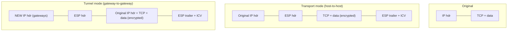

Objective **4.3 Implement secure communication channels according to design** lists *voice, video
and collaboration*, *remote access*, *data communications* and *third-party connectivity*. The
mechanisms underneath are IPsec and TLS, so we start there. Email authentication isn't named in the
outline, but it's a staple secure-channel topic and a frequent scenario.

## IPsec

IPsec (RFC 4301) protects traffic **at layer 3**, so every application above it is protected without
change. It has two protocols, two modes and a key-exchange protocol.

### AH vs ESP

| | **AH** (Authentication Header, RFC 4302) | **ESP** (Encapsulating Security Payload, RFC 4303) |
|---|---|---|
| IP protocol number | **51** | **50** |
| Confidentiality | **No** | Yes |
| Integrity and data-origin authentication | Yes, including immutable outer IP header fields | Yes, for the ESP payload (not the outer IP header) |
| Anti-replay | Yes (sequence numbers) | Yes |
| Works through NAT | **No**: NAT changes the header AH protects | Yes, with NAT traversal (UDP 4500) |

> [!TIP]
> Memory aid: **A**H = **A**uthentication only; **E**SP = **E**ncryption **S**o **P**rivate.
> NIST SP 800-77r1 notes that ESP with integrity covers almost every need. AH is rarely deployed
> today, but the exam still asks what it does.

### Transport vs tunnel mode

- **Transport mode** protects the *payload*. The original IP header stays visible. Use it
  **end-to-end between two hosts**.
- **Tunnel mode** encapsulates the *whole original packet* inside a new one. Internal addresses are
  hidden from observers. Use it **between gateways** (site-to-site VPN) and for most remote-access
  VPNs.

### Security associations and IKE

- A **security association (SA)** is a one-way agreement: algorithms, keys and lifetime, identified
  by a **Security Parameter Index (SPI)**. Two-way communication therefore needs **at least two SAs**.
- The **Security Policy Database** says which traffic to protect, bypass or discard. The **SA
  Database** holds the active SAs.
- **IKEv2** (RFC 7296), on **UDP 500** (UDP 4500 once NAT is detected), negotiates them. A
  Diffie-Hellman exchange creates the IKE SA, the peers **mutually authenticate** with certificates,
  pre-shared keys or EAP, and then IKE creates the child SAs for ESP. IKEv1 used ISAKMP with
  "main mode" and "aggressive mode". Aggressive mode exposes a hash of the pre-shared key to
  offline cracking.

## TLS

**TLS** protects a single connection **at the transport/session boundary**. The application must
use it (HTTPS, SMTP with STARTTLS, LDAPS). **SSL 2.0/3.0, TLS 1.0 and TLS 1.1 are deprecated** (RFC
8996). TLS 1.2 is the minimum and TLS 1.3 (RFC 8446) is preferred (NIST SP 800-52r2). TLS 1.3
removed static-RSA key exchange, so every session has **forward secrecy**, and it allows only AEAD
ciphers. Lesson 5 walks through the handshake step by step.

| | IPsec VPN | TLS VPN |
|---|---|---|
| Layer | 3: whole network access | 4–7: often per-application or portal (clientless via browser) |
| Client | Usually needs a client or OS support | Browser or a lightweight client; passes most firewalls on 443 |
| Typical use | Site-to-site; full-tunnel remote access | Remote access, contractors, BYOD with granular app access |

## Remote access

NIST SP 800-46r2 tells you to **assume the remote device and the network it's on are hostile**.
Design accordingly:

- **MFA** for every remote session (SP 800-53 AC-17 and IA-2).
- **Full tunnel vs split tunnel.** In a *full tunnel*, all of the client's traffic goes through the
  corporate VPN and its controls. In a *split tunnel*, only corporate-bound traffic does and
  internet traffic goes straight out. Split tunnelling saves bandwidth, but it lets a compromised
  home network or malicious site reach a device that's simultaneously connected to the corporate
  network. Where the risk matters, disable it or compensate with endpoint controls and a cloud
  security service.
- **Posture checks** before connection (patch level, EDR running), as with NAC.
- **Zero trust network access (ZTNA)** gives users per-application access through a broker instead
  of a network-level tunnel. The user never gets an IP route to the whole network (NIST SP 800-207).
- **Remote administration ("network administrative functions").** Admins connect to a **jump
  box/bastion host** or privileged access workstation in a management zone, over SSH or RDP with
  MFA and session recording. Never expose RDP (3389) or device management interfaces to the internet.

### Centralised AAA: RADIUS vs TACACS+

| | **RADIUS** (RFC 2865) | **TACACS+** (RFC 8907) |
|---|---|---|
| Transport | UDP (1812/1813) | **TCP 49** |
| What's protected | **Only the password** attribute is hidden | **Entire packet body** is obfuscated |
| AAA separation | Authentication and authorisation combined | Authentication, authorisation and accounting separate |
| Typical use | Network access: VPN, Wi-Fi, 802.1X | **Device administration**: per-command authorisation on routers and switches |

**Diameter** is RADIUS's more capable successor, used heavily in mobile carrier networks.

> [!WARNING]
> Legacy remote-access authentication: **PAP** sends the password in clear text. **CHAP** uses a
> challenge-response with a hash, so the password never crosses the link. **EAP** is a framework
> that carries stronger methods (EAP-TLS with certificates being the strongest common choice).

## Voice, video and collaboration

Modern voice is **VoIP**:

- **Signalling**: **SIP** (RFC 3261) on 5060, or **5061 over TLS**. It sets up and tears down calls.
- **Media**: **RTP**, encrypted as **SRTP** (RFC 3711). Protect both. SIP-over-TLS alone leaves the
  conversation itself in clear.
- Put phones in a **voice VLAN**, separate from data, with QoS so latency and jitter stay low.
- Threats: eavesdropping, **toll fraud** (attackers routing expensive calls through your PBX),
  caller-ID spoofing and **vishing**, SPIT (spam over IP telephony) and DoS against the PBX or SIP
  trunk. Harden PBXs, disable unused features such as remote DISA, and monitor call records.

**Video conferencing and collaboration platforms** (online meetings, meeting-room systems,
messaging): require authentication or waiting rooms for meetings, use per-meeting passcodes, restrict
screen sharing, prefer end-to-end encryption for sensitive meetings (noting it often disables
cloud recording and some features), control recording storage and retention, keep meeting-room
devices patched and on their own segment, and decide by policy what data may be shared in chat.

## Data communications and third-party connectivity

The outline names **backhaul networks** and **satellite** under data communications. Backhaul
carries traffic from the edge (cell towers, branch sites, remote plants) to the core, often over a
carrier's network. Treat any link you don't own as untrusted and **encrypt across it** (IPsec, or
MACsec on dedicated Ethernet links). An MPLS circuit separates traffic. It doesn't encrypt it.

**Third-party connectivity** covers telecom providers, managed service providers and **hardware
vendors' remote support**. NIST SP 800-47r1 frames it as a managed *information exchange*:

1. **Agree in writing** before connecting: an **interconnection security agreement (ISA)** for the
   technical requirements, plus an MOU/MOA or contract for responsibilities, incident notification
   and right to audit.
2. **Least privilege**: the vendor reaches only the systems it supports, through a dedicated
   segment or brokered access, never a flat VPN onto the LAN.
3. **Just-in-time access**: support accounts are disabled until a ticket enables them, then
   time-limited, with MFA and recorded sessions.
4. **Monitor, review and terminate**: log all third-party activity, review access periodically and
   remove it promptly when the contract ends.

## Email security: SPF, DKIM and DMARC

SMTP was designed with no sender authentication. Three DNS-published controls fix the domain
spoofing problem. NIST SP 800-177r1 recommends all three.

| Control | What the receiver checks | Protects | Doesn't |
|---|---|---|---|
| **SPF** (RFC 7208) | Is the sending IP listed in the TXT record of the **envelope (MAIL FROM) domain**? | Envelope sender authorisation | Check the visible From header; survive forwarding well |
| **DKIM** (RFC 6376) | Does the signature verify with the public key at `selector._domainkey.domain`? | Integrity of signed headers and body; the signing domain | Encrypt anything; say what to do on failure |
| **DMARC** (RFC 7489) | Did SPF or DKIM pass **and align** with the **visible From** domain? | Ties authentication to what users see; publishes a policy **none → quarantine → reject**; sends reports | Stop look-alike domains (examp1e.com) |

Roll DMARC out by publishing `p=none` with reporting, fixing every legitimate sender the reports
reveal, then moving to `quarantine` and `reject`. For **confidentiality**: **STARTTLS** encrypts
hop by hop but is opportunistic, so an attacker can strip it. **MTA-STS** (RFC 8461) lets a domain
demand TLS. **S/MIME** or **PGP** gives end-to-end signing and encryption.

## Worked example: connecting a building-systems vendor

**Scenario.** A university's HVAC vendor needs to support the building management system from its
own offices. Its engineer suggests "just give us a site-to-site VPN onto your network like our other
customers".

1. **Governance first.** Put an ISA and contract in place covering scope, security requirements,
   incident notification and audit rights (SP 800-47r1). Approval comes from the system owner.
2. **Architecture.** The BMS lives in its own segment. The vendor connects through a **brokered
   remote-access gateway** (ZTNA or a jump host), authenticated per named engineer with MFA. It's not
   a site-to-site tunnel that routes the vendor's whole network into the university.
3. **Channel.** TLS 1.2+ or IPsec ESP in tunnel mode from vendor to gateway. SSH or vendor tools
   onward only to the BMS controllers.
4. **Operations.** Access is enabled per ticket, time-boxed, recorded and logged to the SIEM, and
   reviewed quarterly. A clause revokes it at contract end.

The vendor's suggestion fails least privilege. A compromised vendor network would be one hop from
everything the university owns.

## Check yourself

1. Two hosts in the same data centre must exchange data with confidentiality and integrity, and an
   auditor wants the original IP addresses to remain visible for troubleshooting. Which IPsec
   protocol and mode?
2. Why does AH fail when one peer is behind a NAT device, while ESP can work?
3. A company publishes SPF and DKIM, but phishing emails showing `From: ceo@company.com` still
   arrive at partners. What's missing, and what does it add?

Answers

1. ESP (confidentiality and integrity) in transport mode, which leaves the original IP header in
   place.
2. AH's integrity check covers immutable fields of the outer IP header, including addresses. NAT
   rewrites the address, so the check fails. ESP doesn't cover the outer header, and NAT traversal
   wraps it in UDP 4500.
3. DMARC. It requires SPF or DKIM to align with the visible From domain and publishes a
   quarantine/reject policy, so receivers act on failures and send reports.

## Sources

ISC2 outline 4.3; NIST SP 800-77r1 and RFCs 4301, 4302, 4303 and 7296 for IPsec; RFC 8446, RFC 8996
and NIST SP 800-52r2 for TLS; RFC 3261 and RFC 3711 for VoIP; NIST SP 800-46r2, SP 800-53r5 and
SP 800-207 for remote access; RFC 2865 and RFC 8907 for RADIUS and TACACS+; NIST SP 800-47r1 for
third-party interconnections; RFCs 7208, 6376, 7489 and 8461 with NIST SP 800-177r1 for email.
