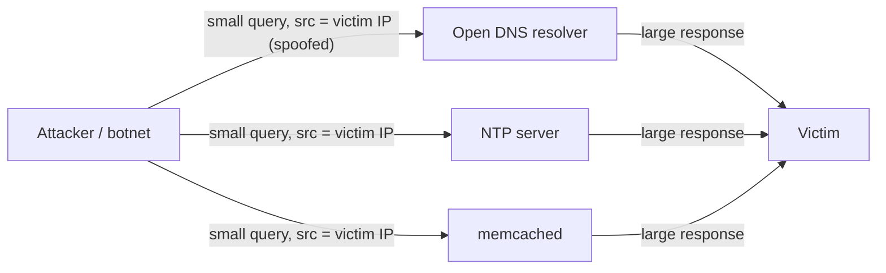
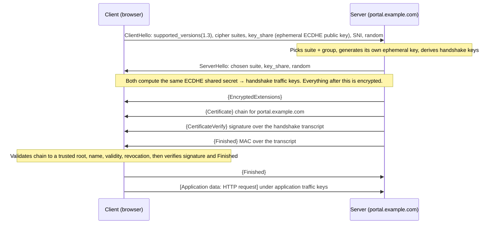

This lesson ties objectives **4.1–4.3** together. The previous lessons described *what to build*;
this one describes *what attackers do to it* and finishes by tracing the most important secure
channel on the internet, the TLS 1.3 handshake, step by step.

## Denial of service

A DoS attack targets **availability**. A *distributed* DoS (DDoS) uses many sources, usually a
botnet, so blocking one address doesn't help.

| Category | Target | Examples | Primary mitigations |
|---|---|---|---|
| **Volumetric** | Bandwidth of your links | UDP floods, reflection/amplification | Upstream ISP or cloud scrubbing, CDN/anycast absorption |
| **Protocol / state exhaustion** | Connection tables in servers, firewalls and load balancers | **SYN flood**, fragmentation attacks | SYN cookies, rate limiting, stateful device tuning |
| **Application layer** | The application's CPU, DB or threads | HTTP floods, slow-request (Slowloris) | WAF/CDN rate limiting, caching, bot management |

### SYN flood

The attacker sends many SYNs, usually from spoofed sources, and never completes the handshake.
Each one leaves a **half-open connection** in the server's backlog until it fills and legitimate
clients are refused (RFC 4987). **SYN cookies** let the server encode the connection state in its
SYN-ACK sequence number instead of storing it. Only a client that returns a valid ACK makes the
server allocate resources.

### Reflection and amplification

The attacker sends small UDP requests with the **victim's address spoofed as the source** to
servers that send **large responses**: open DNS resolvers, NTP (`monlist`), memcached, SSDP,
CLDAP. Those servers "reflect" amplified traffic at the victim. **Smurf** is the ICMP version
(ping to a broadcast address) and **Fraggle** is the UDP version.

Defences sit in three places:

1. **Everyone's egress:** **BCP 38 ingress filtering** (RFC 2827). Networks drop outbound packets
   with source addresses that aren't theirs, so spoofing fails at the origin.
2. **The reflectors:** don't run open resolvers (RFC 5358). Disable `monlist`, and don't expose
   memcached or SSDP to the internet.
3. **The victim:** a DDoS protection service or ISP scrubbing with enough capacity, CDN/anycast,
   and an incident plan arranged *before* the attack (CISA). You can't out-bandwidth a large
   volumetric attack on your own links.

> [!TIP]
> For "the BEST way to protect availability against a large volumetric DDoS", the answer is
> usually an **upstream** service (ISP, scrubbing centre, CDN). Anything on your own premises sits
> behind the saturated link.

Older fragment and malformed-packet attacks: **ping of death** (an oversized ICMP packet after
reassembly), **teardrop** (overlapping fragment offsets crash reassembly) and **LAND** (source equals
destination). Patched stacks have fixed these, but they illustrate why IPS normalisation and fragment
filtering exist.

## Spoofing and man-in-the-middle

| Attack | Mechanism | Defence |
|---|---|---|
| **IP spoofing** | Forged source address | BCP 38, anti-spoofing ACLs; don't rely on source IP as authentication |
| **ARP poisoning** | Forged ARP replies on a LAN | Dynamic ARP Inspection, 802.1X |
| **Rogue DHCP / rogue IPv6 RA** | Victims get an attacker gateway or DNS | DHCP snooping, RA Guard |
| **SSL stripping** | MITM downgrades HTTPS links to HTTP | **HSTS** (and HSTS preload) |
| **Session hijacking** | Take over an authenticated session (stolen token, predicted TCP sequence) | Encrypt the whole session, random sequence numbers and tokens, re-authenticate for sensitive actions |
| **Replay** | Re-send captured valid traffic | Nonces, timestamps, sequence numbers (IPsec anti-replay, TLS record sequence) |

The general defence against man-in-the-middle is **mutual authentication with cryptographic
binding**: certificates validated against a trusted CA, so an interceptor can't present a valid
identity.

## DNS attacks

- **Cache poisoning:** the attacker races forged answers into a resolver's cache, so every user of
  that resolver goes to the wrong IP. The defence is **DNSSEC** validation (RFC 4033), which signs
  records so forged ones fail. Note that DNSSEC gives **integrity and origin authentication, not
  confidentiality**.
- **Query privacy:** DNS over **TLS** (853) or **HTTPS** (DoH, RFC 8484) encrypts queries. In an
  enterprise, uncontrolled DoH lets endpoints bypass DNS filtering and monitoring, so steer clients
  to the corporate resolver.
- **DNS tunnelling:** data hidden in queries and responses for command and control or exfiltration.
  Detect it with query-length and entropy analytics, and allow DNS out only via your resolvers.
- **Domain hijacking:** taking over the registrar account. Defend with registrar lock and MFA.

## Routing attacks: BGP hijacking

BGP trusts what neighbours announce. An attacker, or a misconfigured network, announces someone
else's prefix (or a more specific one) and attracts the traffic. **RPKI route origin validation**
(RFC 6811, recommended in NIST SP 800-189) lets routers reject announcements from an AS not
authorised by the prefix holder's signed Route Origin Authorization. Pair it with prefix filtering
with peers. Encryption (TLS) still protects the *content* of hijacked traffic. It doesn't protect
availability.

## Scanning and reconnaissance

Port scans (SYN "half-open", connect, FIN/Xmas/NULL, UDP), banner grabbing and OS fingerprinting
come before most attacks. Default-deny rule bases, stateful firewalls, minimal banners and
IDS correlation of scan patterns (NIST SP 800-94) reduce what attackers learn and alert you
that someone is looking.

## Worked example: tracing a TLS 1.3 handshake

A browser connects to `https://portal.example.com`. TLS 1.3 (RFC 8446) needs **one round trip**
before application data flows (TLS 1.2 needed two).

Read each step for **the security property it provides**:

| Step | What happens | Security property |
|---|---|---|
| 1. **ClientHello** | Offers TLS 1.3, AEAD cipher suites (e.g. `TLS_AES_128_GCM_SHA256`), and *already* sends an ephemeral ECDHE key share. SNI names the site (in clear unless Encrypted Client Hello is used). Includes a fresh random. | Negotiation; freshness (random defeats replay of old handshakes) |
| 2. **ServerHello** | Chooses the suite and returns its own ephemeral key share | Key agreement. Both sides now derive the **same secret without ever sending it**. Ephemeral keys mean **forward secrecy**: stealing the server's long-term key later can't decrypt this session |
| 3. **EncryptedExtensions** | Remaining parameters, already encrypted | Less metadata exposed than in TLS 1.2 |
| 4. **Certificate** | The server's X.509 chain | Binds the public key to the name `portal.example.com` via a CA (**authentication**, if the client validates it) |
| 5. **CertificateVerify** | Server signs a hash of the whole handshake so far with its private key | Proves the server **holds the private key** and that nobody altered the handshake (**downgrade protection**) |
| 6. **Server Finished** | MAC over the transcript using handshake keys | **Integrity** of the entire handshake |
| 7. **Client validation** | Chain to a trusted root, hostname match, validity dates, revocation status (OCSP/CRL), then verifies 5 and 6 | This is where a MITM with a fake certificate fails, unless the user clicks through the warning |
| 8. **Client Finished** | Client's MAC over the transcript | Confirms the client saw the same handshake |
| 9. **Application data** | AEAD-encrypted records with sequence numbers | **Confidentiality, integrity, replay protection** |

Things TLS 1.3 **removed**, which make good exam distractors: static RSA key transport (no forward
secrecy), CBC-mode and RC4 suites, compression (CRIME), renegotiation, and SHA-1/MD5 in signatures.
**0-RTT** (early data on resumption) saves a round trip, but that early data **can be replayed**, so
it must be limited to idempotent requests.

**Mutual TLS (mTLS):** the server sends a CertificateRequest, and the client returns its own
Certificate and CertificateVerify. It's common for service-to-service authentication in zero
trust and micro-segmented designs.

> [!WARNING]
> TLS proves you're talking to *whoever holds the key for that name*. It doesn't prove the site is
> benign: phishing sites have valid certificates too. Certificate validation also depends on the
> client trust store. An enterprise TLS-inspection proxy works only because its own root CA has been
> installed on managed endpoints, which is why that root key must be protected like crown jewels.

## Putting it together: a risk-adviser incident walk-through

**Scenario.** On a Monday morning, an e-commerce company's site is unreachable. The edge link is
saturated with UDP traffic from thousands of DNS and NTP servers. Simultaneously, the SOC sees a
spike of outbound DNS queries with long random subdomains from one internal server.

1. **Two incidents, not one.** The inbound flood is a **reflection/amplification DDoS** (availability).
   The outbound queries look like **DNS tunnelling** (possible exfiltration, confidentiality). The
   DDoS may be a smokescreen.
2. **Immediate actions.** Invoke the pre-arranged ISP/scrubbing service for the flood; on-premises
   controls can't help behind a saturated link. Isolate the internal server per the incident
   response plan and preserve evidence.
3. **Root causes.** Why could that server send DNS directly to the internet? Fix egress filtering
   so only the corporate resolvers may query outbound, and add DNS analytics.
4. **Architecture and governance.** Review the DDoS contract's capacity and SLA. Put the site behind
   a CDN with the origin locked down. Brief management on residual risk and cost.

Notice the order: protect people and the business, contain, fix the root cause, then improve the
architecture. That's the order the CISSP rewards.

## Check yourself

1. Which TLS 1.3 handshake message proves the server possesses the private key matching its
   certificate, and what else does it protect?
2. An attacker sends 60-byte DNS queries with a spoofed source and the victim receives 3,000-byte
   responses. Name the attack and the control that, deployed widely, would stop the spoofing at its
   origin.
3. A security architect says "we deployed DNSSEC, so our DNS queries are now private". Correct them.

Answers

1. **CertificateVerify.** It's a signature over the handshake transcript, so it also proves the
   handshake (including the negotiated version and suite) wasn't tampered with, which gives
   downgrade protection.
2. A DNS reflection/amplification DDoS (about 50× amplification). **BCP 38 ingress filtering**
   (RFC 2827) stops networks emitting packets with source addresses that aren't theirs. Closing open
   resolvers (RFC 5358) removes the reflectors.
3. DNSSEC provides integrity and origin authentication of DNS data, not confidentiality. Queries
   are still visible. Privacy needs DNS over TLS or HTTPS.

## Sources

RFC 4987, RFC 2827, RFC 5358 and CISA for DoS/DDoS; NIST SP 800-189 and RFC 6811 for BGP; RFC 4033
and RFC 8484 for DNS; RFC 8446 and NIST SP 800-52r2 for TLS 1.3; RFC 768 and RFC 9293 for UDP/TCP
behaviour; NIST SP 800-94 for scan detection; ISC2 outline 4.1–4.3.
