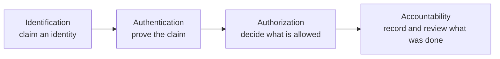

Objective **5.1** asks you to control physical and logical access to six kinds of asset:
**information, systems, devices, facilities, applications and services**. The rest of the domain
is about *how* — identities, authentication, federation, authorization models, the account
lifecycle and the protocols. This lesson sets the vocabulary those lessons rely on.

## Subjects, objects and the access decision

Every access control conversation has three parts:

| Term | Meaning | Examples |
|---|---|---|
| **Subject** | The active entity asking for access | A user, a process, a service account, a device |
| **Object** | The passive entity being accessed | A file, a database row, a printer, a server room |
| **Access** | The operation requested | Read, write, execute, delete, enter |

The same thing can be a subject in one transaction and an object in another: a program is an object
when you install it and a subject when it runs and opens files.

The theoretical model behind this is the **access control matrix**: rows are subjects, columns are
objects, each cell lists the permitted operations. Nobody stores the full matrix — it is huge and
mostly empty — so systems store slices of it:

| Slice | Stored with | Answers | Typical form |
|---|---|---|---|
| **Access control list (ACL)** | The object (a column) | "Who may touch this file?" | NTFS permissions, a firewall rule list, S3 bucket policy |
| **Capability list / table** | The subject (a row) | "What may this user touch?" | Kerberos tickets, OAuth access tokens, capability-based OS designs |

> [!TIP]
> Exam phrasing: an ACL is *object-centric*, a capability is *subject-centric*. If a question
> describes a token the subject carries and presents, that is a capability.

## The access control chain (IAAA)

Access is a chain of four steps. ISC2 materials sometimes say AAA (authentication, authorization,
accounting); the fuller form puts identification first.

| Step | Question it answers | Example | What fails without it |
|---|---|---|---|
| **Identification** | Who do you claim to be? | Typing a username, presenting a badge | No one to authenticate or hold accountable |
| **Authentication** | Can you prove it? | Password, smart card + PIN, fingerprint | Anyone can claim any identity |
| **Authorization** | What may that identity do? | ACL check, role lookup, policy decision | Authenticated users can do anything |
| **Accountability** (auditing / accounting) | Who did what, when? | Logs tied to unique IDs, reviewed | Abuse cannot be detected or attributed |

Accountability depends on the earlier links. Logs are only useful if each entry maps to **one
uniquely identified, strongly authenticated person** — which is why **shared accounts destroy
accountability** and why NIST SP 800-53 control IA-2 requires unique identification of
organisational users and AC-6(9) requires logging the use of privileged functions.

> [!WARNING]
> Identification is *not* authentication. A username, an employee number or an email address is
> a public claim. Exam distractors often call a user ID "something you know" — it isn't a
> secret, so it isn't an authentication factor.

## The six asset types in 5.1

Objective 5.1 lists the assets explicitly. For each one, think of a physical and a logical control.

| Asset | Physical access control | Logical access control |
|---|---|---|
| **Information** | Locked cabinets, clean-desk rules, controlled print release | File and database permissions, encryption with key access control, DLP |
| **Systems** | Locked racks, console port protection | OS accounts, privileged access management, host firewall |
| **Devices** | Cable locks, asset tags, locked cages for network gear | Device certificates, 802.1X network access control, MDM enrolment |
| **Facilities** | Fences, guards, badge readers, mantraps, visitor escort | PACS software, badge-to-identity linkage, alarm integration |
| **Applications** | — (they live on systems) | Application roles, SSO, API authorization, session controls |
| **Services** | Data-centre access for the provider's staff (shared responsibility) | Cloud IAM policies, API keys/tokens, conditional access |

### Physical access deserves the same rigour

Facility access is still an access decision: identification (badge), authentication (badge plus PIN
or biometric), authorization (the door controller's schedule and zone list) and accountability (the
door log). NIST SP 800-116 describes how a **physical access control system (PACS)** should
authenticate PIV smart cards cryptographically at the door rather than simply reading a card number,
because a number alone can be copied. The same thinking applies to any proximity badge: a badge that
only broadcasts an ID is identification, not strong authentication.

Common physical mechanisms:

- **Mantrap / access control vestibule** — two interlocking doors so only one person passes per
  authentication; defeats **tailgating** and **piggybacking**.
- **Turnstiles** — one person per rotation.
- **Guards** — the only control that can exercise judgement; also deterrent and detective.
- **Visitor management** — sign-in, ID check, badge that visibly differs, escort, sign-out.

> [!IMPORTANT]
> People's safety beats asset protection. Doors on emergency exit routes must **fail safe** (unlock
> on power loss) where life safety codes require it, even though a security engineer might prefer
> **fail secure**. When an exam option endangers people, it is wrong.

### Logical access and the policy enforcement point

For logical access, the place a decision is enforced is the **policy enforcement point (PEP)**: an
API gateway, a file server, a proxy, the OS kernel. The PEP asks a **policy decision point (PDP)**
whether to allow the request. In zero trust (NIST SP 800-207) every request is evaluated this way,
with context — device health, location, time — not just "inside the network". The PDP/PEP split
reappears in lesson 4 under authorization models.

## Principles that shape every access decision

| Principle | Meaning | Example |
|---|---|---|
| **Least privilege** | Grant the minimum rights needed for the task, for the minimum time | A DBA gets admin only on the databases they support, elevated only when needed |
| **Need to know** | Even with clearance or role, access only the specific data the task requires | A cleared analyst still cannot browse every case file |
| **Separation of duties (SoD)** | Split a sensitive task so no one person can complete it alone | One person creates a vendor, another approves payments to it |
| **Default deny / implicit deny** | Anything not explicitly allowed is denied | Firewall final rule; ABAC policy with no matching permit |
| **Defence in depth** | Layered controls so one failure is not total | Badge to building, second badge to server room, MFA to console |
| **Accountability** | Unique IDs and reviewed logs | No shared admin accounts |

Least privilege and need to know are often confused. **Clearance** (or role) says you are *eligible*
for a class of information; **need to know** says you need *this specific item now*. Both must hold.

## Worked example: a hospital records room

A regional hospital keeps paper charts in a records room and electronic charts in its EHR. An audit
finds: the records room uses a keypad code shared by 40 staff and changed yearly; EHR clinicians
share a "ward-3" login at nursing stations to save time; and a contractor who left three months ago
still has VPN access.

Walk the chain:

1. **Identification** fails at the records room and at ward 3 — a shared code and a shared account
   identify a group, not a person.
2. **Authentication** is weak everywhere: a shared knowledge factor proves only membership.
3. **Authorization** for the contractor was never removed — a lifecycle failure (lesson 5).
4. **Accountability** is impossible: no log can say *which* nurse opened a chart or entered the room.

What would a security leader recommend *first*? Not a product. The root issue is policy: require
unique identification for physical and logical access to patient information. Then implement:
individual badges with PIN for the records room (with logs), individual EHR logins with fast
re-authentication (tap-badge plus PIN at shared workstations keeps clinicians quick), and a
leaver process tied to contract end dates. Each fix restores a broken link in the chain.

## Centralised versus decentralised administration

| Approach | Strength | Weakness |
|---|---|---|
| **Centralised** (one IAM team, one directory, one IdP) | Consistent policy, single place to revoke, easier audit | Single point of failure; can be slow for local needs |
| **Decentralised** (each system or site manages its own accounts) | Local speed and autonomy | Inconsistent rules, orphaned accounts, hard to revoke everywhere |
| **Hybrid** | Central policy and identities, local delegated admin | Needs clear delegation boundaries |

The exam favours **centralised** identity with delegated administration, because revoking access in
one place on termination is the single biggest risk reducer in the lifecycle.

## Summary

- 5.1 covers information, systems, devices, facilities, applications and services — physically and
  logically.
- The chain is identification → authentication → authorization → accountability; accountability
  needs unique, authenticated identities.
- ACLs are attached to objects; capabilities are carried by subjects.
- Least privilege, need to know, separation of duties and default deny shape every decision.
- Safety of people outranks asset protection in physical controls.

## Check yourself

1. A system logs every action against the account `ops-shared`. Which link of the access control
   chain is broken, and why does it matter?
2. A user presents a signed token listing the files they may open. Is this an ACL or a capability?
3. A cleared analyst asks for a case file unrelated to her assignment. Which principle says no?

Answers

1. **Identification** (and therefore **accountability**): the log identifies a shared account, not a
   person, so actions cannot be attributed to an individual.
2. A **capability** — it is held and presented by the subject and lists what that subject may do.
3. **Need to know**: clearance makes her eligible, but her task does not require that file.

## Sources

ISC2 CISSP exam outline (objective 5.1 asset list); NIST SP 800-53 Rev. 5 (IA-2, AC-3, AC-5, AC-6);
NISTIR 7316 (access control matrix, ACLs and capabilities); NIST SP 800-116 Rev. 1 (PACS and PIV at
doors); NIST SP 800-207 (PDP/PEP and per-request decisions).
