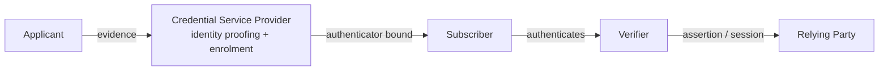

Objective **5.2** asks you to *design* an identification and authentication strategy covering
groups and roles, authentication (MFA and passwordless), session management, registration and
proofing, federated identity management, credential management systems, single sign-on and
just-in-time access. This lesson covers the authentication core; federation is lesson 3 and JIT is
lesson 5.

## Registration, proofing and establishing identity

Before anyone authenticates, someone has to decide the person is who they claim to be and bind
them to a credential. NIST SP 800-63-4 names the roles:

**Identity proofing** collects evidence (a passport, a driving licence), *validates* it is genuine,
and *verifies* it belongs to the applicant (a photo comparison, a check against an authoritative
record). How hard you check is the **identity assurance level**:

| Level | Meaning (SP 800-63A-4) | Typical use |
|---|---|---|
| **IAL1** | Identity evidence is collected and validated with limited checks | Low-risk services where a wrong identity causes little harm |
| **IAL2** | Stronger evidence, validated and verified remotely or in person | Most employee onboarding, access to personal data |
| **IAL3** | In-person or supervised remote proofing by trained staff, biometric collected | High-risk: privileged government access, large financial authority |

## Authentication factors

| Factor | Examples | Main weakness |
|---|---|---|
| **Something you know** (Type 1) | Password, passphrase, PIN, security question answer | Guessed, phished, reused, stuffed |
| **Something you have** (Type 2) | Smart card, hardware security key, OTP token, phone app | Lost, stolen, cloned (weak tokens), SIM-swapped (SMS) |
| **Something you are** (Type 3) | Fingerprint, face, iris, palm vein, voice | Cannot be reissued if compromised; error rates; privacy |

**Context** — somewhere you are (geolocation, network), something you do (typing rhythm), time of
day — feeds risk-based decisions but is not usually counted as a standalone factor on the exam.

**Multi-factor** means two or more *different types*. A password plus a security question is two
things you know: **single-factor**, however many prompts there are. A smart card unlocked by a PIN
is two factors (have + know).

> [!WARNING]
> Classic distractors: "password and PIN" (one factor type), "username and password" (identification
> plus one factor), and "two passwords" (still one factor).

### Synchronous and asynchronous tokens

- **HOTP** (RFC 4226) — counter-based one-time codes.
- **TOTP** (RFC 6238) — the counter is the current time step, typically 30 seconds. Token and
  server must have roughly synchronised clocks; this is a **synchronous** token.
- **Asynchronous / challenge–response** — the server sends a challenge, the token computes the
  response (smart cards, FIDO keys).

### How strong is each "something you have"?

NIST SP 800-63B-4 treats one-time codes sent over the phone network (SMS or voice) as a
**restricted** authenticator: usable only with extra risk acceptance, because of SIM swaps and
number porting. Codes and push approvals can also be relayed in real time by an adversary-in-the-
middle phishing site, and push prompts invite **MFA fatigue** (approve-to-make-it-stop). Number
matching reduces fatigue but not real-time relay.

**Phishing-resistant** authenticators bind the authentication to the genuine site:

- **FIDO2 / WebAuthn** — the authenticator holds a private key created for one relying-party ID
  (the origin). The browser tells the authenticator which origin is asking; a look-alike domain gets
  no valid signature. The server stores only a public key — nothing reusable to steal.
- **PIV / CAC smart cards** with client-certificate (mutual TLS) authentication.

## Passwordless and passkeys

**Passkeys** are FIDO credentials unlocked locally by a fingerprint, face or device PIN. The
biometric or PIN never leaves the device; it only unlocks the private key. Result: something you
have (the device holding the key) plus something you are or know (the local unlock) — multi-factor,
phishing-resistant, and no shared secret on the server. Passkeys can be **device-bound** (a hardware
key; the key cannot be exported) or **synced** through a platform credential manager (easier
recovery, but the key's security now depends on that account).

## Password policy, the modern way

SP 800-63B-4 and the OWASP Authentication Cheat Sheet agree on the essentials:

| Do | Don't |
|---|---|
| Favour length (NIST: at least 15 characters when the password is the only factor, 8 when it is part of MFA); allow long passphrases | Impose composition rules ("one upper, one symbol") |
| Check new passwords against a blocklist of breached and common values | Force periodic changes — change only on evidence of compromise |
| Throttle failed attempts; prefer rate limiting over permanent lockout | Use knowledge-based security questions |
| Store with a salted, slow, memory-hard hash | Show password hints |

> [!TIP]
> Older textbooks teach complexity and 90-day rotation. Current NIST guidance says the opposite.
> If an answer choice reflects current NIST guidance and another reflects folklore, choose NIST.

## Biometrics and the CER

A biometric system compares a live sample to an enrolled template and produces a similarity score.
The **threshold** decides how close is close enough. Two errors trade off against each other:

| Error | Also called | What happens | Hurts |
|---|---|---|---|
| **False rejection rate (FRR)** | **Type I** error (false non-match at algorithm level) | A legitimate user is refused | Usability, productivity |
| **False acceptance rate (FAR)** | **Type II** error (false match at algorithm level) | An impostor is accepted | Security |

Raise the threshold (stricter) and FAR falls while FRR rises. The point where they are equal is the
**crossover error rate (CER)**, also called equal error rate (EER). **The lower the CER, the more
accurate the system**, which makes CER the fair way to compare products.

> [!TIP]
> Memory aid: **Type II is the "Two bad" one** — an impostor gets in. Type I is merely irritating.

### Worked example

A vendor tests a palm-vein reader with **1,000 genuine attempts** (enrolled users) and **2,000
impostor attempts** at five threshold settings:

| Threshold | False rejects (of 1,000) | FRR | False accepts (of 2,000) | FAR |
|---|---|---|---|---|
| 1 (lenient) | 5 | 0.5% | 100 | 5.0% |
| 2 | 10 | 1.0% | 40 | 2.0% |
| 3 | 15 | 1.5% | 30 | **1.5%** |
| 4 | 40 | 4.0% | 10 | 0.5% |
| 5 (strict) | 90 | 9.0% | 2 | 0.1% |

- FRR = false rejects ÷ genuine attempts. At threshold 4: 40 ÷ 1,000 = **4%**.
- FAR = false accepts ÷ impostor attempts. At threshold 4: 10 ÷ 2,000 = **0.5%**.
- FAR = FRR at threshold 3, so the **CER is 1.5%**.

A competitor quotes a CER of 0.8%: that product is more accurate overall. For a data-centre door,
you would *operate* at threshold 4 or 5 — accepting more false rejects to cut false accepts — but
you still *compare* products by CER.

Other biometric considerations: **failure to enrol** rate (some users cannot be enrolled at all),
throughput (seconds per person), user acceptance (retina scans are intrusive), privacy law
(biometric data is special-category data under GDPR), and **presentation attack detection**
(liveness) against fakes. SP 800-63B-4 allows a biometric only **together with a physical
authenticator** — never as a standalone factor — because a biometric is not a secret and cannot be
revoked.

## Authenticator assurance levels

| Level | Requires (SP 800-63B-4, simplified) |
|---|---|
| **AAL1** | Single-factor or MFA; some assurance the claimant controls the authenticator |
| **AAL2** | Two distinct factors; the verifier must **offer** a phishing-resistant option |
| **AAL3** | Phishing-resistant authenticator with a **non-exportable** private key (hardware-bound), plus a second factor |

Pick levels from impact: what happens if the wrong person gets in? A payroll self-service portal
exposing bank details is an AAL2 case; domain admin access is an AAL3 case.

## Session management

Authentication happens once; the **session** carries it forward, so a stolen session is as good as
a stolen password. OWASP and SP 800-63B-4 controls:

- Session identifiers with high entropy, generated by the server, sent only in cookies with
  `Secure`, `HttpOnly` and `SameSite`.
- **Regenerate the session ID after login** (and after privilege change) to defeat **session
  fixation**.
- An **idle (inactivity) timeout** and an **absolute timeout**; at AAL3, NIST sets reauthentication
  at least every 12 hours and after 15 minutes of inactivity.
- **Server-side invalidation** on logout — deleting a cookie client-side is not enough.
- Screen lock on endpoints (NIST SP 800-53 AC-11) and session termination (AC-12).
- Re-authenticate before high-risk actions (step-up), such as changing payout details.

## Credential management systems and SSO

- **Password vaults / credential managers** store unique, generated credentials so users need not
  reuse them; enterprise vaults add sharing controls, check-out, rotation and audit.
- **Single sign-on (SSO)** — authenticate once to an identity provider, reach many applications.
  Benefits: fewer passwords, central MFA, one place to revoke. Risk: the IdP becomes a single point
  of compromise and failure, so it needs the strongest authentication and high availability.
- **Groups and roles** — assign permissions to groups/roles, then people to roles, rather than
  permissions to individuals (lesson 4).
- CIS Control 6 asks for MFA on externally exposed applications, remote access and all
  administrative access, and centralised access control through a directory or SSO provider.

## Check yourself

1. A bank asks for a password and then the answer to "your first pet". Is this MFA?
2. At a given threshold, 12 of 3,000 impostor attempts succeed. What is the FAR, and which error
   type is it?
3. Why does a FIDO2 security key stop a real-time phishing proxy that defeats TOTP codes?

Answers

1. **No.** Both are something you know — single-factor authentication with two prompts.
2. 12 ÷ 3,000 = **0.4%**, a **Type II** (false acceptance) error.
3. The key signs a challenge bound to the **origin** the browser reports. The phishing domain gets
   a signature for the wrong origin (or none), which the real site rejects; a TOTP code has no
   origin binding and can be relayed within its validity window.

## Sources

NIST SP 800-63-4 and SP 800-63B-4 (roles, IAL/AAL, passwords, restricted authenticators, biometrics,
reauthentication); ISO/IEC 19795-1 (biometric error measurement); W3C WebAuthn Level 2 and FIDO
Alliance passkeys (origin binding, passwordless); RFC 6238 (TOTP); OWASP Session Management and
Authentication cheat sheets; CIS Controls v8 Control 6; ISC2 CISSP outline (5.2 sub-topics).
