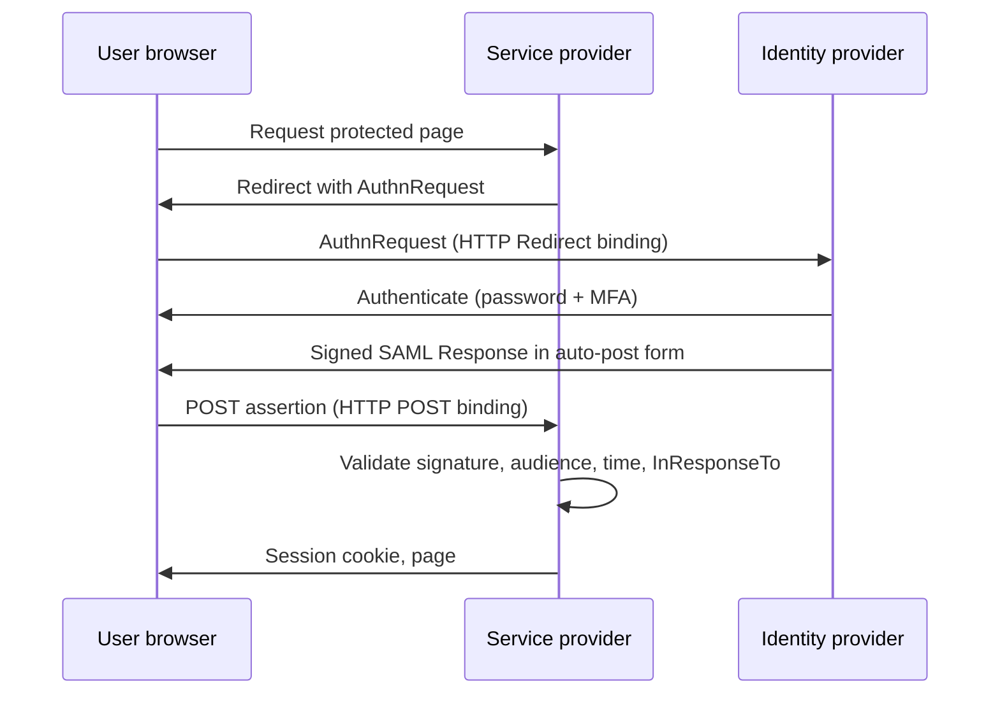

Objective **5.3** is *implement and manage federated identity with third parties*, deployed
**on-premises, in the cloud, or hybrid**. Objective **5.6** names the protocols that make it work:
**OpenID Connect / OAuth** and **SAML** (Kerberos, RADIUS and TACACS+ are in lesson 4).

## What federation is

**Federated identity management (FIM)** lets one organisation's identities be accepted by another
organisation's services, under an agreed trust relationship. The user authenticates at **home**
(their identity provider) and the service trusts a signed statement about that authentication.

| Role | SAML name | OAuth / OIDC name | Does |
|---|---|---|---|
| Identity provider | IdP / asserting party | OpenID Provider (OP) / authorization server | Authenticates the user, issues assertions or tokens |
| Relying party | Service provider (SP) | Relying party (RP) / client | Consumes the assertion, grants access |
| User | Principal | End user / resource owner | Authenticates at the IdP |

**SSO vs federation:** SSO is the *experience* (log in once, reach many apps). Federation is SSO
*across trust boundaries* — different organisations or security domains — built on exchanged
metadata, certificates and contracts.

> [!IMPORTANT]
> Federation moves the authentication risk to the IdP. Before trusting a third party's IdP, the
> relying party must know *how* that IdP proofs and authenticates people (its IAL and AAL), and the
> agreement must cover incident notification and account deprovisioning. Due diligence before tools.

NIST SP 800-63C-4 grades federation by **federation assurance level**: FAL1 needs a signed assertion
audience-restricted to the RP; FAL2 adds stronger protection against assertion injection; **FAL3**
requires **holder-of-key** binding — the user must also prove possession of a key tied to the
assertion, so a stolen assertion alone is useless.

## SAML 2.0

**SAML** (Security Assertion Markup Language) is an OASIS XML standard, dominant for enterprise
browser SSO to SaaS. An **assertion** is a signed XML document from the IdP containing statements:

| Statement | Says |
|---|---|
| **Authentication statement** | This subject authenticated at this time, by this method |
| **Attribute statement** | Facts about the subject: email, department, group memberships |
| **Authorization decision statement** | This subject may (or may not) perform this action on this resource (rarely used) |

Assertions also carry the **issuer**, a **subject** (NameID), **conditions** (NotBefore /
NotOnOrAfter validity, **audience restriction** naming the SP) and an XML **signature**; they may be
encrypted.

### SP-initiated Web Browser SSO

The browser carries the assertion (front channel). **IdP-initiated** SSO starts at the IdP portal and
sends an unsolicited response — convenient, but with no AuthnRequest to match it is more exposed to
injection and replay, so SPs should accept it only deliberately.

> [!WARNING]
> SAML validation bugs are the classic failure: an SP that does not verify the signature, accepts a
> signature covering only part of the document (**XML signature wrapping**), or ignores audience and
> validity conditions will accept forged or replayed assertions. Use a maintained library.

## OAuth 2.0: delegated authorization

**OAuth 2.0** (RFC 6749) lets a user grant an application **limited access to their resources on
another service without sharing their password**. "Let this calendar app read my contacts" is OAuth.

| Role | Example |
|---|---|
| **Resource owner** | The user who owns the contacts |
| **Client** | The calendar app |
| **Authorization server** | The service's login and consent server that issues tokens |
| **Resource server** | The contacts API that accepts the access token |

The client receives an **access token** limited by **scopes** (`contacts.read`) and a lifetime, and
sometimes a **refresh token** to get new access tokens.

> [!IMPORTANT]
> **OAuth is authorization, not authentication.** An access token says "the bearer may read
> contacts", not "this is Alice". Using a bare access token as proof of login is a known
> vulnerability. Need to know *who* the user is? That's OpenID Connect.

### Which grant?

RFC 9700 (OAuth 2.0 Security Best Current Practice, January 2025) is the current reference:

| Grant | Use today? | Why |
|---|---|---|
| **Authorization code + PKCE** | Yes — for web, mobile and single-page apps | Code exchanged on the back channel; PKCE (RFC 7636) stops a stolen code being redeemed |
| **Client credentials** | Yes — machine to machine, no user | The client authenticates as itself |
| **Device authorization** | Yes — TVs and CLIs with no browser | User approves on a second device |
| **Implicit** | **No** | Tokens in the URL fragment leak via history and referrers |
| **Resource owner password credentials** | **No** | The client sees the user's password — the thing OAuth exists to avoid |

Other RFC 9700 points: exact redirect URI matching (open redirects leak codes), short-lived and
audience-restricted tokens, and sender-constrained tokens (mTLS or DPoP) so a stolen token cannot be
replayed by someone else.

## OpenID Connect: authentication on top of OAuth

**OIDC** adds an identity layer to OAuth 2.0. The client requests the `openid` scope and receives,
alongside the access token, an **ID token** — a signed **JWT** with claims:

| Claim | Meaning |
|---|---|
| `iss` | Issuer (the OpenID Provider) |
| `sub` | Stable subject identifier for the user at this issuer |
| `aud` | The client the token is for — the RP must check it is itself |
| `exp`, `iat` | Expiry and issue time |
| `nonce` | Value the RP sent, echoed back to prevent replay |

OIDC is the modern choice for consumer logins, mobile apps and APIs ("Sign in with…"), with JSON
instead of XML. SAML remains common in enterprise SaaS. Both deliver federated SSO.

| | SAML 2.0 | OAuth 2.0 | OIDC |
|---|---|---|---|
| Purpose | Authentication + attributes (SSO) | Delegated authorization | Authentication + profile (SSO) |
| Format | XML assertion | Access token (format not fixed) | JWT ID token + OAuth tokens |
| Typical use | Enterprise web SSO to SaaS | API access on a user's behalf | Web/mobile login, modern SSO |

## On-premises, cloud and hybrid

| Deployment | Pattern | Watch for |
|---|---|---|
| **On-premises** | Directory (e.g., Active Directory) + on-prem federation server (AD FS, Shibboleth) | Federation server is internet-facing and critical; you patch and scale it |
| **Cloud** | Identity as a service (IDaaS) is the IdP for SaaS and cloud workloads | Provider dependency, admin account protection, tenant misconfiguration |
| **Hybrid** | On-prem directory is the source; identities synchronised or federated to cloud | Sync scope, the sync server's privileges, which side authenticates |

Microsoft Entra documents three hybrid sign-in patterns, which generalise well:

1. **Password hash synchronisation** — a hash of the on-prem password hash is synced; the cloud
   authenticates. Survives on-prem outages; leaked-credential detection works.
2. **Pass-through authentication** — the cloud forwards the password to an on-prem agent to
   validate. Passwords never stored in the cloud, but on-prem must be up.
3. **Federation** — the cloud redirects to the on-prem IdP (e.g., AD FS). Most control (smart cards,
   custom policy), most infrastructure to run.

**Provisioning** is separate from sign-in. Federation lets the user log in; something still has to
create, update and delete their account in the SaaS app. **SCIM** (RFC 7644) is the standard API for
pushing those joiner/mover/leaver changes. **Just-in-time provisioning** creates the account on
first SAML/OIDC login from assertion attributes — but it cannot *delete* anyone, so leavers linger
unless SCIM or a review removes them.

## Worked example: a partner portal

A manufacturer wants 30 distributors to use its ordering portal with their own corporate logins.

1. **Choose federation over local accounts** — 30 IdPs already authenticate these people, and their
   leavers are disabled at home first. Local accounts would create 30 lifecycles to chase.
2. **Due diligence:** require each partner IdP to enforce MFA (AAL2 or better) and to notify
   incidents; record this in the partner agreement.
3. **Protocol:** SAML or OIDC (both fine); the portal is the SP/RP. Validate signatures, audience
   and expiry with a maintained library.
4. **Authorization stays with the portal:** map partner attributes (company, role) to portal roles;
   never trust a partner's assertion to grant admin rights in your system.
5. **Lifecycle:** require SCIM deprovisioning, or at least a quarterly partner attestation, because
   JIT creation alone never removes accounts.

## Check yourself

1. A developer proposes using the OAuth access token from a social provider as proof the user
   logged in. What should they use instead, and why?
2. Which SAML assertion element stops an assertion issued for one SP being accepted by another?
3. A company federates its SaaS apps to its on-premises IdP. The data centre loses power. What
   happens to SaaS sign-in, and which hybrid pattern would have avoided it?

Answers

1. The **OIDC ID token** — it is issued for authentication, names the user (`sub`), and is
   audience-restricted to the client. An access token is an authorization grant for an API.
2. The **audience restriction** condition (checked together with signature and validity times).
3. Sign-in fails because the federation IdP is down. **Password hash synchronisation** lets the
   cloud authenticate independently (often kept as a fallback even with federation).

## Sources

ISC2 CISSP outline (5.3, 5.6); NIST SP 800-63C-4 (federation, FAL) and SP 800-63-4; OASIS SAML 2.0
Technical Overview; RFC 6749 (OAuth 2.0); RFC 9700 (OAuth security BCP); OpenID Connect Core 1.0;
Microsoft Entra hybrid identity documentation; RFC 7644 (SCIM).
