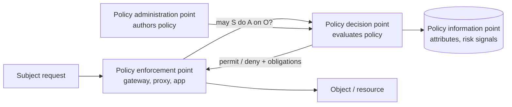
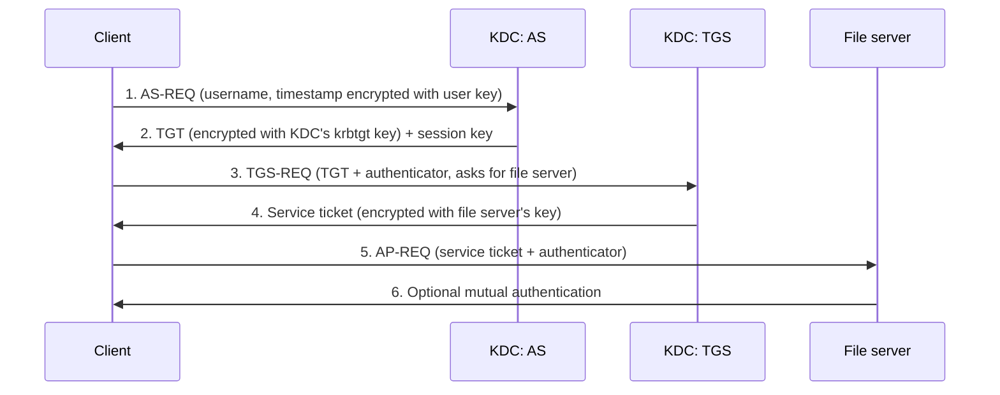

Objective **5.4** is *implement and manage authorization mechanisms*: RBAC, rule-based, MAC, DAC,
ABAC, risk-based access control, and **access policy enforcement** (policy decision point, policy
enforcement point). Objective **5.6** adds the authentication systems; this lesson covers
**Kerberos, RADIUS and TACACS+** (OIDC/OAuth and SAML were lesson 3).

## The authorization models

### Discretionary access control (DAC)

The **owner** of an object decides who may access it, usually through an ACL. Windows NTFS and
Unix file permissions are DAC.

- Strength: flexible, simple, users self-serve.
- Weakness: access spreads at owners' discretion; a **Trojan horse** running as the user inherits
  all the user's rights and can copy data anywhere the user can write. Hard to enforce
  organisation-wide policy.

### Mandatory access control (MAC)

The **system** enforces access by comparing a subject's **clearance** with an object's
**classification label** (and compartments / categories). Users — even owners — cannot change it.
Used in military and intelligence systems, and in SELinux-style label enforcement.

- Labels form a **lattice**: access needs clearance ≥ classification **and** membership of every
  compartment on the object (need to know).
- Strength: strong, central, resistant to user error and Trojans.
- Weakness: rigid, costly to administer, every object must be labelled.

### Role-based access control (RBAC)

Permissions attach to **roles** that mirror job functions; users get roles. NIST's model
(ANSI/INCITS 359) has **core** RBAC, **hierarchical** RBAC (senior roles inherit junior roles'
permissions) and **constrained** RBAC with separation of duties:

- **Static SoD** — conflicting roles can never be assigned to the same user (cannot hold both
  *Create vendor* and *Approve payment*).
- **Dynamic SoD** — a user may hold both, but cannot activate both in the same session or
  transaction.

RBAC is **non-discretionary**: administrators, not owners, decide. It suits organisations with
stable job functions and high staff turnover. Its weakness is **role explosion** — hundreds of
near-duplicate roles when every exception gets its own role.

### Rule-based access control

**Global rules** apply to every subject regardless of identity: "deny all inbound traffic except
TCP 443", "no logins between 23:00 and 05:00". Firewalls and routers are the textbook example.

> [!WARNING]
> **RBAC** (role) and **rule-based** both abbreviate to RBAC. If the scenario mentions job
> functions, it is role-based; if it mentions conditions that apply to everyone (time, port,
> address), it is rule-based. Some texts write RuBAC for rules.

### Attribute-based access control (ABAC)

Decisions evaluate **attributes** against policy (NIST SP 800-162):

- **Subject** attributes: department, clearance, training completed, employment type
- **Object** attributes: classification, owner, data type, project
- **Environment** attributes: time, location, device posture, threat level
- **Action**: read, write, approve

*"Permit read if subject.department = object.department AND subject.training = current AND device
is managed AND time is within business hours."* ABAC is the most fine-grained and context-aware
model and avoids role explosion, at the cost of policy complexity and the need for trustworthy,
well-governed attributes. XACML and cloud IAM condition languages are ABAC implementations.

### Risk-based (adaptive) access control

Access is decided by a **real-time risk score** from signals: impossible travel, new device,
anonymising network, unusual volume, leaked-credential match. Low risk → allow; medium → step-up
MFA; high → block. It is ABAC with risk as a computed attribute, and it is central to zero trust.

### Choosing a model

| Scenario cue | Best fit |
|---|---|
| Owner shares their own files ad hoc | DAC |
| Classified data, labels, clearances, users cannot override | MAC |
| Many staff in stable job functions, frequent turnover | RBAC |
| Same condition for everyone (time, port, IP range) | Rule-based |
| Fine-grained decisions mixing who, what and context; avoid role explosion | ABAC |
| Respond to login anomalies with step-up or block | Risk-based |

Other terms you may meet: **content-dependent** control (decision based on the data's content, e.g.
a database view hiding salaries) and **context-dependent** control (based on the situation, e.g.
time or sequence of actions).

## Policy enforcement: PDP and PEP

- **PEP** intercepts the request and enforces the answer. It must be **non-bypassable** — the
  reference monitor idea: always invoked, tamper-proof, small enough to verify.
- **PDP** evaluates policy and returns permit/deny (sometimes with obligations such as "log this").
- **PIP** supplies attributes; **PAP** is where policy is authored.

In NIST SP 800-207 zero trust, the policy engine and policy administrator form the PDP and every
access passes through a PEP. Centralising the PDP means one consistent policy; distributing PEPs
puts enforcement next to every resource. If the PDP is unreachable, the PEP should **fail closed**
for sensitive resources.

## Kerberos

Kerberos V5 (RFC 4120) is ticket-based SSO for a realm, using **symmetric** cryptography and a
trusted third party, the **Key Distribution Center (KDC)**. The KDC holds every principal's secret
key and runs two services: the **Authentication Service (AS)** and the **Ticket-Granting Service
(TGS)**. Active Directory domain controllers are KDCs.

Key points:

- The password never crosses the network; the user's key (derived from the password) decrypts the
  AS reply.
- The **TGT** lets the client get service tickets without re-entering the password — that is the SSO.
- **Authenticators** contain a timestamp, so Kerberos needs **synchronised clocks** (default
  tolerance about five minutes) to reject replays.
- Weaknesses: the **KDC is a single point of failure and a single point of compromise** (replicate
  and protect it); tickets cached on a client can be stolen; offline guessing of weak passwords.

| Attack | What happens | Mitigation |
|---|---|---|
| **Pass-the-ticket** | Steal a cached ticket and reuse it | Protect endpoints, short ticket lifetimes, credential guard |
| **Golden ticket** | Attacker with the **krbtgt** key forges TGTs for anyone | Protect domain controllers; rotate krbtgt **twice** after compromise |
| **Silver ticket** | Forge service tickets with a service account's key | Strong service account keys, PAC validation |
| **Kerberoasting** | Request service tickets and crack the service account password offline | Long random service account passwords or managed service accounts |

## RADIUS and TACACS+

Both are **AAA protocols**: a network device (switch, VPN concentrator, wireless controller — the
**network access server**, NAS) passes the login to a central server.

| | RADIUS (RFC 2865/2866) | TACACS+ (RFC 8907) |
|---|---|---|
| Transport | **UDP** 1812 (auth), 1813 (accounting) | **TCP** 49 |
| Encryption | Only the **password** attribute is hidden; rest is clear | **Entire packet body** obfuscated |
| AAA | Authentication and authorization **combined** | **Separates** authentication, authorization and accounting |
| Strength | Network access: VPN, Wi-Fi (802.1X/EAP), dial-up | **Device administration**: per-command authorization on routers and switches |
| Origin | Open standard, multi-vendor | Originally Cisco, now an informational RFC |

> [!TIP]
> Remember "**TACACS+ = TCP, Total body, Three separate A's**". RADIUS = UDP, password only,
> combined. **Diameter** is RADIUS's successor (TCP or SCTP, port 3868) used mainly in mobile
> networks.

RFC 8907 itself notes that TACACS+ obfuscation is not strong encryption by modern standards and
recommends protecting the traffic on a secure, isolated management network. RADIUS likewise should
run over a protected path (RADIUS over TLS, or IPsec) when it crosses untrusted networks.

## Worked example: picking for a network team

A company wants (a) employees to join corporate Wi-Fi with their directory credentials, and (b)
network engineers' commands on core routers authorised and logged one by one.

- (a) is **network access**: **RADIUS** with 802.1X/EAP, back-ended by the directory.
- (b) is **device administration** with per-command authorization and accounting: **TACACS+**,
  because it separates authorization from authentication and protects the whole payload.
- Both: put the AAA servers in pairs, keep a local break-glass admin on each device whose use is
  alerted, and log to the SIEM.

## Check yourself

1. Staff in the finance department get access through a "Finance-Clerk" assignment that IT manages.
   Owners cannot change it. Which model is this?
2. An attacker has obtained the krbtgt account hash. What can they do, and what is the recovery step?
3. Why is TACACS+ preferred over RADIUS for router administration?

Answers

1. **RBAC** (role-based, non-discretionary).
2. Forge **golden tickets** — TGTs for any user, including domain admins. Recover by rebuilding trust:
   reset the krbtgt password **twice** (so both current and previous keys are invalid), alongside
   full incident response.
3. TACACS+ **separates authorization**, allowing per-command authorization and accounting, uses TCP,
   and obfuscates the **whole body** rather than just the password.

## Sources

ISC2 CISSP outline (5.4, 5.6); NISTIR 7316 (DAC, MAC, rule-based); NIST RBAC project / ANSI INCITS
359 (RBAC, SoD); NIST SP 800-162 (ABAC, PDP/PEP/PIP/PAP); NIST SP 800-207 (zero trust PDP/PEP);
NIST SP 800-53 Rev. 5 (AC-3, AC-5); RFC 4120 (Kerberos); MITRE ATT&CK T1558 (ticket attacks);
RFC 2865 (RADIUS); RFC 8907 (TACACS+).
