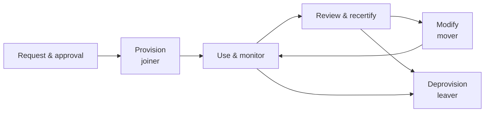

Objective **5.5** is *manage the identity and access provisioning lifecycle*. The outline names
five topics: **account access review** (user, system, service), **provisioning and deprovisioning**
(on/offboarding and transfers), **role definition and transition**, **privilege escalation** (use
of sudo, auditing its use) and **service accounts management**.

Most real breaches of access control are lifecycle failures, not cryptographic ones: the leaver
who kept VPN access, the admin who collected rights across five jobs, the service account nobody
owns with a password from 2014.

## The lifecycle

### Joiner (onboarding)

- **Authoritative source:** HR (or the contract system for contractors) creates the identity, not
  an email to IT. That ties the account to a real person and a real end date.
- Identity proofing at the right IAL (lesson 2), then credential issue.
- **Role-based birthright access**: the role defines the baseline; anything extra goes through a
  request, an approval by the **data or system owner**, and a record.
- Contractors and temporary staff get an **expiry date** at creation.
- Users sign the acceptable use policy before access is enabled.

### Mover (transfer, role transition)

The mover is where **privilege creep** (also called *access accumulation* or *authorization
creep*) happens: the new role's access is added and the old role's is never removed.

The correct process: grant the new role, **remove the old role's access** (with a short, approved
overlap only if a handover needs it), and have the new manager confirm. NIST SP 800-53 PS-5
(personnel transfer) requires reviewing and adjusting access when someone is reassigned.

### Leaver (offboarding)

- **Disable promptly** — for involuntary terminations, disable access **at or before** the moment
  the person is told, coordinated between HR, security and the manager (NIST SP 800-53 PS-4).
- Disable first, delete later: a **disabled** account preserves the audit trail, ownership of data
  and the ability to investigate; delete according to retention policy.
- Revoke everything: directory account, SSO sessions and refresh tokens, VPN, cloud and SaaS
  accounts (SCIM helps), physical badge, shared secrets they knew (rotate them), and personal API
  keys.
- Recover assets: laptops, tokens, badges.

> [!WARNING]
> Disabling the directory account does not necessarily end **existing sessions** or revoke
> long-lived **OAuth refresh tokens** and personal access tokens in SaaS apps. A complete leaver
> process revokes sessions and tokens too.

## Account access reviews

Periodic review (also called **recertification** or attestation) catches what the processes missed.
CIS Control 5 asks for an inventory of all accounts and **disabling dormant accounts after 45 days
of inactivity**; NIST SP 800-53 AC-2 requires reviewing accounts for compliance at a defined
frequency.

| Review type | What to check |
|---|---|
| **User accounts** | Does each person still need each entitlement? Any terminated users still active? |
| **Privileged accounts** | Who holds admin? Is each assignment justified and time-limited? More frequent reviews |
| **System accounts** | Built-in and default accounts disabled or renamed; local admin passwords unique |
| **Service accounts** | Does each have a named owner, a purpose, minimal rights, and a rotated credential? |

Who reviews matters: **managers** confirm their people need access; **data/system owners** confirm
who should reach their resource. IT administrators should *not* certify their own access. Reviews
must **result in removals**, with evidence — a rubber-stamped review that approves 100% of access is
a finding in itself.

> [!TIP]
> Review frequency follows risk: privileged and sensitive-data access more often (e.g. quarterly),
> standard access less often (e.g. annually), and always on a role change.

## Privilege escalation, done properly

Some work needs elevated rights. The goal is to make elevation **deliberate, minimal, time-limited
and audited**.

- **Separate admin accounts:** admins use a standard account for email and browsing and a distinct
  privileged account for administration (CIS Control 5).
- **sudo on Unix/Linux:** grant specific commands to specific users in the sudoers policy instead of
  sharing the root password; every use is logged against the individual. Review sudo logs and the
  sudoers file; avoid broad `ALL` grants and commands that allow a shell escape.
- **Privileged access management (PAM):** a vault holds privileged credentials, issues them on
  check-out with approval, **rotates** them after use, and can broker and **record** privileged
  sessions. NIST SP 1800-18 is a reference build.
- **Just-in-time (JIT) access:** no standing admin rights; a user requests elevation for a task and
  window, it is approved (or auto-approved by policy), granted, and **automatically removed** when the
  window ends. JIT shrinks the attack surface: a stolen admin account with no standing privilege is
  worth little.
- **Break-glass (emergency) accounts:** a small number of highly privileged accounts for when normal
  paths fail (IdP outage). Credentials sealed or vaulted with split knowledge, excluded from
  conditional access that might lock them out, and **every use alerts** and is reviewed.

**Privilege escalation as an attack** — exploiting a bug or misconfiguration to gain rights not
granted — is detected by the same audit trail: monitor group membership changes, new admin grants,
and sudo or elevation events.

## Service accounts

Service (non-human) accounts run applications, scheduled jobs and integrations. They are attractive
targets because they are often over-privileged, never log in interactively (so misuse goes
unnoticed) and have passwords that never change.

Controls:

1. **Inventory with an owner** — every service account has a named human owner and documented
   purpose (CIS Control 5).
2. **Least privilege** — only the rights the service needs; never domain admin "to make it work".
3. **Deny interactive logon** where the platform allows it.
4. **Strong, rotated credentials** — prefer platform-managed identities (managed service accounts,
   cloud workload identities) whose keys rotate automatically; otherwise long random passwords held in
   a vault. Weak service-account passwords are exactly what **Kerberoasting** cracks offline.
5. **Review** service accounts like users — orphaned ones get disabled.

## Worked example: a mover with too much

Priya worked in accounts payable for three years, then in procurement for two, and now in treasury.
An access review shows she can still create vendors (AP), raise purchase orders (procurement) and
release payments (treasury).

- **Finding:** privilege creep produced a **separation of duties** violation: she can create a vendor,
  order from it and pay it — the full fraud cycle.
- **Immediate action:** remove AP and procurement entitlements; check transaction logs for any
  vendor she created and paid.
- **Root cause:** the mover process adds access but never removes it.
- **Fix the process (policy first):** transfers trigger removal of the previous role's access by
  default; RBAC with **static SoD constraints** blocks the conflicting combination; managers recertify
  quarterly for finance roles.

## Check yourself

1. An access review finds 140 accounts belonging to people who left. What is the immediate action,
   and what does the finding say about the process?
2. Why should a terminated employee's account be disabled rather than deleted at once?
3. What does JIT access reduce that a PAM vault with standing admin group membership does not?

Answers

1. **Disable** them now (and check logs for use after the leave dates). The finding shows the **leaver
   process is broken** — deprovisioning is not triggered by HR, so fix the trigger, not just the
   symptoms.
2. Disabling preserves the audit trail and data ownership for investigation and retention, while
   still blocking use; deletion follows the retention policy.
3. **Standing privilege** — with JIT, nobody holds admin rights between tasks, so a compromised
   account has nothing to escalate with outside an approved window.

## Sources

ISC2 CISSP outline (5.5 sub-topics); NIST SP 800-53 Rev. 5 (AC-2 account management, AC-6 least
privilege, PS-4 termination, PS-5 transfer); CIS Controls v8 Controls 5 and 6; NIST SP 1800-18
(privileged account management); RFC 7644 (SCIM deprovisioning); MITRE ATT&CK T1558 (Kerberoasting
against service accounts).
