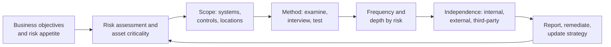

Domain 6 is about **evidence**. Domains 1–5 had you choose and build controls; here you prove
they work, and you prove it to people who did not build them: executives, the board, auditors,
regulators and customers. Outline objectives **6.1** (design and validate assessment, test and
audit strategies) and **6.5** (conduct or facilitate security audits) are two halves of the same
question: *who looks, at what, how often, how independently, and what will the result be
trusted for?*

## Assessment, test, audit: three words, three jobs

The exam uses these words precisely.

| Activity | What it is | Typical output | Who relies on it |
|---|---|---|---|
| **Test** | A specific procedure that exercises a control and records pass/fail (a scan, a restore, a login attempt) | Test results, raw findings | The team running the control |
| **Assessment** | A broader evaluation that combines several tests with document review and interviews to judge whether controls are implemented correctly and producing the desired outcome | Assessment report with findings and risk ratings | Management, the system owner, the authorising official |
| **Audit** | A systematic, **independent**, evidence-based evaluation against defined criteria (a standard, a regulation, a contract, policy) | Audit report or opinion; possibly a certificate or attestation | Board, regulators, customers, external parties |

NIST SP 800-53A gives the three methods every assessor uses: **examine** (review documents,
configurations, logs), **interview** (talk to the people who run the control) and **test**
(exercise the control and compare actual to expected behaviour). An assessment that only examines
policies tells you a control was *designed*; only testing tells you it *operates*.

> [!TIP]
> When an exam question asks what gives the **strongest assurance** that a control works, look for
> the answer that tests operation over time by an independent party. Design review < point-in-time
> test < operating-effectiveness testing over a period < independent audit of that testing.

## Designing the strategy

A strategy is a decision about where limited assessment effort goes. Build it top-down from
risk, not bottom-up from the tools you happen to own.

The strategy should state:

1. **Objectives and criteria.** What question is being answered, and against which yardstick
   (policy, ISO/IEC 27001, PCI DSS, a contract)? An audit without criteria is an opinion.
2. **Scope.** Which systems, business processes, locations and third parties are in and out —
   and why. Exclusions must be explicit, because readers assume silence means "covered".
3. **Methods and depth.** Which mix of examine, interview and test, and how deep (SP 800-53A
   calls these *depth* — basic, focused, comprehensive — and *coverage* — how many items are sampled).
4. **Frequency.** Driven by risk and change. SP 800-137 (continuous monitoring) says frequency
   should reflect the criticality of the system, how volatile the control is and how quickly a
   failure would hurt. External obligations set a floor: PCI DSS v4.0.1 Requirement 11, for
   example, requires vulnerability scans at least every three months and after significant change,
   and penetration tests at least annually and after significant change.
5. **Roles and independence.** Who performs, who reviews, who receives the report, and how
   independent the assessor is from the thing being assessed.
6. **Rules and authorisation.** Written approval from someone with authority over the systems,
   especially before any intrusive test (lesson 2 covers rules of engagement).

**Validating** the strategy (the word in 6.1) means checking it still matches the business: after
a merger, a cloud migration, a new regulation or a major incident, the scope and frequency
assumptions are probably wrong.

## Internal, external and third-party

The 2024 outline lists the same three perspectives for strategies (6.1) and audits (6.5), with
these glosses: **internal** — within the organisation's control; **external** — outside the
organisation's control; **third-party** — outside the enterprise's control. ISO 19011 uses the
parallel terms *first-party*, *second-party* and *third-party* audit.

| Perspective | Who performs it | Independence | Typical use | Watch out for |
|---|---|---|---|---|
| **Internal** (first-party) | Your own staff, ideally an internal audit function reporting to the audit committee | Organisational independence from the audited team, but not from the enterprise | Readiness checks, continuous assurance, ISO 27001 clause 9.2 internal audits | Conflicts of interest if the auditor built or runs the control |
| **External** (second-party) | An organisation with a direct interest audits another — e.g. you audit a supplier under the contract's right-to-audit clause, or a customer audits you | Independent of the audited party but has a stake in the result | Supplier assurance, contractual compliance | Needs a right-to-audit clause; many cloud providers will not allow individual customer audits and offer reports instead |
| **Third-party** | An independent body with no stake: a CPA firm issuing a SOC report, an accredited ISO certification body, a PCI QSA, a regulator | Highest | Certification, attestation, regulatory compliance; reports that many customers can rely on | Scope is set by the audited organisation — read it |

> [!WARNING]
> Independence is about **who the assessor reports to and what they built**, not their job title.
> An internal auditor who designed the access-review process cannot objectively audit it. The fix
> is to assign a different auditor or bring in an external one, not to "be careful".

Internal teams are cheaper, faster and know the environment; use them for frequent, broad
coverage. External and third-party auditors are slower and costlier but their opinions carry
weight with outsiders. A mature programme uses all three: internal audit finds and fixes issues
*before* the third-party auditor arrives.

## Location: on-premises, cloud, hybrid

The outline adds **location** to both 6.1 and 6.5. The question is what you can physically and
contractually reach.

| Location | What you can test yourself | What you must obtain from others |
|---|---|---|
| **On-premises** | Everything: physical, network, host, application | Nothing extra, but you own all of it |
| **IaaS** | Your OS, network configuration, identity, data; usually your own penetration tests within the provider's published policy | Physical security, hypervisor and facility controls — via the provider's SOC 2 / ISO certificates |
| **PaaS / SaaS** | Your configuration, identities and data handling; tenant-level settings | Almost everything below that — via provider attestations, contract terms and shared-responsibility documentation |
| **Hybrid** | Each side separately, *plus* the seams: interconnects, identity federation, data flows, consistent logging | Evidence from each provider covering the same period |

Cloud audits lean on **inherited assurance**: you cannot walk into a hyperscaler's data centre,
so you rely on its third-party reports and certificates, then test the part of the shared
responsibility model that is yours. ISO 19011 also covers **remote audits** (evidence gathered
by video, screen-share and document exchange) — common for distributed and cloud estates, with
the risk that the auditor sees only what the auditee chooses to show.

## Third-party audit standards you must know

### SOC reports (AICPA)

A service organisation (payroll processor, data centre, SaaS vendor) hires an independent CPA
firm to examine its controls. The report is written for the **user entities** (the customers)
and their auditors.

| Report | Subject matter | Audience | Contains detailed tests and results? |
|---|---|---|---|
| **SOC 1** | Controls relevant to user entities' **internal control over financial reporting** (performed under SSAE 18 / AT-C 320) | Restricted: user entities and their financial auditors | Yes |
| **SOC 2** | Controls against the **Trust Services Criteria**: security (always included), availability, processing integrity, confidentiality, privacy | Restricted: customers, prospects and others with sufficient knowledge, usually under NDA | Yes |
| **SOC 3** | The same Trust Services Criteria as SOC 2 | **General use** — can be posted publicly | No: an opinion and system description only |

Each of SOC 1 and SOC 2 comes in two types:

- **Type 1** — the *fairness of the description* and the *suitability of the design* of controls
  **as of a specific date**. It does not say the controls worked.
- **Type 2** — Type 1 plus **operating effectiveness over a period** (commonly 6–12 months), with
  the auditor's tests and any **exceptions**.

> [!TIP]
> Memory aid: **1 = one day, 2 = a duration.** And **SOC 1 = money** (financial reporting),
> **SOC 2 = security & the other trust criteria**, **SOC 3 = SOC 2 for the public**.

When you read a Type 2 report, check:

- **The period** — does it cover your contract term? If it ended months ago, ask for a **bridge
  (gap) letter**: a management assertion that nothing material changed since the period end. It is
  the provider's own statement, not audited.
- **Scope and system description** — are the services and locations you use actually in scope?
- **Subservice organisations** — under the **carve-out** method, a subservice provider's controls
  (often the provider's own cloud host) are excluded and you need *that* provider's report too;
  under the **inclusive** method they are covered.
- **Complementary user entity controls (CUECs)** — controls the provider assumes *you* operate
  (for example, reviewing your own users' access). If you don't do them, the report's assurance
  doesn't fully apply to you.
- **Exceptions and the opinion** — an unqualified (clean) opinion can still list test exceptions;
  a qualified opinion means something material failed.

### ISAE 3402 (IAASB)

ISAE 3402 is the **international** standard for assurance reports on controls at a service
organisation relevant to user entities' financial reporting — the international counterpart of
SOC 1, with the same Type 1 / Type 2 split. If a European outsourcer offers an "ISAE 3402 Type II",
treat it like a SOC 1 Type 2: excellent for financial-reporting controls, not designed to answer
broader security questions. (ISAE 3000 is the general assurance standard used for broader
security engagements outside the US.)

### ISO/IEC 27001 certification

ISO/IEC 27001:2022 specifies requirements for an **information security management system
(ISMS)**. Certification means an **accredited certification body** has audited the ISMS
against the standard:

1. **Stage 1** — documentation and readiness review (scope, risk assessment, Statement of
   Applicability).
2. **Stage 2** — evidence that the ISMS operates as documented.
3. Certificate issued for **three years**, maintained by **surveillance audits** (normally annual)
   and renewed by a **recertification audit**.

Note the difference in kind: a SOC 2 is an **attestation** (an auditor's opinion on specific
controls, with test detail); ISO 27001 is a **certification** of a management system (the
certificate states scope but carries no control test detail). Always check the **scope statement**
on a certificate — a certificate covering "the London head office" says nothing about the data
centre that hosts your data. The standard itself requires **internal audits (clause 9.2)** and
**management review (clause 9.3)**, which link this lesson to lesson 3.

## Worked example: assurance for a new SaaS payroll provider

*Scenario.* Your company is moving payroll to a SaaS provider hosted on a public IaaS platform.
Finance wants assurance for the year-end financial audit; the CISO wants assurance about the
security of employee personal data. The provider's contract offers no right to audit.

*Reasoning.*

1. **Two questions, two reports.** Payroll affects financial statements → ask for a **SOC 1 Type 2**
   (or ISAE 3402 Type II) for Finance and the external auditor. Personal-data security is a
   Trust Services question → ask for a **SOC 2 Type 2** including security, confidentiality and
   privacy.
2. **Type 2, not Type 1.** You need evidence the controls *operated* during the year, not that they
   were well designed on one day.
3. **Check the carve-out.** The SOC 2 carves out the IaaS host. Obtain the IaaS provider's SOC 2
   as well, for an overlapping period.
4. **Gap.** The SOC 2 period ended four months before your year-end → request a bridge letter
   and diarise the next report.
5. **CUECs.** The report expects customers to review payroll-admin access quarterly and enforce
   MFA through their own IdP. Add both to your internal control testing.
6. **Residual.** No right to audit, so remaining concerns (for example, data residency) go into the
   contract renewal and the vendor risk register, owned by the business sponsor.

*Result.* You have independent third-party evidence for what you cannot see, internal tests for
what you own, and documented residual risk for management to accept or treat.

## Exam traps

> [!WARNING]
> - **SOC 3 is not "a more advanced SOC 2".** It is the public summary, with no test details.
> - **Type 1 never proves operating effectiveness.**
> - **A certificate's scope matters more than the logo.**
> - **The auditor recommends; management decides.** Auditors don't fix findings or accept risk.

## Check yourself

1. A regulator asks for evidence that your outsourced data centre's access controls worked
   throughout last year. The provider offers a SOC 2 Type 1 dated last March. Is that enough?
2. Your internal audit team helped design the new privileged-access process. Next quarter they
   are scheduled to audit it. What should happen?
3. What is the difference between the carve-out and inclusive methods in a SOC report?

Answers

1. No. A Type 1 covers design at a point in time. You need a **Type 2** whose period covers last
   year (and possibly a bridge letter for any gap).
2. Independence is impaired. Assign auditors who were not involved, or use an external party, and
   record the decision; don't rely on the original team "being objective".
3. **Carve-out** excludes a subservice organisation's controls from the report, so you need that
   subservice organisation's own report; **inclusive** includes them in scope and testing.

## Sources

ISC2 CISSP Exam Outline (2024), objectives 6.1 and 6.5; NIST SP 800-53A Rev. 5 and SP 800-115
(assessment methods, independence, planning); NIST SP 800-137 (risk-based frequency); ISO 19011
(first/second/third-party and remote audits); AICPA SOC suite and IAASB ISAE 3402 (service
organisation reports); ISO/IEC 27001:2022 (certification, clauses 9.2 and 9.3); PCI DSS v4.0.1
Requirement 11 (testing frequency).
