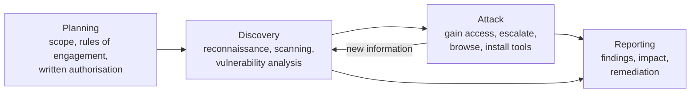

Objective **6.2** lists ten kinds of control test. The exam rarely asks you to run one; it asks
you to **pick the right one** for a goal, a constraint and a risk, and to know what each can and
cannot prove.

## Vulnerability assessment

A vulnerability assessment **identifies, quantifies and prioritises** weaknesses — usually with
automated scanners — **without exploiting them**. NIST SP 800-115 places it under *target
identification and analysis*: discovery, port and service identification, then vulnerability
scanning.

| Choice | Option A | Option B | Exam takeaway |
|---|---|---|---|
| Credentials | **Credentialed (authenticated)**: logs in, reads installed packages, registry, configs | **Uncredentialed**: sees only what an outsider sees on the network | Credentialed is more accurate (fewer false positives and negatives); uncredentialed shows the attacker's view |
| Vantage point | **Internal** (inside the perimeter) | **External** (from the internet) | Both: external is the exposure, internal is the blast radius |
| Approach | **Network-based** scanner | **Agent-based** on hosts | Agents cover laptops and ephemeral cloud hosts that miss scan windows |

Scanner output is a **list of candidates**, not facts. Know the error types:

- **False positive** — reports a vulnerability that isn't there (wastes effort, erodes trust).
- **False negative** — misses a real vulnerability (the dangerous one; gives false assurance).

SCAP standardises the vocabulary scanners use: **CVE** names vulnerabilities, **CPE** names
platforms, **CCE** names configuration settings, **CVSS** scores severity, **XCCDF** expresses
checklists and **OVAL** expresses the machine-checkable tests. CVSS (now v4.0 from FIRST) measures
**severity**, not risk: you add threat context (is it being exploited?) and environmental context
(how critical is this asset?) to prioritise.

## Penetration testing

A penetration test **validates** vulnerabilities by **exploiting** them, the way an attacker
would, to show real-world impact and attack paths that chain several "medium" findings into one
critical compromise. SP 800-115 defines four phases:

The attack phase loops back to discovery: each foothold reveals more to explore. Reporting
runs alongside the whole test, not only at the end.

**Rules of engagement (RoE)** and **written authorisation** come first — always. Without signed
permission from someone who has authority over the systems, a penetration test is an unauthorised
intrusion. The RoE records:

- scope (IP ranges, applications, sites) and explicit exclusions;
- permitted techniques (social engineering? denial of service? physical entry?);
- timing windows and blackout periods;
- emergency contacts and the **stop condition** (what happens if testers find evidence of a
  real attacker, or something breaks);
- handling of sensitive data found during the test;
- who is told in advance (overt vs covert).

| Term | Meaning |
|---|---|
| **Zero knowledge / black box** | Testers get no internal information — simulates an outsider; slower, may miss things |
| **Partial knowledge / grey box** | Some information (accounts, architecture) — common balance of realism and efficiency |
| **Full knowledge / white box / crystal box** | Full documentation and source — most thorough coverage per hour |
| **Overt (white-hat, announced)** | Staff know the test is happening |
| **Covert (unannounced, double-blind)** | Defenders don't know — tests detection and response too |
| **Red team** | Offensive team emulating an adversary toward an objective |
| **Blue team** | Defenders — monitoring, detection, response |
| **Purple team** | Red and blue working together, sharing results in real time to improve detection |
| **White team** | Referees: set rules, oversee, judge (in exercises) |

> [!WARNING]
> Penetration testing carries operational risk: exploits can crash services and corrupt data.
> Confirm backups, agree stop conditions and keep a named contact on call. If testers find signs
> that a **real** attacker is present, they stop and escalate per the RoE — the test becomes an
> incident.

## Log reviews

Logs are evidence that controls operated. SP 800-115 lists log review as a *review technique*,
and SP 800-92 sets out log management. For the exam:

- **Synchronise clocks** (NTP) so events across systems can be correlated and used as evidence.
- **Protect integrity**: send logs to a central, write-restricted store (SIEM); restrict who can
  alter or delete them; hash or sign where needed.
- **Review regularly, prioritising by risk** — no one reads every line; use correlation rules,
  thresholds and sampling, and review privileged-user activity with priority.
- **Clipping levels** — thresholds below which events are not alerted (e.g. alert on 5 failed
  logins, not 1) to keep reviews workable.
- **Separation of duties** — administrators should not be the only reviewers of their own activity.

## Synthetic transactions and benchmarks

| Monitoring | How it works | Strength |
|---|---|---|
| **Synthetic transactions** (active) | Scripted transactions run on a schedule against production — log in, search, check out — and check results and timing | Detects problems **before** users hit them, even when there is no traffic; repeatable baseline |
| **Real user monitoring (RUM)** (passive) | Observes actual user sessions | Shows true user experience, but only for paths users happen to take |

Synthetic transactions also serve as **benchmarks**: run the same scripted workload before and
after a change and compare. They are ideal for checking that an availability, integrity or
performance control still works after every release.

## Code review and testing

| Technique | When it runs | Finds | Misses |
|---|---|---|---|
| **Manual code review / peer review** | Before merge | Logic flaws, design errors, business-logic bugs | Scales poorly |
| **Static analysis (SAST)** | On source or binaries, **without executing** | Injection patterns, unsafe functions, hard-coded secrets, early in the SDLC | Runtime and configuration issues; false positives |
| **Dynamic analysis (DAST)** | Against the **running** application | Runtime behaviour, configuration, auth and session flaws | Code paths it never reaches |
| **Fuzzing** | Dynamic: feeds malformed, random or unexpected input | Crashes, memory corruption, input-handling flaws | Logic flaws |

Fuzzing comes in two forms: **mutation (dumb) fuzzing** alters known-good input; **generation
(intelligent) fuzzing** builds input from a model of the protocol or file format. The SSDF (NIST
SP 800-218) tasks PW.7 and PW.8 ask for both human-readable code review/analysis and executable
code testing; the OWASP Code Review Guide recommends combining manual review with tools, focused
on the riskiest code.

Other testing terms that appear here: **positive testing** (valid input gives expected output),
**negative testing** (invalid input is handled gracefully), **boundary value analysis** (test at
and just beyond limits), **equivalence partitioning** (one test per class of equivalent input),
**regression testing** (re-test after change to make sure nothing broke), **unit / integration /
system / user acceptance testing** (increasing scope).

## Misuse case testing

A **use case** describes how a legitimate user achieves a goal; a **misuse (abuse) case** describes
how an attacker would abuse the same function. Misuse cases turn threat modelling into test cases:

> *Use case:* customer applies a discount code at checkout. *Misuse cases:* apply the same code
> twice; apply a code meant for another region; change the price in the request; brute-force code
> values.

Automated scanners rarely find business-logic abuse like this; misuse case tests written from the
attacker's perspective do. The OWASP WSTG's business-logic tests are a good source.

## Test coverage analysis

Coverage measures **how much of the code (or requirements) the tests exercised**:

$$\text{coverage} = \frac{\text{items tested}}{\text{total items}} \times 100\%$$

The "items" define the type: **statement (line)**, **branch (decision)** — each true/false outcome,
**condition**, **function**, **loop** and **path** coverage. Branch coverage is stronger than
statement coverage; 100% statement coverage can still leave every `else` path untested. Coverage
tells you what you **did not** test; high coverage does not prove the tests checked the right
things.

## Interface testing

The 2024 outline names three interfaces: **user interface** (input validation, error handling,
what the screen reveals), **network interface** (protocols, ports, encryption, unexpected packets)
and **API** (authentication and authorisation on every call, object-level access checks, rate
limits, input validation, versioning). Interface testing also covers the **seams between
components** — what happens when one side sends malformed data, times out or is replaced. APIs are
a favourite exam scenario because they expose business functions directly, often with weaker
controls than the web UI in front of them.

## Breach and attack simulation (BAS)

BAS platforms **continuously and automatically** run safe simulations of attacker techniques —
usually mapped to **MITRE ATT&CK** — against production controls, then report which were
prevented, detected or missed. Compared with a penetration test:

| | Penetration test | Breach and attack simulation |
|---|---|---|
| Who | Skilled humans | Automated platform |
| When | Periodic (e.g. annually and after major change) | Continuous or scheduled, frequent |
| Depth | Creative, chains novel attack paths | Breadth over known techniques, repeatable |
| Best for | Discovering what an adversary could do | Proving controls still detect/prevent known TTPs after every change (control drift) |

BAS doesn't replace a penetration test; it fills the long gaps between them.

## Compliance checks

Compliance checks compare actual configuration with a defined baseline — your hardening standard,
a **CIS Benchmark**, a regulatory requirement. They are usually automated (SCAP content, cloud
posture tools, configuration management) and run continuously. They show **conformance**, which
is not the same as **security**: a fully compliant system can still be exploitable through a
flaw the baseline doesn't cover.

## Worked example: choosing the tests for a new customer API

*Scenario.* A retailer will launch a public order API in six weeks. The CISO wants assurance
that it is secure at launch and stays secure afterwards. Budget allows one external engagement.

| Need | Test | Why |
|---|---|---|
| Catch coding flaws early | SAST in the pipeline + manual review of auth code | Cheapest point to fix |
| Prove auth works on every call | API interface tests including **misuse cases** (access another customer's order by changing the ID) | Object-level authorisation flaws are business logic; scanners miss them |
| Find what an attacker could do | **Grey-box penetration test** before launch, under signed RoE | One external engagement → most coverage per day |
| Know what the tests missed | **Branch coverage** report from the test suite | Shows untested error paths |
| Stay secure | Synthetic transactions (availability, correct responses) + scheduled DAST + BAS for detection | Detects drift between annual tests |
| Configuration | Compliance checks against the hardened container and cloud baseline | Continuous, automated |

## Exam traps

> [!TIP]
> - Scan = **finds**; penetration test = **exploits to prove**.
> - **Authorisation before everything.** The first step of a pen test is never "run nmap".
> - Synthetic = **scripted and proactive**; RUM = **passive, real users**.
> - Static = **not executing**; dynamic = **running**. Fuzzing is dynamic.
> - Misuse cases come from the **attacker's** view.

## Check yourself

1. Your scanner reports a critical flaw on 40 servers, but the admins say those servers are
   patched. What change to scanning would most likely resolve the disagreement?
2. A test suite reports 100% statement coverage. Why might the security team still be worried?
3. Leadership wants to know, every week, whether the EDR still blocks credential dumping
   techniques after configuration changes. Penetration test or BAS?

Answers

1. Run **credentialed** scans. Uncredentialed scans infer versions from banners and often give
   false positives on patched systems; authenticated scans read installed patch levels.
2. Statement coverage doesn't show every branch outcome was tested; error and failure paths
   (where security bugs hide) may never have run. And coverage doesn't show the assertions were
   meaningful.
3. **BAS** — continuous, automated, repeatable simulation of known techniques mapped to ATT&CK.
   A penetration test is periodic and human-led.

## Sources

ISC2 CISSP Exam Outline (2024), objective 6.2; NIST SP 800-115 (techniques, pen test phases, RoE);
NIST SCAP and FIRST CVSS (vulnerability vocabulary and scoring); NIST SP 800-92 (log management);
OWASP WSTG and Code Review Guide, NIST SP 800-218 (code review, dynamic testing, fuzzing, business
logic); MITRE ATT&CK (BAS mapping); CIS Benchmarks (baselines); PCI DSS v4.0.1 Requirement 11.
