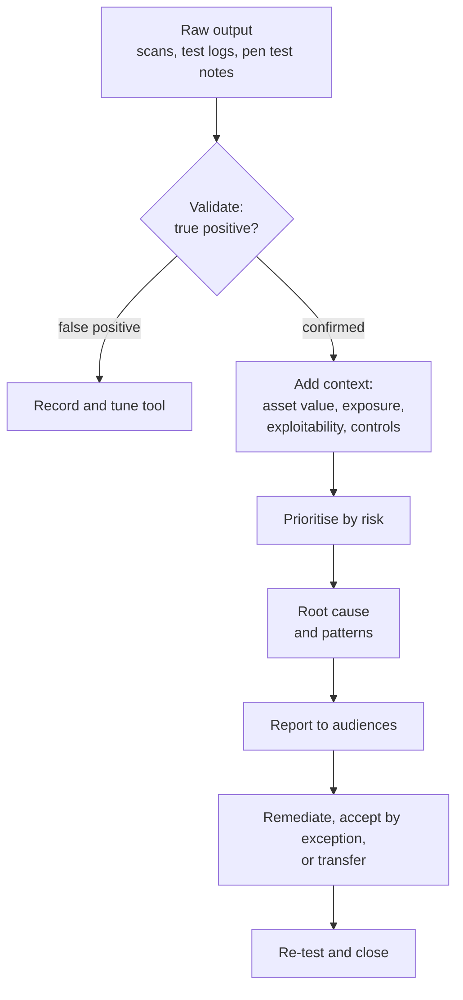

Testing is only worth what happens next. Objective **6.4** — analyse test output and generate
reports — names three activities: **remediation**, **exception handling** and **ethical
disclosure**. Behind all three sits analysis: turning raw output into decisions.

## From raw output to findings

1. **Validate.** Confirm findings, especially automated ones. False positives waste remediation
   effort and destroy credibility; mark them and tune the tool so they don't return.
2. **Contextualise.** A CVSS base score measures **severity**. FIRST is explicit that it is not a
   measure of risk: add threat (is it being exploited in the wild?), environment (is the asset
   critical, exposed, holding regulated data?) and existing controls. A CVSS 9.8 on an isolated lab
   host may matter less than a 6.5 on the internet-facing payment API.
3. **Prioritise by risk** — likelihood × impact for *this* organisation.
4. **Find root causes.** Forty servers missing the same patch is one finding about the patch
   process, not forty findings. SSDF practice RV.3 asks organisations to analyse root causes so
   whole classes of vulnerability are prevented.

## Writing the report

SP 800-115 and SP 800-53A both treat reporting as part of the assessment, not an afterthought.
A good report serves several audiences:

| Section | Audience | Contents |
|---|---|---|
| **Executive summary** | Senior management, board | Overall risk posture in business terms, top issues, decisions needed. No jargon |
| **Scope and methodology** | Everyone, auditors | What was and wasn't tested, when, how, by whom, under what limits |
| **Findings** | System owners, risk owners | Each finding: description, evidence, affected assets, risk rating, business impact |
| **Recommendations** | Owners, technical teams | Specific, feasible remediation, with options where possible |
| **Appendices** | Technical teams | Raw output, tool versions, reproduction steps |

Reports contain a map of your weaknesses: **classify and protect them** (need-to-know
distribution, encryption, retention rules).

> [!TIP]
> The assessor's job is to **report accurately and recommend**. Deciding what to fix, when, and
> what risk to accept belongs to **management / the risk owner**. When an exam option has the
> tester fixing production or accepting risk, it's usually wrong.

## Remediation

Remediation turns findings into tracked work. The federal pattern from SP 800-53A — a **plan of
action and milestones (POA&M)** — is a good model for any organisation:

- each weakness, its risk rating and its **owner**;
- the planned action, resources and **milestone dates**;
- status, and evidence of completion;
- **re-testing** (verification) before closure — a fix that hasn't been re-tested isn't closed.

SP 800-40 Rev. 4 lists the risk responses available for a vulnerability: **accept**, **mitigate**
(patch, or apply another control such as a configuration change or isolation), **transfer**
(e.g. insurance) and **avoid** (retire the vulnerable software or stop the risky activity).
Remediation timeframes should follow risk (e.g. critical internet-facing issues in days, low
internal issues in the normal maintenance cycle) and be set in policy so they aren't negotiated
case by case.

## Exception handling

Sometimes a finding cannot be fixed on time: the vendor has no patch, the fix would break a
safety-critical system, or the system is being retired in three months. An **exception** is a
formal, documented decision to operate outside policy for a defined period.

A sound exception process requires:

1. **A written request** describing the finding, the reason it can't be remediated, and the risk.
2. **Compensating controls** that reduce the risk meanwhile (segmentation, extra monitoring,
   disabling the vulnerable feature, a WAF rule).
3. **Approval by the risk owner** with the authority to accept that level of risk — not the
   requester, and not the security tester.
4. **An expiry date** and review — exceptions are time-bound, not permanent.
5. **Tracking in the risk register**, so the accepted risk remains visible to management.

> [!WARNING]
> An expired exception is an unmanaged risk. And a policy with more exceptions than compliance
> is telling management the policy (or the architecture) needs to change.

## Ethical disclosure

Testing sometimes finds vulnerabilities in **someone else's** product: a vendor's appliance, an
open-source library, a SaaS platform. Ethical disclosure balances the vendor's need for time to
fix with users' need to protect themselves.

| Model | What happens | Assessment |
|---|---|---|
| **Coordinated (responsible) disclosure** | Report privately to the vendor (or a coordinator such as CISA/CERT), allow a reasonable time to fix, then publish together | The default professional choice |
| **Full disclosure** | Publish everything immediately | Pressures vendors, but exposes users before a fix exists |
| **Non-disclosure** | Tell no one | Leaves users exposed and the flaw for attackers to find |

CISA's coordinated disclosure process works with researchers and vendors and generally follows a
**45-day** default publication window, adjusted for circumstances such as active exploitation or a
vendor who doesn't respond. ISO/IEC 29147 describes what vendors should do on their side: publish
how to report vulnerabilities, acknowledge reports, and publish advisories with remediation.
Many organisations publish a **vulnerability disclosure policy** (and a `security.txt` file) so
researchers know where to report and that good-faith research is welcome.

The ISC2 Code of Ethics gives the reasoning: the first canon is to **protect society, the common
good, necessary public trust and confidence, and the infrastructure**. Coordinated disclosure
serves that canon: users get a fix rather than an unpatched public exploit. Disclosure must also
respect your **contract and authorisation**: a finding made during a client engagement belongs to
the client's report first, and you follow the RoE and NDA about who you may tell.

## Worked example: a pen test finds three things

*Scenario.* An external grey-box test of a hospital's patient portal reports:

- **F1** — SQL injection in the portal's appointment search (exploited to read records).
- **F2** — An infusion-pump management server runs an unsupported OS; the medical-device vendor
  certifies only that OS and won't support an upgrade for nine months.
- **F3** — The portal relies on a commercial scheduling library with a previously unknown
  authentication bypass.

*Analysis and handling.*

| Finding | Risk reasoning | Handling |
|---|---|---|
| F1 | Patient data exposed via internet → critical; regulated data | **Remediate** urgently (fix the query, parameterised statements), consider incident-response review of whether the flaw was exploited before, then **re-test** |
| F2 | Can't patch without losing vendor certification and patient-safety assurance | **Exception**: isolate on a segmented VLAN, allow-list traffic, extra monitoring; approved by the clinical system's risk owner; expires when the vendor's upgrade ships; recorded in the risk register |
| F3 | Affects every customer of the library vendor | **Coordinated disclosure** to the vendor, with the hospital's agreement as the client; compensating control (WAF rule) meanwhile |

*Report.* The executive summary leads with F1 and the decisions needed: approve emergency change
for F1, approve the F2 exception, and authorise disclosure of F3.

## Check yourself

1. A scanner reports a CVSS 9.8 vulnerability on an isolated, decommissioning test server and a
   CVSS 7.5 vulnerability on the internet-facing customer login service. Which do you prioritise,
   and why?
2. Who should approve an exception that lets an unpatched legacy system remain in production?
3. During an authorised test you find a flaw in a third-party vendor's product. What should you do
   first?

Answers

1. Usually the login service: CVSS measures severity, not risk. Exposure and asset criticality
   make the 7.5 the greater risk to the business.
2. The **risk owner** (business/system owner with authority to accept that risk), with
   compensating controls, an expiry date and an entry in the risk register.
3. Report it to your client per the rules of engagement, then pursue **coordinated disclosure**
   to the vendor (directly or via a coordinator) with the client's agreement — not public
   disclosure.

## Sources

ISC2 CISSP Exam Outline (2024), objective 6.4; NIST SP 800-115 and SP 800-53A (analysis,
reporting, POA&M); FIRST CVSS (severity vs risk); NIST SP 800-40 Rev. 4 (risk responses,
remediation); NIST SP 800-218 RV.1–RV.3 (vulnerability response and root cause); CISA CVD
process and ISO/IEC 29147 (disclosure); ISC2 Code of Ethics.
