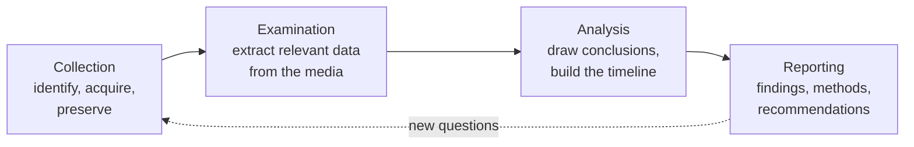

Objective **7.1** asks you to *understand and comply with investigations*: evidence collection
and handling, reporting and documentation, investigative techniques, digital forensics tools,
tactics and procedures, and artifacts (computer, network, mobile device). The *types* of
investigation (administrative, criminal, civil, regulatory, industry standards) belong to
objective 1.5; here the focus is on **doing** the investigation correctly so that whatever you
find can be used.

The CISSP mindset for this objective is simple: **an investigation is only as good as the
evidence it can defend.** A brilliant finding from a tampered disk is worthless.

## The forensic process

NIST SP 800-86 describes four phases that apply whether the case ends in a court, an HR hearing
or just a lessons-learned report.

| Phase | What happens | Typical tools and outputs |
|---|---|---|
| Collection | Identify sources, acquire data, protect integrity | Write blockers, disk imagers, memory capture, hash values, photos, custody forms |
| Examination | Extract the relevant data from large volumes | File carving, keyword search, filtering known-good files by hash |
| Analysis | Correlate, reconstruct events, answer who/what/when/how | Timelines, link analysis, log correlation |
| Reporting | Communicate what was found and how | Report with methods, tools and versions, findings, limitations |

ISO/IEC 27037 frames the same work from the first responder's side (identify, collect, acquire,
preserve) and stresses that the process must be **auditable, repeatable, reproducible and
justifiable**: another qualified examiner using the same method should reach the same result.

## Collecting evidence

### First, don't make it worse

The first responder's job is to **preserve the scene**. Typical rules from RFC 3227 and
SP 800-86:

- Do not power off a running system by reflex. Pulling the plug destroys memory (running
  processes, network connections, encryption keys, malware that never touches disk).
- Do not run tools *from* the suspect system's own binaries if you can avoid it; they may be
  trojaned. Use trusted tools from external media.
- Isolate the system from the network if the attacker could otherwise destroy evidence or
  spread, but record that you did it and when.
- Document everything: who, what, when, where, how. Photograph screens, cabling and the room.

### Order of volatility

Collect the most fleeting data first. RFC 3227 gives the order:

| Order | Source | Why it goes first |
|---|---|---|
| 1 | CPU registers, cache | Changes in nanoseconds |
| 2 | Routing table, ARP cache, process table, kernel statistics, **memory (RAM)** | Lost at power-off or within minutes |
| 3 | Temporary file systems (swap, /tmp) | Overwritten as the system runs |
| 4 | Disk | Persists, but can be altered |
| 5 | Remote logging and monitoring data | Held elsewhere, may roll over |
| 6 | Physical configuration, network topology | Slow to change |
| 7 | Archival media (backups) | Most stable |

> [!TIP]
> Memory aid: **"Registers Rarely Take Days to Leave Port Authority"**: Registers, RAM (and
> tables), Temp files, Disk, Logs (remote), Physical configuration, Archives. If a question asks
> what to capture **first** on a live system, the answer is almost always memory.

### Imaging and integrity

- Make a **bit-for-bit (forensic) image**, not a file copy. A file copy misses deleted files,
  slack space and unallocated space.
- Use a **hardware or software write blocker** so the act of reading cannot change the original.
- Compute a **cryptographic hash** (SHA-256 today; older material says MD5 or SHA-1) of the
  original and the image. Matching hashes show the copy is identical; re-hashing later shows
  nothing changed.
- **Work only on copies.** The original goes into evidence storage. Analysts examine a working
  copy of the image.

### Artifacts by source

| Source | Useful artifacts |
|---|---|
| Computer | File system metadata (MAC times: modified, accessed, changed/created), registry, browser history, prefetch, event logs, memory |
| Network | Full packet capture, NetFlow/IPFIX, firewall and proxy logs, DNS logs, DHCP leases (who had which IP when) |
| Mobile device | Call and message logs, location history, app data, cloud sync; isolate from networks (Faraday bag) to stop remote wipe |

## Chain of custody

The **chain of custody** is the documented, unbroken record of who had the evidence, when, where
and why, from collection to court (or to destruction). Each transfer is recorded. A gap lets the
other side argue the evidence was altered or substituted.

A custody record typically holds: a unique evidence ID, description (make, model, serial),
where and when it was collected and by whom, its hash, and a signed log of every hand-off and
storage location. Evidence is sealed in tamper-evident bags and kept in a locked store with
access logging.

> [!WARNING]
> A matching hash proves the *data* didn't change. It does not prove *who* had it. The exam
> will offer "we hashed it, so custody doesn't matter". It does: integrity and custody answer
> different questions.

## Admissible evidence

For evidence to be admissible it must generally be:

- **Relevant**: it tends to prove or disprove a fact in the case.
- **Material**: the fact it relates to actually matters to the case.
- **Competent** (reliable): obtained legally and handled properly.

The US Federal Rules of Evidence supply the vocabulary the CISSP borrows.

| Evidence type | Meaning | Example |
|---|---|---|
| Real (object) | A physical thing | The seized laptop |
| Documentary | Written records, including computer records | Logs, emails, contracts |
| Testimonial | A witness's statement | The admin describing what she saw |
| Demonstrative | Helps explain other evidence | A timeline chart for the jury |

| Rule | What it says |
|---|---|
| **Best evidence rule** | To prove the content of a writing, produce the original; an accurate copy (such as a verified forensic image or printout) is generally accepted as a duplicate |
| **Parol evidence rule** | When an agreement is put in writing, the written document is presumed to contain all its terms; oral side-agreements don't change it |
| **Hearsay** | Second-hand statements are normally excluded; **business records** made in the regular course of business (e.g. routine logs) are a recognized exception |

Other terms you'll meet: **direct evidence** proves a fact by itself (eyewitness), **circumstantial**
evidence implies it, **corroborative** evidence supports other evidence, and **conclusive**
evidence can't be contradicted.

> [!IMPORTANT]
> Routine system logs are admissible as business records largely *because* they are produced
> automatically and routinely. Logs created only after the incident, or edited by hand, lose that
> footing. This is one reason log integrity (lesson 2) matters.

## Investigative techniques

- **Motive, Opportunity, Means (MOM)** frames who could have done it.
- **Locard's exchange principle**: every contact leaves a trace. In digital terms, an intruder
  leaves log entries, artifacts, network flows.
- **Interviews** are done by trained people (HR, legal, or law enforcement). An *interview* gathers
  information; an *interrogation* questions a suspect and carries legal risk. Plan them, have a
  witness present, and involve legal counsel.
- **Search and seizure**: in a criminal case, law enforcement needs a warrant or valid consent.
  Employees' expectation of privacy on company systems is reduced when the **acceptable use
  policy and login banners** say systems are monitored. Exigent circumstances can allow seizure
  without a warrant when evidence is about to be destroyed.
- **Enticement versus entrapment**: a honeypot that lets an attacker who is already intent on
  attacking find an attractive target is enticement (generally acceptable); persuading someone to
  commit a crime they otherwise wouldn't is entrapment (not acceptable, and may make evidence
  unusable).

### When to call law enforcement

Bringing in police is a **business decision** made by senior management with legal counsel. It can
mean public disclosure, loss of control over the investigation's pace and seizure of systems.
Some incidents (for example, child sexual abuse material, or a mandatory reporting rule) take the
choice away.

## Reporting and documentation

A forensic report is written for its audience (technical, management, legal) but always includes:

- scope and authorization (who asked, under what authority);
- evidence list with hashes and custody references;
- methods, tools and **tool versions**, so the work can be reproduced;
- findings as facts, clearly separated from opinion;
- limitations (what couldn't be examined) and recommendations.

ISO/IEC 27002 control 5.28 (collection of evidence) expects the organization to have procedures
for this *before* an incident.

## Worked example

*A finance analyst reports that a colleague's workstation shows a remote-access tool connecting at
night. HR suspects fraud. The machine is on and logged in.*

1. **Authorize.** The security manager confirms the investigation with HR and legal; scope is the
   workstation and related logs. Because this may lead to dismissal or prosecution, treat it to
   the criminal standard from the start.
2. **Preserve the scene.** Photograph the screen. Don't browse the suspect's files.
3. **Volatile first.** From trusted external media, capture RAM, then network connections and the
   process list. Note times against a trusted clock.
4. **Decide on isolation.** Disconnect the network cable (not power) to stop remote tampering;
   record the time.
5. **Image the disk** through a write blocker; hash the original and the image with SHA-256;
   record both on the custody form; seal the original.
6. **Collect remote data** before it rolls over: proxy, firewall and VPN logs; DHCP leases mapping
   the IP to this machine.
7. **Examine and analyze** a working copy: build a timeline correlating the remote tool's sessions
   with ledger changes.
8. **Report** with methods, tool versions, hashes and findings, separating fact (the tool connected
   from address X at 02:14) from inference (the account holder was likely not present).

## Check yourself

1. You arrive at a running server suspected of hosting malware that lives only in memory. What do
   you capture first, and why not pull the power?
2. An analyst images a disk, verifies the hashes match, then leaves the original on an unlocked desk
   overnight. What has been lost, even though the hashes still match?
3. Which rule lets routine firewall logs be admitted despite the hearsay rule?

Answers

1. RAM (with process, connection and ARP tables) first, per the order of volatility. Pulling the
   power destroys memory-resident malware, keys and connection state.
2. The chain of custody. The hash shows the image matches the original, but nobody can attest who
   had access to the original overnight, so its integrity can be challenged.
3. The business records exception: logs produced automatically in the regular course of business.

## Sources

ISC2 CISSP exam outline (7.1); NIST SP 800-86 (forensic process, imaging, hashing); RFC 3227
(order of volatility, custody); ISO/IEC 27037 (handling of digital evidence); US Federal Rules of
Evidence (relevance, hearsay, best evidence); ISO/IEC 27002:2022 control 5.28.
