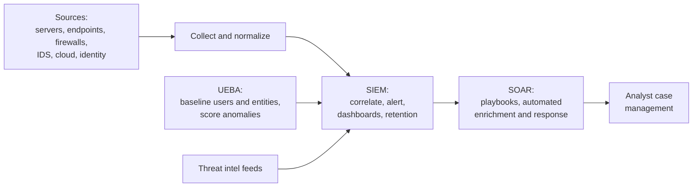

Objective **7.2**, *conduct logging and monitoring activities*, lists: intrusion detection and
prevention, SIEM, continuous monitoring and tuning, egress monitoring, log management, threat
intelligence (threat feeds, threat hunting), user and entity behavior analytics (UEBA), and
SOAR. IDS/IPS technology is taught with the other preventive and detective tools in lesson 4;
this lesson is about *the visibility pipeline* and what you do with it.

The CISSP angle: monitoring exists to support **accountability** (tying actions to identities)
and **risk decisions**. Logs that nobody reviews, or that an attacker can edit, provide neither.

## Logging, auditing and monitoring

| Term | Meaning |
|---|---|
| **Logging** | Recording events as they happen |
| **Monitoring** | Reviewing those records, continuously or periodically, to spot problems |
| **Auditing** | Methodical examination of records against a standard (often after the fact) |
| **Accountability** | Being able to tie an action to a unique identity; needs identification, authentication, logging and **integrity** of the logs |

## Log management

NIST SP 800-92 describes log management as generating, transmitting, storing, analyzing and
disposing of log data. The controls that matter on the exam:

- **Centralize.** Ship logs off the source system to a collector or SIEM. An intruder with admin
  rights on a server can wipe its local logs; they can't easily reach a hardened central store.
- **Protect integrity.** Write-once (WORM) or append-only storage, hashing or signing log batches,
  restricted access, and **separation of duties**: the administrators whose actions are logged
  must not be able to alter the logs.
- **Synchronize time.** Use NTP against trusted sources across every device. Correlation (and
  courtroom timelines) fail if clocks disagree.
- **Choose what to log.** Authentication successes and failures, privilege use, account and
  policy changes, access to sensitive data, security tool alerts, system start/stop. NIST SP 800-53
  AU-2 ("event logging") asks the organization to *decide* which events are logged and why.
- **Retain and dispose** per policy, legal and regulatory requirements. Plan capacity so logs
  don't silently roll over (AU-4 storage capacity; AU-5 alert on logging failure).
- **Review.** Clipping levels (thresholds) reduce noise: for example, alert only after five failed
  logons in ten minutes.

> [!WARNING]
> "Logs were overwritten before anyone looked" is a capacity and retention failure. "An admin
> deleted the logs that recorded his own actions" is a separation-of-duties failure. Know which
> fix the question is asking for.

## SIEM, SOAR and UEBA

| Tool | Solves | Key idea |
|---|---|---|
| **SIEM** (security information and event management) | Too many logs in too many places | Aggregates, normalizes and **correlates** events from many sources; real-time alerts; long-term retention and reporting |
| **SOAR** (security orchestration, automation and response) | Too many alerts for analysts to handle by hand | **Playbooks/runbooks** that automate enrichment and response (look up reputation, disable account, isolate host) and manage cases |
| **UEBA** (user and entity behavior analytics) | Attacks that use valid credentials and look normal to signature rules | Builds behavioral **baselines** for users and entities (hosts, service accounts) and flags deviations: impossible travel, unusual data volume, odd hours |

A SIEM *tells you something is happening*. SOAR *does something about it, consistently and fast*.
UEBA *finds the insider or compromised account* that rules miss.

## Continuous monitoring and tuning

NIST SP 800-137 defines information security continuous monitoring (ISCM) as maintaining ongoing
awareness of security, vulnerabilities and threats to support risk decisions. Its cycle is
**define → establish → implement → analyze/report → respond → review and update**.

**Tuning** is the never-ending job of adjusting detections:

| Outcome | Meaning | Cost |
|---|---|---|
| True positive | Alert, and it was an attack | Desired |
| False positive | Alert, but benign | Analyst time, alert fatigue |
| False negative | No alert, but it was an attack | Undetected breach (worst case) |
| True negative | No alert, benign | Desired |

Tuning reduces false positives without creating false negatives: whitelisting known-good
activity, adjusting thresholds, adding context (asset criticality) and retiring stale rules.

## Egress monitoring

Most monitoring faces inward. **Egress monitoring** watches what leaves:

- **Data loss prevention (DLP)** at network egress, email and endpoints, inspecting for sensitive
  patterns or labels.
- **Proxy and DNS logs** for command-and-control beaconing and DNS tunneling.
- **NetFlow** for unusual volume to unusual destinations.
- **Steganography and encryption** limit content inspection; TLS inspection at the proxy helps
  but has privacy and legal implications that policy must address.
- **Watermarking** documents so leaked copies can be traced.

## Threat intelligence

NIST SP 800-150 distinguishes types of threat information: **indicators** (IP addresses, domains,
file hashes), **TTPs** (tactics, techniques and procedures), **security alerts**, **threat
intelligence reports** and **tool configurations**.

| Level | Audience | Example |
|---|---|---|
| Strategic | Executives | "Ransomware groups are targeting our sector" |
| Operational | SOC leads | "Campaign X uses phishing with ISO attachments" |
| Tactical / technical | Analysts and tools | The hashes, domains and IPs to block |

**Threat feeds** deliver indicators to tools, often in STIX format over TAXII. Their weakness:
indicators are cheap for attackers to change. Detecting **TTPs** (behaviors) is more durable,
which is why frameworks like **MITRE ATT&CK** catalog techniques rather than IPs.

Sharing intelligence (through ISACs, for example) requires handling rules; the **Traffic Light
Protocol (TLP)** labels how widely a report may be shared.

### Threat hunting

**Threat hunting** is proactive: analysts assume a compromise has already happened and search for
it *without waiting for an alert*. A good hunt starts with a **hypothesis** ("an attacker with
stolen credentials would use remote PowerShell to move laterally; let's look for PowerShell
remoting from workstations to servers"), often derived from ATT&CK techniques or fresh
intelligence. Hunts that find something become new automated detections.

> [!TIP]
> Monitoring = waiting for alerts. Hunting = going looking. If the scenario says "the SOC has no
> alerts but believes the adversary may be present", the answer is threat hunting.

## Worked example

*A bank's SOC receives 9,000 alerts a day and handles about 600. An attacker used a contractor's
valid credentials for three weeks before discovery, downloading customer data to a personal cloud
storage site.*

- **Root problem 1, alert volume:** tune noisy rules, then add **SOAR** playbooks that
  auto-enrich and close known-benign alerts, so analysts see fewer, better alerts.
- **Root problem 2, valid credentials looked normal:** add **UEBA** to baseline the contractor's
  normal hours, systems and volumes; three weeks of off-hours bulk access would score high.
- **Root problem 3, nobody watched data leaving:** **egress monitoring** with DLP and proxy
  categories for personal cloud storage.
- **Governance:** the CISO reports to the risk committee that monitoring coverage now includes
  outbound data, a gap the previous design accepted silently.

## Check yourself

1. A domain administrator is suspected of fraud. Logs live only on the servers he administers.
   What's the BEST control to add?
2. Your SIEM correlates well but analysts can't keep up, and response steps vary by analyst. Which
   technology addresses this?
3. Why do mature programs value TTP-based detections over feeds of malicious IP addresses?

Answers

1. Forward logs to a central, write-protected store the administrator cannot modify (separation of
   duties for log management).
2. SOAR: playbooks automate enrichment and response consistently and reduce manual work.
3. Attackers change IPs, domains and hashes cheaply; behaviors (TTPs) are costly to change, so
   detections last longer.

## Sources

ISC2 CISSP outline (7.2); NIST SP 800-92 (log management); NIST SP 800-137 (continuous
monitoring); NIST SP 800-150 (threat information sharing); MITRE ATT&CK; NIST SP 800-94 (false
positives and tuning); NIST SP 800-53 AU and SI-4; ISO/IEC 27002:2022 controls 8.15 and 8.16.
