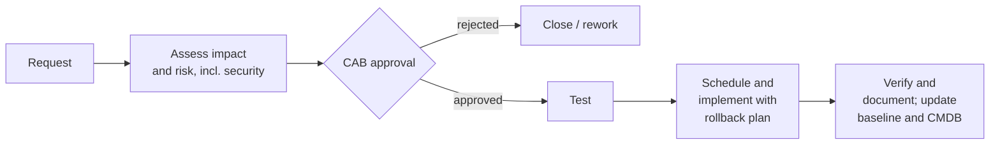

This lesson covers five objectives that together describe **how a well-run operations team
behaves every day**: **7.3** configuration management (provisioning, baselining, automation),
**7.4** foundational security operations concepts, **7.5** resource protection (media management
and protection techniques, data at rest and in transit), **7.8** patch and vulnerability
management and **7.9** change management.

## Foundational concepts (7.4)

| Concept | What it means | What it stops |
|---|---|---|
| **Need to know** | Access to *specific information* only when the job requires it, even if your clearance is high enough | A cleared employee browsing files outside their work |
| **Least privilege** | The *minimum rights and permissions* required to do the job, for the minimum time | Damage from a compromised or careless account |
| **Separation (segregation) of duties (SoD)** | Split a sensitive task so no single person can complete it alone | Fraud by one person |
| **Two-person control / dual control** | Two people must act together (both present, or two keys) | Single-person abuse of a critical action |
| **Split knowledge** | Each person holds only part of a secret (e.g. half a key) | One person learning the whole secret |
| **Job rotation** | Moving people between roles periodically | Long-running fraud; single points of knowledge; also cross-trains |
| **Mandatory vacation** | Forcing time away so others perform the duties | Fraud that needs daily concealment (it's a **detective** control) |

> [!TIP]
> Need to know governs **what information** you may see; least privilege governs **what you can
> do** (rights and permissions). They are related but tested separately. SoD *prevents* fraud
> by one person; job rotation and mandatory vacations help *detect* it. SoD and job rotation
> together still leave **collusion** possible.

### Privileged account management

Privileged accounts (domain and cloud admins, root, database admins, service accounts) are the
most valuable targets. Controls from NIST SP 800-53 (AC-2, AC-6) and ISO/IEC 27002 control 8.2:

- Separate admin accounts from everyday accounts; no email or browsing as admin.
- **Just-in-time (JIT)** elevation and time-bound access through a **PAM** tool; credentials
  vaulted and rotated; sessions recorded.
- Strong MFA on all privileged access.
- **Monitor and review** privileged activity and **recertify** privileged access regularly.
- Break-glass (emergency) accounts that are sealed, alarmed when used and reviewed afterwards.

### Service level agreements

An **SLA** is a contract (or internal agreement) defining measurable service levels: uptime,
response time, time-to-restore, support hours, and penalties or credits when missed. Related:
an **OLA** (operational level agreement) between internal teams that support the SLA, and an
**MOU/MOA** for less formal arrangements. Security teams care about SLAs because they set
availability expectations, incident notification times and the right to audit a provider.

## Configuration management (7.3)

NIST SP 800-128 defines security-focused configuration management as managing the configuration
of systems to secure them and manage risk. Its phases: **planning; identifying and implementing
configurations; controlling configuration changes; monitoring**.

- **Provisioning**: new systems are built from approved, hardened images or templates, not by hand.
- **Baselining**: a **baseline** is the documented, approved configuration at a point in time
  (NIST SP 800-53 CM-2). Industry hardening guides (CIS Benchmarks, DISA STIGs) are common
  starting points, *tailored* to the organization.
- **Automation**: infrastructure as code, configuration management tools and desired-state
  enforcement rebuild and **detect drift** from the baseline automatically.
- A **configuration management database (CMDB)** records configuration items (CIs) and their
  relationships so the impact of a change can be judged.

## Change management (7.9)

Change management ensures that changes are **requested, assessed, approved, tested, implemented,
documented and reviewed**, so the organization never loses track of what changed and why.

- The **change advisory board (CAB)** reviews and approves significant changes; security is a
  voting member.
- Every change has a **rollback (back-out) plan**.
- **Emergency changes** may be implemented first to stop harm, but are **documented and reviewed
  retroactively** through the same process. "Emergency" is not "unrecorded".
- Unauthorized changes discovered by drift detection are themselves incidents to investigate.

> [!WARNING]
> Configuration management keeps systems in a known state; change management controls moving from
> one known state to another. A question about "an admin fixed it directly on production and
> nobody knows what changed" is a change-management failure.

## Patch and vulnerability management (7.8)

**Vulnerability management** is the continuous cycle of finding, prioritizing, remediating and
verifying weaknesses. **Patch management** is one remediation method. NIST SP 800-40 Rev. 4
frames patching as **preventive maintenance**, a normal cost of running IT.

| Step | Practice |
|---|---|
| Inventory | You can't patch what you don't know you have; asset inventory comes first |
| Identify | Vendor bulletins, authenticated vulnerability scans, threat intel |
| Prioritize | **Risk-based**: severity (CVSS) *and* exploitation in the wild (CISA KEV) *and* asset criticality and exposure |
| Test | In a staging environment that resembles production |
| Deploy | Through change management, in rings or waves; emergency process for actively exploited flaws |
| Verify | Rescan to confirm remediation; report |

When a patch can't be applied (legacy systems, vendor certification, availability), use
**compensating controls**: isolate the system, restrict access, virtual patching on a WAF or IPS,
heightened monitoring, and record the **risk acceptance** by the asset owner.

> [!TIP]
> CVSS measures *severity*, not *risk to you*. A CVSS 9.8 flaw on an isolated lab box can matter
> less than a 7.5 flaw on your internet-facing VPN that the KEV catalog says is being exploited.

## Resource protection (7.5)

Media management protects information on storage media through its whole life.

- **Labeling** media with its classification; **inventory** and tracking (including tapes sent
  off-site).
- **Protection at rest**: encryption, access control, secure storage (locked, environmentally
  controlled).
- **Protection in transit**: encrypted transport, bonded couriers, tamper-evident containers,
  custody records.
- **Lifecycle**: media is handled at the level of the most sensitive data it ever held; at end of
  life it is sanitized (clearing, purging, destroying) according to classification. Media
  reuse inside the organization still requires sanitization when moving to a lower classification.

## Worked example

*A retailer's audit finds: (1) one developer can write code, approve his own merge and deploy to
production; (2) payment-server patches are applied when the admin "gets to it"; (3) backup tapes
go off-site in an employee's car.*

| Finding | Concept violated | Fix |
|---|---|---|
| 1 | Separation of duties; change management | Require peer review and a separate deploy role; CI/CD pipeline enforces approvals |
| 2 | Patch management not risk-based or governed | Documented patch SLA by severity and exposure, KEV-driven emergency process, rescans to verify |
| 3 | Media protection in transit | Encrypt the tapes; bonded courier with custody logs; locked containers |

## Check yourself

1. A senior engineer holds Top Secret clearance but is denied a Secret project folder. Which
   principle explains it?
2. An outage is fixed by an emergency firewall change at 03:00. What must happen next?
3. Why is mandatory vacation described as a detective rather than preventive control?

Answers

1. Need to know: clearance alone doesn't grant access; the job must require that information.
2. The change is documented and submitted for retroactive review and approval through the normal
   change process, and the baseline and CMDB are updated.
3. It doesn't stop the fraud from being committed; it reveals ongoing fraud when someone else
   performs the duties and finds irregularities.

## Sources

ISC2 CISSP outline (7.3, 7.4, 7.5, 7.8, 7.9); NIST SP 800-53 Rev. 5 (AC-5, AC-6, CM-2, CM-3, MP,
SI-2); ISO/IEC 27002:2022 controls 5.3, 8.2, 8.9, 8.8 and 8.32; NIST SP 800-128; NIST SP 800-40
Rev. 4; CISA KEV catalog; FIRST CVSS.
