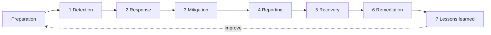

Objective **7.6** is *conduct incident management*; objective **7.7** is *operate and maintain
detective and preventive measures*. They belong together: the measures in 7.7 generate the
detections that start the process in 7.6, and lessons learned in 7.6 drive improvements to 7.7.

## Events, incidents and breaches

- An **event** is any observable occurrence (a logon, a packet, a file opened).
- An **adverse event** has a negative consequence.
- A **security incident** is an event that actually or potentially jeopardizes confidentiality,
  integrity or availability, or violates security policy.
- A **breach** usually means confirmed unauthorized disclosure of protected data, which often
  triggers legal notification duties.

Not every event is an incident. **Triage** decides.

## The ISC2 incident management steps

The 2024 outline lists seven steps. Preparation (policy, plan, team, tools, training) comes
before them all.

| Step | What happens | Notes |
|---|---|---|
| **Detection** | Alerts, user reports, monitoring; triage confirms an incident and sets severity | Speed matters: dwell time drives damage |
| **Response** | Activate the incident response team (CSIRT); begin the investigation; preserve evidence | Follow the plan; involve legal early if it may go to court |
| **Mitigation** | **Contain** the incident to limit damage: isolate hosts, disable accounts, block indicators | Containment comes before eradication |
| **Reporting** | Inform management, and as required regulators, customers, law enforcement | Reporting continues throughout; deadlines may be set by law or contract |
| **Recovery** | Restore systems to normal operation, from known-good sources, with monitoring | Verify before returning to production |
| **Remediation** | Fix the **root cause** so it can't recur: patch, reconfigure, retrain | Root cause analysis happens here |
| **Lessons learned** | Post-incident review: what happened, what worked, what to change | Feeds the plan, controls and training; blameless |

> [!TIP]
> Memory aid: **"Dogs Really Must Run Round Racing Lanes"**: Detection, Response, Mitigation,
> Reporting, Recovery, Remediation, Lessons learned.

### NIST SP 800-61 mapping

NIST SP 800-61 Rev. 2 used four phases: **preparation; detection and analysis; containment,
eradication and recovery; post-incident activity**. Rev. 3 (April 2025) retires that diagram and
aligns incident response with the NIST CSF 2.0 functions (Govern, Identify, Protect, Detect,
Respond, Recover), treating response as part of overall risk management. The ideas line up:

| ISC2 step | 800-61 Rev. 2 phase | CSF 2.0 function (Rev. 3) |
|---|---|---|
| (Preparation) | Preparation | Govern, Identify, Protect |
| Detection | Detection and analysis | Detect |
| Response, Mitigation, Reporting | Containment, eradication and recovery | Respond |
| Recovery, Remediation | Containment, eradication and recovery | Recover |
| Lessons learned | Post-incident activity | Identify (improvement) |

### Containment choices

Containment strategy depends on the incident: damage potential, need to preserve evidence,
service availability, time and resources. Options range from isolating a single host, to
blocking an IP, to taking a whole segment offline. Sometimes the team **monitors a contained
attacker** to learn scope before eradication, but only with management and legal approval.

> [!WARNING]
> In a CISSP question, if people are in danger, **life safety** comes before evidence or
> availability. Otherwise, the usual order is: contain first, then preserve evidence while
> eradicating, then recover. Restoring from backup *before* containment just gets the restored
> system reinfected.

## Detective and preventive measures (7.7)

### Firewalls

| Type | Inspects | Notes |
|---|---|---|
| Packet filter | Header fields (IP, port, protocol) per packet | Fast, stateless, easily fooled |
| Stateful inspection | Tracks connection state | Knows return traffic belongs to an allowed session |
| Application-level / proxy | Application protocol content | Breaks the connection into two; deep inspection |
| **Next-generation firewall (NGFW)** | Application identity, users, content, integrated IPS, TLS inspection | Policy by app and user, not just port |
| **Web application firewall (WAF)** | HTTP/S to a web app | Blocks injection, XSS; can "virtually patch" |
| Network vs host-based | Segment boundary vs single endpoint | Defense in depth uses both |

NIST SP 800-41 recommends **default deny**: block everything not explicitly allowed, for both
inbound *and outbound* traffic.

### IDS and IPS

| | IDS | IPS |
|---|---|---|
| Placement | Passive, often on a span port or tap | **Inline** |
| Action | Detects and alerts | Detects and **blocks** |
| Risk | Missed attack if nobody responds | A false positive blocks legitimate traffic |

Detection methods (NIST SP 800-94):

- **Signature (knowledge) based**: matches known patterns. Few false positives on known attacks;
  blind to new (zero-day) attacks; needs updates.
- **Anomaly (behavior) based**: compares to a learned baseline. Can catch novel attacks; more false
  positives; the baseline must be learned on clean traffic.
- **Stateful protocol analysis**: compares behavior to protocol specifications.

Host-based (HIDS/HIPS) sees what happens on the endpoint, including decrypted traffic;
network-based (NIDS/NIPS) sees the wire but not inside encryption.

### Allow and deny lists

The outline's "whitelisting/blacklisting" is now usually called **allow-listing/deny-listing**.

- **Deny list**: block known-bad, allow everything else. Easy, but misses anything new.
- **Allow list** (application allow-listing): only approved software runs. Very strong against
  malware, especially on fixed-function systems (kiosks, ICS), but needs maintenance.

### Sandboxing

A **sandbox** runs untrusted code (email attachments, downloads) in an isolated environment and
watches its behavior before letting it reach users. Malware may detect the sandbox and stay
dormant, so sandboxing is a layer, not a guarantee.

### Honeypots and honeynets

A **honeypot** is a decoy system with no legitimate use, so *any* interaction is suspicious; a
**honeynet** is a network of them. A **honeytoken** is decoy data (a fake credential or record).
They give early warning and attacker intelligence with very few false positives. Legal note:
**enticement** (being available) is acceptable; **entrapment** (inducing a crime) is not. A
**padded cell** is a simulated environment an IDS can move an attacker into.

### Anti-malware

Signature-based antivirus plus heuristics; modern **EDR/XDR** adds behavioral detection,
telemetry and remote response (isolate, kill process). NIST SP 800-83 adds that anti-malware
works best combined with patching, least privilege and user awareness.

### Third-party security services

Managed security service providers (MSSPs), managed detection and response (MDR), cloud
security services and outsourced SOCs extend capability. The organization **remains accountable**:
contracts and SLAs must define responsibilities, notification times, data handling and the right
to audit.

### ML and AI-based tools

Machine learning powers anomaly detection, UEBA, phishing classification and alert triage. Benefits:
scale and detection of novel patterns. Limits: needs good training data, can drift, produces
false positives, can be **poisoned or evaded** by adversaries, and may be hard to explain. Keep
humans in the loop for consequential actions.

## Worked example

*At 10:15 the EDR flags ransomware encrypting a file share from one workstation in accounting.*

1. **Detection**: the SOC triages, confirms an incident and raises it to severity 1.
2. **Response**: the incident manager activates the CSIRT, opens a case and notifies the CISO.
3. **Mitigation**: EDR isolates the workstation; the user's account is disabled; the share is set
   read-only. Memory is captured from the workstation before any reimage.
4. **Reporting**: the CISO briefs executives; legal assesses whether personal data was accessed
   (breach notification clock).
5. **Recovery**: files are restored from immutable backups after confirming the backups predate
   infection; the share returns to service with heightened monitoring.
6. **Remediation**: root cause was a macro-enabled attachment; macros from the internet are now
   blocked and the EDR rule that fired late is tuned.
7. **Lessons learned**: a blameless review a week later updates the playbook and the awareness
   program.

## Check yourself

1. A new worm uses an unknown exploit. Which IDS detection method is more likely to catch it, and
   what's the trade-off?
2. During an incident, an engineer wants to wipe and restore a server immediately. The team hasn't
   yet determined how the attacker got in. What's wrong with this?
3. Your company outsources monitoring to an MDR provider, which misses a breach. Who is accountable
   to customers and regulators?

Answers

1. Anomaly (behavior) based detection; it typically produces more false positives and needs a
   clean baseline.
2. Without containment and root-cause work (and evidence capture), the restored server can be
   re-compromised the same way, and evidence is destroyed.
3. The company. Responsibility for operation can be outsourced; accountability can't.

## Sources

ISC2 CISSP outline (7.6, 7.7); NIST SP 800-61 Rev. 3 and its Rev. 2 lifecycle; ISO/IEC 27002:2022
controls 5.24–5.27; NIST SP 800-94 (IDPS); NIST SP 800-41 Rev. 1 (firewalls); NIST SP 800-83 Rev. 1
(malware, sandboxing, allow-listing); NIST SP 800-53 Rev. 5 (IR, SI-3, SI-4).
