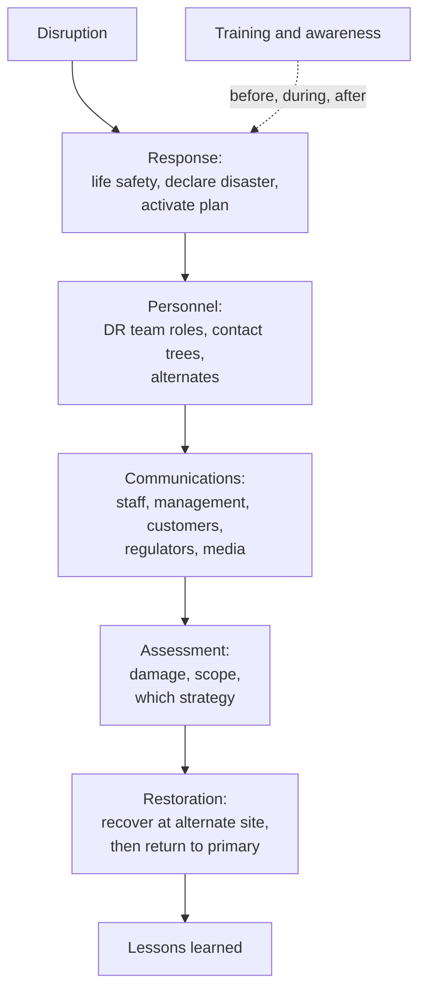

Three objectives here: **7.10** implement recovery strategies (backup storage strategies,
recovery site strategies, multiple processing sites, system resilience, high availability,
quality of service, fault tolerance); **7.11** implement disaster recovery processes (response,
personnel, communications, assessment, restoration, training and awareness, lessons learned);
**7.12** test disaster recovery plans (read-through/tabletop, walkthrough, simulation, parallel,
full interruption, and communications).

Business continuity (lesson 6) asks *how does the business keep functioning?* Disaster recovery
asks *how do we get the IT that supports it back?* DR is a subset of continuity.

## The numbers that drive every choice

These come from the business impact analysis (BIA, objective 1.7) and NIST SP 800-34.

| Term | Meaning | Drives |
|---|---|---|
| **MTD** (maximum tolerable downtime; also MTPD or MAO) | Longest the *business function* can be down before unacceptable harm | Everything below must fit inside it |
| **RTO** (recovery time objective) | Target time to restore the *system* | Site and resilience choice |
| **WRT** (work recovery time) | Time after systems are back to verify data and resume work | RTO + WRT ≤ MTD |
| **RPO** (recovery point objective) | Maximum acceptable *data loss*, measured in time | Backup and replication frequency |

> [!TIP]
> **RPO looks backwards** (how much data can we lose? → backup frequency). **RTO looks forwards**
> (how fast must we be back? → recovery site). An RPO of 15 minutes is not met by nightly backups,
> however fast the restore.

## Backup strategies

| Type | Backs up | Archive bit | Restore needs |
|---|---|---|---|
| **Full** | Everything | Cleared | The one full set (fastest restore, slowest backup) |
| **Incremental** | Changes since the **last backup of any kind** | Cleared | Last full **plus every** incremental since, in order |
| **Differential** | Changes since the **last full** | **Not** cleared | Last full **plus the latest** differential only |

Differentials grow each day but restore faster; incrementals are small but restore slower and
depend on every link in the chain.

Other techniques:

- **Snapshots** (point-in-time copies, fast but often on the same storage).
- **Replication / mirroring** (synchronous for near-zero RPO over short distances; asynchronous over
  long distances with some lag). Replication copies corruption and ransomware encryption too, so
  it doesn't replace backups.
- **Electronic vaulting** (bulk backup transfer to an offsite location) and **remote journaling**
  (shipping transaction logs frequently, giving a lower RPO).

Storage strategy: the **3-2-1 rule**: at least **3 copies**, on **2 different media types**, with
**1 offsite**. Against ransomware add an **immutable or offline (air-gapped)** copy, which NIST SP
800-209 recommends as protection against tampering. **Cloud** storage provides offsite and
geo-redundant copies but needs encryption, key management and access control. Backups must be
**tested by restoring** (NIST SP 800-53 CP-9 calls for testing backup reliability and integrity).

## Recovery site strategies

| Site | What's there | Time to operate | Cost |
|---|---|---|---|
| **Cold** | Space, power, HVAC; no equipment or data | Weeks | Lowest |
| **Warm** | Equipment and connectivity, but data must be restored | Days (often 12–72 hours) | Medium |
| **Hot** | Fully equipped, near-current data | Minutes to hours | High |
| **Mirrored / redundant** (active-active) | A second live site sharing load | Near-zero | Highest |
| **Mobile** | Trailer or containerized data center | Days | Varies |
| **Cloud** (DR as a service) | On-demand infrastructure with replicated data | Minutes to hours | Pay as you go |

Agreements:

- **Reciprocal (mutual aid) agreement**: two organizations agree to host each other. Cheap, but
  hard to enforce, may lack capacity, and both may be hit by the same regional disaster.
- **Service bureaus and resource capacity agreements**: a provider guarantees capacity (check the
  contract: oversubscription if many customers declare disaster at once).
- **Multiple processing sites**: the organization runs workloads in two or more of its own sites,
  geographically separated so one disaster doesn't hit both.

## System resilience, high availability and fault tolerance

| Concept | Meaning | Example |
|---|---|---|
| **Fault tolerance** | Keeps operating despite a component failure | Redundant power supplies, RAID |
| **High availability (HA)** | System stays available with minimal downtime | Clusters with failover, load balancers |
| **Resilience** | Ability to withstand and recover from disruption | Graceful degradation, autoscaling |
| **Quality of service (QoS)** | Prioritizing critical traffic when capacity is short | Voice traffic prioritized over bulk transfer |

### RAID

| Level | Technique | Min disks | Survives | Notes |
|---|---|---|---|---|
| **RAID 0** | Striping | 2 | **No** disk failure | Speed only, **no** redundancy |
| **RAID 1** | Mirroring | 2 | One disk | 50% capacity |
| **RAID 5** | Striping with distributed parity | 3 | One disk | Common balance of cost and protection |
| **RAID 6** | Striping with double parity | 4 | Two disks | Safer during long rebuilds |
| **RAID 10 (1+0)** | Mirrored pairs, striped | 4 | One per mirror pair | Fast and redundant |

> [!WARNING]
> RAID is **not a backup**. It protects against disk failure, not deletion, corruption or
> ransomware: those are faithfully written to every disk.

Other building blocks: redundant power (UPS for short outages, generators for long), dual network
paths and ISPs, server clustering, and load balancing.

## The DR process (7.11)

- **Response**: people first. Then a designated authority **declares the disaster**; the decision
  criteria and who can make it are written in advance.
- **Personnel**: named roles with trained **alternates**; a DR team that doesn't depend on any one
  person being available.
- **Communications**: multiple methods (call trees, mass notification, satellite phones, out-of-band
  channels) because email and VoIP may be down. A single spokesperson handles the media.
- **Assessment**: a damage assessment team determines scope and whether the event exceeds MTD, which
  decides whether to fail over.
- **Restoration**: recover critical functions first, in BIA priority order. **Return to the primary
  site** is its own project. Bring back **the least critical functions first** so that if the
  primary site has problems, critical work is still safe at the alternate.
- **Training and awareness**: everyone knows their role; plans are useless if nobody knows them.
- **Lessons learned**: update the plan.

## Testing the DR plan (7.12)

The outline lists five test types, from least to most disruptive. Naming varies between sources:
some call the first a **checklist** test and the second a **structured walkthrough** or tabletop.

| Test | What happens | Disruption | Value |
|---|---|---|---|
| **Read-through / tabletop** | Team members review the plan (individually or together), check it's current and complete | None | Catches outdated contacts and steps |
| **Walkthrough** | Team meets and talks through a scenario step by step | None | Finds gaps in logic and roles |
| **Simulation** | A realistic scenario is played out; people act as they would, to a point, without actually failing over | Low | Tests decisions and coordination |
| **Parallel** | Systems are actually brought up at the alternate site and process real data **while production keeps running** | Low to production | Proves the alternate site works |
| **Full interruption** | Production is actually shut down and the alternate takes over | **High**: may itself cause a disaster | The only full proof; needs senior management approval |

NIST SP 800-84 distinguishes discussion-based **tabletop** exercises from operations-based
**functional** exercises and calls for an **after-action report** after each.

**Communications during tests**: stakeholders are told in advance a test is happening (so a
simulated alert isn't mistaken for a real one), test status is reported as it goes, and regulators
are informed where rules require evidence of DR testing.

> [!TIP]
> Exam pattern: "the BEST test that doesn't disrupt operations but proves systems work" is a
> **parallel** test. "The most thorough test" is **full interruption**, and the right answer
> usually includes "only after the other tests succeed and with management approval".

## Worked example

*An insurer's BIA says claims processing has an MTD of 24 hours and an RPO of 1 hour. Today it
takes nightly full backups to a tape library in the same building and has no alternate site.*

- **RPO gap**: nightly backups risk up to 24 hours of data loss. Add hourly incrementals or
  asynchronous replication to a remote location, plus remote journaling for the claims database.
- **RTO**: with MTD 24 hours and roughly 4 hours of work recovery, RTO must be ~20 hours or less.
  A cold site (weeks) fails; a warm site fails if data restore takes days; a **hot site or cloud
  DR** with replicated data fits.
- **Offsite**: tapes in the same building fail the 3-2-1 rule; add an offsite immutable copy.
- **Testing**: start with read-through and walkthrough, then a simulation, then a **parallel**
  test to prove the hot site processes real claims.

## Check yourself

1. Monday full backup; incrementals Tuesday to Thursday. The server fails Friday morning. What do
   you restore?
2. Which recovery site best fits a function with an MTD of 4 hours?
3. A RAID 5 array with four disks loses two disks. What happens?

Answers

1. The Monday full, then Tuesday, Wednesday and Thursday incrementals, in order.
2. A hot site (or mirrored / active-active, or cloud DR with replicated data); warm and cold sites
   take too long.
3. The array fails and data is lost; RAID 5 tolerates only one disk failure. Restore from backup.

## Sources

ISC2 CISSP outline (7.10–7.12); NIST SP 800-34 Rev. 1 (BIA metrics, alternate sites, backup
methods, plan testing); NIST SP 800-209 (backup, immutable copies, RAID); NIST SP 800-84 (tabletop
and functional exercises); ISO/IEC 27002:2022 controls 8.13 (backup) and 8.14 (redundancy);
NIST SP 800-53 Rev. 5 CP family.
