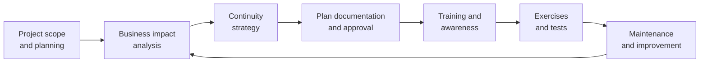

The last three Domain 7 objectives are **7.13** participate in business continuity (BC) planning
and exercises; **7.14** implement and manage physical security (perimeter and internal controls);
and **7.15** address personnel safety and security concerns (travel; security training and
awareness, including insider threat, social media impacts and two-factor authentication
fatigue; emergency management; duress).

The rule that overrides everything else in this lesson, and on the exam: **human life and safety
come first.** No data, equipment or evidence is worth a person.

## Business continuity planning and exercises (7.13)

Business continuity is set up in Domain 1 (1.7, requirements and the BIA). In Domain 7 the
security professional **participates**: contributes to plans, plays a role in exercises, and
makes sure security controls still work during disruption (an alternate site needs access
control, logging and patching too).

ISO 22301 describes a BC management system: understand the organization, perform a BIA and risk
assessment, choose continuity strategies, write plans, **exercise and test them at planned
intervals**, and improve.

| Plan | Focus |
|---|---|
| **Business continuity plan (BCP)** | Keeping critical business functions running during and after disruption |
| **Disaster recovery plan (DRP)** | Restoring IT systems and data (lesson 5) |
| **Continuity of operations plan (COOP)** | Sustaining essential functions at an alternate site for up to 30 days (US government term) |
| **Crisis communications plan** | Internal and external messaging, spokesperson, templates |
| **Occupant emergency plan (OEP)** | Protecting people in a facility: evacuation, shelter-in-place |
| **Incident response plan** | Handling security incidents (lesson 4) |

### Exercises

Exercises validate plans and train people. NIST SP 800-84 and Ready.gov group them as:

- **Discussion-based**: seminars, workshops, **tabletop exercises** where participants talk through
  a scenario led by a facilitator.
- **Operations-based**: drills (a single function, such as an evacuation or call-tree test),
  **functional exercises** (performing tasks in a simulated environment) and **full-scale
  exercises** (real deployment of people and resources).

Every exercise ends with an **after-action report** and an improvement plan. Senior management
must support the program; BC is a **business** responsibility, not an IT project.

> [!TIP]
> If a question asks why a BCP failed in a real event, look for: it wasn't tested, it wasn't
> updated after organizational change, people weren't trained, or senior management didn't own it.
> **Plan maintenance** is part of the lifecycle.

## Physical security (7.14)

Physical security follows **defense in depth** from the outside in, and the design order is
**deter → delay → detect → assess → respond**. (Site design such as CPTED and facility controls
are in Domain 3, 3.8–3.9; here the focus is operating them.)

### Perimeter controls

| Control | Purpose | Notes |
|---|---|---|
| Fencing | Deter and delay | ~1 m (3–4 ft) deters casual trespass; ~2.4 m (8 ft) with barbed wire deters determined intruders |
| Gates, bollards | Control and stop vehicles | Bollards stop vehicle ramming |
| Lighting | Deter; help guards and cameras | Continuous lighting of entrances and parking |
| CCTV | Detect, assess, record | Deters if visible; needs monitoring and retention |
| Guards | Detect, assess, respond; apply judgement | Most flexible, most expensive |
| Dogs | Detect and deter | Liability concerns |

### Internal controls

- **Access control** to zones: badges, smart cards, PINs, biometrics; more factors for more
  sensitive zones.
- **Mantraps / access control vestibules**: two interlocked doors that stop **piggybacking and
  tailgating** (someone following an authorized person through).
- **Visitor management**: sign-in, ID check, badges that look different, **escort** at all times.
- **Locks**: mechanical and electronic; key and combination control.
- **Intrusion detection**: door contacts, motion sensors, glass-break sensors, alarms tied to
  monitoring.
- **Secure areas**: server rooms with restricted access and logs; wiring closets locked; clean desk
  and clear screen policies.
- **Fail-safe vs fail-secure**: a door that **fails safe (unlocks)** on power loss protects people
  and is used on emergency exit routes; a door that **fails secure (stays locked)** protects assets.
  Where they conflict, **life safety wins**.

ISO/IEC 27002 controls 7.1–7.14 and NIST SP 800-53 PE (physical and environmental protection)
cover these.

## Personnel safety and security (7.15)

### Travel

Traveling staff face theft of devices, border inspection of devices, hostile networks and personal
safety risks. Guidance from NIST SP 800-46 (telework and remote access) and ISO/IEC 27002 control
6.7 (remote working):

- Carry **minimal data**: a clean "loaner" device for high-risk destinations, wiped on return.
- **Full-disk encryption**, strong authentication and a **VPN** on all networks; treat hotel and
  public Wi-Fi as hostile.
- Never leave devices unattended (the "evil maid" attack on hotel rooms).
- Know that some countries restrict encryption or may demand device access at borders; check
  export and local laws before travel.
- Brief travelers before departure; provide emergency contacts and check-in procedures.

### Security training and awareness

The 2024 outline names three topics:

- **Insider threat**: malicious, negligent or compromised insiders. Indicators include unexplained
  wealth, working odd hours, accessing data outside one's role, disgruntlement. Combine awareness
  (see something, say something), UEBA, least privilege and a clear reporting path.
- **Social media impacts**: oversharing (org charts, travel plans, badge photos) fuels social
  engineering and physical threats. Policy plus training.
- **Two-factor authentication fatigue** (MFA fatigue or push bombing): attackers with a stolen
  password send repeated push prompts until a tired user approves. Train users to **deny and
  report** unexpected prompts; technically, use **number matching**, rate limits, and
  phishing-resistant MFA (FIDO2/passkeys).

### Emergency management

Planning for fire, flood, severe weather, active assailants and pandemics. OSHA's emergency
action plan guidance and Ready.gov include:

- Evacuation routes and **assembly points**; **floor wardens** who sweep areas; **accounting for
  everyone** after evacuation (a visitor log is essential here).
- Shelter-in-place and lockdown procedures.
- Mass notification systems and emergency contact information.
- Drills so that procedures are reflexes.

### Duress

**Duress** is being forced to act under threat. Controls let a person comply visibly while
signalling for help:

- **Duress codes / passwords**: a word or PIN that appears to work but silently alerts security.
- **Panic buttons** and silent alarms.
- Policies that tell staff to **comply** with an armed attacker rather than resist, then report.

## Worked example

*A pharmaceutical company's lab is evacuated after a fire alarm. The badge system's doors on the
evacuation route were configured fail-secure to protect research data, and staff were trapped
briefly. Afterwards, nobody can confirm everyone left because visitors don't sign in.*

1. **Life safety**: doors on egress routes must fail **safe**; protect research data with other
   controls (encryption, locked cabinets, interior fail-secure doors on non-egress rooms).
2. **Accountability**: introduce visitor sign-in and escorts; badge data and the visitor log feed
   the warden's head count at the assembly point.
3. **Exercises**: run evacuation drills each quarter; capture issues in after-action reports.
4. **Governance**: the security manager reports to senior management that the previous
   configuration put assets ahead of people and gets approval for the redesign.

## Check yourself

1. A data center's doors lose power during a fire. They are on the only exit route. How should
   they behave?
2. A user receives 30 MFA push prompts at 2 a.m. and approves one to make them stop. Which
   awareness topic and which technical control apply?
3. A BCP exercise team talks through a flooding scenario around a table, with no systems touched.
   What kind of exercise is this?

Answers

1. Fail safe (unlock) to let people out; life safety outranks asset protection.
2. Two-factor authentication (MFA) fatigue; number matching or phishing-resistant MFA, and
   training to deny and report unexpected prompts.
3. A discussion-based tabletop exercise.

## Sources

ISC2 CISSP outline (7.13–7.15); ISO 22301:2019; NIST SP 800-34 Rev. 1; NIST SP 800-84;
Ready.gov business preparedness; ISO/IEC 27002:2022 controls 6.7, 7.1–7.14; NIST SP 800-53 Rev. 5
PE family; OSHA evacuation plans and procedures; NIST SP 800-46 Rev. 2; CISA physical security
resources.
