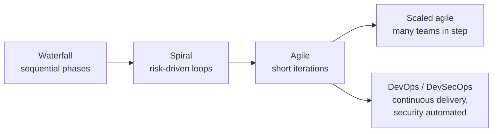
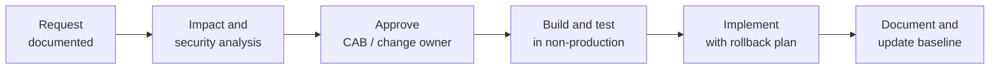

## Why this objective exists

Defects cost more the later they are found. A missing authorisation requirement caught in a
design review costs a conversation; the same flaw caught by a customer after release costs an
incident, a patch, a re-test and reputation. Objective **8.1** asks you to *integrate* security
into the software development life cycle (SDLC), not to inspect it in at the end. NIST's Secure
Software Development Framework (SSDF, SP 800-218) says the same thing in methodology-neutral terms:
its practices apply whether you run waterfall, agile or DevOps.

> [!IMPORTANT]
> The CISSP mindset for Domain 8: **security requirements are defined at the start** and
> traced through design, build, test, deployment, operation and disposal. If an answer option
> adds security "before go-live" and another adds it "when requirements are gathered", the earlier
> one is almost always better.

## The SDLC and the security activity in each phase

Names vary between sources, but every life cycle has the same shape.

| Phase | What happens | Security activity |
|---|---|---|
| Initiation / requirements | Business need, scope, feasibility | Data classification, regulatory needs, **security and privacy requirements**, abuse cases, initial risk assessment |
| Design | Architecture and detailed design | **Threat modelling** (e.g. STRIDE), attack-surface analysis, secure design principles (least privilege, defence in depth, fail secure) |
| Development | Coding and unit testing | Secure coding standards, approved libraries, peer code review, SAST in the IDE and pipeline |
| Testing / verification | Functional, integration, acceptance | DAST, IAST, fuzzing, penetration testing, verification against security requirements |
| Deployment / implementation | Release to production | Hardened configuration, secrets management, **certification and accreditation (authorisation to operate)** |
| Operation and maintenance | Running the system, fixing it | Monitoring, vulnerability management, patching, **change management**, periodic reassessment |
| Disposal | Retirement | Data retention or sanitisation, revoking credentials and certificates, decommissioning dependencies |

Two terms worth separating: **certification** is the technical evaluation of whether the system
meets its security requirements; **accreditation** (in NIST RMF language, *authorisation*) is the
management decision to accept the residual risk and allow it to operate. The authorising official
is a senior manager, not the tester.

## Development methodologies

| Method | How it works | Security strengths | Security risks |
|---|---|---|---|
| **Waterfall** | Sequential phases; each finishes before the next starts | Clear documentation and sign-off gates suit formal security reviews | Late testing; requirements changes are costly; flaws found late |
| **V-model** | Waterfall where every build phase has a matching test phase | Requirements trace directly to verification | Same rigidity as waterfall |
| **Spiral** (Boehm) | Repeated loops of plan, **risk analysis**, engineer, evaluate | Risk assessment is built into every loop | Needs risk expertise; can be costly |
| **Prototyping / RAD** | Rapid builds to explore requirements | Early user feedback | Prototypes slip into production unhardened |
| **Agile** (Scrum, Kanban) | Short iterations (sprints) delivering working software; values change over plans | Security can be a story, part of the **definition of done**, and re-checked every sprint | Security work is dropped from the backlog if no one owns it; thin documentation |
| **Scaled agile** (e.g. SAFe) | Many agile teams coordinated in release trains and program-increment planning | Security **enablers** and shared architecture runways; one compliance view across teams | Coordination gaps between teams; inconsistent practice |
| **DevOps** | Development and operations as one team; frequent automated releases via CI/CD | Fast patching; repeatable builds | Speed without controls ships vulnerabilities quickly |
| **DevSecOps** | DevOps with security as a shared responsibility and automated in the pipeline ("shift left") | SAST, SCA, secrets and IaC scanning on every commit; policy gates | Tool noise; a compromised pipeline is a supply-chain attack path |

The **Agile Manifesto** values "responding to change over following a plan". That is not an excuse
to skip security: it means security has to be expressed in the units agile teams already use:
user stories ("as an attacker I must not be able to…" abuse stories), acceptance criteria, and
a definition of done that includes "no high-severity SAST findings" and "threat model updated".

**DevSecOps** extends DevOps culture: everyone owns security, and the pipeline enforces it.
NIST SP 800-204D adds that the pipeline itself must be protected, because whoever controls the
build controls what customers run.

> [!TIP]
> **Shift left** means moving security activities earlier in the life cycle (left on a timeline).
> It does not mean removing later testing. The best answer adds early controls *and* keeps
> verification before release.

## Maturity models

A maturity model tells you how consistently and measurably an organisation does something. The
exam names three.

| Model | Type | Structure | Use it to… |
|---|---|---|---|
| **CMMI** (Capability Maturity Model Integration) | General process maturity, not security-specific | Five levels: **1 Initial** (ad hoc), **2 Managed** (repeatable per project), **3 Defined** (organisation-wide standard process), **4 Quantitatively Managed** (measured, statistically controlled), **5 Optimizing** (continuous improvement) | Rate how disciplined a development organisation is |
| **OWASP SAMM** (Software Assurance Maturity Model) | Open, **prescriptive** software security model | 5 business functions (Governance, Design, Implementation, Verification, Operations) × 3 practices each, scored at levels 1–3 | Assess where you are and build a roadmap of what to do next |
| **BSIMM** (Building Security In Maturity Model) | **Descriptive**, based on observing real firms' software security initiatives | 4 domains (Governance, Intelligence, SSDL Touchpoints, Deployment), 12 practices, many activities | Benchmark your activities against what peers actually do |

> [!TIP]
> Memory aid for CMMI: **"I Must Define Quality Optimally"** — Initial, Managed, Defined,
> Quantitatively managed, Optimizing. The jump from 2 to 3 is the move from "each project does it
> its own way" to "the organisation has one documented process".

The distinction the exam likes: **SAMM tells you what you should do** (prescriptive), **BSIMM
tells you what others are doing** (descriptive). Older study material also mentions the SW-CMM,
the software-only predecessor of CMMI, and IDEAL (Initiating, Diagnosing, Establishing, Acting,
Learning), a model for running an improvement programme.

## Operation and maintenance

Most of a system's life is spent in operation. Security tasks continue:

- **Monitoring and logging** of security-relevant events.
- **Vulnerability management**: tracking new CVEs in your code and dependencies, prioritising,
  patching. The SSDF's "Respond to Vulnerabilities" (RV) group covers identifying, assessing and
  remediating vulnerabilities and finding their root causes so the same class does not recur.
- **Periodic reassessment** after significant change, and re-authorisation where required.
- **Maintenance hooks** removed: developer back doors that bypass access control must not survive
  into production.

## Change management

Uncontrolled change is one of the commonest causes of outages and new vulnerabilities. In
software, change management and configuration management work together (NIST SP 800-53 CM-3
configuration change control and CM-4 impact analysis).

Key points:

- Every change is **requested, analysed for security impact, approved, tested, implemented and
  documented**. Skipping the approval step, even for "small" changes, is the trap.
- **Version control** keeps every change attributable and reversible; the configuration baseline
  is updated after release.
- **Emergency changes** may be approved by a smaller group and implemented first, but they are
  still documented and reviewed afterwards.
- **Separation of duties**: the developer who wrote a change should not be the one who approves
  and deploys it to production unaided. In DevSecOps that separation is enforced by protected
  branches, mandatory reviews and pipeline-only deployment.

## The integrated product team (IPT)

An **IPT** brings together people from every function needed to deliver a product: developers,
testers, operations, security, the business owner, sometimes legal, procurement and the customer.
It is the organisational answer to "security is somebody else's job". In an IPT, the security
engineer is in the room when requirements are written and when design trade-offs are made. DevOps
and DevSecOps teams are a modern form of the same idea.

## Worked example: putting security into a two-week sprint

**Situation.** A retail company's mobile team runs Scrum with two-week sprints. Last quarter a
penetration test, run once just before a major release, found an insecure direct object reference
that let one customer read another's orders. The fix delayed release by three weeks. The CISO asks
you, as security adviser, how to stop this happening without slowing the team down.

**Analysis.** The flaw was a *missing authorisation requirement*, a design-level problem, found
by a late, once-a-release test. The methodology is fine; security was outside it.

**Recommendation, in order of priority:**

1. **Requirements:** add security acceptance criteria to stories that touch customer data ("a user
   can retrieve only orders whose owner matches their session identity"). Write abuse stories.
2. **Definition of done:** a story is not done until its threat model delta is reviewed, unit
   tests cover the authorisation rule, and the pipeline's SAST and SCA show no new high findings.
3. **People:** nominate a **security champion** in the team and include the security engineer in
   sprint planning (an IPT in miniature).
4. **Pipeline:** automate SAST, SCA and secrets scanning on every pull request; run DAST against
   the staging build nightly.
5. **Keep the penetration test**, but now as confirmation, not discovery.
6. **Measure:** track findings per sprint and mean time to remediate; review with SAMM's
   Verification function to show maturity improving.

Notice the order: requirements and process first, tools second, and the late test kept as
assurance. That is the order the exam rewards.

> [!WARNING]
> A common distractor is "move to waterfall so there is a formal security gate". Changing the
> methodology does not fix missing requirements; integrating security into the existing method does.

## Check yourself

1. A development organisation has a documented, organisation-wide standard process that every
   project tailors, but does not yet measure it statistically. Which CMMI level is it at?
2. Your board wants to know how your software security activities compare with those of similar
   companies. Which maturity model fits best, and why?
3. A developer pushes an urgent fix straight to production at 2 a.m. to stop an outage. What must
   still happen under change management?

Answers

1. **Level 3, Defined.** Level 2 is managed per project; level 4 adds quantitative measurement.
2. **BSIMM**, because it is descriptive: it is built from observing what real organisations do,
   so it supports peer benchmarking. SAMM is better for building your own roadmap.
3. It is handled as an **emergency change**: documented, reviewed and approved retroactively by
   the change authority, tested, and the baseline updated. Emergency does not mean undocumented.

## Sources

ISC2 CISSP exam outline (objective 8.1); NIST SP 800-218 (SSDF) and SP 800-160 Vol. 1 Rev. 1 for
life-cycle security; Microsoft SDL for per-phase security activities; the Agile Manifesto and SAFe
for methodologies; CMMI Institute and SEI for CMMI levels; OWASP SAMM and BSIMM for software
security maturity; NIST SP 800-53 Rev. 5 (CM-3, CM-4, SA-3) for change control; NIST SP 800-204D
for DevSecOps pipelines.
