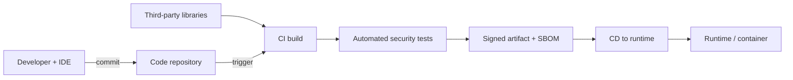

## The ecosystem is part of the attack surface

Objective **8.2** widens the view from "the code" to everything that produces it: the language,
the third-party libraries, the developer's IDE and plug-ins, the runtime, the repository, the
build pipeline and the testing tools. Attackers have learned that compromising a build server or
a popular package reaches thousands of victims at once. NIST's SSDF practice group **PS (Protect
the Software)** exists for this reason: protect all forms of code from unauthorised access and
tampering, and give consumers a way to verify the integrity of what you release.

Every arrow is a trust boundary. Every box needs access control, integrity protection and logging.

## Programming languages

| Property | Security implication |
|---|---|
| **Memory-safe vs memory-unsafe** | C and C++ let code write outside buffers (overflows, use-after-free). Rust, Go, Java, C#, Python manage memory and remove most of that defect class. CISA's Secure by Design guidance urges memory-safe languages for new code. |
| **Compiled vs interpreted** | Compiled code is harder (not impossible) to read; interpreted code ships source or bytecode. Neither is "secure" by itself. Obfuscation is not a security control. |
| **Strong vs weak typing** | Strong, static typing catches some errors at compile time (e.g. treating untrusted strings as numbers). |
| **Language generations** | 1GL machine code, 2GL assembly, 3GL (C, Java), 4GL (SQL, report generators), 5GL (logic/constraint languages). Higher generations hide more of the machine. |

Object-oriented concepts also appear on the exam: **encapsulation** (data hiding behind methods),
**inheritance**, **polymorphism**, and the design goals of **high cohesion** (a module does one
thing) and **low coupling** (modules depend little on each other), which make code easier to
review and change safely.

## Libraries and dependencies

Modern applications are mostly other people's code. Controls:

- An **approved component list** and a private mirror or proxy repository so builds pull vetted
  versions, not whatever the public registry serves today.
- **Pin versions** and use lock files; verify checksums or signatures.
- **Software composition analysis (SCA)** to find known-vulnerable components and licence
  problems; an **SBOM** for each release (lesson 3).
- Watch for **dependency confusion** (a public package with the same name as an internal one) and
  **typosquatting** (names one character off).

## Tool sets and IDEs

The developer's workstation and IDE hold source code, credentials and signing keys.

- Approve IDE **plug-ins and extensions**; they run with the developer's rights.
- Use IDE-integrated **SAST and secrets linting** so problems are found as code is typed (the
  furthest left you can go).
- Keep **secrets out of source**: use a secrets manager and pre-commit secret scanning.
- Approved **compilers and build tools**, with security flags enabled (stack protection, ASLR/DEP
  support). Microsoft's SDL calls this "use approved tools".

## Runtimes

The runtime is where code executes: a JVM or .NET CLR, a browser JavaScript engine, a container,
a serverless function.

- **Sandboxing** limits what code can do (the Java sandbox, browser same-origin policy, container
  isolation with seccomp and dropped capabilities).
- **Least privilege**: the process runs as a non-root user with only the permissions it needs.
- **Runtime application self-protection (RASP)** instruments the application to detect and block
  attacks from inside, e.g. stopping a query whose structure was changed by input.
- Keep runtimes patched; an unsupported runtime is a vulnerability in every app on it.

## Code repositories and software configuration management

**Software configuration management (SCM)** identifies, controls and audits every version of every
configuration item: source, build scripts, infrastructure-as-code, documentation. A repository
needs:

| Control | Why |
|---|---|
| Strong authentication (MFA) and least-privilege access | Stops stolen developer credentials becoming a supply-chain attack |
| **Protected branches** and required peer review before merge | Separation of duties; no single person can put code into the release branch |
| **Signed commits** and tags | Attributes changes to a verified identity |
| Secret scanning and push protection | Stops credentials being committed |
| Audit logging of pushes, permission and setting changes | Supports investigations and objective 8.3's auditing of changes |
| Backups and integrity checks | Recover from deletion or tampering |

> [!WARNING]
> **Public repositories leak.** A frequent scenario: an API key appears in a public commit.
> Deleting the commit is not enough; the key must be **revoked and rotated** first, because it must
> be assumed already harvested.

## CI/CD pipelines

**Continuous integration** builds and tests every change; **continuous delivery/deployment**
releases it automatically. NIST SP 800-204D treats the pipeline as critical infrastructure.

- **Harden the build platform**: ephemeral, isolated build runners; no developer can alter a
  build in progress.
- **Pipeline credentials** are scoped per job and short-lived; deploy keys are not shared.
- **Pipeline as code** in the repository, so pipeline changes go through review too.
- **Security gates**: the build fails on high-severity findings, missing tests or policy
  violations.
- **Sign artifacts** and generate **provenance** (who built what, from which source, on which
  builder). SLSA's build levels describe increasing assurance: provenance exists (L1), provenance
  generated by a hosted build platform and signed (L2), a hardened build platform (L3).
- **Promote** the same tested artifact through environments rather than rebuilding it.

## Application security testing

This table is heavily tested. Learn the *box colour* and *when* each runs.

| Technique | What it looks at | Box | When in SDLC | Strengths | Limits |
|---|---|---|---|---|---|
| **Manual code review** | Source code by people | White | Development | Finds logic and design flaws | Slow, depends on reviewer skill |
| **SAST** (static) | Source, bytecode or binaries **without running** them | White | Earliest: IDE, commit, build | Precise file/line; finds injection, unsafe functions | False positives; no runtime/config context |
| **DAST** (dynamic) | The **running** application from outside, via HTTP | Black | Test/staging, production scans | Finds runtime and configuration issues; language-independent | No line of code; coverage depends on crawl; later in cycle |
| **IAST** (interactive) | An **agent inside the running app** watching data flow while tests exercise it | Grey | QA/integration testing | Low false positives; points to the code line | Needs instrumentation and good test coverage; language-specific |
| **SCA** (software composition analysis) | **Third-party components** against vulnerability and licence databases | — | Build and continuously after release | Finds known CVEs and licence conflicts; feeds SBOM | Only known issues; does not test your own code |
| **Fuzzing** | Malformed, random or mutated input to find crashes | Black/grey | Testing | Finds memory corruption and input-handling bugs | Needs crash triage; coverage varies |
| **RASP** | Protects in production from inside the runtime | — | Operations | Blocks exploitation in real time | A compensating control, not a fix |
| **Penetration test** | Skilled humans attacking the deployed system | Usually black/grey | Before release, periodically | Chains flaws; tests business logic | Point-in-time; costly |

> [!TIP]
> Quick separators: **S**tatic = **S**ource, not running. **D**ynamic = running, from outside.
> **I**nteractive = **I**nside the running app. **SCA** = **C**omponents you did not write.
> If the scenario says "no access to source code", SAST and IAST are out.

Other testing terms you may meet: **regression testing** (old features still work after a change),
**unit testing**, **integration testing**, **user acceptance testing**, **misuse/abuse-case
testing**, and **synthetic transactions** (scripted user activity used for monitoring).

## Worked example: designing the security gates for a pipeline

**Situation.** A fintech company builds a Java payments API with GitHub-style hosted
repositories and a CI/CD pipeline that deploys containers to Kubernetes. The team ships several
times a day. The security manager has budget for automation but wants findings early and wants
proof, for auditors, that what runs in production is what was reviewed.

**Design, by stage:**

| Stage | Control | Fails the build when… |
|---|---|---|
| Developer IDE | SAST plug-in, secrets linting | (advisory only) |
| Pull request | Required review by a second developer; SAST; SCA; secret scanning; IaC scan of Kubernetes manifests | New high/critical finding, secret detected, disallowed licence |
| Build | Ephemeral runner; dependency pull from internal proxy only; container image scan; SBOM generated; artifact signed with provenance | Image has critical CVE with fix available; signing fails |
| Staging | Deploy the signed artifact; IAST agent during automated tests; DAST scan | IAST/DAST high finding |
| Production | Admission control accepts only signed images with valid provenance; RASP; runtime logging | Unsigned image rejected |

**Why this answers the requirements.** Findings arrive at the earliest point (IDE and pull
request). The auditor's question, "is production running reviewed code?", is answered by the chain
protected branch → hosted build → signed artifact with provenance → admission control that
verifies the signature. That chain is what NIST SP 800-204D and SLSA describe.

**What it does not do.** Tools do not find design flaws such as missing business-logic checks.
Threat modelling and periodic penetration testing remain.

## Check yourself

1. A team must test a vendor web application for which it has no source code. Which technique
   from the table can it use, and which two are ruled out?
2. A development lead wants the earliest possible detection of SQL-injection patterns. Which tool,
   and where should it run?
3. Why does signing an artifact in the pipeline not, by itself, prove the code is safe?

Answers

1. **DAST** (and penetration testing or fuzzing). **SAST** needs source or binaries for analysis
   and **IAST** needs an agent inside the application, so both are ruled out without vendor
   co-operation.
2. **SAST**, run in the **IDE and on every pull request**, because it analyses code before it
   runs.
3. A signature proves **integrity and origin** (the artifact is what the pipeline built and has
   not been changed), not **quality**. A signed artifact can still contain a vulnerability; the
   tests and reviews are what reduce that risk.

## Sources

ISC2 CISSP exam outline (objective 8.2); NIST SP 800-218 (PS and PW practices); NIST SP 800-204D
and SLSA v1.0 for pipeline and build integrity; OWASP DevSecOps Guideline and the OWASP Web
Security Testing Guide for testing types; Microsoft SDL for approved tools and analysis; NIST SP
800-53 Rev. 5 (SA-11, SA-15) for developer testing and tools; CISA Secure by Design for
memory-safe languages.
