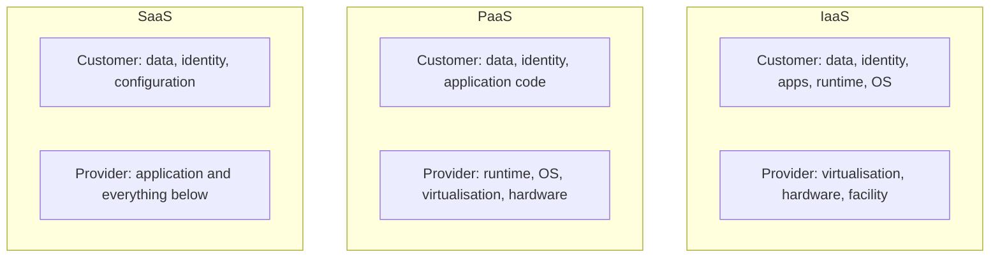

## Part 1 — Is our software security working? (8.3)

Objective **8.3** asks how you *know* your software security controls are effective. The outline
names two activities: **auditing and logging of changes**, and **risk analysis and mitigation**.
Around them sit measurement and independent verification.

### Auditing and logging of changes

Every change to code, configuration, pipeline and production must leave a trustworthy record:

- **Who** made the change (an individual identity, not a shared account), **what** changed,
  **when**, **why** (linked change request or ticket), and **who approved** it.
- Repository history, pull-request approvals, pipeline run logs and deployment records together
  form the audit trail. NIST SP 800-53's AU family and CM-3 require that configuration changes be
  recorded and that records are retained and protected.
- **Logs must be protected from the people whose actions they record**: developers should not be
  able to edit or delete deployment logs. Send them to a central, append-only store.
- Audit periodically: compare what is in production with what was approved. An unexplained
  difference ("configuration drift") is either an unapproved change or an attack.

> [!TIP]
> On the exam, logging answers **accountability** questions. If a scenario asks how to prove which
> developer introduced a back door, the answer involves individual authentication plus a protected
> audit trail, not "ask the team".

### Risk analysis and mitigation

Software security findings are risks, and risks are managed by the business, not only by the
development team.

1. **Identify** the weakness (test result, scan, bug report, threat model).
2. **Analyse**: likelihood (exposure, exploit availability, attacker skill) and impact (data
   classification, affected users). Scoring such as CVSS helps but is not the whole picture: a
   CVSS 9.8 in an unreachable internal component may matter less than a 6.5 on an internet-facing
   payment flow.
3. **Treat**: mitigate (fix, compensating control such as a WAF rule), transfer, avoid (remove
   the feature), or accept (formally, by the risk owner, with an expiry date).
4. **Track** to closure and verify the fix with a re-test.

The SSDF's **RV.2** and **RV.3** practices add **root-cause analysis**: if three SQL-injection
findings arrive in one quarter, the mitigation is not three patches but a coding standard, a
parameterised data-access layer and a SAST rule.

### Measuring effectiveness

| Measure | What it tells you |
|---|---|
| Vulnerabilities found per phase | Whether you are finding problems early (shift left working) |
| Mean time to remediate, by severity | Whether fixes keep up with discovery |
| Escaped defects (found in production) | How much testing misses |
| Recurrence of the same weakness class | Whether root causes are being fixed |
| Coverage: % of apps with threat models, SAST, SCA | How consistent the programme is |
| SAMM or BSIMM score over time | Programme maturity trend |

Effectiveness is also assessed against a **standard**: OWASP **ASVS** gives verifiable
requirements in three levels (L1 baseline, L2 for most applications, L3 for high-value or
safety-critical ones), and **ISO/IEC 27034** describes an organisation-wide application security
framework. **Acceptance testing** confirms the software meets its security requirements before the
authorising official accepts the residual risk.

## Part 2 — Software you did not write (8.4)

Most software an organisation runs was written by someone else. Objective **8.4** lists four
sources. The common principle: **you can outsource the work but not the accountability.** The
acquiring organisation still owns the risk to its data.

| Source | Typical risks | Key controls |
|---|---|---|
| **COTS** (commercial off-the-shelf) | No source access; vendor's secure-development quality unknown; end of support; insecure defaults | Vendor security questionnaires and attestations (e.g. SSDF self-attestation), independent certifications (Common Criteria for products), SBOM, contract clauses for patch timelines and vulnerability disclosure, **source code escrow** if the vendor fails, harden defaults, test before deployment |
| **Open source** | Anyone can contribute, including attackers; abandoned projects; licence obligations; no contractual support | SCA, approved-component list, check project health (maintainers, release cadence, response to CVEs), pin and verify versions, licence review, internal mirror, plan to patch or fork |
| **Third-party** (custom development, contractors, outsourced code) | Back doors, poor practices, IP and data handling | Contractual security requirements, **right to audit**, code review on delivery, background checks, defined acceptance tests, escrow |
| **Managed services** (SaaS, PaaS, IaaS) | No control over code; shared infrastructure; provider breach; data location | Due diligence (SOC 2 Type II, ISO/IEC 27001, CSA STAR), **shared responsibility** mapping, SLAs, data-processing terms, exit plan, configure your side (identity, logging, encryption) |

### The shared-responsibility model

In every model the customer keeps **data, identity and access, and its own configuration**. A
SaaS breach caused by a customer leaving an admin account without MFA is the customer's failure.
The Cloud Security Alliance Cloud Controls Matrix maps which party owns each control.

### Software supply-chain attacks

Three cases worth knowing as illustrations:

- **SolarWinds (2020)**: attackers compromised the vendor's build system and inserted a back door
  into signed updates of the Orion product. A valid signature did not mean safe code: the build was
  the target.
- **Log4Shell (CVE-2021-44228, December 2021)**: a critical remote code execution flaw in the
  ubiquitous open-source Log4j library. Many organisations spent weeks finding out *whether* they
  used it.
- **xz Utils (CVE-2024-3094, 2024)**: a maintainer identity built up trust over years and then
  slipped a back door into release tarballs of a compression library. An open-source governance
  and maintainer-trust problem.

NIST SP 800-161 Rev. 1 (cybersecurity supply chain risk management, C-SCRM) frames the response:
assess suppliers before purchase, write security into contracts, require provenance and SBOMs,
monitor suppliers continuously, and plan for supplier compromise.

### SBOM: the ingredients list

A **software bill of materials (SBOM)** is a formal, machine-readable inventory of the components
in a piece of software and their relationships. The NTIA **minimum elements** (2021) are:

| Data field | Example |
|---|---|
| Supplier name | Apache Software Foundation |
| Component name | log4j-core |
| Version | 2.14.1 |
| Other unique identifiers | package URL (purl), CPE |
| Dependency relationship | log4j-core is included in reporting-service |
| Author of SBOM data | Our build pipeline |
| Timestamp | 2026-10-30T09:12Z |

Formats: **SPDX** (Linux Foundation; ISO/IEC 5962:2021) and **CycloneDX** (OWASP). An SBOM lists
what is present; a **VEX** (Vulnerability Exploitability eXchange) statement says whether a known
vulnerability in a listed component actually affects the product (for example, "not affected:
vulnerable code not present"). SBOM plus VEX turns "are we exposed?" from weeks into minutes.

> [!WARNING]
> An SBOM is an **inventory, not an assurance**. It does not say the components are safe. It lets
> you find vulnerable ones quickly when a new CVE is published. Pair it with SCA and provenance.

## Worked example: a new critical CVE, with and without SBOMs

**Situation.** A hospital group runs 40 applications: 25 COTS products, 10 SaaS services and 5
in-house apps. A new critical remote-code-execution CVE is published in a widely used open-source
JSON parsing library. The CIO asks: "Are we exposed, and what do we do?"

**Without SBOMs.** Staff email 35 vendors, grep servers for file names, and wait. Some vendors
answer in days, some never. Exposure persists while the inventory is being built.

**With SBOMs and a supplier programme:**

1. **Query** the SBOM repository for the component name and affected versions: 4 in-house apps
   and 6 COTS products contain it.
2. **Check VEX** statements: 3 of the COTS vendors have already published "not affected" (the
   vulnerable function is not called). 3 remain.
3. **Prioritise by risk**: of the 7 remaining, which are internet-facing and process patient
   data? Those come first.
4. **Mitigate**: patch in-house apps through the normal pipeline (emergency change, documented);
   apply compensating controls (WAF rule, network isolation) for the COTS products until vendor
   patches arrive; invoke contractual patch timelines.
5. **SaaS**: shared responsibility means the provider patches the service; the hospital asks for
   confirmation under its contract and checks its own integrations.
6. **Lessons learned**: require SBOM and VEX in all new contracts; add the SCA rule to the
   pipeline; review whether two of the slow vendors meet the hospital's risk appetite at renewal.

The key judgement: the *contract and inventory* work done before the incident is what made the
response fast. That is due care in acquisition.

## Check yourself

1. A department wants to buy a SaaS HR system. Before signing, what should security obtain to
   assess the provider, given that the provider will not allow a penetration test?
2. What is the difference between an SBOM and a VEX document?
3. A vendor of a critical COTS application is financially unstable. Which contractual control
   protects the organisation's ability to maintain the software if the vendor fails?

Answers

1. Independent assurance: a **SOC 2 Type II** report and/or ISO/IEC 27001 certificate (or CSA
   STAR), the shared-responsibility matrix, data-processing and breach-notification terms, and the
   right to audit or an equivalent. Then configure the customer's side securely.
2. An **SBOM** lists components and versions; a **VEX** says whether a specific known
   vulnerability in one of those components is exploitable in this product.
3. **Source code escrow**: a trusted third party holds the source and releases it to the customer
   on defined triggers such as bankruptcy or end of support.

## Sources

ISC2 CISSP exam outline (objectives 8.3 and 8.4); NIST SP 800-218 (RV practices, PW.4 reuse of
components); NIST SP 800-53 Rev. 5 (AU, CM-3, SA-4, SR families); OWASP SAMM and ASVS and ISO/IEC
27034 for measuring and verifying application security; NIST SP 800-161 Rev. 1 for C-SCRM; NTIA
minimum elements and CISA's SBOM resources; SPDX and CycloneDX for formats; CISA Secure by Design
for vendor expectations; the CSA Cloud Controls Matrix for shared responsibility; SLSA for
provenance.
