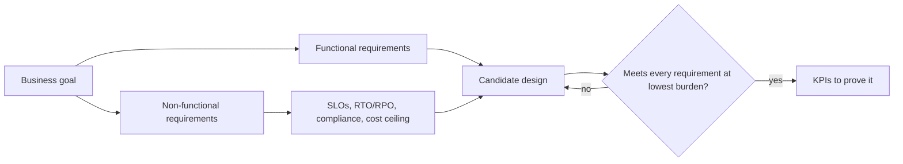

## Why this objective matters

Objective 1.1 is where the exam tests whether you think like an architect or like an engineer.
Engineers start with a product they like. Architects start with **what the business is trying to
achieve**, then pick the simplest set of services that meets every stated requirement. Almost every
case-study question (Altostrat Media, Cymbal Retail, EHR Healthcare, KnightMotives Automotive) is
built this way: a paragraph of business context, one or two hard constraints, and four answers that
are all technically possible. The right one is the answer that meets *all* the constraints at the
lowest operational burden.

The current guide lists twelve considerations for 1.1. They group naturally into five questions you
ask of every scenario:

| Question | Guide considerations |
|---|---|
| What is the business trying to do? | Business use cases and product strategy; supporting the application design |
| What must the system do, and how well? | Functional and non-functional requirements; design decision trade-offs |
| What will it cost, and how is success measured? | Cost optimization; success measurements (KPI, ROI, metrics) |
| What happens to the existing estate? | Workload disposition (build, buy, modify, deprecate); integration with external systems; movement of data |
| What must never go wrong? | Business continuity plan; security and compliance; observability |

## Use cases, product strategy and requirements

**Functional requirements** say what the system does: "dealers can configure a vehicle and place a
build-to-order request", "the chatbot answers listener questions about episodes". **Non-functional
requirements** say how well it must do it: availability, latency, throughput, durability, security,
compliance, cost ceilings, data residency, time to market.

The exam hides non-functional requirements in business language. Learn to translate:

| Business phrase | Non-functional requirement it implies |
|---|---|
| "Customers complain the site is slow in Asia" | Latency target per region; global load balancing, CDN, or a multi-region data layer |
| "We cannot afford outages during the holiday peak" | Availability SLO, autoscaling, quota headroom, load testing |
| "Our lease on the data centre ends in 18 months" | A hard migration deadline; favour rehost for most workloads first |
| "Must comply with healthcare regulations" | Data protection, audit logging, access control, region choice, a BAA where relevant |
| "Reduce the cost of running our call centre" | An automation or AI use case with a measurable cost KPI |
| "Engineers spend most of their time on infrastructure" | Prefer managed and serverless services to reduce toil |

> [!TIP]
> When a scenario says the team is small, inexperienced with Kubernetes, or wants to "focus on
> features", that is a non-functional requirement: **minimise operational overhead**. It usually
> rules out self-managed VMs and tips the answer toward Cloud Run, GKE Autopilot or a managed database.

**Product strategy** shapes the design horizon. A start-up proving a market needs speed and low fixed
cost (serverless, pay-per-use). A regulated incumbent replacing a data centre needs predictability
and control (committed capacity, landing zone, strong governance). The same workload can have
different right answers for each.

## Design decision trade-offs

Every design trades the Well-Architected Framework pillars against each other: operational
excellence; security, privacy and compliance; reliability; cost optimization; performance
optimization; and sustainability. Common trades the exam probes:

- **Reliability vs cost.** A multi-region active-active deployment survives a regional outage but
  roughly doubles the footprint. Only pay for it when the RTO/RPO or SLO demands it.
- **Performance vs cost.** SSD persistent disks, memory-optimised machines or Spanner multi-region
  buy latency and scale at a price.
- **Control vs operational burden.** Compute Engine gives full OS control; Cloud Run gives almost
  none and needs almost no operations.
- **Speed vs optimisation.** Rehosting a VM is fast; refactoring it to containers costs time now and
  saves cost later.

State the trade-off explicitly in a design document. The exam rewards answers that meet the
requirement **without over-engineering**: if the stated need is 99.9% availability in one region,
a multi-region Spanner design is wrong even though it is "more available".

## Cost optimization, CapEx and OpEx

On premises, infrastructure is **capital expenditure (CapEx)**: you buy servers up front, depreciate
them over years and must size for peak. In the cloud, most spend is **operating expenditure
(OpEx)**: you pay for what you use each month. The business consequences are what the exam cares
about:

| | CapEx (on-prem) | OpEx (cloud) |
|---|---|---|
| Cash flow | Large up-front purchase | Monthly, proportional to use |
| Capacity | Sized for peak, idle off-peak | Elastic, scale with demand |
| Risk | Over-buy or under-buy | Bill can grow without governance |
| Refresh | Hardware cycle every 3–5 years | Provider refreshes hardware |

The cloud does not automatically save money. The cost optimization pillar emphasises a culture of
cost awareness, attributing cost to teams (labels, billing export to BigQuery, budgets and alerts),
and continuous optimisation. The levers you must know:

| Lever | What it does | Use when |
|---|---|---|
| **Committed use discounts (CUDs)** | Commit to resources (resource-based) or to an hourly spend (spend-based, flexible) for 1 or 3 years in exchange for a discount | A steady, predictable baseline load |
| **Sustained use discounts** | Automatic discount for eligible machine families that run much of the month | Always-on VMs on eligible families; no action needed |
| **Spot VMs** | Spare capacity at a deep discount; can be preempted at any time; no SLA | Fault-tolerant, restartable batch, rendering, CI, simulation |
| **Rightsizing / recommenders** | Shrink over-provisioned machines; delete idle resources | Utilisation is consistently low |
| **Autoscaling and scale-to-zero** | Pay only for what demand needs | Spiky or unpredictable traffic |
| **Storage classes and lifecycle** | Move cold data to Nearline, Coldline, Archive | Data accessed rarely |
| **Managed services** | Reduce the labour (toil) part of TCO | Small ops teams |

> [!WARNING]
> Spot VMs are never right for a stateful database or a workload that must not be interrupted, no
> matter how attractive the discount. And CUDs are wrong for workloads that are about to be
> decommissioned or whose size is unknown: you pay the commitment whether you use it or not.

**Worked example: choosing a cost lever.** A media company runs a transcoding farm. A baseline of
40 vCPUs is busy all day; nightly back-catalogue re-encoding adds 400 vCPUs for six hours and can be
retried if interrupted. The business wants the lowest cost without missing the morning publishing
deadline.

1. The 40-vCPU baseline is steady → a **3-year CUD** (or 1-year if the roadmap is uncertain).
2. The nightly burst is fault-tolerant and restartable → **Spot VMs** in a managed instance group,
   with checkpointing so preempted jobs resume.
3. The deadline is a hard requirement → add a fallback: if Spot capacity is scarce, the instance
   group can fall back to standard VMs for the remainder.
4. Track it: label the resources `team=media-ops`, export billing to BigQuery and set a budget alert.

The answer combines levers; the exam often offers each lever alone as distractors.

## Workload disposition: build, buy, modify or deprecate

Not everything should move as-is. For each workload decide its disposition:

| Disposition | Meaning | Signals in a scenario |
|---|---|---|
| **Build** | Write something new, cloud native | Differentiating capability; no product fits; long life expected |
| **Buy** | Adopt SaaS or a managed product | Commodity function (email, CRM, ticketing); "focus on core business" |
| **Modify** | Change it while moving (replatform, refactor) | Workload is valuable but has scaling, cost or licence pain |
| **Deprecate** | Retire it | Duplicate function, no users, or replaced by a purchased service |

These map onto Google's migration types (rehost, replatform, refactor, re-architect, rebuild,
repurchase), covered in lesson 4. "Buy" is repurchase; "modify" is replatform or refactor;
"build" is rebuild.

## Integration patterns and data movement

Few systems live alone. The exam expects you to recognise the standard patterns:

- **API-led integration**: expose services to partners through **Apigee** (security, quotas,
  analytics, developer portal). Good for insurer or dealer onboarding.
- **Asynchronous messaging**: decouple producers and consumers with **Pub/Sub**; absorb spikes,
  tolerate a slow consumer, fan out to many subscribers.
- **Event-driven**: Eventarc routes events from Google services to Cloud Run.
- **Batch file exchange**: legacy SFTP drops or nightly ETL; modernise toward streaming where latency
  matters, keep batch where it doesn't.
- **Hybrid connectivity**: a private link (HA VPN, Interconnect) so cloud services can call
  on-premises systems that cannot move yet.

**Movement of data** raises four questions: how much (volume and growth), how fast (latency
tolerance: batch versus streaming), where (residency, egress cost between regions or out of Google
Cloud) and how safely (encryption in transit, private paths). Design to keep compute near the data;
moving petabytes is slow and moving data out of a cloud costs money.

## Success measurements: KPIs, ROI and metrics

A requirement nobody can measure cannot be accepted. Translate each goal into a **KPI** with a
baseline and a target:

| Business goal | KPI |
|---|---|
| Faster insurer onboarding | Median days from contract to first claim processed (60 → 10) |
| Lower call-centre cost | % of orders taken without a human agent; cost per order |
| Better reliability | Monthly availability against the SLO; incidents per quarter |
| Faster delivery | Deployment frequency; lead time for changes |

**ROI** compares the benefit to the investment: ROI = (gain − cost) / cost. A migration's ROI
argument usually combines avoided CapEx (no hardware refresh, no new lease), lower operating cost,
and new revenue or productivity from capabilities the cloud enables. Migration Center's TCO reports
and the Pricing Calculator supply the cost side.

> [!TIP]
> If an answer says "measure success by the number of services migrated", be suspicious. The exam
> prefers outcome measures tied to the business goal (cost per transaction, onboarding time,
> availability) over activity counts.

## Business continuity

A **business continuity plan (BCP)** keeps the business running through disruption; disaster
recovery is the IT part of it. Two numbers drive the design:

- **RTO (recovery time objective):** how long the service may be down.
- **RPO (recovery point objective):** how much data, measured in time, may be lost.

Google's DR planning guide describes **cold**, **warm** and **hot** patterns. Tighter RTO/RPO costs
more: a cold standby restores from backups (hours), a warm standby keeps a scaled-down copy running
(minutes), a hot standby runs active-active (near zero). Lesson 2 goes deeper; for 1.1, remember the
business sets RTO and RPO, and the architect prices them.

## Security, compliance and observability as requirements

The security pillar asks for **security by design**: requirements such as "healthcare data",
"EU customers" or "past breaches" must shape the architecture from day one (region choice,
encryption key management, least-privilege IAM, audit logs, organisation policies), not be bolted
on later. Section 3 covers the controls; in Section 1 you only need to spot that compliance is a
requirement and pick designs that keep it achievable.

**Observability** is also a business requirement. EHR Healthcare's "central visibility into
performance" and Cymbal's "open-source monitoring" pain both point to **Google Cloud Observability**
(Cloud Logging, Cloud Monitoring, Cloud Trace), with SLO-based alerting so the business sees service
health in its own terms.

## Memory aid

**"Goals, Needs, Money, Estate, Never."** Goals (use case), Needs (functional and
non-functional), Money (cost and ROI), Estate (disposition, integration, data), Never (continuity,
compliance, observability). Walk each scenario through those five words before reading the answers.

## Check yourself

1. A retailer's catalogue batch job runs every night, can restart from checkpoints and must finish
   by 06:00. Which two cost levers fit best?
2. A company's lease ends in 12 months and its team has no cloud experience. Which migration
   disposition is most likely for the bulk of its VMs, and why?
3. The CFO asks how you will know the migration succeeded. Give one KPI that measures an outcome,
   not an activity.

Answers

1. Spot VMs for the restartable burst (with fallback to standard VMs to protect the deadline), and a
   CUD only for any steady baseline. Autoscaling keeps nothing idle during the day.
2. Rehost (lift and shift) first: the hard deadline favours speed and low risk, with optimisation
   after the move.
3. For example, monthly infrastructure cost per transaction against the on-prem baseline, or the
   availability SLO met each month. "Number of VMs migrated" is an activity, not an outcome.

## Sources

The pillar list and cost principles come from the Well-Architected Framework (overview, cost,
security, operational excellence, sustainability pillars). Discount mechanics come from the
Compute Engine CUD, sustained-use and Spot VM pages. RTO/RPO and DR patterns come from the DR
planning guide; disposition types from Google's migration guide; integration from the Apigee and
Pub/Sub overviews; observability from the Google Cloud Observability documentation.
