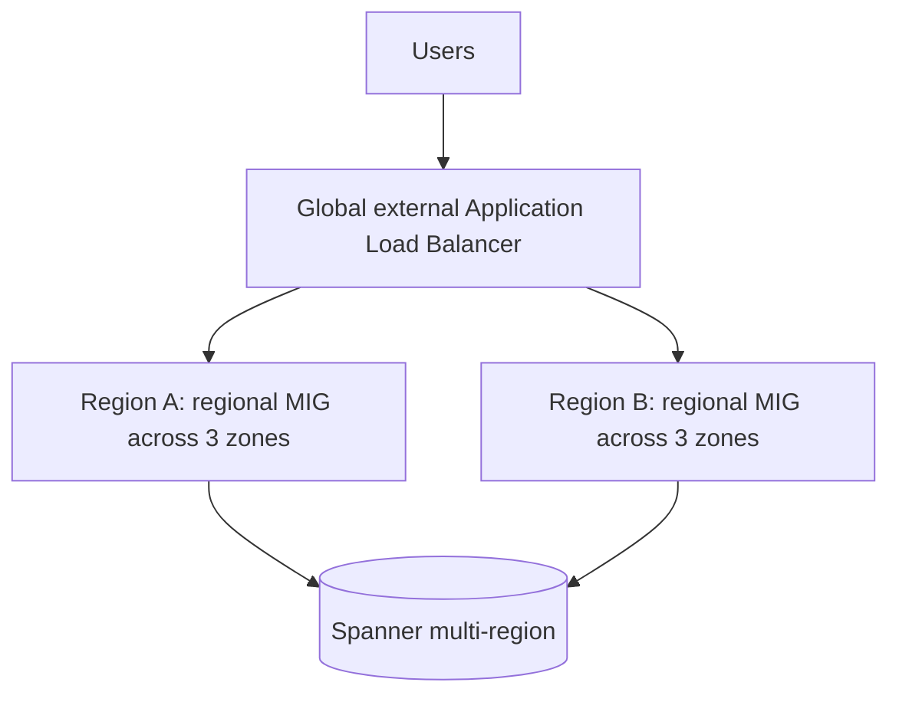

## From business words to technical numbers

Objective 1.2 takes the non-functional requirements from 1.1 and makes them precise: a number for
availability, a number for latency, a growth curve, an RTO and an RPO. The guide's considerations
are the Well-Architected Framework, high availability and failover, flexibility of resources,
scalability for growth, performance and latency, Gemini Cloud Assist, and backup and recovery.

## The Well-Architected Framework as a checklist

The framework has six pillars and cross-pillar perspectives (AI and ML; financial services). Use
the pillars as a review checklist for any design:

| Pillar | Technical question it forces |
|---|---|
| Operational excellence | Can we deploy, observe and recover this without heroics? |
| Security, privacy and compliance | Is access least-privilege, data protected, activity auditable? |
| Reliability | What fails, how often, and how do users experience it? |
| Cost optimization | Are we paying only for value? |
| Performance optimization | Does it meet latency and throughput targets as load grows? |
| Sustainability | Are we using efficient services and low-carbon regions where possible? |

The reliability pillar's core idea is the one the exam keeps returning to: **define reliability from
the user's point of view with SLOs, then design redundancy, scaling and recovery to meet them**, no
more and no less.

## SLIs, SLOs, SLAs and error budgets

- **SLI** (indicator): a measured ratio, for example the proportion of HTTP requests served
  successfully in under 300 ms.
- **SLO** (objective): the target for that SLI over a window, for example 99.9% over 30 days.
- **SLA** (agreement): a contract with consequences (usually credits). It should be looser than
  your internal SLO so you are warned before you breach it.
- **Error budget**: 1 − SLO. It is the unreliability you are allowed to spend on releases,
  experiments and incidents. When it is gone, an error-budget policy typically freezes risky
  changes and redirects effort to reliability.

**Worked example: error budget.** SLO = 99.9% availability over 30 days.
30 days × 24 h × 60 min = 43,200 minutes. Error budget = 0.1% × 43,200 = **43.2 minutes** of
full outage per 30 days. At 99.99% it is 4.32 minutes; at 99.95% it is 21.6 minutes. Each extra
"nine" cuts the budget by ten, and costs far more than ten times as much to engineer.

## Composite availability

A request that passes through several components in **series** needs all of them up:

$$A_{series} = A_1 \times A_2 \times \cdots \times A_n$$

Redundant components in **parallel** fail only if all fail:

$$A_{parallel} = 1 - (1 - A_1)(1 - A_2)\cdots$$

**Worked example.** A web tier at 99.95%, an app tier at 99.95% and a single database at 99.9% in
series give 0.9995 × 0.9995 × 0.999 ≈ **99.80%**, below a 99.9% target. Replace the single database
with a high-availability configuration (primary and standby in different zones) rated at 99.95%
and the chain becomes ≈ 99.85%. To reach 99.9% you raise every link: put each tier behind a load
balancer across zones, and choose a database SLA that is higher than the target. The lesson: **the
end-to-end SLO is always lower than the weakest serial component.**

> [!TIP]
> If a question asks how to meet an SLO and one answer adds redundancy to the weakest serial
> component, that is usually the right lever. Adding a fourth zone to an already redundant web tier
> does little.

## High availability and failover

Google Cloud's failure domains are **zones** (inside a region) and **regions**. Design for the
failure the requirement names:

| Scope | Survives | Typical building blocks | Cost |
|---|---|---|---|
| Zonal | Instance failure | Managed instance group (MIG) with autohealing in one zone | Lowest |
| Regional | Zone failure | Regional MIG, regional GKE cluster, regional persistent disk, Cloud SQL HA, regional load balancer | Moderate |
| Multi-regional | Region failure | Global external Application Load Balancer, deployments in two regions, Spanner multi-region, cross-region replicas, multi-region Cloud Storage | Highest |

The Compute Engine SLA itself rewards spreading instances across zones: the multi-zone target is
higher than the single-instance one.

**Failover** is the mechanism that moves traffic or roles when something breaks:

- **Load balancers with health checks** stop sending traffic to unhealthy backends automatically.
  A global external Application Load Balancer routes users to the nearest healthy region.
- **Autohealing** in a MIG recreates instances that fail an application health check.
- **Cloud SQL high availability** keeps a standby in another zone of the same region with
  synchronous replication; it fails over automatically. Cross-region read replicas can be promoted
  for regional DR (manual or scripted, with a small RPO).
- **Spanner** and **AlloyDB** have built-in replication; Spanner multi-region configurations survive
  the loss of a region with no data loss.
- **DNS failover** (Cloud DNS routing policies with health checks) for services not behind a global
  load balancer.

> [!WARNING]
> Read replicas are not high availability by themselves. A Cloud SQL read replica serves reads and
> can be promoted, but promotion is a deliberate action. For automatic zonal failover, enable HA
> on the primary.

## Flexibility, elasticity and scalability

**Elasticity** is scaling with load in both directions; **scalability** is the ability to keep
growing at all. Prefer **horizontal** scaling (more instances) to vertical (bigger instances):
it is elastic, it adds redundancy, and it avoids machine-size ceilings.

| Platform | Scaling mechanism |
|---|---|
| Compute Engine | MIG autoscaler on CPU, load-balancer utilisation, Monitoring metrics or schedules |
| GKE | Horizontal Pod Autoscaler, cluster autoscaler (Standard) or automatic node provisioning (Autopilot) |
| Cloud Run | Automatic per-request scaling, including to zero; min instances to avoid cold starts |
| Databases | Spanner and Bigtable add nodes/processing units; Cloud SQL read replicas for reads |

Design stateless application tiers (sessions in Memorystore or Firestore, files in Cloud Storage)
so any instance can serve any request; that is what makes autoscaling safe.

### Quotas: the silent scaling limit

Every project has **quotas**: **allocation quotas** (how many vCPUs, IP addresses or GPUs you may
hold, usually per region) and **rate quotas** (API requests per minute). Autoscaling stops at a
quota. For planned growth or a known peak (a product launch, a holiday sale):

1. Forecast the peak footprint per region.
2. Check current quotas in the console or the Cloud Quotas API.
3. Request increases well ahead of time; they are not always instant.
4. Set quota alerts in Cloud Monitoring.

Quotas are also a safety feature: they cap runaway cost and abuse.

## Performance and latency

Latency comes mostly from distance and from round trips. Levers, roughly in order of impact:

- **Place compute near users and data.** Pick regions near the user base; keep the app and its
  database in the same region.
- **Cache.** Cloud CDN for static and cacheable content at the edge; Memorystore for hot data.
- **Use Google's network.** Premium Network Service Tier and global load balancing carry traffic on
  Google's backbone from the nearest edge.
- **Choose the right data store.** Bigtable for single-digit-millisecond key lookups at scale;
  BigQuery for analytics, not for per-request lookups.
- **Right-size hardware.** SSD-backed disks or Hyperdisk for I/O-heavy workloads; compute-optimised
  machines for CPU-bound ones.

## Backup and recovery

Backups protect against what replication does not: corruption, deletion, ransomware and bad
deployments, because replication copies mistakes instantly.

| Need | Mechanism |
|---|---|
| VM disks | Scheduled snapshots (multi-regional or regional storage location) |
| Centralised, policy-based backup with protection from deletion | Backup and DR Service with backup vaults |
| Cloud SQL | Automated backups plus point-in-time recovery (binary/WAL logs) |
| Cloud Storage | Object Versioning, soft delete, retention policies and Bucket Lock |
| GKE | Backup for GKE |
| Spanner | Backups and point-in-time recovery within the version retention period |

Match the mechanism to RTO/RPO with the DR planning guide's patterns:

| Pattern | RTO | RPO | Example |
|---|---|---|---|
| Cold | Hours to a day | Last backup | Restore VMs from snapshots in another region when needed |
| Warm | Minutes to an hour | Minutes | Scaled-down copy running in the DR region, replica database, scale up on failover |
| Hot | Near zero | Near zero | Active-active in two regions behind a global load balancer, multi-region database |

> [!IMPORTANT]
> An untested backup is a hope, not a plan. Recovery procedures should be exercised regularly;
> Section 6 covers DR testing and chaos engineering.

## Gemini Cloud Assist

Gemini Cloud Assist is Google Cloud's AI assistant across the application lifecycle. Know its
three jobs:

- **Design and build**: describe an application in natural language in **Application Design
  Center** and get an architecture and infrastructure-as-code you can review and deploy; get help
  with IAM and IaC.
- **Troubleshoot**: **Investigations** analyse logs, metrics, configuration and recent changes to
  propose a root cause for an incident; it can hand off to support.
- **Optimise**: cost optimisation recommendations, FinOps Hub insights, proactive cost-anomaly
  analysis, database and storage insights.

Google's own documentation says its output can be wrong and should be validated. On the exam it is
the answer when a scenario asks to *speed up* design, troubleshooting or cost analysis with AI
assistance inside the console, not when it asks for a guaranteed control (that is still IAM,
organisation policies or monitoring alerts).

## Check yourself

1. A service chain has three serial components at 99.9% each. What is the end-to-end availability,
   and does it meet a 99.9% SLO?
2. A team's SLO is 99.95% per 30 days. How many minutes of full outage is the error budget?
3. A database needs automatic failover if a zone fails and point-in-time recovery after a bad
   migration script. Which two Cloud SQL features cover this?

Answers

1. 0.999³ ≈ 99.70%. No; serial chains are always weaker than their weakest link.
2. 0.05% × 43,200 = 21.6 minutes.
3. High availability (regional standby, automatic failover) and automated backups with
   point-in-time recovery. Replication alone would copy the bad script's changes.

## Sources

Pillars and reliability principles come from the Well-Architected Framework (overview, reliability,
performance pillars). SLI/SLO/SLA and error-budget definitions come from Google's SRE book and
workbook. HA, DR patterns and backup building blocks come from the DR planning guide, DR building
blocks, Backup and DR overview, regions and zones page and the Compute Engine SLA. Quotas come from
the Cloud Quotas overview; Gemini Cloud Assist and Application Design Center from their overviews.
