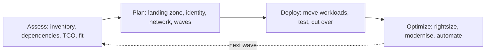

## What a migration plan is

The guide frames 1.4 as producing **documents and architectural diagrams**: a plan someone can
execute. It covers integrating with existing systems, assessing and migrating systems and data
(with Google Cloud Migration Center), migration methodology, workload testing, network and
dependency planning, and software licence and financial impact.

## Google's migration framework

Google's migration guide uses four phases:

1. **Assess**: build an inventory, map dependencies, classify workloads by complexity and value,
   estimate total cost of ownership, and choose first movers.
2. **Plan**: build the foundation (the **landing zone**: resource hierarchy, IAM and identity
   federation, networking, security policies, billing, logging) before moving anything.
3. **Deploy**: move workloads in waves, test, and cut over.
4. **Optimize**: rightsize, adopt managed services, automate, and feed lessons into the next wave.

> [!TIP]
> When an answer jumps straight to "migrate the VMs" and another says "set up the landing zone /
> networking / identity first", the foundation answer is usually right for an early-stage question.

### The six migration types

| Type | Also called | What changes | When |
|---|---|---|---|
| **Rehost** | Lift and shift | Nothing in the app; VM moves to Compute Engine | Deadline-driven (lease ending), low cloud skills, low-risk first wave |
| **Replatform** | Lift and optimize | Small changes, e.g. self-managed MySQL → Cloud SQL, VM → container | Quick wins with managed services |
| **Refactor** | Move and improve | Modify code to use cloud capabilities while moving | App is valuable but needs scaling or cost improvements |
| **Re-architect** | Continue to modernise | Break into services, change architecture | Strategic apps with long life |
| **Rebuild** | Remove and replace, rip and replace | Rewrite cloud native | Legacy is unmaintainable; capability is differentiating |
| **Repurchase** | Buy | Replace with SaaS | Commodity function (CRM, email, HR) |

## Assessing with Migration Center

**Migration Center** is Google Cloud's hub for the assess and plan phases. Its capabilities:

- **Cost estimation**: a rapid estimate of Google Cloud cost from your current environment.
- **Asset discovery**: automatic scanning (with the discovery client) to inventory servers and SQL
  Server, MySQL and PostgreSQL databases, or manual upload of exported data (for example from RVTools
  or a CMDB).
- **Assessment**: total cost of ownership (TCO) reports, application and network **dependency
  identification**, and technical-fit recommendations with cost projections.
- **Migration planning**: grouping assets into waves with prescriptive recommendations, then
  handing off to the migration tools (rehost, replatform, refactor).

Assessment also has human parts: interview application owners, record compliance constraints,
identify the **business-critical** and **tightly coupled** workloads, and find the **first movers**,
typically low-risk, low-dependency workloads that teach the team the process.

## Choosing migration tools

| What moves | Tool | Notes |
|---|---|---|
| VMs (VMware, AWS, Azure, physical) | **Migrate to Virtual Machines** | Continuous replication, test clones before cut-over, short cut-over window |
| VMware estate as-is | **Google Cloud VMware Engine** | Run vSphere natively; keep VMware tooling; fastest exit from a data centre |
| VMs to containers | **Migrate to Containers** | Replatform suitable VMs onto GKE or Cloud Run |
| MySQL, PostgreSQL, SQL Server → Cloud SQL; PostgreSQL → AlloyDB | **Database Migration Service** (homogeneous) | Continuous migration with CDC → minimal downtime cut-over |
| Oracle or SQL Server → Cloud SQL for PostgreSQL or AlloyDB | **Database Migration Service** (heterogeneous) | Schema and code conversion before data movement |
| Files from other clouds, HTTP, on-prem file systems | **Storage Transfer Service** | Managed, scheduled, incremental, with agents for on-prem; logs every file |
| Small or ad-hoc transfers | **gcloud storage** CLI | Fine for small-to-medium data on a good network |
| Very large data, limited bandwidth | **Transfer Appliance** | Ship Google-owned hardware (TA40 or TA300 models) |
| Data warehouse (Teradata, Redshift, etc.) | **BigQuery Migration Service / Data Transfer Service** | Assessment, SQL translation and data transfer |

**Continuous versus one-time database migration.** A one-time migration takes a snapshot, so the
source must stop accepting writes during the move (downtime). A continuous migration does an
initial load then replicates changes (change data capture) until you promote the destination,
keeping downtime to the cut-over moment. If the scenario says "minimal downtime", choose continuous.

## Worked example: how long will the data take?

Transfer time = data size (bits) ÷ effective bandwidth.

**Scenario.** Altostrat holds 300 TB of archive media on premises with a 1 Gbps internet link that
is already 50% used by daytime traffic. It wants the archive in Cloud Storage within four weeks.

1. Convert size to bits: 300 TB × 8 = 2,400 Tb = 2.4 × 10¹⁵ bits.
2. Effective bandwidth: half of 1 Gbps is available = 0.5 Gbps; assume about 80% efficiency →
   0.4 Gbps = 4 × 10⁸ bits/s.
3. Time = 2.4 × 10¹⁵ ÷ 4 × 10⁸ = 6 × 10⁶ s ≈ **69 days**.

69 days blows the four-week deadline. Google's guidance recommends **Transfer Appliance** when
uploading would take more than about a week; Google's own example is 300 TB at 100 Mbps taking about
nine months online. Ship an appliance (or several), then use **Storage Transfer Service** to sync
the changes made after the appliance was filled.

Sanity anchors from Google's large-dataset guide: **1 GB at 1 Gbps ≈ 8 seconds; 100 TB at 1 Gbps ≈
12 days; 100 TB at 100 Mbps ≈ over 100 days.**

| Constraint | Choose |
|---|---|
| Plenty of bandwidth, recurring or incremental transfers, need logs | Storage Transfer Service |
| Data in another cloud (e.g. S3) | Storage Transfer Service |
| Small dataset, one-off | gcloud storage |
| Network would take more than about a week, or bandwidth can't be bought in time | Transfer Appliance |

> [!WARNING]
> Upgrading to a 10 Gbps Dedicated Interconnect is sometimes offered as a distractor for a one-time
> bulk move. Provisioning a physical connection takes weeks and costs ongoing money; for a one-off
> archive move it is usually the wrong lever. It is right when the company also needs high-bandwidth
> hybrid connectivity for the long term.

## Integrating with existing systems

Most migrations are hybrid for a while. Plan for:

- **Connectivity** (HA VPN to start, Interconnect for bandwidth) and **DNS** across environments
  (Cloud DNS forwarding and peering zones).
- **Identity**: federate the existing directory (for example Active Directory) to Cloud Identity
  with Google Cloud Directory Sync and SSO, rather than creating separate accounts.
- **Legacy interfaces**: keep them reachable (EHR's insurer integrations) and wrap them with APIs
  (Apigee) so new consumers don't depend on old protocols.
- **Data synchronisation** during the transition (DMS continuous replication, Pub/Sub, Datastream).

## Network and dependency planning

- **IP address plan**: avoid overlapping ranges between on-prem and VPC subnets; overlaps break
  routing and peering.
- **Bandwidth and latency**: chatty applications split across on-prem and cloud suffer; migrate
  tightly coupled components **together in the same wave**.
- **Dependency mapping**: Migration Center's dependency identification plus owner interviews find
  shared databases, hard-coded IPs, batch jobs and licence servers.
- **Wave planning**: start with low-risk, low-dependency workloads; group by dependency; leave the
  most critical systems for when the team has practice.

## Workload testing

Before cut-over, prove the migrated workload: functional tests, **performance and load tests**
against the target SLOs, failover tests, data validation (row counts, checksums), and a rehearsed
**rollback plan**. Migrate to Virtual Machines' **test clones** let you run tests without affecting
the source or replication.

## Licensing and financial impact

| Licence situation | Option |
|---|---|
| Want licences included and billed per use | Premium images (Windows Server, SQL Server, RHEL, SLES) pay-as-you-go |
| Existing licences that may move to shared cloud hardware (licence mobility) | Bring your own licence on standard VMs |
| Licences that require dedicated physical hardware or count physical cores | **BYOL on sole-tenant nodes** |
| Want to stop paying a commercial database licence | Heterogeneous migration to PostgreSQL (Cloud SQL or AlloyDB) via DMS |
| Managed database with licence included | Cloud SQL for SQL Server |

Financial impact belongs in the plan too: the cost of running both environments in parallel during
migration, egress during transfer, one-off migration labour, avoided hardware refresh, and the
steady-state cloud bill (Migration Center TCO plus Pricing Calculator), reduced by CUDs once the
baseline is known.

## Check yourself

1. You must move 40 TB to Cloud Storage and have 10 Gbps of spare bandwidth. Appliance or online?
2. A SQL Server database must move to Cloud SQL with less than five minutes of downtime. Which
   tool and mode?
3. An application's licence is tied to physical cores. Where should its VMs run?

Answers

1. Online: 40 TB ≈ 3.2 × 10¹⁴ bits; at ~8 Gbps effective that is about 11 hours. Use Storage
   Transfer Service (or gcloud storage).
2. Database Migration Service, continuous migration (CDC), then promote at cut-over.
3. Sole-tenant nodes with BYOL.

## Sources

Phases and migration types come from Google's "Migrate to Google Cloud: Get started" and
assessment guides. Migration Center capabilities come from its overview; tool behaviour from the
Migrate to Virtual Machines, Database Migration Service, Storage Transfer Service and Transfer
Appliance overviews. Transfer-time anchors come from Google's large-dataset transfer guide.
Licensing comes from the sole-tenant BYOL page; costing from the Pricing Calculator and CUD pages.
