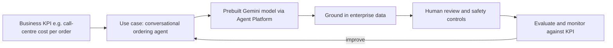

## What "envisioning improvements" means on the exam

Objective 1.5 has three considerations: **cloud and technology improvements**, **evolution of
business needs**, and a **cloud-first design approach**. Questions usually describe a working
solution and ask what to do next, or ask you to pick the design that will be easiest to evolve.
The right answer keeps options open at low cost: modular services, managed platforms, clean data,
automation and measurement.

## Cloud and technology improvements

Google Cloud ships new services and features continuously. A design benefits from them only if it
is built to adopt them:

| Design habit | Why it helps future improvement |
|---|---|
| **Managed services over self-managed** | Upgrades, new features and performance gains arrive without your effort |
| **Infrastructure as code** (Terraform, Application Design Center templates) | New regions, services or settings are a reviewed code change, not a manual project |
| **Containers and standard APIs** (Kubernetes, PostgreSQL, Apache Beam, OpenTelemetry) | Easy to move to a better platform later; avoid rewrites |
| **Loose coupling** (Pub/Sub, APIs via Apigee) | Replace one component without touching the rest |
| **A central, governed data platform** (BigQuery with good metadata) | Analytics and AI use cases can be added quickly |
| **Observability and SLOs** | You can prove an improvement worked |

The Optimize phase of Google's migration framework is exactly this loop: after moving, keep
rightsizing, replacing self-managed components with managed ones, and automating. The operational
excellence pillar describes the same culture as continuous improvement.

> [!TIP]
> If the question asks for "future-proof" or "easiest to evolve", favour answers using open
> standards and managed services with clean interfaces. Answers that hard-wire a custom component
> or a single-vendor appliance into the core are usually distractors.

## Evolution of business needs

Business needs change: new markets (data residency), new partners (integrations), acquisitions
(identity and network merges), growth (quotas, sharding), new regulation (EU data-protection
rules for KnightMotives), new revenue lines (data monetisation). Plan for the likely ones:

- **Regional expansion**: choose services that can add regions (global load balancing, Spanner
  multi-region, multi-region storage) and keep residency controls (organisation policy resource
  location constraints) in the foundation.
- **Partner growth**: an API layer (Apigee) with onboarding automation turns "months to onboard an
  insurer" into days.
- **Data products**: governed datasets in BigQuery with sharing (for example Analytics Hub)
  support monetisation without copying data around.
- **Scale**: horizontally scalable services and quota planning avoid a re-architecture at the
  next growth step.

Revisit the KPIs from lesson 1 regularly; when a KPI stalls, it signals that the architecture or the
business need has moved.

## Cloud-first design approach

**Cloud-first** means new solutions are designed for the cloud by default, using cloud-native
capabilities (managed services, elasticity, global networking, pay-per-use) rather than replicating
an on-premises design. It does not mean "everything must move tomorrow": some systems stay on
premises for latency, regulation or economics, and hybrid is a legitimate end state.

Cloud-first in practice:

- New applications start on serverless or managed containers (Cloud Run, GKE Autopilot) and managed
  data stores.
- Design for failure: multiple zones, health checks, automation, not hand-tended servers.
- Pay per use and scale to zero where possible; commit only for steady baselines.
- Security in the platform: identity-based access, organisation policies, encryption by default.
- Sustainability: managed services and low-carbon regions reduce footprint (sustainability pillar).

## AI integration as a future improvement

Every current case study includes a generative-AI goal. Treat AI like any other capability: start
from a business KPI, use the most managed option that works, and govern it.

- **Start with prebuilt models and agents** on Gemini Enterprise Agent Platform: Gemini models,
  Model Garden for alternatives, agent tooling for conversational and task agents.
- **Ground** answers in the company's own data (catalogue, policies, episode transcripts) instead of
  training new models.
- **Keep a human in the loop** where errors are costly (Cymbal's product attributes, Altostrat's
  moderation decisions) and make decisions **auditable and explainable**.
- **Evaluate and monitor** quality, safety and cost; the AI and ML perspective of the
  Well-Architected Framework applies every pillar to AI workloads.

### Gemini Cloud Assist in the improvement loop

Gemini Cloud Assist speeds up the architect's own improvement work: designing a new version in
Application Design Center from a natural-language description, investigating incidents to shorten
time to root cause, and surfacing cost-optimisation opportunities and cost anomalies. It is an
assistant: validate what it proposes, and keep guaranteed controls (IAM, policies, alerts) in place.

## Worked example: a roadmap for Cymbal Retail

Cymbal runs MySQL, SQL Server, Redis, MongoDB and Kubernetes in a hybrid estate, integrates through
SFTP batch jobs and keys IVR orders by hand. A three-step improvement roadmap:

| Horizon | Improvement | KPI |
|---|---|---|
| Now (0–6 months) | Rehost/replatform: MySQL → Cloud SQL via DMS, Redis → Memorystore, Kubernetes → GKE; Google Cloud Observability replaces scattered open-source monitoring | Data-centre cost; incident MTTR |
| Next (6–18 months) | Replace SFTP batch with event-driven integration (Pub/Sub, APIs); generate product attributes and descriptions with Gemini plus a human review queue | Catalogue onboarding time; attribute accuracy |
| Later (18+ months) | Conversational shopping and ordering agents grounded in the catalogue; retire manual IVR order entry | % orders without an agent; cost per order; customer satisfaction |

Each step is independently valuable and makes the next one easier: the managed data layer feeds
the AI features; event-driven integration feeds real-time catalogue updates to agents.

## Exam traps for 1.5

| Distractor pattern | Why it is usually wrong |
|---|---|
| "Train a custom model from scratch" for a common language or vision task | Slower and costlier than a prebuilt Gemini model with grounding; only right when no available model can meet the requirement |
| "Rebuild everything as microservices first" | Delays value; modernise incrementally after migrating, guided by KPIs |
| "Buy 3-year commitments for the future footprint now" | Commitments suit known, steady baselines; future growth is uncertain by definition |
| "Pick the newest preview feature for a production core" | Preview features may change and can lack SLAs; adopt them where the risk is acceptable |
| "Keep the self-managed component because the team knows it" | Familiarity is real, but the exam favours managed services that remove toil when they meet the requirements |

The pattern behind all five: the right future-facing answer keeps the design **modular,
managed and measurable**, so the next improvement is cheap to make and easy to prove.

## Check yourself

1. Two designs meet today's requirements. One uses a self-managed message broker on VMs, the other
   Pub/Sub. Which better supports future improvement, and why?
2. What does "cloud-first" **not** require?
3. A retailer wants AI-generated product descriptions next quarter. Train a custom LLM or use a
   prebuilt model with grounding and human review?

Answers

1. Pub/Sub: managed (no upgrades or capacity work), scales automatically, and decouples producers
   from consumers so components can change independently.
2. It does not require moving every existing workload immediately or abandoning hybrid; it means new
   designs default to cloud-native, managed capabilities.
3. A prebuilt Gemini model, grounded in catalogue data, with a human review step. Training from
   scratch is slower, costlier and unnecessary for the requirement.

## Sources

The continuous-improvement loop comes from the operational excellence pillar and the Optimize
phase of Google's migration guide. Sustainability and AI guidance come from the framework's
sustainability pillar and AI and ML perspective. AI services come from the Gemini Enterprise Agent
Platform overview; Gemini Cloud Assist and Application Design Center from their overviews; data and
integration services from the BigQuery and Pub/Sub overviews.
