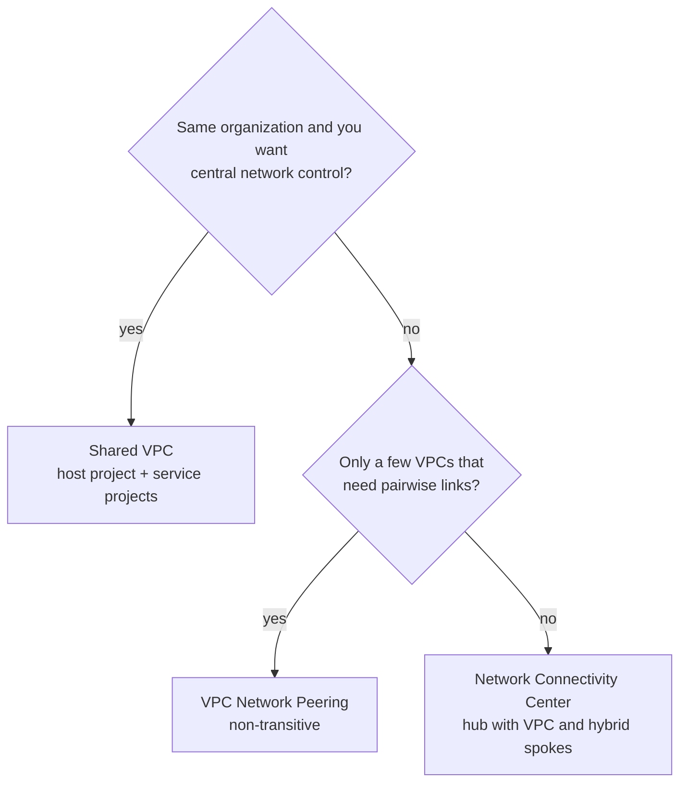

Objective **2.1** asks you to configure a network for four situations: extending to on-premises
(hybrid), extending to other clouds (multicloud, including Google Cloud-to-Google Cloud),
protecting traffic (intrusion protection, access control, firewalls), and designing the VPC and
its load balancing. Exam questions usually give you a requirement such as "private", "99.99%",
"no overlapping ranges" or "client IP preserved". Your job is to spot the one product that meets
it with the least to manage.

## 1. The VPC building blocks

A **VPC network is a global resource**: one network can hold subnets in many regions, and VMs in
different regions of the same VPC talk over Google's backbone using internal IPs with no extra
configuration. **Subnets are regional.** Routes and firewall rules belong to the VPC.

| Choice | What it means | Exam guidance |
|---|---|---|
| Auto mode VPC | One subnet per region is created for you from a fixed range | Good for experiments. Its ranges can collide with on-premises ranges and with other auto mode VPCs, so avoid it for production or hybrid |
| Custom mode VPC | You create every subnet and choose its range | The default answer for production, hybrid and peering designs |
| Secondary ranges | Extra ranges on a subnet (alias IPs) | GKE uses them for Pods and Services in VPC-native clusters |
| Dynamic routing mode | Regional or global | Global lets a Cloud Router in one region advertise learned on-premises routes to subnets in every region |

**Plan the IP space first.** Overlapping ranges block peering and complicate hybrid routing, and
fixing them later usually means re-addressing. Reserve non-overlapping RFC 1918 blocks per
environment and per region before you build anything.

## 2. Connecting VPCs: Shared VPC, peering or NCC

**Shared VPC** lets one **host project** own the network while **service projects** in the same
organization deploy VMs, GKE clusters and serverless connectors into its subnets. A central
network team keeps subnets, routes and firewalls. App teams receive `roles/compute.networkUser`,
either on specific subnets or on the whole host project. This is the documented pattern for
"central network administration with separate project billing and IAM for each team".

**VPC Network Peering** connects two VPC networks so they exchange subnet routes over internal
IPs. It works across projects and across organizations. Three properties appear in exam
questions:

- It is **not transitive**. If A peers with B and B peers with C, A cannot reach C through B.
- **Subnet ranges must not overlap** between the peered networks.
- Each side keeps its **own administration**. Firewall rules are not shared, and each side controls what it exports.

**Network Connectivity Center (NCC)** is a hub-and-spoke control plane. **VPC spokes** connected
to one hub get full-mesh reachability among themselves, which avoids an N×N peering mesh and the
non-transitivity problem. **Hybrid spokes** (HA VPN tunnels, Interconnect VLAN attachments,
router appliance VMs) attach on-premises and other-cloud sites. With site-to-site data transfer
turned on, NCC can also carry traffic between those sites over Google's backbone.

| Need | Answer |
|---|---|
| Many teams, one org, central control of the network | Shared VPC |
| Two VPCs (possibly different orgs) need private connectivity | VPC Network Peering |
| Many VPCs need any-to-any connectivity, or you hit peering limits | NCC with VPC spokes |
| Branch offices should reach each other through Google | NCC hybrid spokes with site-to-site data transfer |
| Consume one service from another VPC with overlapping IPs | Private Service Connect (next section) |

> [!TIP]
> "Transitive" is a trigger word. Peering never gives it to you. NCC, or a hub VPC with
> appliances, does.

## 3. Reaching services privately

| Mechanism | What it gives you |
|---|---|
| **Private Google Access** (per subnet) | VMs with **no external IP** can reach Google APIs such as Cloud Storage and BigQuery |
| **Private Google Access for on-premises hosts** | On-premises clients reach Google APIs over Interconnect or VPN through `private.googleapis.com` or `restricted.googleapis.com` (the restricted VIP supports VPC Service Controls), with the range advertised by Cloud Router |
| **Private services access** | A peering connection to a Google-managed producer VPC, used by services such as Cloud SQL and Memorystore for private IPs |
| **Private Service Connect (PSC)** | An **endpoint** (an internal IP in your VPC) that forwards to Google APIs or to a producer's **service attachment**. No peering is involved, so **overlapping ranges are fine** and the consumer sees only that one service |

PSC is the modern answer for "a SaaS provider (or another business unit) publishes a service, and
consumers in many VPCs must reach it privately without exposing their networks to each other". The
producer publishes the service behind an internal load balancer with a service attachment and
approves consumer projects. Each consumer creates an endpoint.

## 4. Hybrid and multicloud connectivity

| Option | Path | Capacity (typical) | When to choose it |
|---|---|---|---|
| **Dedicated Interconnect** | Your own physical circuit into a Google colocation facility | 10-, 100- or 400-Gbps circuits, bundled for more | High, steady volume, and you can reach a Google facility |
| **Partner Interconnect** | Through a supported service provider | 50 Mbps to 50 Gbps per VLAN attachment | You can't reach a facility, or need less than 10 Gbps |
| **Cross-Cloud Interconnect** | Google-provisioned physical link to another cloud (AWS, Azure, Oracle Cloud Infrastructure, Alibaba Cloud) | 10-Gbps or 100-Gbps | Private, high-bandwidth Google Cloud-to-other-cloud links |
| **HA VPN** | IPsec over the internet | A few Gbps per tunnel. Add tunnels to scale | Quick, encrypted, lower volume, or as a backup to Interconnect |

**Cloud Router** runs **BGP** for every one of these. It learns on-premises prefixes and advertises
VPC subnets (and custom ranges such as the Google API VIPs). Static routes over Interconnect are
not supported, and BGP is what makes failover automatic.

**Availability is a topology, not a checkbox.**

- **HA VPN** carries a **99.99% SLA** only when both HA VPN interfaces have tunnels to the peer (two peer devices, or one device with two interfaces) and BGP sessions are up on each.
- **Interconnect at 99.99%** needs **four connections**: two in each of **two metropolitan areas**, in different edge availability domains, with Cloud Routers in two regions and **global dynamic routing**. **99.9%** needs two connections in one metro, in different edge availability domains.
- Interconnect is **not encrypted by default**. If the requirement says "encrypt in transit over the private link", use **MACsec for Cloud Interconnect** (link layer) or **HA VPN over Cloud Interconnect** (IPsec).

For **multicloud**, Google's hybrid and multicloud architecture guidance describes patterns such
as *meshed* (full connectivity), *gated egress/ingress* (only exposed APIs cross the boundary),
and *handover* (data is shipped across for processing). The exam rarely names these patterns, but it
rewards the instinct behind them: connect only what must talk, through a controlled entry point.
"Google Cloud-to-Google Cloud" communication means VPC-to-VPC, project-to-project or
org-to-org. Shared VPC, peering, NCC and PSC from section 2 are your tools for it.

## 5. Choosing a load balancer

Answer three questions: **what protocol**, **who calls it** (internet or internal), and
**how many regions**.

| Product | Layer / protocol | Exposure and scope | Key traits |
|---|---|---|---|
| **Global external Application Load Balancer** | L7 HTTP(S), HTTP/2, gRPC | Internet, global anycast IP | URL maps, Cloud CDN, Cloud Armor, managed certificates, serverless NEGs for Cloud Run |
| **Regional external Application Load Balancer** | L7 HTTP(S) | Internet, one region | Regional data residency or a Standard network tier |
| **Internal Application Load Balancer** (regional or cross-region) | L7 HTTP(S) | Inside the VPC or hybrid | Envoy-based proxy for internal microservices |
| **External proxy Network Load Balancer** | L4 TCP (with optional TLS offload) | Internet, global or regional | Non-HTTP TCP services that want a proxy and global reach |
| **External passthrough Network Load Balancer** | L4 TCP, UDP, ESP, ICMP | Internet, regional | **Preserves the client source IP**. Backends see the original packets. Good for UDP and gaming |
| **Internal passthrough Network Load Balancer** | L4 TCP or UDP | Internal, regional | Next hop for appliances, and a front end for PSC service attachments |

> [!WARNING]
> "Global" plus "UDP" plus "internet" is a trap. Passthrough load balancers are regional. For a
> worldwide UDP service, use regional passthrough load balancers per region with DNS-based routing
> (for example Cloud DNS geolocation policies). A global proxy works only for TCP and HTTP(S).

## 6. Security protection and egress

Firewalls in Google Cloud are **stateful** and **distributed**: they are enforced at each VM
interface, not at a choke point. Rules are evaluated in this order:

1. **Hierarchical firewall policies** at the organization, then at each folder. These rules can `allow`, `deny` or `goto_next` (delegate).
2. **VPC firewall rules** and **global or regional network firewall policies** on the VPC.
3. The **implied rules**: deny all ingress, allow all egress.

Use hierarchical policies for guardrails that project owners must not override, such as
"block RDP from the internet everywhere". Target rules with **secure tags** (IAM-controlled), not
network tags, when you need least privilege over who can attach a VM to a rule.

**Cloud Next Generation Firewall (Cloud NGFW)** has three tiers:

| Tier | Adds |
|---|---|
| Essentials | Stateful L3/L4 rules, address groups, secure tags |
| Standard | FQDN objects, geolocation, Google Threat Intelligence lists |
| Enterprise | **Intrusion prevention (IPS)** through zonal firewall endpoints and security profiles, with optional TLS inspection |

**Cloud IDS** is the older *detection* service. It uses packet mirroring to send copies of
traffic to an analysis engine and raises alerts, but it **does not block** traffic. When the requirement
says "detect and block known exploits inline", choose Cloud NGFW Enterprise.

**Cloud Armor** protects internet-facing **external load balancers**: WAF rules (preconfigured
OWASP signatures), rate limiting, IP and geo allow or deny lists, bot management and adaptive
protection against L7 DDoS attacks.

**Cloud NAT** gives VMs and GKE nodes **without external IPs** outbound access to the internet.
It is a regional, software-defined service configured on a Cloud Router, with no NAT VMs to
manage, and it **never allows unsolicited inbound connections**. Private NAT translates between
networks with overlapping ranges, for example between NCC spokes.

## Worked example

*A retailer has 40 product teams in one organization. A central network team must own all
routing and firewalls. The data centre needs a 99.99% private link of 20 Gbps to Google Cloud.
Back-end VMs must have no public IPs but must download OS patches. The public storefront is
HTTPS, served worldwide, and needs WAF protection.*

1. **VPC layout:** one Shared VPC host project per environment (prod and non-prod), with custom mode subnets in each region, and the 40 teams as service projects. Central control comes from the host project, and teams get `networkUser` on their subnets.
2. **Hybrid link:** Dedicated Interconnect, because the volume is high and steady, in the 99.99% topology (four connections across two metros). Cloud Routers in two regions run BGP, and the VPC's dynamic routing mode is global.
3. **Egress:** Cloud NAT in each region for patch downloads. Private Google Access on the subnets lets the VMs reach Cloud Storage and other APIs without NAT.
4. **Front end:** a global external Application Load Balancer with a managed certificate, Cloud CDN and a Cloud Armor security policy.
5. **Guardrails:** an organization-level hierarchical firewall policy denies SSH and RDP from `0.0.0.0/0`, and allows the IAP TCP forwarding range for administration.

Why not the alternatives? VPC peering between 40 team VPCs would be a non-transitive mesh with
decentralised firewalls. HA VPN would need several tunnels to reach 20 Gbps and would run over
the internet. A passthrough Network Load Balancer is regional and can't run Cloud Armor's WAF
rules on HTTP.

## Check yourself

1. Three VPCs (A, B, C) are each peered with a central VPC H. Can VMs in A reach C? What would you change?
2. A supplier publishes an inventory API inside its own VPC, and its IP ranges overlap with yours. How do you consume it privately?
3. Which load balancer serves a UDP game protocol to the internet while preserving the client IP?

Answers

1. No. Peering is not transitive. Make A, B, C and H spokes on a Network Connectivity Center hub (or route through appliances in H) to get any-to-any reachability.
2. Private Service Connect: the supplier exposes a service attachment, and you create a PSC endpoint in your VPC. Overlapping ranges don't matter because no routes are exchanged.
3. The external passthrough Network Load Balancer. It is regional, so deploy one per region if players are global.

## Sources

VPC, Shared VPC, peering, NCC and PSC behaviour comes from the Google Cloud VPC and Network
Connectivity documentation. Interconnect, HA VPN and Cloud Router SLAs and topologies come from
the Network Connectivity product-choice and topology pages. Load balancer traits come from the
Cloud Load Balancing overview and its "choose a load balancer" guide. Firewall evaluation order and
the NGFW tiers come from the Cloud NGFW documentation, with Cloud Armor, Cloud IDS and Cloud NAT
from their product overviews. See this module's sources list.
