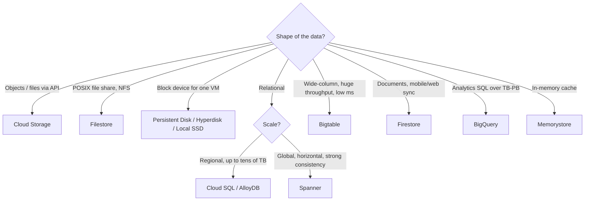

Objective **2.2** lists seven considerations: storage **allocation**, data **processing and compute
provisioning**, **security and access**, **transfer and latency**, **retention and lifecycle**,
**growth planning** and **data protection**. In exam scenarios they usually show up as a mix: "store
X for seven years, unchangeable, cheaply, and restore within hours". This lesson takes each in turn.

## 1. Allocation: which service?

### Cloud Storage classes

| Class | Minimum storage duration | Retrieval fee | Typical access |
|---|---|---|---|
| Standard | None | None | Hot data, serving, analytics staging |
| Nearline | 30 days | Yes | About once a month |
| Coldline | 90 days | Yes, higher | About once a quarter |
| Archive | 365 days | Yes, highest | Less than once a year, such as compliance archives |

All classes have **millisecond first-byte latency** and the same durability. The colder classes
trade a lower storage price for retrieval fees and minimum-duration charges. "Archive" in Cloud
Storage is **not** a tape-style service with hours of restore delay. That is a common distractor.

**Location types:** *region* (lowest latency to co-located compute, data residency),
*dual-region* (two specific regions, with optional **turbo replication** for a 15-minute replication
RPO) and *multi-region* (a large geographic area such as US or EU, for content served widely).

## 2. Retention and lifecycle

| Feature | What it does | Use it when |
|---|---|---|
| **Lifecycle rules** | Actions (`SetStorageClass`, `Delete`, `AbortIncompleteMultipartUpload`) triggered by conditions such as `age`, `createdBefore`, `numNewerVersions`, `isLive` and `daysSinceNoncurrentTime` | Access patterns are **predictable**, e.g. "move to Coldline after 90 days, delete after 7 years" |
| **Autoclass** | Moves each object between classes based on its own access, with no retrieval fees | Access patterns are **unknown or mixed** |
| **Retention policy** | Objects can't be deleted or overwritten until they reach the retention period | Regulatory minimum retention |
| **Bucket Lock** | Locks the retention policy **permanently**. It can't be shortened or removed | WORM compliance, such as SEC 17a-4 style requirements |
| **Object holds** | Event-based or temporary holds on individual objects | Legal holds, or "retain for N years after account closure" |
| **Object Versioning** | Keeps noncurrent versions when objects are overwritten or deleted | Recovery from accidental overwrite. Pair it with a lifecycle rule that trims old versions |
| **Soft delete** | Deleted objects stay restorable for a retention window (seven days by default) | A safety net against accidental or malicious deletion |

> [!WARNING]
> Locking a retention policy is **irreversible**. If a question says "the retention period may
> change next year", don't lock it yet. If it says "must be provably immutable to auditors", lock it.

## 3. Block and file storage for compute

| Option | Characteristics | Choose when |
|---|---|---|
| **Persistent Disk** (standard, balanced, SSD) | Network block storage, zonal or **regional** (synchronously replicated across two zones) | General VM disks. Use a regional PD for zone-failure protection of a stateful VM |
| **Hyperdisk** (Balanced, Throughput, Extreme, ML) | **IOPS and throughput are provisioned separately from capacity**. Hyperdisk storage pools share capacity and performance | Databases and analytics that need tuned performance without oversizing the disk |
| **Local SSD** | Physically attached, highest IOPS, **ephemeral** | Scratch space, caches, and replicated databases that rebuild themselves |
| **Filestore** | Managed **NFS** file shares. Tiers range from Basic to zonal, regional and enterprise | Lift-and-shift apps that need a shared POSIX file system, and GKE ReadWriteMany volumes |
| **Cloud Storage FUSE** | Mounts a bucket as a file system | Read-heavy access to objects by tools that expect files, such as ML training data |

## 4. Databases: availability, protection and growth

| Service | High availability | Backup and recovery | Growth |
|---|---|---|---|
| **Cloud SQL** | HA configuration: a primary and a **standby in another zone** with synchronous replication and automatic failover. Read replicas, including cross-region ones, scale reads and support DR | Automated daily backups, plus **point-in-time recovery** from logs | Storage auto-increase (it never shrinks). Scale up the machine size, and add read replicas for read traffic |
| **AlloyDB** | Regional HA by default, with read pools | Continuous backup and PITR | PostgreSQL-compatible, for heavier OLTP plus analytics |
| **Spanner** | Regional (99.99%) or **multi-region (99.999%)** configurations | Backups and PITR within the version retention period | Add **nodes or processing units**, or use the managed autoscaler. Scales horizontally |
| **Bigtable** | Replication across clusters in multiple zones or regions, with app profiles for routing | Backups | Add nodes or enable autoscaling. Row-key design determines hotspotting |
| **BigQuery** | Managed, regional or multi-region datasets | **Time travel** (2–7 days, configurable) plus a 7-day fail-safe. Table snapshots and clones | Serverless storage. Use partition and table **expiration** to control growth, and long-term storage pricing to cut cost |

For protection across many resources, **Backup and DR Service** centralises backup plans and stores
backups in **backup vaults** that can enforce a minimum retention immutably, even against project
owners. Compute Engine **snapshots** are incremental and can be scheduled with snapshot schedules.
They are stored regionally or multi-regionally, so they survive a zone loss.

## 5. Security and access management

- Turn on **uniform bucket-level access** so that IAM alone governs a bucket (no per-object ACLs), and enforce **public access prevention** with an organization policy.
- Grant the narrowest role (`roles/storage.objectViewer` rather than `storage.admin`) to service accounts.
- Use **signed URLs** for time-limited access by users without Google identities.
- Use **CMEK** through Cloud KMS when the requirement says "customer controls key rotation or revocation" (key management in depth is in Section 3).

## 6. Data transfer and latency

| Situation | Tool |
|---|---|
| Small or ad-hoc copies, scripts | `gcloud storage cp` / `rsync` |
| Large or recurring transfers from another cloud, a URL list or another bucket | **Storage Transfer Service**, which is managed, scheduled, incremental and can verify integrity |
| On-premises file systems or HDFS to Cloud Storage over the network | Storage Transfer Service with **on-premises transfer agents** |
| Hundreds of TB to PB with limited bandwidth | **Transfer Appliance** (offline shipment) |
| SaaS and ads data, or warehouse migrations, into BigQuery | BigQuery Data Transfer Service |
| Live database migration with minimal downtime | Database Migration Service |

**Rule of thumb from Google's large-dataset transfer guidance:** estimate *time = size ÷
usable bandwidth*. 100 TB over a 1 Gbps link at full utilisation takes roughly 12 days, and longer in
practice. When the network estimate exceeds your window, or would starve production traffic,
ship a Transfer Appliance.

For **latency**, put data in the same region as the compute that reads it. Use Cloud CDN in front
of a bucket for global reads, and dual-region or multi-region buckets for availability.

## 7. Processing and compute provisioning

Storage choices drive compute choices. BigQuery separates storage from compute (**slots**), and
BigQuery editions can autoscale slots. Dataflow autoscales workers for pipelines. Dataproc
clusters can be ephemeral (create, run the job, delete), with data kept in Cloud Storage rather than
HDFS so the cluster can be deleted. The exam pattern is **"separate storage and compute"**: keep
durable data in Cloud Storage or BigQuery, and size compute for the job.

## Worked example

*A media archive holds 2 PB of raw footage. New footage is edited heavily for 30 days and then
rarely touched, but legal must be able to retrieve any clip within minutes for 10 years, and nothing
may be deleted early. The data centre has a 2 Gbps link that is already busy.*

1. **Migration:** at 2 Gbps, 2 PB would take more than three months even at full utilisation. Use **Transfer Appliance** for the bulk, then **Storage Transfer Service** with agents for the ongoing delta.
2. **Bucket:** a regional bucket next to the editing workloads, set to Standard class.
3. **Lifecycle:** `SetStorageClass` to Archive at `age: 30`. Archive retrieval is still millisecond latency, so "within minutes" is met. A `Delete` rule at 10 years removes objects after the retention period.
4. **Immutability:** a 10-year **retention policy**, locked with **Bucket Lock** once legal signs off.
5. **Access:** uniform bucket-level access, with editors getting `objectUser` only during the 30-day window through a separate staging bucket if needed.

Why not Autoclass? The access pattern is known and stable, so explicit lifecycle rules are
cheaper to reason about and audit. Why not Coldline? Clips older than 30 days are accessed less than
once a year, so Archive's lower storage price wins, and its 365-day minimum is irrelevant for
10-year data.

## Check yourself

1. A bucket's access pattern is unpredictable: some old objects suddenly become hot. Which feature minimises cost with no rules to maintain?
2. A stateful VM must survive a zonal outage with no data loss, and you can't change the app. Which disk option?
3. A Cloud SQL instance must fail over automatically if its zone fails. What do you configure?

Answers

1. Autoclass. It moves each object according to its own access, and there are no retrieval fees when objects warm up again.
2. A regional Persistent Disk (or regional Hyperdisk Balanced High Availability), which replicates synchronously across two zones. Attach it to a standby VM in the other zone on failover.
3. The high availability (regional) configuration, with a standby in a second zone and synchronous replication. Read replicas do not fail over automatically.

## Sources

Storage-class durations, location types, lifecycle conditions, Autoclass, retention and Bucket
Lock, versioning and soft delete come from the Cloud Storage documentation. Disk and Hyperdisk
behaviour comes from the Compute Engine storage docs, and Filestore tiers from the Filestore
overview. Database HA and backup facts come from the Cloud SQL, Spanner, Bigtable and BigQuery
docs, and transfer guidance from Storage Transfer Service and the large-dataset transfer guide. See this
module's sources list.
