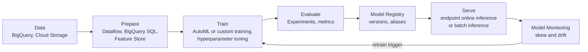

> [!IMPORTANT]
> **Naming.** The current exam guide uses **Gemini Enterprise Agent Platform** (shortened to *Agent
> Platform*). It is the successor to **Vertex AI**: the same ML services (training, pipelines,
> registry, endpoints, Feature Store, Model Garden) now carry the Agent Platform name, and Vertex AI
> no longer exists as a separate product. Older study material, and some documentation URLs, still say
> "Vertex AI". On the exam, read "Vertex AI X" and "Agent Platform X" as the same service.

Objective **2.4** has three parts: **Agent Platform Pipelines** to automate the ML lifecycle,
**data integration** for Agent Platform, and **AI Hypercomputer**, which covers GPUs and TPUs, consumption
models, large-scale training, and where Cloud Run functions fit.

## 1. The lifecycle on one platform

| Stage | Agent Platform service | Notes |
|---|---|---|
| Experiment | Notebooks (Colab Enterprise or Workbench), **Agent Platform Experiments** | Track parameters and metrics across runs |
| Train | **AutoML** (no code; tabular, image, text and video tasks) or **custom training** (your code in prebuilt or custom containers, with distributed training) | Hyperparameter tuning jobs run many trials in parallel |
| Register | **Agent Platform Model Registry** | One place for versions, evaluation results and **aliases** (e.g. `default`, `staging`). It can also register BigQuery ML models |
| Serve | **Endpoints** for low-latency online inference, with autoscaling and traffic splitting between model versions. **Batch inference** for large offline scoring | Traffic splitting supports canary rollouts |
| Monitor | **Model Monitoring** | Detects **training-serving skew** and **inference drift** in features and alerts you |
| Lineage | Vertex ML Metadata | Records which data, code and parameters produced which artifact |

## 2. Automating with Agent Platform Pipelines

**Agent Platform Pipelines** is a **serverless** orchestrator for ML workflows. You define the
pipeline with the **Kubeflow Pipelines (KFP) SDK** or **TensorFlow Extended (TFX)**, compile it, and
submit runs. There is no cluster to manage. Each step runs as a container, and artifacts and lineage
are recorded automatically. **Google Cloud Pipeline Components** provide prebuilt steps for
training, batch inference, model upload and endpoint deployment.

Google's MLOps architecture guidance describes three maturity levels:

| Level | What's automated | Typical sign in a scenario |
|---|---|---|
| **0: manual** | Nothing. Data scientists hand a model file to engineers | "Models are retrained by hand every few months, and deployments are inconsistent" |
| **1: ML pipeline automation** | **Continuous training**: the pipeline retrains automatically on new data or on a trigger, and pipeline components are reusable | "Retrain whenever new data lands or drift is detected" |
| **2: CI/CD pipeline automation** | The **pipeline itself** is built, tested and deployed by CI/CD (for example Cloud Build), as well as the model | "Many data scientists iterate on pipeline code, and changes must be tested and promoted safely" |

**Triggers** for retraining: a pipeline **schedule**, an **event** (a Cloud Run function or Eventarc
trigger on a new file in Cloud Storage, or a Pub/Sub message, calling the Pipelines API), or a **Model
Monitoring alert**. This is where *Cloud Run functions* appear in the outline. They are lightweight
glue that reacts to events and starts or post-processes ML work. They aren't a training platform.

> [!TIP]
> When a question says "orchestrate preprocessing, training, evaluation and conditional
> deployment, with lineage, and minimise operations", the answer is **Agent Platform Pipelines**.
> Cloud Composer (Airflow) is the general-purpose orchestrator for data workflows. Pick it only
> when the scenario is mostly non-ML ETL across many systems.

## 3. Preparing for data integration

Agent Platform reads from where data already lives. The exam favours **not copying data
unnecessarily**.

| Source or need | Integration pattern |
|---|---|
| Structured data in **BigQuery** | Train AutoML or custom models directly from BigQuery tables. Use **BigQuery ML** when SQL-skilled analysts can build the model in the warehouse, and register it in the Model Registry |
| Unstructured data (images, audio, documents) | Store it in **Cloud Storage**, and reference it from managed datasets or training code. Cloud Storage FUSE mounts buckets for training jobs |
| Large-scale preprocessing, batch or streaming | **Dataflow** (Apache Beam), which can also run inference inside the pipeline (RunInference) |
| Spark-based existing pipelines | Dataproc or Serverless for Apache Spark |
| Consistent features between training and serving | **Agent Platform Feature Store**, with BigQuery as the offline store and online serving for low-latency lookups. This removes training-serving skew caused by computing features twice |
| Data governance | Dataplex Universal Catalog for discovery, lineage and data quality, and IAM plus VPC Service Controls around the data |

**Readiness checklist:** data in the same region as training, service accounts with least-privilege
read access, labelled data versioned (a dataset or a snapshot table), features defined once, and
private networking (Private Service Connect or a VPC peering connection to Agent Platform) if data
must not cross the public internet.

## 4. AI Hypercomputer: accelerators, platforms and consumption

**AI Hypercomputer** is Google Cloud's integrated architecture for AI workloads. It has three layers:
**performance-optimized hardware** (NVIDIA GPUs, Cloud TPUs, high-bandwidth networking and
storage), **open software** (optimized PyTorch, JAX and TensorFlow, orchestration on GKE or Slurm
through Cluster Director), and **flexible consumption models**.

### GPUs or TPUs?

| | GPUs (NVIDIA) | Cloud TPUs |
|---|---|---|
| Strength | Broadest framework and library support (CUDA), flexible for mixed workloads, and good for inference of many model types | Google-designed ASICs optimised for large matrix operations. Very cost-efficient for **large transformer training and high-volume inference** in JAX, PyTorch/XLA or TensorFlow |
| Scale-out | Multi-GPU VMs, and GPU clusters with high-bandwidth networking | TPU **slices and pods** connected by a dedicated inter-chip interconnect |
| Choose when | Custom CUDA kernels, broad ecosystem, or smaller and varied jobs | Very large models, a framework that compiles with XLA, and price-performance at scale |

### Where to run it

| Platform | Choose when |
|---|---|
| **Agent Platform Training** and **endpoints** | Managed jobs and serving with the least infrastructure to run. Specify the accelerator type and count |
| **GKE** with GPU or TPU node pools | You already run Kubernetes, need custom schedulers, or run multi-host training and serving with fine control |
| **Compute Engine** (or Cluster Director) | Bare VM control, Slurm-based HPC-style training |
| **Cloud Run** with GPUs | Serverless inference of small or medium models that can scale to zero |
| **Cloud Run functions** | Event glue: start a pipeline, pre- or post-process, call an endpoint |

### Consumption models

| Model | Fit |
|---|---|
| **On-demand** | Ad-hoc work, when capacity happens to be available |
| **Spot VMs** | Fault-tolerant training with frequent **checkpointing**, and experiments. The cheapest option, but preemptible |
| **Dynamic Workload Scheduler, Flex-start** | Bounded-duration jobs that can wait in a queue for capacity. All requested nodes start together, which suits distributed training |
| **Reservations** (including future reservations) | Guaranteed capacity for a planned training run or for production serving |
| **Committed use discounts** | Steady, long-running inference or training fleets |

**Running large-scale training:** checkpoint to Cloud Storage regularly so that preemption or failure
costs minutes, not days. Keep data close to accelerators (same region, a high-throughput file
system or Cloud Storage FUSE with caching). Use **atomic provisioning** of whole node blocks (DWS)
so multi-host jobs don't sit half-provisioned.

## Worked example

*A media company retrains a content-classification model weekly. Today a data scientist runs
notebooks by hand, copies the model to a VM and restarts a Flask server. Leadership wants
automated retraining when new labelled data lands, safe canary releases, and drift alerts. The team
has no Kubernetes expertise.*

1. **Pipeline:** rewrite the notebook steps as a KFP pipeline on **Agent Platform Pipelines**: a Dataflow preprocessing component, then custom training on GPUs, evaluation, a conditional "if better than production, upload to Model Registry", and deploy.
2. **Trigger:** a **Cloud Run function**, fired by an Eventarc trigger when labelled data lands in Cloud Storage, submits a pipeline run. That is MLOps level 1, continuous training.
3. **Serve:** an **endpoint** with **traffic splitting** of 10% to the new version, promoted after checking metrics. The Registry alias moves to the new version.
4. **Monitor:** **Model Monitoring** on the endpoint for feature drift, and its alert can trigger a retrain.
5. **Capacity:** training on **Spot** GPUs with checkpointing, because the weekly job tolerates delay. Serving on on-demand capacity with autoscaling.

Why not GKE with Kubeflow? It works, but it adds a cluster the team can't run. Why not Cloud
Composer? It is less ML-aware, with no built-in artifact lineage or prebuilt ML components.

## Check yourself

1. Features are computed in SQL for training and recomputed in Java for serving, and model quality drops in production. What service addresses this?
2. A 2-week LLM fine-tuning job on 256 accelerators needs all nodes up at once, but no long-term commitment. Which consumption option fits?
3. What distinguishes MLOps level 2 from level 1?

Answers

1. Agent Platform Feature Store: define features once and serve the same values online, removing training-serving skew. Model Monitoring will detect the skew in the meantime.
2. Dynamic Workload Scheduler (Flex-start, or a future reservation for a fixed calendar window). Spot would risk preemption of a tightly coupled job, and committed use discounts need a 1- or 3-year term.
3. At level 2, the pipeline code itself goes through CI/CD (build, test, deploy the pipeline). At level 1, only training runs automatically.

## Sources

Agent Platform naming and component names come from the Agent Platform introduction and overview pages. Pipelines,
Model Registry, Feature Store, training, inference and monitoring behaviour come from their
Agent Platform documentation pages, and the MLOps levels from Google's MLOps continuous-delivery architecture
guide. AI Hypercomputer layers and consumption options come from the AI Hypercomputer overview, and accelerator
characteristics from the Cloud TPU introduction and the Compute Engine GPU docs. See this module's sources list.
