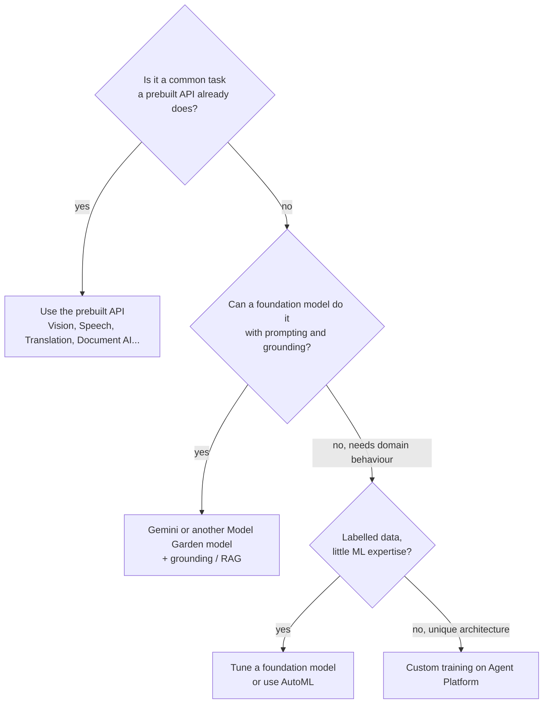

Objective **2.5** asks you to **differentiate the Google AI APIs** (search, conversation, vision, image,
video, audio), **integrate Gemini Enterprise features** (AI agents and NotebookLM) into workflows, and
**integrate models from Model Garden**. The case studies lean on this objective heavily. Altostrat
wants summaries, metadata extraction and content moderation. Cymbal wants attribute generation,
image variants and conversational shopping. EHR and KnightMotives want agents over their own data.

## 1. The decision ladder

The exam's rule: **use the most managed option that meets the requirement.** Don't train a model
to read invoices when Document AI has an invoice processor, and don't build OCR when the Vision API
does it.

## 2. The Google AI APIs

| Modality | Service | What it does | Classic scenario |
|---|---|---|---|
| **Vision (images)** | **Cloud Vision API** | Labels, objects, OCR (text and document text detection), logos, landmarks, faces, **SafeSearch** (adult, violent and racy content) | Moderate user-uploaded images, or extract text from photos |
| **Image generation and editing** | **Imagen** on Agent Platform (in Model Garden) | Text-to-image, editing, inpainting and outpainting, variations, upscaling | Cymbal's product-image variations, with a human review step |
| **Video** | **Video Intelligence API** | Shot changes, labels, **explicit content detection**, object tracking, on-screen text, speech transcription | Index a video library, and flag unsafe frames |
| **Audio in** | **Speech-to-Text** (Chirp models) | Transcription in batch or streaming, many languages, diarization | Transcribe podcasts and calls |
| **Audio out** | **Text-to-Speech** | Natural voices, SSML, custom voice | IVR prompts, accessibility |
| **Language** | **Natural Language API** | Entities, sentiment, content classification, **text moderation** | Classify articles, and screen comments |
| **Translation** | **Cloud Translation** (Basic and Advanced) | Text and **document** translation, **glossaries**, custom and adaptive translation | Localise a catalogue with consistent brand terms |
| **Documents** | **Document AI** | OCR, Form Parser, Layout Parser and **specialized processors** (invoices, receipts, IDs, lending), with Custom Extractor and classifier | Extract fields from insurer claim forms (EHR) |
| **Search** | **Agent Search** (formerly Vertex AI Search) | Google-quality search, recommendations and RAG over websites and structured and unstructured data (custom, media and healthcare search) | Natural-language product discovery (Cymbal), and an intranet knowledge search |
| **Conversation** | **Conversational Agents** (Dialogflow CX) and the **Customer Engagement Suite** (including Agent Assist) | Chat and voice virtual agents with flows plus generative playbooks, telephony integration, real-time help for human agents | Replace Cymbal's IVR and manual order entry with a voice agent |

> [!NOTE]
> Google has renamed several of these services recently. The search product has carried the names
> Enterprise Search, Vertex AI Search and AI Applications before **Agent Search**. Expect any of those names on the exam.

> [!TIP]
> Video moderation uses the **Video Intelligence API** (explicit content detection), and image
> moderation uses **Vision SafeSearch**. Text moderation is the **Natural Language API**. For
> generative AI input and output, use **Model Armor** (section 6). Match the modality first.

## 3. Foundation models and Model Garden

**Model Garden** is Agent Platform's catalogue of models:

- **Google first-party** models: Gemini (multimodal text, image, audio and video understanding), Imagen, Veo (video generation), Chirp (speech), and embeddings.
- **Partner models** offered as managed APIs (model-as-a-service), with billing through Google Cloud.
- **Open models** (for example Gemma and other open-weight families), which you **deploy** to an Agent Platform endpoint or to GKE, and which you can tune.

**Integrating a Model Garden model** typically means one of three things: call a managed API
(nothing to host), deploy an open model to a dedicated endpoint (you choose the machine and
accelerators, and pay for uptime), or deploy to GKE when you need your own serving stack.
Choose an open model when you need weights you control, self-hosting, or a specific licence. Choose
a managed Gemini model when you want the least operations and the strongest general capability.

**Adapting a model**, in order of effort:

1. **Prompt design** and system instructions.
2. **Grounding**: connect responses to **Google Search** (fresh public facts), to **your data** through Agent Search (formerly Vertex AI Search), or to a **RAG Engine** corpus. Grounding cuts hallucination and can return citations.
3. **Supervised tuning**: teach a style, format or domain task from labelled examples.
4. Full custom training (rarely the right exam answer for gen AI).

**Vector Search** provides the low-latency similarity search behind custom RAG and recommendation
systems, at very large scale.

## 4. Building agents on Agent Platform

| Component | Role |
|---|---|
| **Agent Development Kit (ADK)** | Open-source, model-agnostic code framework for agents and multi-agent systems |
| **Agent Studio** | Visual canvas for designing and prototyping agent logic |
| **Agent Garden** | Catalogue of sample agents and tools to start from |
| **Agent Runtime** (formerly Agent Engine) | Managed, scalable runtime to deploy and run agents |
| **Sessions** and **Memory Bank** | Short-term conversation state, and long-term memory across sessions |
| **Agent Registry, Agent Identity, Agent Gateway** | Governance: catalogue agents and tools, give each agent an identity, and enforce policy on tool calls (Model Armor integrates here) |

An **agent** combines a model, instructions, **tools** (APIs, functions, other agents, MCP
servers, data stores) and memory to complete multi-step tasks, such as "check stock, place the order,
email the confirmation". Use one when the task needs actions and decisions, not just an answer.

## 5. Gemini Enterprise: agents and NotebookLM for employees

**Gemini Enterprise** is the employee-facing product: a secure chat and agent workspace that
connects to company data sources (Google Workspace, Microsoft 365, Salesforce, Jira, ServiceNow,
Confluence and others) through **connectors**, while respecting each user's existing access
permissions. It offers:

- **Prebuilt Google agents** (for example deep research and idea generation), and **custom agents** built without code in the agent designer or with ADK and published to an **agent gallery** for colleagues.
- **NotebookLM Enterprise** (the exam guide's name; current docs also title it *Gemini Notebook Enterprise*): notebooks whose answers are **grounded in the sources you add** (PDFs, Docs, Slides, Office files, URLs, audio), with summaries and audio overviews. Data stays in your Google Cloud project, under enterprise controls (IAM roles, CMEK, US or EU data residency, VPC Service Controls). It suits "help staff digest policy manuals or research packs with answers traceable to the source".

**Platform versus product:** if *developers* are building an agent into a customer-facing app, the answer is
**Agent Platform** (ADK, Agent Runtime, Model Garden). If *employees* need AI over their
workplace data with little or no build, the answer is **Gemini Enterprise**.

## 6. Securing AI integrations with Model Armor

**Model Armor** screens prompts **and** responses for any model (it's model-agnostic):

- **Prompt injection and jailbreak** detection.
- **Sensitive data** detection and de-identification through **Sensitive Data Protection**.
- **Malicious URL** detection.
- **Responsible AI** filters (hate, harassment, sexually explicit, dangerous content) at configurable confidence levels.

You configure **templates** of filters and call Model Armor inline from the app, or rely on its
integrations (for example with Agent Gateway). It complements the model's built-in safety settings
and is the outline's named control for securing AI (covered further in Section 3).

## Worked example

*Altostrat Media wants to (a) auto-generate summaries and topic metadata for 20 years of podcasts and
video, (b) flag inappropriate content with an auditable, explainable trail, and (c) offer a 24/7
natural-language assistant that answers questions about its catalogue.*

| Need | Design |
|---|---|
| Transcripts | **Speech-to-Text** (Chirp) batch transcription of audio. Gemini can also take audio and video directly for shorter assets |
| Summaries and metadata | **Gemini** (managed, through Agent Platform) prompted with the transcript or video for a structured JSON summary, topics and entities. **Agent Platform Pipelines** or a batch job processes the back catalogue |
| Moderation | **Video Intelligence** explicit content detection for frames, and **Natural Language** moderation for transcripts. Write scores and model versions to BigQuery for audit. Send borderline items to human review |
| Assistant | An agent built with **ADK** on **Agent Runtime**, **grounded** with Agent Search over the catalogue metadata, with **Model Armor** screening prompts and responses |

Why not train a custom moderation model? Prebuilt detectors already cover the categories, and
their scores give an explainable, auditable signal. A custom model would add training data, MLOps
burden and explainability work.

## Check yourself

1. Thousands of scanned supplier invoices must have totals, dates and line items extracted. Which service?
2. A team wants to self-host an open-weight model in its own VPC and fine-tune it. Where does it start?
3. HR wants staff to ask questions about 300 policy PDFs, with every answer cited to the source document, and no app to build. What do you recommend?

Answers

1. Document AI's Invoice Parser, a specialized processor. Vision OCR alone would return text without the field structure.
2. Model Garden: choose the open model, then tune it and deploy it to an Agent Platform endpoint (or GKE) with private connectivity.
3. NotebookLM Enterprise (part of the Gemini Enterprise offering): source-grounded answers with citations and enterprise controls, with nothing to build.

## Sources

API capabilities come from the Vision, Video Intelligence, Speech-to-Text, Text-to-Speech, Translation, Natural
Language and Document AI documentation. Imagen, Model Garden, grounding and RAG Engine come from the
generative AI docs on Agent Platform, and agent components from the Agent Platform overview. Gemini Enterprise
and NotebookLM Enterprise come from their product documentation, and Model Armor from its overview. See this
module's sources list.
