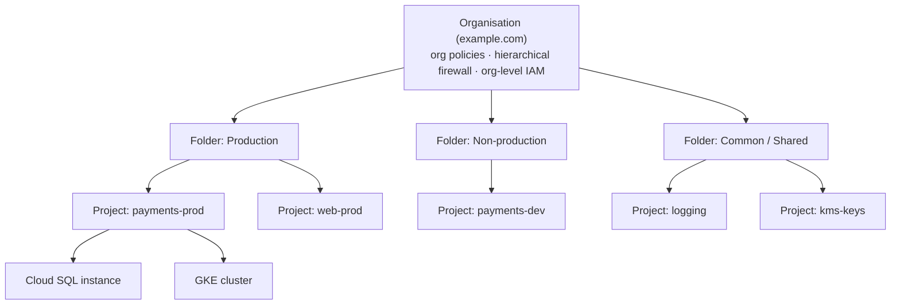

Objective **3.1** opens with IAM, the resource hierarchy and separation of duties. These three ideas
decide almost every "who can do what, where" question on the exam, and they are the foundation for the
data and network controls in the next lessons.

## The resource hierarchy

Google Cloud resources sit in a tree:

| Level | What it is for | Key facts |
|---|---|---|
| **Organisation** | The root, tied to one Cloud Identity or Google Workspace domain | Created automatically when the domain's first project is made. Organisation Administrator manages it. |
| **Folders** | Grouping by environment, business unit or regulatory scope | Can nest. The usual place to attach IAM and policies that apply to a group of projects. |
| **Projects** | The trust and billing boundary for resources | Every resource belongs to exactly one project; APIs, quotas and billing are per project. |
| **Resources** | VMs, buckets, datasets, keys | Some support their own IAM policy (buckets, datasets, secrets, keys). |

Two rules make the hierarchy powerful:

1. **IAM allow policies are inherited downward and are additive.** A resource's effective policy is the
   union of its own bindings and every ancestor's. You **cannot** remove, at a project, a role that was
   granted at the folder above it with an allow policy.
2. **Organisation policies are also inherited**, but a child can be allowed to merge with or override
   the parent's policy, depending on how the policy is written.

The enterprise foundations blueprint, Google's reference landing zone, uses folders per environment
(production, non-production, development) plus a shared/common folder for logging, key management and
networking projects. That shape is the safe default for exam answers.

> [!TIP]
> When a question asks how to give a team the same access to "all current and future projects" of a
> department, the answer is a **group** bound at the **folder**, not per-project bindings and not the
> organisation.

## Principals, roles and policies

An **allow policy** binds **principals** to **roles** on a resource. Principals include Google
accounts, **Google groups**, service accounts, a whole Cloud Identity domain, and federated identities
(workforce and workload pools).

Grant roles to **groups**, not individual users. Joiners and leavers are then handled in the
identity system (Cloud Identity, or your IdP synchronised into it) rather than by editing dozens of
IAM policies.

### Role types

| Role type | Examples | When to use |
|---|---|---|
| **Basic** | Owner, Editor, Viewer | Almost never in production. Thousands of permissions across all services. Google advises against them. |
| **Predefined** | `roles/storage.objectViewer`, `roles/cloudsql.client`, `roles/compute.networkAdmin` | The default choice. Google maintains them as services change. |
| **Custom** | Your own list of permissions | When no predefined role is narrow enough. Can be created at **organisation or project** level (not folder). You must maintain them when Google adds permissions. |

> [!WARNING]
> "Give the developers Editor on the project" is a classic wrong answer. Editor can modify almost every
> resource and lets a user act as many service accounts. Look for a predefined role scoped to the job.

Other IAM tools you will see in answers:

- **IAM Conditions** add attribute-based rules to a binding, for example "only until 31 March", or
  "only on resources tagged `env=dev`".
- **Deny policies** are evaluated **before** allow policies and block named permissions for named
  principals however they were granted, with exceptions. Use them for "nobody except the security
  group may delete these keys, whatever roles they hold".
- **Privileged Access Manager (PAM)** grants just-in-time, time-bound elevation, optionally with
  approval and justification, all logged. It replaces standing admin rights.
- **The role recommender** (Policy Intelligence) uses observed permission use to suggest removing or
  narrowing excess grants, which is how you drive least privilege on an existing estate.

## Service accounts and keyless authentication

A **service account** is an identity for a workload. It is both a principal (it can be granted roles)
and a resource (others can be granted roles *on* it, such as permission to impersonate it).

The biggest service-account risk is the **user-managed key**: a long-lived JSON private key that can be
copied, committed to Git and used from anywhere. Google's best practice is to avoid keys entirely:

| Where the code runs | Keyless option |
|---|---|
| Compute Engine, Cloud Run, Cloud Run functions, App Engine | **Attach** a single-purpose service account to the resource; the metadata server supplies short-lived tokens. |
| GKE | **Workload Identity Federation for GKE**: map each Kubernetes service account to an IAM principal so each pod gets only its own permissions. |
| AWS, Azure, on-premises with an OIDC or SAML IdP, GitHub Actions, GitLab | **Workload Identity Federation**: the external workload exchanges its own credential for a short-lived Google token. |
| A human or tool that needs a service account's rights briefly | **Service account impersonation** with the Service Account Token Creator role; the audit log records both identities. |

Other service-account rules worth memorising:

- One service account per application or purpose, with only the roles it needs.
- Do not use the **Compute Engine default service account** with its historic Editor grant. The
  `iam.automaticIamGrantsForDefaultServiceAccounts` constraint stops that grant on new projects.
- The `iam.disableServiceAccountKeyCreation` organisation policy blocks key creation outright; Google
  enforces it by default on newer organisations.
- `iam.serviceAccountUser` on a service account lets someone deploy resources that run *as* it, so
  treat it as a privileged grant.

## Identity for people: Cloud Identity and Workforce Identity Federation

| Approach | How it works | Choose it when |
|---|---|---|
| **Cloud Identity / Google Workspace + Google Cloud Directory Sync (GCDS)** | Users and groups are synchronised from Active Directory or LDAP into Cloud Identity; SSO to your IdP via SAML | You want Google identities and Google groups (for example to use Google Workspace or group-based IAM everywhere). |
| **Workforce Identity Federation** | Users authenticate with an external IdP (Microsoft Entra ID, Okta, etc.) and access Google Cloud as federated principals; **no user sync** | You must not, or would rather not, copy identities into Google, for example a strict policy that the IdP is the sole source of identity. |

Either way, enforce **multi-factor authentication** at the IdP and keep a small number of
emergency ("break-glass") super-admin accounts that are not federated.

## Organisation policies: guardrails on configuration

IAM decides **who** can act. The **Organization Policy Service** decides **what configurations are
allowed at all**, whoever is acting. An Owner still cannot create an external IP if a policy forbids
it.

| Constraint | Effect |
|---|---|
| `iam.allowedPolicyMemberDomains` | Domain-restricted sharing: only identities from your Cloud Identity customer IDs can be granted roles |
| `iam.disableServiceAccountKeyCreation` | No user-managed service account keys |
| `gcp.resourceLocations` | Resources only in allowed regions (data residency) |
| `compute.vmExternalIpAccess` | No (or only listed) VMs with external IPs |
| `compute.requireOsLogin` | SSH access controlled by IAM via OS Login |
| `sql.restrictPublicIp` | No public IP on Cloud SQL |
| `storage.uniformBucketLevelAccess` | Buckets use IAM only, no object ACLs |
| `compute.requireShieldedVm` | Only Shielded VMs |
| `gcp.restrictNonCmekServices` | Listed services must use customer-managed keys |

Policies are set at organisation, folder or project level, inherit downward, and can be tested in
**dry-run** mode before enforcement. **Custom constraints** let you write your own rules on supported
resource fields with CEL.

> [!TIP]
> If the requirement is "prevent anyone, including project owners, from doing X", look for an
> **organisation policy** (or a deny policy for permissions). Granting fewer roles alone does not
> satisfy "including owners".

## Separation of duties

Separation of duties means no single person can both perform and approve, or both administer and
use, a sensitive function. On Google Cloud you build it from structure:

1. **Separate projects for separate trust domains.** Keep Cloud KMS keys in a dedicated key project,
   logs in a dedicated logging project, and shared VPC networking in a host project run by the network
   team. Owners of the application project then have no rights over the keys or logs.
2. **Separate roles.** In Cloud KMS, `roles/cloudkms.admin` manages keys but cannot encrypt or
   decrypt; `roles/cloudkms.cryptoKeyEncrypterDecrypter` uses keys but cannot manage them. Give them to
   different groups.
3. **Separate groups per duty**: for example `gcp-security-admins`, `gcp-network-admins`,
   `gcp-billing-admins`, `gcp-auditors` (Viewer plus Logs Viewer and Private Logs Viewer).
4. **No standing high privilege**: use PAM for time-bound elevation, and alert on use of break-glass
   accounts.

### Worked example: a payments platform

*A retailer is moving a payments service to Google Cloud. Requirements: developers deploy to
non-production freely but cannot touch production data; production changes go through CI/CD only; the
security team manages encryption keys and no one else may; auditors need read-only access to every
project; no service account keys are allowed.*

| Requirement | Design |
|---|---|
| Developers free in non-prod, no prod data | Folders `prod` and `nonprod`. Bind the `payments-devs` group to predefined roles (for example `roles/run.developer`, `roles/cloudsql.client`) on the **nonprod folder** only. |
| Prod via CI/CD only | A Cloud Build service account in a CI project holds deploy roles on the prod folder; developers can trigger builds but hold no deploy roles in prod. Emergency access through **PAM** with approval. |
| Security owns the keys | Keys in a `kms-keys` project under a common folder; `roles/cloudkms.admin` for `security-admins` only; the services' service agents get `cryptoKeyEncrypterDecrypter`. A **deny policy** blocks key destruction for everyone else. |
| Auditors read-only everywhere | `gcp-auditors` bound at the **organisation** to Viewer-type roles and log viewing roles. |
| No keys | `iam.disableServiceAccountKeyCreation` enforced at the organisation; GitHub-based tooling uses **Workload Identity Federation**. |

Every element meets one stated requirement with a managed, low-burden control, which is what the exam
rewards.

## Exam traps

> [!WARNING]
> - A narrower grant lower down does **not** remove a broader grant higher up. Fix the higher grant.
> - Custom roles cannot be created at folder level.
> - "Download a service account key and store it in Secret Manager" is still a key. Prefer keyless
>   options whenever one exists.
> - Organisation policy restricts **configurations**; IAM restricts **principals**. Know which one the
>   question needs.

## Check yourself

1. A team lead must be able to manage Compute Engine instances in every current and future project of
   the analytics department, and nothing else. Where and what do you grant?
2. A Jenkins server on AWS EC2 must deploy to Cloud Run. The security policy bans long-lived
   credentials. What do you use?
3. An Owner of a project insists they must be able to give a contractor's personal Gmail account
   Viewer access. Your organisation enforces domain-restricted sharing. What happens, and why?

Answers

1. Bind the department's admin **group** to `roles/compute.instanceAdmin.v1` on the **analytics
   folder**. Inheritance covers future projects; the predefined role keeps it to Compute Engine.
2. **Workload Identity Federation** with an AWS provider in a workload identity pool, allowed to
   impersonate (or granted roles as) a dedicated deploy service account. No key is ever created.
3. The grant fails. `iam.allowedPolicyMemberDomains` is an organisation policy, so it limits what
   any principal, Owners included, can configure, and the Gmail account is outside the allowed domains.

**Sources:** Google Cloud documentation on the resource hierarchy, IAM roles, custom roles, service
account best practices, impersonation, Workload and Workforce Identity Federation, Cloud Identity,
organisation policies, deny policies, IAM Conditions, Privileged Access Manager, role recommendations
and Cloud KMS separation of duties; the enterprise foundations blueprint; the Well-Architected
Framework security pillar.
