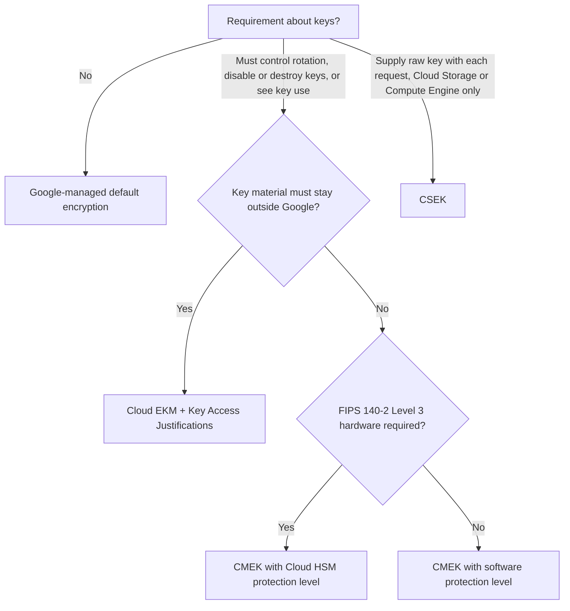
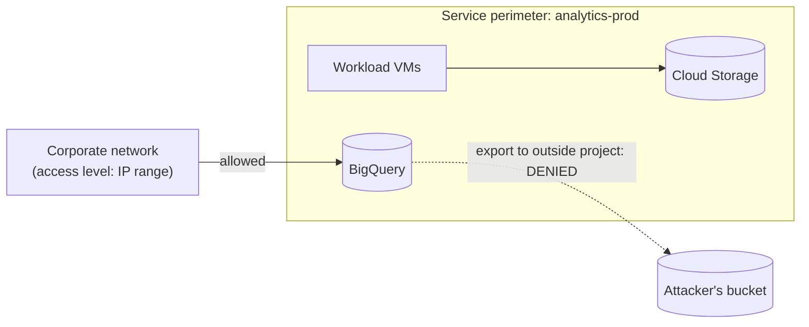

This lesson covers the **data security** bullets of objective **3.1**: key management, encryption,
secret management, managing customer-managed encryption keys with Cloud KMS, and the VPC Service
Controls and context-aware access security controls.

## What Google already does for you

| Layer | Default protection | Customer action needed |
|---|---|---|
| **At rest** | All customer content is encrypted with **AES-256** using **envelope encryption**: data is encrypted with data encryption keys (DEKs), which are wrapped by key encryption keys (KEKs) held in Google's internal key management. | None. It cannot be turned off. |
| **In transit to Google** | Traffic to Google APIs and to external load balancers terminates TLS at the **Google Front End**. | Use HTTPS; choose an SSL policy with modern TLS versions on your load balancers. |
| **In transit inside Google** | Traffic between Google data centres, and service-to-service RPC, is authenticated and encrypted (ALTS and network-layer encryption). | None. |
| **Your own links** | Cloud Interconnect is **not** encrypted by default. | Add HA VPN over Interconnect or MACsec for Cloud Interconnect when a requirement says data must be encrypted on the private link. |

So "encrypt the data at rest" alone never justifies extra work. Extra key options exist for **control**
over the key, not for encryption itself.

## Choosing a key option

| Option | Where the key lives | Who controls it | Typical requirement |
|---|---|---|---|
| **Google-managed (default)** | Google's internal KMS | Google | No specific key requirement |
| **CMEK, software** | Cloud KMS in your project | You: rotation period, location, IAM, disable, destroy | "We must be able to revoke access to our data" or "rotate keys every 90 days" |
| **CMEK, Cloud HSM** | Google-managed cluster of **FIPS 140-2 Level 3** certified HSMs, used through the Cloud KMS API | You | "Keys must be protected by validated hardware" |
| **Cloud EKM** | A supported **external key manager** outside Google (partner or your own) | You, outside Google; Google must call out for every wrap/unwrap | "Keys must never be held by the cloud provider", sovereignty, "we must be able to cut Google off" |
| **CSEK** | Nowhere in Google; you send the raw AES key with each API call | You entirely; lose it and the data is gone | Rare. Only Cloud Storage and Compute Engine disks support it. |

With **CMEK**, Google services still do the encryption, but the KEK is your Cloud KMS key. Disabling
or destroying the key version makes the data unreadable (**crypto-shredding**). Key use shows up in
Cloud Audit Logs.

**Autokey** removes most of the toil: when someone creates a resource that needs CMEK, Autokey creates
a key ring and key in a dedicated key project, in the right location, with the recommended protection
level and IAM. It is the low-operational-burden way to get "CMEK everywhere".

**Key Access Justifications** (used with Cloud EKM) attaches a reason to each request Google makes to
your external key manager, so you can approve or refuse decryption by reason.

### Cloud KMS design rules

- **Location must match the data.** A regional resource in `europe-west3` needs a key in
  `europe-west3` (or a compatible multi-region). Plan key rings per location.
- **Key hierarchy:** project → key ring (location) → key (purpose, protection level, rotation) →
  key versions. Destroying a key version is scheduled, with a waiting period during which it can still
  be restored, so a mistaken destroy is recoverable for a short time.
- **Rotation:** set an automatic rotation period on symmetric keys. New data uses the new primary
  version; old versions stay enabled to decrypt older data.
- **Separation of duties:** keys in a dedicated project; key admins (`cloudkms.admin`) differ from key
  users; grant `cryptoKeyEncrypterDecrypter` to the **service agent** of the service that uses the key
  (for example the Cloud SQL or BigQuery service agent), not to people.
- **Enforcement:** the `gcp.restrictNonCmekServices` organisation policy requires CMEK for the listed
  services, and `gcp.restrictCmekCryptoKeyProjects` limits which key projects may be used.

> [!TIP]
> "Must be able to immediately revoke Google's ability to decrypt our data" → CMEK (disable the key).
> "Keys must be stored outside Google Cloud" → **Cloud EKM**. "Keys in a FIPS 140-2 Level 3 HSM" →
> **Cloud HSM**. Do not choose CSEK unless the question says the customer supplies the raw key per request.

## Secret Manager

Passwords, API keys and certificates belong in **Secret Manager**, never in source code, container
images or plain environment variables in a deployment file.

| Feature | Why it matters |
|---|---|
| **Versions** | Rotate by adding a version; pin apps to `latest` or a specific version; disable old versions. |
| **IAM per secret** | Grant `roles/secretmanager.secretAccessor` on the one secret to the one service account that needs it. |
| **Replication policy** | Automatic, or user-managed to named regions for data residency. |
| **CMEK** | Secrets can be encrypted with your Cloud KMS keys. |
| **Rotation schedules** | Secret Manager publishes a rotation notification to Pub/Sub; your function performs the actual rotation. |
| **Audit logs** | Every access is recorded in Data Access audit logs (once enabled). |

Cloud Run and GKE can mount secrets as files or environment variables directly from Secret Manager.

## Sensitive Data Protection

**Sensitive Data Protection** (which includes the Cloud DLP API) finds and transforms sensitive data.

- **Discovery** builds data profiles across BigQuery, Cloud SQL and Cloud Storage, showing where PII,
  card numbers or health identifiers live and how sensitive each table or bucket is. Findings can go to
  Security Command Center.
- **Inspection** scans content for **infoTypes** (built-in detectors such as `CREDIT_CARD_NUMBER`,
  `EMAIL_ADDRESS`, `US_SOCIAL_SECURITY_NUMBER`, plus custom ones).
- **De-identification** transforms what it finds:

| Technique | Reversible? | Use it for |
|---|---|---|
| Redaction / masking (`****1234`) | No | Display, support tools |
| Bucketing / generalisation (age 30–39) | No | Analytics that need ranges, not values |
| Date shifting | No (consistently shifted) | Research data keeping intervals intact |
| Cryptographic hashing | No | Joining on a token without revealing the value |
| **Deterministic encryption / format-preserving encryption (FPE)** | **Yes, with the key** | Tokenising card numbers or IDs so authorised systems can re-identify; FPE keeps the format |

The de-identification key is wrapped by a Cloud KMS key, so re-identification is itself controlled by
IAM.

## VPC Service Controls

IAM answers "is this identity allowed?" It does not stop a **legitimate, compromised or careless
identity** from copying data out of BigQuery or Cloud Storage to a project the attacker owns.
**VPC Service Controls** closes that gap by drawing a **service perimeter** around projects:

- Google API calls that cross the perimeter (for example `bq extract` to a bucket outside, or reading a
  bucket from the internet) are denied, **even with valid credentials**.
- **Access levels** from **Access Context Manager** (IP ranges, device posture, identity, region) let
  defined callers in from outside.
- **Ingress and egress rules** allow specific, narrow cross-perimeter flows (for example one partner
  project may read one bucket).
- **Perimeter bridges** connect two perimeters.
- **Dry-run mode** logs what *would* be blocked so you can tune before enforcing.
- On-premises hosts reach protected services privately through **restricted.googleapis.com** (Private
  Google Access) over Interconnect or VPN.

> [!WARNING]
> VPC Service Controls protects **Google API** access (BigQuery, Cloud Storage, Agent Platform and so
> on). It is not a VPC firewall and does not filter VM-to-VM traffic. Firewalls and VPC SC solve
> different problems.

## Worked example: health analytics

*A provider builds an analytics platform on BigQuery with patient data. Requirements: (1) the
organisation must be able to cut off access to the data instantly; (2) no data may leave approved
projects even if an analyst's credentials are stolen; (3) analysts see de-identified data only, while
a small clinical team can re-identify; (4) the ETL job's database password must rotate monthly.*

| # | Control |
|---|---|
| 1 | **CMEK** on the BigQuery datasets with keys in a separate key project (Autokey to keep it simple). Disabling the key version cuts access. |
| 2 | **VPC Service Controls** perimeter around the analytics and landing projects, with an access level for the corporate IP range and dry-run first. |
| 3 | **Sensitive Data Protection** de-identification in the pipeline: FPE or deterministic encryption on patient IDs (reversible with KMS-wrapped key for the clinical team's service), masking on free-text fields. Analysts get roles on the de-identified dataset only. |
| 4 | Password in **Secret Manager**, rotation schedule notifying a Cloud Run function; the ETL service account has `secretAccessor` on that secret only. |

## Check yourself

1. A bank requires that encryption keys for its Cloud Storage data never be held by Google and that it
   can refuse any decryption request. Which option?
2. A data scientist with BigQuery Data Viewer could copy a sensitive table to a personal project. Which
   control stops this, and does IAM alone?
3. Which de-identification method lets an authorised system recover the original card number while
   keeping it 16 digits long?

Answers

1. **Cloud EKM**, with Key Access Justifications to approve or refuse each request by reason. CMEK and
   Cloud HSM keys are still held in Google infrastructure.
2. **VPC Service Controls**. IAM alone cannot stop it, because the viewer legitimately holds read
   permission; the perimeter blocks the cross-perimeter copy.
3. **Format-preserving encryption** in Sensitive Data Protection, with the key wrapped by Cloud KMS.

**Sources:** Google Cloud documentation on default encryption at rest, encryption in transit, CMEK,
Cloud HSM, Cloud EKM, Autokey, Cloud KMS separation of duties, Secret Manager, Sensitive Data
Protection and pseudonymisation, VPC Service Controls, Access Context Manager, organisation policies
and Cloud Audit Logs; the enterprise foundations blueprint.
