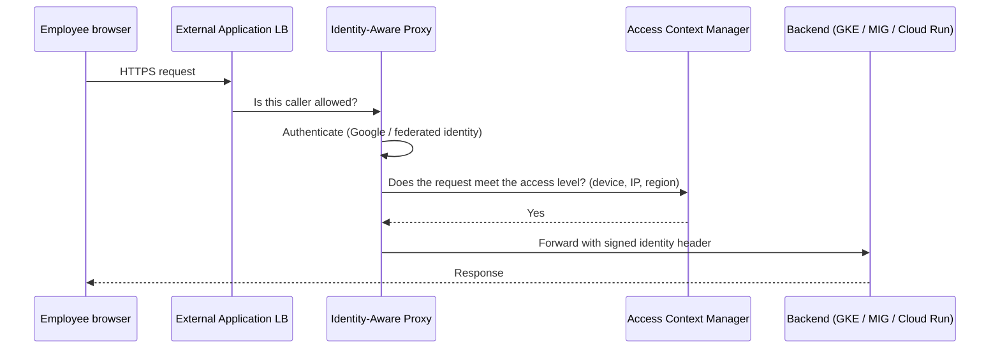
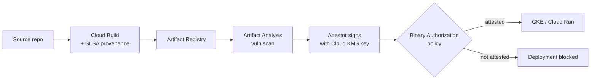

This lesson covers the rest of objective **3.1**: security controls (context-aware access and
hierarchical firewall policy), **secure remote access** (Identity-Aware Proxy, service account
impersonation, Chrome Enterprise Premium, Workload Identity Federation) and **securing the software
supply chain**, plus the workload hardening and posture tools that show up in case-study answers.

## Zero trust: access by identity and context, not network location

Google's model (originally BeyondCorp) treats the corporate network as untrusted. Every request is
authenticated and authorised on **who** is asking and **from what context** (device, location,
time), wherever it comes from.

| Need | Google pattern | Replaces |
|---|---|---|
| Employees use an internal web app | **Identity-Aware Proxy (IAP)** in front of the app's load balancer (or Cloud Run / App Engine); grant `IAP-secured Web App User` to a group | VPN plus app login |
| Admins SSH or RDP to VMs with no external IP | **IAP TCP forwarding**: allow ingress from `35.235.240.0/20` on port 22/3389, grant `IAP-secured Tunnel User`, use OS Login for SSH | Bastion hosts with public IPs |
| Access depends on device posture or location | **Context-aware access**: access levels in **Access Context Manager** attached to IAP or to the console/APIs | IP allowlists only |
| Zero-trust access to SaaS and private apps, plus data-loss and threat protection in the browser | **Chrome Enterprise Premium** (formerly BeyondCorp Enterprise) | Legacy VPN and secure web gateway |
| A person needs a service account's permissions for a task | **Service account impersonation** (Token Creator role), short-lived token | Downloaded service account key |
| A workload outside Google Cloud calls Google APIs | **Workload Identity Federation** | Service account key in the CI system |

> [!TIP]
> "Remote employees need access to an internal app without a VPN" → **IAP** (plus context-aware access
> if device posture is mentioned). "Contractors should SSH to VMs that have no public IP" → **IAP TCP
> forwarding**. Neither needs a bastion host.

## Network controls

### Firewall policies (Cloud Next Generation Firewall)

| Layer | Who manages it | Use it for |
|---|---|---|
| **Hierarchical firewall policy** on the organisation or a folder | Central security team | Rules every project must obey, for example "deny all ingress from the internet except to load balancer ranges", "always allow the IAP range and health checks". Can `allow`, `deny` or `goto_next` (delegate to lower levels). |
| **Global or regional network firewall policy** on a VPC | Network / project team | The VPC's own rules; supports secure tags and FQDN and geolocation objects. |
| **VPC firewall rules** (legacy) | Project team | Still supported; firewall policies are preferred for new designs. |

Hierarchical policies are evaluated **first**, organisation then folder, so a central `deny` cannot be
overridden by a project rule. That is how you enforce a security baseline while letting teams own
their own `allow` rules. Cloud NGFW Enterprise adds intrusion prevention (IPS) and TLS inspection.

### Cloud Armor

**Cloud Armor** is attached as a security policy to backends of **external Application Load
Balancers** (and some other load balancer types). It provides:

- **DDoS protection** at the edge, and **Adaptive Protection** that learns traffic and proposes rules
  during layer-7 attacks;
- **Preconfigured WAF rules** based on the OWASP ModSecurity Core Rule Set (SQL injection, XSS, etc.);
- **Rate limiting** and bot management, **IP and geography** allow/deny lists, custom rules in CEL.

Cloud Armor protects internet-facing applications. It is not used for VM-to-VM traffic (that is
firewalls) or for Google API exfiltration (that is VPC Service Controls).

### Private access to Google services

- **Private Google Access** lets VMs with only internal IPs reach Google APIs. Use the
  `private.googleapis.com` VIP normally, or `restricted.googleapis.com` when the APIs sit inside a
  VPC Service Controls perimeter.
- **Private Service Connect** gives you a private endpoint (an internal IP in your VPC) for Google APIs
  or for a producer's published service, including from on-premises over Interconnect.
- Combined with `compute.vmExternalIpAccess` and Cloud NAT for controlled outbound internet, this keeps
  workloads off the public internet.

## Securing the software supply chain

Attackers increasingly target what you build and deploy (compromised dependencies, tampered build
systems, unscanned images). Google maps controls to each stage, aligned with the open **SLSA**
framework:

| Stage | Control |
|---|---|
| Dependencies | **Assured Open Source Software**: Google-built, scanned copies of popular packages with provenance; Artifact Registry remote/virtual repositories to control what is pulled |
| Source | Branch protection and code review in your SCM |
| Build | **Cloud Build** on hermetic, ephemeral workers; generates signed **SLSA build provenance**; private pools with no public IPs |
| Artefacts | **Artifact Registry** + **Artifact Analysis** vulnerability scanning (automatic on push, and continuous for new CVEs) |
| Deploy | **Binary Authorization**: GKE and Cloud Run only run images that carry the required **attestations** (built by our pipeline, passed scanning, approved by QA); break-glass is logged |
| Runtime | GKE security posture, Container Threat Detection in Security Command Center, continuous validation of running images |

> [!TIP]
> "Ensure only images built by our CI pipeline and free of critical vulnerabilities can be deployed
> to production GKE" → **Binary Authorization** with attestations from Cloud Build and Artifact
> Analysis. Scanning alone only reports; Binary Authorization **enforces**.

## Hardening compute

| Feature | Protects against | Notes |
|---|---|---|
| **Shielded VM** | Boot-level malware, rootkits, tampered kernels | Secure Boot, virtual TPM with measured boot, integrity monitoring. Enforce with `compute.requireShieldedVm`. |
| **Confidential VM** | Access to **data in use** in memory, including by the host | Hardware memory encryption (AMD SEV / SEV-SNP, Intel TDX) with attestation. Also Confidential GKE Nodes and Confidential Space. |
| **OS Login** | Unmanaged SSH keys in metadata | SSH access by IAM role and optional 2FA. |
| **GKE hardening** | Container breakout, over-privileged pods | Private clusters, Workload Identity Federation for GKE, Shielded GKE nodes, network policies, Autopilot's hardened defaults. |

> [!NOTE]
> Encryption at rest and in transit are default; **data in use** is the one state that needs a choice.
> When a question says "protect data while it is being processed" or "even from the cloud operator",
> think **Confidential Computing**.

## Security Command Center

**Security Command Center (SCC)** is the central security and risk view across the organisation:

- **Security Health Analytics**: misconfiguration findings (public buckets, open firewall rules,
  service account keys, missing MFA).
- **Threat detection**: Event Threat Detection (suspicious activity in logs), Container Threat
  Detection, VM Threat Detection.
- **Vulnerability findings** from Web Security Scanner and other sources.
- **Compliance** views mapping findings to standards such as CIS benchmarks, PCI DSS and NIST 800-53.
- **Attack path simulation** and **AI protection** in the higher tiers; **Security Command Center
  Enterprise** adds SecOps case management for multi-cloud.

Activate it at the **organisation** level so it sees every project. Export findings to Pub/Sub for
automated response or to a SIEM.

## Worked example: KnightMotives dealer portal

*KnightMotives (one of the four case studies) is launching a dealer portal on GKE after past security
breaches. Requirements: (1) dealers on the internet use the portal; block SQL injection and absorb
DDoS; (2) KnightMotives staff reach the admin console only from managed laptops, without VPN; (3)
only images built by the official pipeline may run; (4) no project may open SSH to the internet;
(5) one place to see misconfigurations and threats.*

| # | Control |
|---|---|
| 1 | External Application Load Balancer + **Cloud Armor** with preconfigured SQLi rules, rate limiting and Adaptive Protection |
| 2 | **IAP** on the admin backend with a **context-aware access** level requiring a company-managed device (via Chrome Enterprise Premium device signals) |
| 3 | **Binary Authorization** on the GKE cluster requiring a Cloud Build attestation and a vulnerability-scan attestation |
| 4 | **Hierarchical firewall policy** at the organisation: deny 0.0.0.0/0 to port 22, allow `35.235.240.0/20` for IAP TCP forwarding |
| 5 | **Security Command Center** activated at the organisation |

## Check yourself

1. A central security team must guarantee that no project can allow RDP from the internet, while
   project teams keep managing their own firewall rules. What do you use?
2. Why is Artifact Analysis alone not enough to stop a vulnerable image reaching production?
3. A financial firm wants its risk models' data protected from the cloud operator while in memory.
   Which feature?

Answers

1. A **hierarchical firewall policy** on the organisation (or relevant folder) with a `deny` rule for
   TCP 3389 from `0.0.0.0/0`. It is evaluated before project-level rules, so they cannot override it.
2. Artifact Analysis **finds** vulnerabilities but does not block deployment. **Binary Authorization**
   enforces a policy that requires a passing attestation before GKE or Cloud Run runs the image.
3. **Confidential VM** (or Confidential GKE Nodes), which encrypts memory with hardware keys the host
   cannot read.

**Sources:** Google Cloud documentation on Identity-Aware Proxy and IAP TCP forwarding, Chrome
Enterprise Premium, Access Context Manager, impersonation, Workload Identity Federation, Cloud Armor,
firewall policies, Private Google Access, Private Service Connect, Binary Authorization, Artifact
Analysis, software supply chain security, Cloud Build provenance, Assured OSS, Shielded VM,
Confidential VM and Security Command Center; the SLSA framework; the enterprise foundations blueprint.
