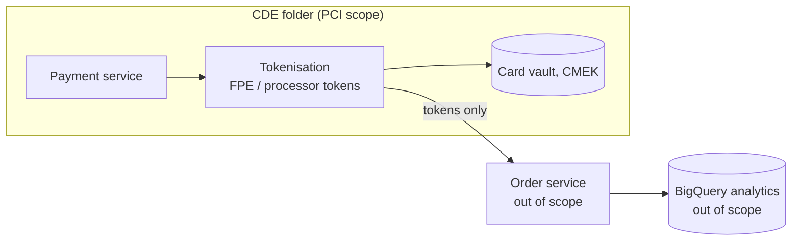

Objective **3.2** asks you to design for **legislation and regulation** (health record privacy,
children's privacy, data privacy, ownership and sovereignty), **commercial** requirements (card data,
PII), **industry certifications** (such as SOC 2) and **audits** (including logs). The exam does not
test legal detail; it tests whether you pick the Google Cloud design that lets the customer meet the
obligation.

## Shared responsibility and shared fate

Google is responsible for the security **of** the cloud (data centres, hardware, the global network,
the hypervisor, and the managed services' own operation). The customer is responsible for security
**in** the cloud: their identities, IAM, data classification, configuration and application code. The
split moves with the service model:

| Responsibility | IaaS (Compute Engine) | PaaS / serverless (Cloud Run, BigQuery) | SaaS (Google Workspace) |
|---|---|---|---|
| Physical, network, hypervisor | Google | Google | Google |
| Guest OS and patching | **Customer** | Google | Google |
| Application code | **Customer** | **Customer** | Google |
| Identity, access, data, configuration | **Customer** | **Customer** | **Customer** |

Google adds **shared fate**: secure defaults, blueprints (the enterprise foundations blueprint),
Assured Workloads and risk-protection programmes to help customers get their part right.

> [!IMPORTANT]
> A Google certification never makes **your workload** compliant by itself. Google's HIPAA BAA, PCI DSS
> attestation or SOC 2 report covers Google's side; you still configure and evidence your side.

## Legislation and regulation

| Law / regime | What it protects | Google Cloud design points |
|---|---|---|
| **HIPAA** (US health records) | Protected health information (PHI) | Sign Google's **Business Associate Agreement (BAA)**; keep PHI only in **covered products**; least-privilege IAM, Data Access audit logs, CMEK if required, VPC Service Controls; Cloud Healthcare API for FHIR/HL7v2/DICOM. |
| **COPPA** (US children under 13) | Personal information collected from children online | Verifiable parental consent and data minimisation are **application** duties; on the platform, minimise collection, restrict access, set retention and deletion, and de-identify for analytics. |
| **GDPR** (EU personal data) | Any personal data of people in the EU | Customer is **controller**, Google is **processor** under the Cloud Data Processing Addendum. Data residency where required (`gcp.resourceLocations`), data subject rights (find data with Sensitive Data Protection; delete or pseudonymise), breach detection and logging, records of processing. |
| **Data sovereignty and ownership** | Control by local law and the data owner, not only location | Residency plus control of **keys** and of **provider personnel access**: Assured Workloads, Cloud EKM, Access Approval, Access Transparency, or partner-operated / on-premises offerings. |

### Residency vs sovereignty

- **Data residency** = *where* data is stored and processed. Enforce it with the
  `gcp.resourceLocations` organisation policy (for example `in:eu-locations`), regional resources and
  regional endpoints.
- **Data sovereignty** = *who* can access or compel access to it. Add control over keys (**Cloud EKM**
  with Key Access Justifications), over Google personnel (**Access Approval**, personnel location
  restrictions), and visibility (**Access Transparency**).

Google's sovereign cloud portfolio spans:

| Offering | What it is |
|---|---|
| **Google Cloud Data Boundary** (public cloud, delivered with **Assured Workloads**) | Software-defined residency, access and key controls, including external key management |
| **Google Cloud Dedicated** | Isolated infrastructure operated by an independent local partner (for example S3NS in France, designed for SecNumCloud) |
| **Google Distributed Cloud** | Google Cloud services on-premises, including an air-gapped option |

### Assured Workloads

**Assured Workloads** creates a **folder** with a chosen **control package** (for example the **EU
Data Boundary**, FedRAMP Moderate/High, CJIS, IL4/IL5, ITAR, or Sovereign Controls by Partners). It
then enforces the package with organisation policies (allowed locations, allowed services), personnel
access controls and key management requirements, and **monitors for violations**. It is the low-effort
answer when a regulated workload needs a ready-made, enforced boundary.

> [!TIP]
> "EU personal data must stay in the EU, and Google support staff outside the EU must not access it" →
> **Assured Workloads** with an EU data boundary package (residency + personnel controls). A
> `gcp.resourceLocations` policy alone covers only the first half.

## Commercial requirements: card data and PII

### PCI DSS

Google Cloud is validated as a **PCI DSS service provider**, but the **cardholder data environment
(CDE)** you build is in scope for your own assessment. The winning architecture **shrinks scope**:

1. **Isolate** the CDE in its own projects (and VPC, ideally its own folder) so other systems are out of
   scope; use VPC Service Controls and firewall policies to segment it.
2. **Tokenise** card numbers as early as possible (a payment processor's tokens, or Sensitive Data
   Protection format-preserving encryption) so downstream systems such as analytics hold only tokens.
3. Apply PCI controls in the CDE: CMEK, strict IAM, Cloud Armor WAF on the payment front end, logging
   and log review, vulnerability scanning, SCC compliance reports.

### PII generally

Discover where PII lives (**Sensitive Data Protection discovery**), classify it, minimise it,
de-identify it for analytics, restrict access by IAM and perimeters, and define retention. These steps
serve GDPR, COPPA, state privacy laws and contractual commitments alike.

## Industry certifications

Google Cloud holds third-party certifications and attestations including **ISO/IEC 27001, 27017,
27018 and 27701**, **SOC 1, SOC 2 and SOC 3**, **PCI DSS**, **FedRAMP**, and supports HIPAA through the
BAA.

- **SOC 2** is an AICPA attestation that controls meet the **Trust Services Criteria** (security,
  availability, processing integrity, confidentiality, privacy). A **Type II** report covers operating
  effectiveness over a period.
- Customers get Google's reports and certificates from **Compliance Reports Manager**, typically to
  hand to their own auditors as evidence for the parts Google operates.
- When a customer needs **their own** SOC 2, they still design and evidence their controls (access
  reviews, change management, logging); Google's report covers the inherited infrastructure controls.

## Audits and logs

### Cloud Audit Logs

| Log type | Records | On by default? | Default retention |
|---|---|---|---|
| **Admin Activity** | Configuration and metadata changes (who created a VM, changed IAM) | **Always on**, cannot be disabled | 400 days (`_Required` bucket) |
| **System Event** | Google-initiated changes (live migration) | Always on | 400 days |
| **Data Access** | Reads of configuration or data, and writes of user data | **Off** (except BigQuery); must be enabled per service, can be billed | 30 days (`_Default` bucket, configurable) |
| **Policy Denied** | Access denied by a security policy such as VPC Service Controls | On (can exclude) | 30 days |

To audit **who read patient records**, you must **enable Data Access audit logs** for those services.

### Retaining and centralising evidence

- Create an **aggregated sink** at the organisation (or folder) that routes audit logs from every
  project to a central **logging project**: a log bucket (with **Log Analytics** for querying),
  BigQuery for analysis, or Cloud Storage for long-term archive.
- Set **custom retention** on log buckets and **lock** it if logs must not be shortened or deleted.
- For multi-year, write-once evidence, use Cloud Storage with a **locked retention policy (Bucket
  Lock)**: objects cannot be deleted or overwritten until the period ends, even by Owners.
- Restrict who can read logs (Private Logs Viewer for Data Access logs) and keep the logging project's
  admins separate from application teams (separation of duties).

### Provider access

- **Access Transparency** writes near-real-time logs of actions **Google personnel** take on your
  content, with the justification (for example a support case you opened).
- **Access Approval** requires your **explicit approval** before Google personnel access your content
  (within documented exceptions).
- **Key Access Justifications** (with Cloud EKM) lets you refuse key use by reason.

## Worked example: EHR Healthcare

*EHR Healthcare (a case study) hosts electronic health records for US providers and must stay
compliant while moving off colocation. Requirements: (1) store PHI on Google Cloud lawfully; (2) prove
who accessed each patient's records; (3) keep audit evidence for six years unaltered; (4) let
analysts study healthcare trends without seeing identities; (5) show regulators Google's own controls.*

| # | Design |
|---|---|
| 1 | Sign the **BAA**; use only HIPAA-covered services for PHI; Cloud Healthcare API for FHIR data; CMEK; VPC Service Controls perimeter |
| 2 | **Enable Data Access audit logs** on the services holding PHI; route via an **aggregated sink** to a central logging project |
| 3 | Export to Cloud Storage with a **locked retention policy** of six years (or a locked log bucket retention) |
| 4 | **Sensitive Data Protection** de-identification into a separate analytics dataset; analysts get roles only there |
| 5 | Provide Google's **SOC 2** and ISO reports from **Compliance Reports Manager**; enable **Access Transparency** |

> [!WARNING]
> Six-year retention is a good example of a figure that changes the answer: the default 30-day
> `_Default` bucket and the 400-day `_Required` bucket both fall short, so you must design retention.

## Check yourself

1. A European retailer must keep customer data in the EU and be able to show that Google cannot
   decrypt it without the retailer's consent. Which two controls together?
2. Which audit log type must be enabled to see who queried a Cloud SQL database's data, and is it on
   by default?
3. A company uses Google Cloud for card payments. Which design choice most reduces the number of systems
   in PCI DSS scope?

Answers

1. Data residency through **Assured Workloads** with an EU data boundary (or `gcp.resourceLocations`
   set to EU locations), plus **Cloud EKM** with Key Access Justifications so the keys stay outside
   Google and each decryption can be refused.
2. **Data Access** audit logs. They are off by default for most services (BigQuery is the exception)
   and must be enabled.
3. **Isolate** the cardholder data environment in dedicated projects and **tokenise** card numbers at
   entry, so downstream systems only ever see tokens and fall out of scope.

**Sources:** Google Cloud documentation and compliance pages on shared responsibility and shared fate,
the compliance resource centre, Compliance Reports Manager, HIPAA, PCI DSS, GDPR, COPPA, SOC 2,
Assured Workloads, sovereign cloud, resource location restriction, Cloud EKM, Cloud Audit Logs, log
routing and buckets, Bucket Lock, Access Transparency and Access Approval; the HIPAA pages of the US
HHS, the PCI Security Standards Council, the GDPR text on EUR-Lex and the FTC's COPPA rule.
