Objective **4.1** asks you to *analyse and define* technical processes. On the exam that rarely
means "name the product". It means: given a company with a slow, risky or manual process, which
process change (and which managed service behind it) fixes the stated problem with the least
operational burden? This lesson walks the six considerations in the guide: SDLC, CI/CD,
troubleshooting and root cause analysis, testing and validation, service catalog and provisioning,
and disaster recovery.

## 1. The software development lifecycle (SDLC)

Every SDLC model, waterfall or agile, passes through the same activities: **plan, design, build,
test, release, operate, and learn**. What changes in the cloud is how short the loop can be and how
much of it can be automated. Google's operational excellence pillar and DORA's research both push
the same direction: small batches, version control for everything, automated testing, and fast
feedback from production back into planning.

| SDLC stage | What "good" looks like on Google Cloud |
|---|---|
| Plan | Requirements tied to SLOs and business KPIs; architecture decisions recorded |
| Design | Well-Architected review; threat model; choose managed services first |
| Build | Code and **infrastructure as code** in Git; Cloud Build runs builds on every commit |
| Test | Automated unit, integration and IaC tests in the pipeline; ephemeral test environments |
| Release | Immutable artifacts in Artifact Registry; Cloud Deploy promotes the *same* artifact through environments |
| Operate | Google Cloud Observability dashboards, SLO alerts, runbooks |
| Learn | Blameless post-mortems and action items feed the backlog |

> [!TIP]
> When a case study says releases are "slow", "manual", "inconsistent between environments" or
> "different teams do it differently", the answer is almost always a **standardised, automated
> pipeline** with artifacts built once and promoted, not more manual review or a bigger QA team.
> Altostrat Media's requirement for centralised container CI/CD is exactly this.

## 2. Continuous integration and continuous deployment

**Continuous integration (CI)** means every change is merged often and automatically built and
tested. **Continuous delivery** means every change that passes is *deployable*; **continuous
deployment** goes one step further and releases it automatically. The Google-managed pieces:

```mermaid
flowchart LR
  A[Git push / PR] --> B[Cloud Build trigger]
  B --> C[Build + unit tests + IaC checks]
  C --> D[Push image to Artifact Registry]
  D --> E[Vulnerability scan + attestation]
  E --> F[Cloud Deploy release]
  F --> G[dev target]
  G -->|promote| H[staging target]
  H -->|approval + canary| I[prod target]
  I -.->|Binary Authorization checks attestation| J[GKE / Cloud Run]
```

- **Cloud Build** is serverless CI. A build config lists container steps; triggers start builds
  from repository events. You pay per build minute, with no build servers to patch.
- **Artifact Registry** stores container images and language packages, with IAM per repository
  and integrated vulnerability scanning. It replaces Container Registry.
- **Cloud Deploy** is managed continuous delivery to **GKE and Cloud Run**. A *delivery pipeline*
  defines the promotion order of *targets*; a *release* is created from rendered manifests and
  specific images; each deployment of a release to a target is a *rollout*. Targets can set
  `requireApproval`, and Cloud Deploy supports **canary** strategies and **rollback** to the last
  successful release.
- **Binary Authorization** is the deploy-time gate: only images carrying the attestations your
  policy requires (for example, "built by the trusted pipeline" and "passed scanning") can run.

Two release-engineering principles from the SRE book appear in exam answers in disguise:

1. **Build once, deploy many.** The artifact tested in staging is byte-for-byte the one in
   production. Rebuilding per environment is a distractor.
2. **Hermetic, reproducible builds** with enforced policy, so anyone can tell exactly what is
   running and how it was made.

**Deployment strategies** you should be able to pick between:

| Strategy | How it works | Choose it when |
|---|---|---|
| Rolling | Replace instances a few at a time | Default; cheap; tolerates brief mixed versions |
| Blue/green | Stand up the full new version, switch traffic at once | Instant rollback needed; can afford double capacity briefly |
| Canary | Send a small percentage of traffic to the new version, watch SLIs, then expand | Risky change; want real-user validation with small blast radius |
| Traffic splitting / A/B | Split by percentage or header for experiments | Product experiments (Cloud Run revisions, GKE Gateway) |

## 3. Testing and validation of software and infrastructure

The SRE book splits tests into **traditional tests** (before production) and **production tests**
(on the live system).

| Layer | Examples | Runs where |
|---|---|---|
| Unit | Function-level logic | Every commit, in Cloud Build |
| Integration | Service + its real dependencies (or emulators) | Pipeline, ephemeral environment |
| System | Smoke, performance, regression | Staging |
| Production | Canary analysis, configuration tests, probers | Live, small blast radius |
| Load / stress | Capacity at peak, breaking point | Production-like environment |
| Disaster / chaos | Kill a zone, fail a database, revoke a credential | Planned exercise (lesson 4) |

**Infrastructure is software too.** Google's Terraform testing guidance describes a pyramid:
cheap **static analysis** (formatting, `terraform validate`, policy checks) on every change;
**module integration tests** that deploy a module into an ephemeral project and assert on the
result; and a few slow **end-to-end tests**. Test in throwaway projects, then destroy them.

> [!WARNING]
> "Test in production" on the exam never means "skip staging". It means canaries, probers and
> controlled experiments that limit blast radius, *after* pre-production tests pass.

## 4. Troubleshooting and root cause analysis

The SRE book's model is a loop: **triage → examine → diagnose → test/treat → repeat** until a
cause is confirmed. Its most testable instruction is about order:

> [!IMPORTANT]
> **Stop the bleeding first.** In triage, restore service (roll back, drain a bad zone, shed load)
> before hunting the root cause. On the exam, "roll back the release and then investigate" beats
> "debug the live system while users see errors".

Good RCA practice:

- **Work from evidence**: metrics, logs and traces in Google Cloud Observability, plus *what
  changed* (deploy history, config changes in Cloud Audit Logs).
- **Form a hypothesis and test it**, ideally by a reversible change or in a copy of the system.
- **Beware correlation**: two things spiking together is not proof one caused the other.
- **Ask "why" repeatedly** (the 5 Whys) to get past the trigger ("bad config pushed") to the
  systemic causes ("no config validation; no canary for config").
- **Record it** in a blameless post-mortem with owned, prioritised action items (lesson 4).

### Worked example: troubleshooting a latency regression

*Situation:* after Tuesday's 14:00 release, checkout p99 latency on Cloud Run rises from 300 ms to
2.4 s. Error rate is normal.

1. **Triage.** Is the SLO burning? Yes, latency SLO burn rate is high. Mitigate: shift traffic
   back to the previous Cloud Run revision (seconds, reversible). Latency recovers. Users are safe.
2. **Examine.** Compare traces for the two revisions in Cloud Trace. The new revision spends 2 s in
   a call to the inventory service.
3. **Diagnose.** The diff shows the new code calls inventory once per cart line instead of once
   per cart (an N+1 pattern). Hypothesis: carts with many lines are slow.
4. **Test.** Replay a 20-line cart against the new revision in staging: 2.3 s. A 1-line cart: 280 ms.
   Hypothesis confirmed.
5. **Treat and prevent.** Fix the batching; add a performance test with large carts to the
   pipeline; make the canary step check p99 latency, not just errors. Write the post-mortem.

Notice that the root cause is not just "the developer wrote N+1"; it is "our pipeline had no
latency gate and the canary watched only error rate". That is the systemic finding.

## 5. Service catalog and provisioning

Large organisations want teams to self-serve infrastructure **without** each team inventing its
own networking, IAM and logging. The pattern:

1. A platform team writes **approved, opinionated IaC** (Terraform modules with org policy,
   logging and labels built in).
2. They publish it for discovery: **Service Catalog** lets admins share approved solutions with
   internal users, who deploy them in a governed way.
3. Deployment runs through managed IaC such as **Infrastructure Manager** (Google-managed
   Terraform with state and previews), or through the CI/CD pipeline.
4. **Organization Policy** and IAM keep guardrails in place even if someone bypasses the catalog.

> [!TIP]
> When a scenario says "developers wait weeks for infrastructure tickets" *and* "security needs
> every project to have the same baseline", the answer is a **curated catalog of IaC templates**
> plus org-level guardrails. Giving everyone Project Owner is fast but fails security; a central
> team building everything by hand is secure but fails speed.

## 6. Disaster recovery

Disaster recovery is the technical side of business continuity (lesson 4 covers the business
side). Two numbers drive every design:

- **RTO (recovery time objective)**: the longest the service can be down.
- **RPO (recovery point objective)**: the longest window of data you can afford to lose, measured
  back from the moment of failure.

Smaller RTO and RPO cost more. Google's DR planning guide describes three patterns:

| Pattern | What is running in the DR location | Typical RTO | Typical RPO | Relative cost |
|---|---|---|---|---|
| **Cold** | Nothing but backups and IaC; provision on disaster | Hours to days | Last backup (hours) | Lowest |
| **Warm** | A scaled-down copy, data replicated, ready to scale up | Minutes to an hour | Minutes | Medium |
| **Hot** (active-active or hot standby) | Full capacity serving or ready, synchronous or near-synchronous data | Near zero | Near zero | Highest |

Memory aid: **the hotter the standby, the smaller the numbers and the bigger the bill.**

**Failure domains matter.** A *zonal* outage is handled by regional resources (regional managed
instance groups, regional GKE clusters, Cloud SQL HA, regional persistent disk). A *regional*
outage needs **multi-region** design: data in a multi-region or dual-region Cloud Storage bucket,
a cross-region replica (Cloud SQL cross-region read replica, Spanner multi-region configuration),
global load balancing, and IaC to stand up compute in the second region. Backups should live in a
**different location** from the data they protect, and services such as **Backup and DR Service**
manage backup plans centrally.

> [!WARNING]
> Replication is not backup. If someone deletes a table or ransomware encrypts it, synchronous
> replication copies the damage instantly. A design that meets RPO with replication alone still
> needs point-in-time backups for logical corruption.

Lesson 3 works a full DR design through all three patterns with costs.

## Check yourself

1. A team rebuilds its container image separately for staging and production "to pick up the
   latest base image". What principle does this break, and what is the fix?
2. Production error rate jumps right after a release. The on-call engineer wants to attach a
   debugger to find the bug. What should happen first?
3. A business says it can lose at most 15 minutes of orders and must be back within one hour after
   a regional outage, on a moderate budget. Which DR pattern fits?

Answers

1. **Build once, deploy many.** The artifact tested in staging must be the one released. Build a
   single image in Cloud Build, store it in Artifact Registry, and promote the same digest with
   Cloud Deploy; refresh base images through a new build that goes through the whole pipeline.
2. **Stop the bleeding**: roll back (or shift traffic to the previous revision) to restore
   service, then investigate with the evidence collected.
3. **Warm standby** in a second region: replicated data meets a 15-minute RPO, and a scaled-down
   environment that scales up meets a one-hour RTO without the cost of a full hot site.

## Sources

Google Cloud Well-Architected Framework (operational excellence and reliability pillars); Cloud
Build, Artifact Registry, Cloud Deploy and Binary Authorization documentation; DORA continuous
delivery capability; *Site Reliability Engineering* chapters 8, 12, 15 and 17; Google's Terraform
testing best practices; Service Catalog and Infrastructure Manager documentation; and the Google
Cloud DR planning guide, DR building blocks, DR scenarios for data, and DR for cloud infrastructure
outages.
