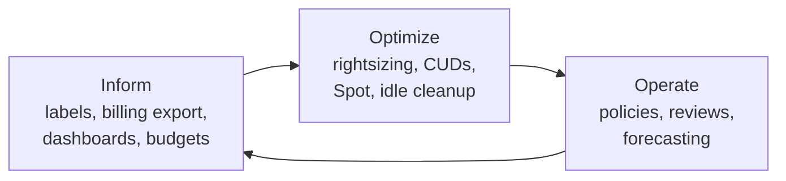

Objective **4.2** is the part of the exam most candidates under-prepare, because it reads like
management theory. The questions, though, are concrete: a CFO is unhappy with a surprise bill; an
operations team resists the migration; two teams disagree on an architecture. The best answer is
the one that solves the stated business problem **with evidence, with the people involved, and
with the least disruption**.

## 1. Stakeholder management: influencing and facilitation

A stakeholder is anyone affected by, or able to affect, the solution: executives, finance,
security, operations, developers, regulators, customers. The architect's job is to understand what
each needs and to move them toward a decision.

| Stakeholder | Usually cares about | Speak in terms of |
|---|---|---|
| CEO / board | Growth, risk, strategy | Business outcomes, time to market |
| CFO / finance | Predictable spend, ROI | OpEx vs CapEx, unit cost, forecasts |
| CISO / compliance | Risk, audit | Controls, evidence, shared responsibility |
| Operations | Stability, workload | Toil reduction, runbooks, training |
| Developers | Velocity, tooling | Self-service, CI/CD, managed services |

- **Influencing** without authority: build the case on data (a proof of concept, a cost model, an
  SLO report), connect it to *their* goals, and find a sponsor.
- **Facilitation**: run the workshop so that the group reaches a decision: shared goals first,
  options with trade-offs, explicit decision owner, documented outcome.

> [!TIP]
> On the exam, when stakeholders disagree, the answer is rarely "escalate to the CEO" or "let the
> architect decide alone". It is usually "gather the data (a PoC, a pilot, a cost comparison) and
> facilitate a decision against agreed criteria".

## 2. Change management

Technology changes fail most often on the people side. Google's Cloud Adoption Framework names
four themes: **Learn** (upskilling), **Lead** (executive mandate and cross-functional teams),
**Scale** (automation and managed services), **Secure** (controls). It places organisations on a
maturity scale: **Tactical → Strategic → Transformational**.

For individuals, the Prosci **ADKAR** model is a useful memory aid: **A**wareness of why the change
is needed, **D**esire to take part, **K**nowledge of how, **A**bility to do it, and
**R**einforcement to make it stick. If a team "knows the tools but keeps reverting to old habits",
you have a Reinforcement gap; if they "don't see why we're moving", it is Awareness.

Practical change management in a cloud programme:

1. **Executive sponsor** and a clear "why" tied to business goals.
2. **Communicate early**, repeatedly, through the channels each group uses.
3. **Pilot** with a willing team, publish the win, then scale (a Cloud Center of Excellence often
   owns this).
4. **Train before you cut over**, not after.
5. **Measure adoption** and reinforce: recognise teams, retire the old path.

*Technical* change management (change advisory, approvals, rollback plans) still exists, but in
the cloud it shifts toward **automated, low-risk, frequent change**: peer review in Git, pipeline
gates, canaries and quick rollback, instead of a weekly meeting that approves big batches.

## 3. Team assessment and skills readiness

Before committing to a design, ask: **can this team run it?** A Kubernetes-heavy design for a team
that has never operated containers is a risk, however elegant it is.

1. **Assess** current skills against the target architecture (a skills matrix per role).
2. **Close gaps**: role-based learning paths, hands-on labs, certifications, pairing with a
   partner or Google Professional Services for the first workloads.
3. **Reduce the skill needed**: prefer managed services (Cloud Run over self-managed GKE, GKE
   Autopilot over Standard, Cloud SQL over self-managed databases) where they meet requirements.
4. **Re-assess** after the pilot.

> [!WARNING]
> "Hire a whole new team" and "delay the migration until everyone is certified" are usually wrong.
> The exam favours **training plus managed services plus a pilot**.

## 4. Decision-making processes

Good decisions are **explicit, evidence-based and recorded**.

- **Architecture decision records (ADRs)** capture the context, the options considered, the
  decision and its consequences, so later teams know *why*.
- **Error budgets** make reliability-versus-velocity a data question. If the SLO is 99.9%, the
  budget is 0.1% of unreliability per window. Budget left: ship features. Budget spent: freeze risky
  releases and invest in reliability. Product and SRE agree the policy in advance, so nobody argues
  in the moment.
- **Build vs buy vs managed**: compare total cost of ownership, time to value and operational
  burden, not just licence price.
- **Reversibility**: make reversible decisions quickly; spend analysis on the ones that are hard to
  undo (data location, long commitments).

## 5. Customer success management

Customer success means the customer actually achieves the outcome they bought, measured over time.
For an architect this shows up two ways:

- **Your own customers**: define success metrics (adoption, SLO attainment, satisfaction,
  onboarding time), monitor them, and act early. EHR Healthcare's goal of onboarding insurers
  faster is a customer-success metric.
- **You as Google's customer**: pick a **Customer Care** tier that matches the business impact.
  Higher tiers add faster response targets, and Premium Support adds a named **Technical Account
  Manager** for proactive guidance. Mission-critical production workloads justify a higher tier;
  a sandbox does not.

## 6. Cost and resource optimisation (CapEx/OpEx) and FinOps

**CapEx** is up-front spending on assets you own (servers, a data centre), depreciated over years.
**OpEx** is ongoing spending on services consumed. Moving to cloud shifts spend from CapEx to OpEx:
no big purchase, pay for what you use, but spend now varies month to month, so finance needs new
controls. That is why **FinOps** exists: a practice where engineering, finance and business share
ownership of cloud cost. The FinOps Framework runs in three phases: **Inform** (visibility,
allocation), **Optimize** (rates and usage), **Operate** (continuous governance).

### Inform: see and allocate the spend

- **Labels** on resources (`team`, `env`, `cost-center`) flow into billing data, so cost can be
  allocated to the team that caused it.
- **Billing export to BigQuery**: standard usage cost, detailed (resource-level) usage cost, and
  pricing data. Query it, join it with business data for unit cost (cost per order), and build
  Looker Studio dashboards. Enable it **early**: with a multi-region dataset, standard and detailed
  exports backfill only to the start of the previous month, and pricing data is not backfilled.
- **Budgets and alerts**: thresholds on **actual or forecasted** spend, scoped to the billing
  account, folders, projects, services or labels. Alerts-only budgets **do not cap spending**. To
  act automatically, connect the budget to a **Pub/Sub topic** and have a Cloud Run function
  respond (notify chat, scale down, or, for a sandbox, disable billing).

### Optimize: reduce rates and usage

| Lever | What it is | Fits | Watch out |
|---|---|---|---|
| **Sustained use discounts (SUDs)** | Automatic discount for eligible series (N1, N2, N2D, C2, M1, M2, sole-tenant) running more than 25% of a month: up to 30% (N1, M1, M2) or 20% (N2, N2D, C2) | Steady VMs with no planning effort | Not for E2; not on usage already covered by a CUD |
| **Resource-based CUDs** | Commit to vCPU, memory, GPU and so on in a region for 1 or 3 years; up to about 55% (most series) or 70% (memory-optimised) | Predictable baseline on a known machine family in one region | Cannot be cancelled; billed whether used or not |
| **Compute flexible (spend-based) CUDs** | Commit to an hourly spend across projects and regions; covers Compute Engine, GKE and Cloud Run | Steady spend that moves between families or regions | Lower discount than resource-based (about 28% for 1 year) |
| **Spot VMs** | Spare capacity at up to 91% off; preemptible at any time, no SLA, no maximum runtime | Batch, CI runners, rendering, fault-tolerant stateless work | Never for a database primary or anything that can't be interrupted |
| **Rightsizing recommender** | Recommends a smaller (or larger) machine type from observed CPU and memory | Over-provisioned VMs | Review before applying; respect peaks |
| **Idle resource recommendations** | Idle VMs, unattached disks, unused IPs | Forgotten resources | Confirm with the owner |
| **Autoscaling and scale to zero** | MIG autoscaler, GKE autoscaling, Cloud Run | Variable load | Set sensible minimums for latency |
| **Storage classes and lifecycle** | Standard → Nearline → Coldline → Archive by access frequency | Ageing data (Altostrat's archive) | Retrieval fees and minimum durations |

Recommendations come from **Recommender** (part of Active Assist), which estimates savings for each
one.

> [!IMPORTANT]
> Optimise **usage before rate**. Rightsize and delete idle resources first, then buy CUDs on the
> smaller baseline that remains. Committing first locks in waste for one to three years.

### Worked example: a FinOps plan for a surprise bill

*Situation:* a retailer's Compute Engine bill rose 40% in three months. Finance can't tell which
team caused it. The estate is 200 N2 VMs, steady around the clock, plus a nightly batch job on 80
on-demand VMs for four hours.

1. **Inform.** Enforce labels (`team`, `env`) through IaC modules and policy; enable detailed
   billing export to BigQuery; build a cost-by-team dashboard; create per-team budgets with
   forecasted-spend alerts to each team's channel through Pub/Sub.
2. **Optimize usage.** Run the rightsizing recommender: suppose 60 VMs are at under 15% CPU and
   can drop one size. Delete idle disks.
3. **Optimize rate.** Move the nightly batch to **Spot VMs** in a MIG, with checkpointing so a
   preemption restarts work rather than losing it. For the steady, now-rightsized N2 baseline that
   will stay in one region, buy **1-year resource-based CUDs** sized to the lowest steady usage;
   anything above that still earns SUDs for N2.
4. **Operate.** Monthly FinOps review with engineering and finance; CUD utilisation tracked in
   billing export; new projects must use the labelled templates.

## Check yourself

1. A CFO wants Google Cloud to stop all spending automatically when a project hits $10,000. Is a
   budget alert enough?
2. A company runs a steady fleet but expects to change machine families and regions over the next
   year. Which commitment type fits better?
3. Operations engineers attended training but keep making changes by hand in the console. Which
   ADKAR element is missing, and what helps?

Answers

1. No. Alerts-only budgets notify; they don't cap. Connect the budget to a Pub/Sub topic and use a
   Cloud Run function to take action (for example, disable billing on that project), accepting
   that this stops its services.
2. **Compute flexible (spend-based) CUDs**: they commit to spend across families, projects and
   regions, whereas resource-based CUDs are tied to a machine family's resources in one region.
3. **Reinforcement** (and possibly Ability). Make the pipeline the only path to production (IaC
   with restricted console permissions), recognise teams using it, and pair engineers on their
   first changes.

## Sources

Google Cloud Well-Architected Framework cost optimization pillar; Google Cloud Adoption Framework;
Google Cloud training; Prosci ADKAR; architecture decision records overview; *Site Reliability
Engineering* chapter 3 (error budgets); Google Cloud Customer Care; FinOps Framework; Compute
Engine documentation on committed use discounts, sustained use discounts, Spot VMs and machine-type
recommendations; Recommender overview; Cloud Billing budgets and BigQuery export documentation
(discount figures checked 2026-10-30).
