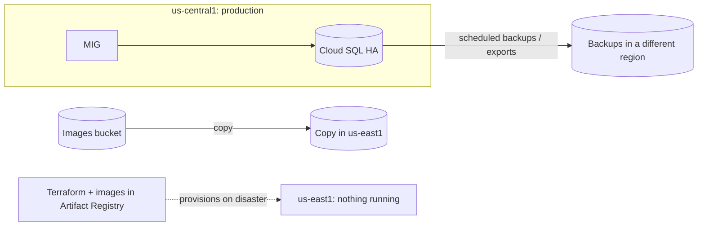
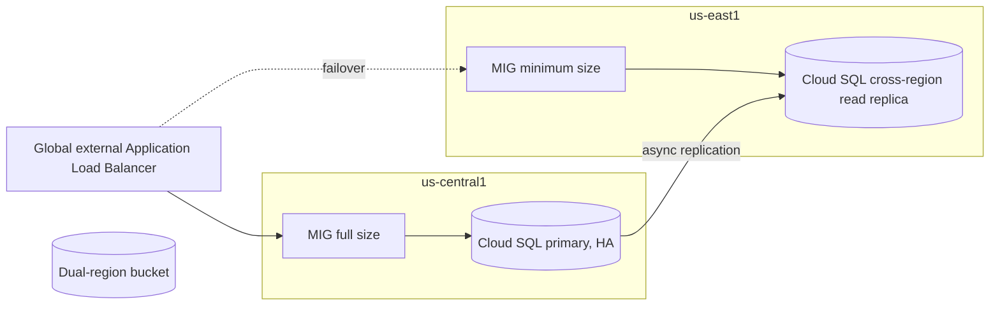
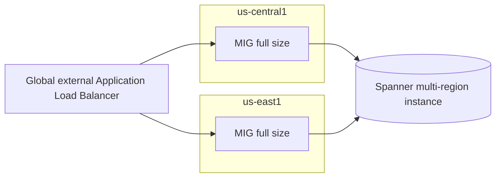

DR questions on the PCA exam are almost always the same puzzle: *here are the RTO, RPO and budget;
which design meets them?* This lesson works one application through all three patterns from
Google's DR planning guide, with costs, so you can see how the trade-off actually moves. Objective
**4.1 (disaster recovery)** and **4.2 (cost optimisation, business continuity)**.

> [!NOTE]
> All prices in this lesson are **illustrative round numbers** chosen to show proportions. They are
> not Google list prices; use the Google Cloud Pricing Calculator for real estimates.

## The scenario

*Fernhill Outdoor* (fictional) sells camping gear online. Its order system runs in
**us-central1**:

- Web and API tier on a **regional managed instance group** (survives a zone failure).
- **Cloud SQL for PostgreSQL**, 2 TB, high-availability configuration (primary plus standby in a
  second zone).
- Product images in a **regional Cloud Storage** bucket.
- Container images in Artifact Registry; everything defined in Terraform.

Production costs about **$40,000 a month**: $25,000 compute, $10,000 database, $5,000 storage and
networking. The business loses about **$50,000 an hour** in sales when the site is down.

The zonal HA is already in place. The question is the **regional** disaster: what happens if
us-central1 is unavailable?

### Step 1: turn the business requirement into numbers

The CEO says "we can't lose orders and we can't be down for a day". That is not a requirement yet.
Facilitate it into numbers (lesson 2's stakeholder skills):

- Finance confirms: up to **15 minutes** of lost orders can be recovered by hand from payment
  provider records. → **RPO = 15 minutes.**
- Sales confirms: an outage of up to **one hour** is survivable; a full day breaks contracts with
  wholesale partners. → **RTO = 1 hour.**
- Budget: DR should cost no more than **50%** of production run cost.

## Pattern 1: cold standby

- **Data:** Cloud SQL backups and exports stored in another region (or managed with Backup and DR
  Service); images copied to a bucket in us-east1.
- **Compute:** none running. On disaster, Terraform builds the network, MIG and a new Cloud SQL
  instance in us-east1, and the database is restored from the latest backup.
- **Traffic:** DNS or load balancer switched to the new region after restore.

| Measure | Value |
|---|---|
| RTO | **4–8 hours**: provisioning is quick with IaC, but restoring 2 TB and validating it is slow |
| RPO | The backup interval, e.g. **4 hours** with exports every 4 hours |
| Extra monthly cost | ~**$2,000** (backup storage, cross-region copies, quarterly test runs) = 5% |

**Verdict:** fails both RTO (1 h) and RPO (15 min). Cheap, but not compliant with the requirement.

## Pattern 2: warm standby

- **Data:** a **Cloud SQL cross-region read replica** in us-east1, replicated asynchronously
  (lag typically seconds). Images in a **dual-region** bucket; with turbo replication, Google
  targets replicating new objects within 15 minutes.
- **Compute:** a small MIG in us-east1 (for example, 20% of production), already behind a **global
  external Application Load Balancer** with health checks.
- **On disaster:** promote the replica to primary, let the autoscaler (or a runbook) grow the MIG,
  and the load balancer shifts traffic as us-east1 backends become healthy.

| Measure | Value |
|---|---|
| RTO | **15–60 minutes**: replica promotion plus scale-up |
| RPO | **Seconds to minutes**: the replication lag |
| Extra monthly cost | ~**$16,000**: replica $10,000 + standby compute $5,000 + replication and dual-region storage $1,000 = 40% |

**Verdict:** meets RTO (1 h), RPO (15 min) and budget (≤ 50%).

## Pattern 3: hot (active-active)

- **Data:** Cloud SQL cannot accept writes in two regions at once, so true active-active means
  re-platforming to **Spanner** with a multi-region configuration (synchronous replication,
  strong consistency, writes survive a regional loss).
- **Compute:** full-size MIGs in both regions, both serving through the global load balancer.
- **On disaster:** the load balancer stops sending traffic to unhealthy backends; nothing to promote.

| Measure | Value |
|---|---|
| RTO | **Near zero**: automatic |
| RPO | **Zero** for committed transactions |
| Extra monthly cost | ~**$45,000**: second full compute fleet $25,000 + Spanner multi-region premium over Cloud SQL ~$20,000 = 112%, **plus** a one-off migration project to Spanner |

**Verdict:** meets RTO and RPO, but blows the budget and adds a database migration risk.

## Side-by-side

| | Cold | Warm | Hot |
|---|---|---|---|
| RTO | 4–8 h ❌ | 15–60 min ✅ | ~0 ✅ |
| RPO | ~4 h ❌ | seconds–minutes ✅ | 0 ✅ |
| Extra cost / month | $2,000 | $16,000 | $45,000 + migration |
| % of production | 5% | 40% ✅ | 112% ❌ |
| Operational complexity | Low running, high recovery effort | Medium: replica + runbook | High: new database, two live fleets |

### Sanity-check with expected loss

Suppose a regional outage long enough to trigger DR happens about once every ten years (an
assumption for illustration; you would agree the figure with the risk owner). Expected annual
downtime loss is *probability × hours down × $50,000*:

| | Hours down | Expected annual loss | Annual DR cost | Total |
|---|---|---|---|---|
| Cold | 6 | 0.1 × 6 × 50k = $30,000 | $24,000 | $54,000 |
| Warm | 0.5 | 0.1 × 0.5 × 50k = $2,500 | $192,000 | $194,500 |
| Hot | 0 | $0 | $540,000 | $540,000 |

On pure expected loss, cold looks cheapest. That is the point of this check: **the requirement,
not the expected-value maths, sets the floor.** The business has contracts and customers that make
a day-long outage unacceptable whatever its probability, so cold is out. Among the patterns that
meet every requirement, choose the cheapest: **warm**.

> [!IMPORTANT]
> The exam rule: **eliminate options that miss any stated requirement, then pick the lowest cost
> and operational burden among the survivors.** Over-engineering (hot when warm meets the
> requirement) is as wrong as under-engineering.

### Don't forget logical corruption

The warm design replicates every write, including a bad `DELETE`. Keep **point-in-time recovery**
on the Cloud SQL primary and backups in a separate location, so you can recover from mistakes and
ransomware, not just from a lost region.

### Presenting the decision

Record it as an architecture decision record: context (RTO 1 h, RPO 15 min, ≤ 50% budget), options
(cold, warm, hot with the table above), decision (warm), consequences (quarterly failover tests,
runbook ownership, revisit if RTO tightens or if the database moves to Spanner for other reasons).
That gives finance, sales and operations one document they all agreed to.

## Variations the exam likes

| If the scenario says… | Then lean toward… |
|---|---|
| "Cost is the primary concern; a day of downtime is acceptable" | Cold: backups in another region + IaC |
| "Analytics or batch system; can rerun from source" | Cold, or just durable multi-region source data |
| "Minutes of downtime acceptable; must not lose more than a few minutes of data" | Warm |
| "Global users; zero downtime; strongly consistent writes" | Hot with Spanner multi-region and global load balancing |
| "Data must stay in one country" | Two regions in the same country (locality-restricted DR) |

## Check yourself

1. Fernhill's RTO tightens to five minutes, RPO stays at 15 minutes, and the budget doubles. Does
   that justify hot?
2. Why is a Cloud SQL HA configuration **not** a regional DR solution?
3. A cold design restores from nightly backups. Which number does that set, RTO or RPO, and to
   what?

Answers

1. Possibly. Warm's promotion plus scale-up is hard to bring under five minutes reliably, so a hot
   standby (full-size compute in us-east1, automated replica promotion) or active-active becomes
   the candidate. Check whether a hot *standby* with Cloud SQL meets it before taking on a Spanner
   migration; choose the cheapest option that meets the target.
2. Cloud SQL HA places the standby in another **zone of the same region**. It protects against a
   zone failure, not the loss of the region. Regional DR needs a cross-region replica or backups.
3. **RPO**: up to about 24 hours of data could be lost. RTO is set by how long provisioning and the
   restore take.

## Sources

Google Cloud DR planning guide; DR scenarios for applications and for data; DR building blocks;
Architecting DR for cloud infrastructure outages; Backup and DR Service overview; Cloud SQL HA and
cross-region replica docs; Spanner instance configurations; Cloud Storage turbo replication; Well-Architected
Framework reliability and cost optimization pillars.
