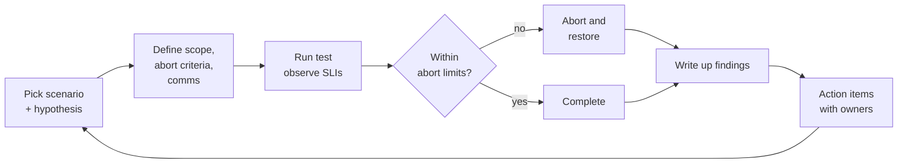

A DR design that has never been tested is a hypothesis. This lesson covers the business-continuity
consideration in objective **4.2** and the process side of DR in **4.1**: how organisations prove
their recovery works, respond when it is needed, and learn from what happens.

## 1. Business continuity vs disaster recovery

| | Business continuity (BC) | Disaster recovery (DR) |
|---|---|---|
| Scope | The whole business: people, processes, suppliers, facilities, IT | IT systems and data |
| Question | How do we keep delivering critical services during disruption? | How do we restore systems after failure? |
| Inputs | Business impact analysis (BIA): critical processes, maximum tolerable downtime | RTO and RPO per system, derived from the BIA |
| Output | BC plan: roles, communication, alternate processes, supplier contingencies | DR plan: runbooks, architecture, test schedule |

DR is a subset of BC. The **business impact analysis** comes first: it ranks business processes by
the damage an outage would cause over time. That ranking becomes the RTO and RPO for each supporting
system. A BC plan also covers things no cloud architecture fixes: who calls customers, how staff
work if the office is closed, what happens if a key supplier fails.

> [!TIP]
> If a question asks what to do **first** when building continuity or DR plans, the answer is
> usually the business impact analysis / defining RTO and RPO with the business, not choosing
> products.

## 2. Testing DR: a ladder of realism

Google's DR planning guide is explicit: test the plan regularly, record what fails, update the plan.
Tests become more realistic, and riskier, as you move up the ladder.

| Level | What happens | Finds | Risk |
|---|---|---|---|
| **Plan review** | Owners read the plan for accuracy | Out-of-date contacts, missing systems | None |
| **Tabletop exercise** | Team talks through a scenario step by step | Gaps in decisions, roles and communication | None |
| **Component test** | Restore one backup; promote one replica in a test project | Whether backups actually restore, and how long it takes | Low |
| **Parallel / simulation** | Bring up the DR environment alongside production, verify, tear down | Provisioning gaps, IAM mismatches, missing quotas | Low–medium |
| **Full failover** | Move production traffic to the DR site, then back | Real RTO/RPO, hidden dependencies | Highest; needs approval and rollback |

Things the guide specifically calls out when testing in Google Cloud:

- **Automate** infrastructure with IaC so the DR environment matches production.
- Check that **IAM and access** in the DR environment match production; a recovery that nobody has
  permission to run is not a recovery.
- Check **quotas** in the DR region before you need them.
- Simulate losing your **usual access path** (for example, the corporate VPN or identity provider).
- Test **restoring data**, not just taking backups, and measure the time.
- Make every runbook step concrete, and **train** the people who will run it.

## 3. Game days and DiRT

A **game day** is a planned exercise where a team deliberately injects a failure (stop a zone's
instances, block a dependency, revoke a credential, page the on-call at 3 a.m.) and practises
detecting and recovering from it. Chaos engineering (objective 6.6) automates the injection;
the game day adds the human and process side.

Google's own version is **DiRT (Disaster Recovery Testing)**, an annual company-wide programme
described in *Weathering the Unexpected*. Its lessons map directly to exam answers:

- Test **people and processes**, not just systems: what if a key team is unreachable or a
  building is unavailable?
- Be **realistic** but **safe**: tests have an owner, a documented scope, a monitoring plan and a
  **rollback ("abort") plan** agreed in advance.
- Start small, increase scope as confidence grows.
- Every test produces findings, and findings get **owners and deadlines**, like a post-mortem.

### Worked example: a game day plan for a warm-standby DR

*Context:* the warm-standby design from lesson 3 (Cloud SQL cross-region replica, small MIG in
us-east1, global load balancer). RTO 1 hour, RPO 15 minutes. It has never been failed over.

1. **Hypothesis.** "On-call can fail over to us-east1 within 60 minutes with under 15 minutes of
   data loss, using only the runbook."
2. **Scope and safety.** Run it in a **staging** copy of the full stack first, then in production
   during a low-traffic window with a business sign-off. Abort criteria: checkout error rate over
   5% for 10 minutes. Rollback: fail back to us-central1 using the reverse runbook.
3. **Communication.** Customer support and status page owner told in advance; incident channel open.
4. **Execute.** Block traffic to us-central1 backends, promote the replica, scale the MIG, and time
   each step.
5. **Observe.** Timeline: promotion 6 min, MIG scale-up 22 min (a quota limit in us-east1 slowed
   it), total 41 min. Replication lag at cut-over: 9 s.
6. **Findings → actions.** Raise the us-east1 CPU quota (owner: platform, 1 week); automate the
   scale-up in the runbook (owner: SRE, 1 month); schedule the test quarterly.

Result: the hypothesis held, *and* the test found a quota problem that would have hurt in a real
disaster. That is a successful test.

## 4. Incident response during a disruption

When a real disruption hits, structure beats heroics. The SRE book's incident roles:

| Role | Does |
|---|---|
| **Incident commander (IC)** | Holds the overall picture, assigns roles, decides; does not debug |
| **Operations lead** | The only person (or team) changing the system |
| **Communications lead** | Updates stakeholders and customers on a regular cadence |
| **Planning lead** | Tracks follow-ups, handoffs, longer-running tasks |

Practices: declare incidents early, keep a **live incident document**, mitigate before root-causing,
and hand over explicitly when shifts change.

## 5. Blameless post-mortems

After any significant incident, failed test or near miss, write a **post-mortem**. Google's SRE
books set the rules:

- **Blameless.** Assume everyone acted reasonably with the information they had. Ask "how did the
  system allow this?" not "who did this?". Blame makes people hide information, and hidden
  information repeats outages.
- **Triggered by agreed criteria**, for example user-visible downtime over a threshold, any data
  loss, on-call intervention such as a rollback, or a monitoring failure.
- **Contents:** summary, impact, timeline, root cause and contributing factors, what went well,
  what went badly, where we got lucky, and **action items**.
- **Action items** each have an owner, a priority and a tracking ticket. A post-mortem without
  tracked actions is a story, not an improvement.
- **Reviewed and shared** widely, so other teams learn too.

> [!WARNING]
> Distractors to reject: "identify the engineer responsible and restrict their access", "keep the
> post-mortem confidential to the team", "skip the post-mortem because the incident was short".
> The documented Google practice is blameless, shared, and action-oriented.

Post-mortems also feed decision-making: if repeated incidents exhaust the **error budget**, the
agreed policy shifts engineering effort from features to reliability until the service is back
within its SLO.

## Check yourself

1. A company's DR plan has existed for two years with no test. Leadership is nervous about a full
   failover. What should come first?
2. During a major outage, the most senior engineer is both coordinating and debugging, and
   executives keep messaging her for updates. What change helps most?
3. A post-mortem draft says "root cause: engineer X ran the wrong command". What is wrong with it?

Answers

1. Climb the ladder: review the plan and run a **tabletop exercise**, then component tests
   (restore a backup, promote a replica in a test project) and a staging failover, before a
   controlled production failover with abort criteria.
2. Separate the roles: an **incident commander** coordinates, she stays as **operations lead**,
   and a **communications lead** handles executive updates on a fixed cadence.
3. It is not **blameless** and stops at the trigger. Ask why the system allowed the command:
   missing validation, no dry-run, broad permissions, unclear runbook. Action items should fix
   those, with owners.

## Sources

Google Cloud DR planning guide; Well-Architected Framework reliability and operational excellence
pillars; *Site Reliability Engineering* chapters 3, 14, 15 and 17; *The Site Reliability Workbook*
chapter 10; Kripa Krishnan, "Weathering the Unexpected", ACM Queue.
