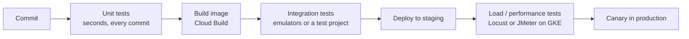

Objective **5.1** asks you to *advise* the teams who build and run your design. On the exam this
reads as: "the developers want to do X, what should the architect recommend?" The right answer is
almost always the **managed, documented Google pattern** that meets every stated requirement with
the least operational burden. This lesson covers the development side: APIs, testing, migration
tooling and AI assistance. Lesson 2 covers the operations side.

## 1. API management: three products, three jobs

Most PCA scenarios that mention partners, mobile apps, monetisation or "exposing services to third
parties" are API management questions. Google offers three products, and the exam tests whether you
can tell them apart.

| Need | Product | Why |
|---|---|---|
| Full API lifecycle for external developers: developer portal, API products, quotas per app, analytics, monetisation, mediation (XML↔JSON), OAuth | **Apigee** (SaaS) or **Apigee hybrid** | The only one with API products, developer portal, monetisation and rich policy mediation |
| Apigee features but the runtime must stay in your own data centre or Kubernetes cluster | **Apigee hybrid** | Management plane in Google Cloud, runtime plane on your own Kubernetes |
| A simple, fully managed gateway in front of **serverless** backends (Cloud Run, Cloud Run functions, App Engine), defined by an OpenAPI spec | **API Gateway** | Pay per call, no infrastructure, API keys / JWT / service-account auth |
| Lightweight API auth and monitoring for OpenAPI or **gRPC** services on GKE or Compute Engine, using a sidecar proxy | **Cloud Endpoints** (ESPv2) | Runs alongside your service; you operate the proxy |

> [!TIP]
> Keywords that point to **Apigee**: "monetise", "developer portal", "partners self-register",
> "API products", "transform legacy SOAP/XML", "analytics on API consumers", "hybrid runtime".
> Keywords that point to **API Gateway**: "serverless backends", "OpenAPI", "simple", "minimal cost".

### Apigee policies you should recognise

Apigee works by putting an **API proxy** in front of each backend. Policies run in the proxy's
request and response flows:

- **Security:** VerifyAPIKey, OAuthV2, JWT verification, threat protection (JSON/XML size and depth).
- **Traffic management:** **Quota** (a business limit: "1,000 calls per app per month", tied to the
  API product the app subscribed to) versus **SpikeArrest** (a protective limit that smooths bursts so
  the backend is never hit with more than, say, 50 requests per second). ResponseCache reduces
  backend load.
- **Mediation:** AssignMessage, XML-to-JSON / JSON-to-XML, ServiceCallout.

Quota answers "how much is this customer allowed to use?"; SpikeArrest answers "how do I stop a
sudden burst from knocking over the backend?". A scenario that mentions pricing tiers wants Quota;
a scenario about a fragile legacy backend wants SpikeArrest (often with ResponseCache).

### API design advice

Google's own **API design guide** and the **API Improvement Proposals (AIPs)** are the reference.
The practices the exam expects you to know:

- **Resource-oriented design**: nouns as resources (`/v1/orders/123`), standard methods (List, Get,
  Create, Update, Delete) mapped to HTTP verbs.
- **Versioning**: major version in the path (`/v1/`, `/v2/`). Make **backwards-compatible** changes
  within a version (add optional fields, never remove or rename); breaking changes get a new major
  version, and the old one runs in parallel with a published deprecation window.
- **Pagination** for list calls (page size plus page token), **long-running operations** for slow
  work, and consistent error codes.
- Put a gateway in front even for internal consumers when you need consistent auth, quotas and
  telemetry.

## 2. Testing frameworks: what runs where

The exam guide lists **load, unit and integration** testing. Think of them as layers of a pipeline,
each catching a different kind of fault at a different cost.

| Test type | What it proves | Typical Google Cloud placement |
|---|---|---|
| **Unit** | One function or class behaves correctly in isolation; dependencies are mocked | Developer machine and a Cloud Build step on every commit; fails the build fast |
| **Integration** | Components work together: your code with Pub/Sub, Spanner, a real HTTP API | Cloud Build step against **emulators** (lesson 3) or an ephemeral test project |
| **System / end-to-end** | The deployed application meets functional requirements | Staging environment that mirrors production |
| **Load / performance** | The system meets latency and throughput targets at expected and peak load, and shows where it breaks | Distributed load generators (for example **Locust** workers on GKE) against staging, with Cloud Monitoring watching the target |
| **Security** | No known vulnerabilities or misconfigurations | Artifact Analysis scanning, Web Security Scanner, penetration tests (Section 6) |

DORA's research shows the pattern that works: tests are **automated**, **fast**, run on **every
commit**, are owned by the developers who write the code, and a failing test **stops the pipeline**.
Cloud Build is where these steps usually run: each step in `cloudbuild.yaml` is a container, so a
step can be `go test ./...`, `pytest`, or `npm test`, and a non-zero exit fails the build.

> [!WARNING]
> Load testing is not unit testing at scale. A load test must run against an environment sized like
> production, with production-like data volumes, from **distributed** generators, otherwise the load
> generator becomes the bottleneck. Google's reference architecture runs Locust master and worker
> pods on GKE for exactly this reason.

Shift testing left where you can: Cloud Code can run a Cloud Run service locally, and the emulators
let integration tests run in CI without touching a real project.

## 3. Data and system migration tooling

Migrations follow Google's **assess → plan → deploy → optimise** framework. Developers and DBAs will
ask "what do we use to move this?". Know the tool for each job.

| Moving… | Tool | Notes |
|---|---|---|
| Discovering and assessing what you have, TCO | **Migration Center** | Inventory, utilisation, cost estimates, migration waves |
| VMs from VMware, AWS or Azure to Compute Engine | **Migrate to Virtual Machines** | Test clones before cut-over; rehost |
| VMs into containers on GKE or Cloud Run | **Migrate to Containers** | Replatform |
| MySQL, PostgreSQL, SQL Server → Cloud SQL; PostgreSQL → AlloyDB | **Database Migration Service** (homogeneous) | Continuous replication, minimal-downtime cut-over |
| Oracle → PostgreSQL / AlloyDB | **Database Migration Service** (heterogeneous, conversion workspace) | Schema and code conversion |
| Ongoing change data capture into BigQuery or Cloud Storage | **Datastream** | Serverless CDC; keeps analytics current during and after migration |
| Files and objects online (other clouds, HTTP, on-prem file systems) | **Storage Transfer Service** | Scheduled, incremental, agent-based for on-prem |
| Hundreds of TB to PB with limited bandwidth | **Transfer Appliance** | Offline; ship the device |
| SaaS and warehouse data into BigQuery on a schedule | **BigQuery Data Transfer Service** | For example from Amazon S3, Redshift, Teradata, Google Ads |

The bandwidth rule of thumb: divide the data size by the *usable* bandwidth. 500 TB over a 1 Gbps
link that you can use at 80% takes roughly 500 × 8,000 Gb ÷ 0.8 Gbps ≈ 5,000,000 seconds, about
**58 days**. If the business wants it in two weeks, the answer is Transfer Appliance (or more
bandwidth), not Storage Transfer Service.

## 4. Gemini Cloud Assist and Gemini Code Assist

The current guide names **Gemini Cloud Assist** under 5.1. Keep the two products straight:

| | Gemini Cloud Assist | Gemini Code Assist |
|---|---|---|
| Where | Google Cloud console (chat panel, Application Design Center, investigations) | IDEs: VS Code, JetBrains, Cloud Shell Editor, Cloud Workstations |
| Helps with | Designing architectures, generating gcloud / kubectl / Terraform, troubleshooting with AI investigations over logs, errors and alerts, cost optimisation | Code completion and generation, explaining code, writing unit tests, chat about the code base |
| Who | Architects, operators, SREs, FinOps | Developers |

As an adviser, your guidance is: use them to speed up work, but **review generated output** before
applying it (it can be wrong), keep normal code review and CI gates in place, and make sure the
organisation has decided which data the assistants may see. Gemini Code Assist Enterprise can be
customised with the organisation's private repositories; that is an enterprise decision, not a
developer toggle.

## Worked example: Cymbal Retail's partner API

**Situation.** Cymbal Retail wants to let marketplace partners query the product catalogue and place
orders. Partners must self-register, get keys, and be billed per call above a free tier. The order
backend is an older service that falls over above about 200 requests per second. The catalogue API
runs on Cloud Run.

**Reasoning.**

1. *Self-registration, keys, billing per call* → developer portal, API products and monetisation.
   Only **Apigee** has all three. API Gateway would cover the Cloud Run catalogue but not the portal
   or billing.
2. *Free tier, then paid* → two API products (Free, Paid), each with a **Quota** policy.
3. *Fragile backend at 200 rps* → a **SpikeArrest** policy on the order proxy set below 200 rps, plus
   **ResponseCache** on catalogue reads.
4. *Versioning* → publish `/v1/`; when the order schema changes incompatibly, publish `/v2/` and keep
   `/v1/` running through a stated deprecation period.
5. *Testing* → unit tests in Cloud Build on every commit; integration tests of the proxies against
   a staging backend; a **Locust** load test against staging to confirm SpikeArrest holds the backend
   under 200 rps while the proxy returns HTTP 429 to the excess.

**Recommendation:** Apigee with API products and Quota for the commercial model, SpikeArrest and
caching to protect the backend, path versioning, and a pipeline that runs unit, integration and
load tests before production.

## Check yourself

1. A startup has three Cloud Run services and needs API-key authentication and per-key monitoring at
   minimum cost and effort. No partner portal is required. Which product?
2. What is the difference between Apigee's Quota and SpikeArrest policies?
3. A company must move 300 TB of archive files to Cloud Storage within three weeks over a 500 Mbps
   link. Which tool?

Answers

1. **API Gateway.** It is fully managed for serverless backends, configured from OpenAPI, and
   supports API keys. Apigee would work but is heavier and costlier than the requirement needs.
2. **Quota** enforces a business allowance over a period (per app or developer, usually tied to an
   API product). **SpikeArrest** smooths bursts to protect the backend, regardless of the
   consumer's allowance.
3. **Transfer Appliance.** 300 TB at 500 Mbps is about 300 × 8,000 ÷ 0.5 = 4.8 million seconds,
   roughly 56 days even at full line rate, so an online transfer cannot meet three weeks.

> [!NOTE]
> **Sources.** Exam guide §5.1; Apigee, API Gateway, Cloud Endpoints and Apigee policy docs; Google's
> API design guide and AIPs; Database Migration Service, Storage Transfer Service, Transfer Appliance,
> Migrate to Virtual Machines, Migration Center and Datastream docs with Google's migration framework;
> Gemini Cloud Assist and Gemini Code Assist overviews; Cloud Build, DORA test automation, Google's
> distributed load testing architecture and the Locust docs. Full list in this module's sources.
