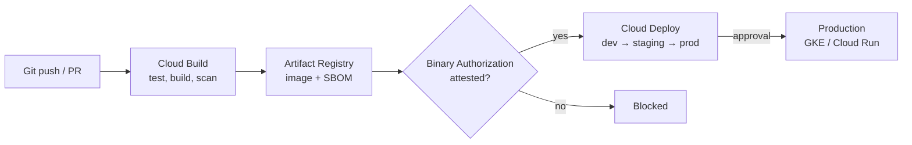

The second half of objective **5.1** is "application and infrastructure deployment": how the
operations team gets your design into Google Cloud repeatably, and how new versions reach users
safely. On the exam, anything done by hand in the console is a red flag. The answers favour
**declarative infrastructure as code**, an **automated pipeline**, and a release pattern that matches
the stated risk and cost constraints.

## 1. Infrastructure as code: pick the tool for the team

| Tool | Model | Choose it when |
|---|---|---|
| **Terraform** (Google provider) | Declarative HCL; `plan` shows the diff, `apply` makes it; state file records what exists | The default answer. Multi-environment, multi-cloud, large module ecosystem, Google's own blueprints |
| **Infrastructure Manager** | Google-managed Terraform: runs plan/apply in Cloud Build with a service account, stores state and revisions for you | You want Terraform without operating the state bucket and runners yourself |
| **Config Connector** | Google Cloud resources as Kubernetes custom resources, continuously reconciled by a controller in GKE | The team already runs everything through Kubernetes manifests and GitOps (Config Sync), and wants drift corrected automatically |
| **gcloud scripts** | Imperative | One-off tasks, glue, bootstrapping. Not for managing an estate |
| **Deployment Manager** | Retired | End of support 31 March 2026. Migrate to Infrastructure Manager or Terraform |

> [!WARNING]
> Older practice material recommends **Deployment Manager**. It reached end of support on 31 March
> 2026. If it appears as an option on the current exam, it is a distractor; the Google-managed
> replacement is **Infrastructure Manager**.

### Terraform done properly

Google's Terraform best practices boil down to a few rules the exam likes to test:

- **Remote, shared state with locking.** Store state in a Cloud Storage bucket with **object
  versioning** enabled, using the `gcs` backend. The backend locks state during an apply, so two
  engineers cannot corrupt it. Never keep state on a laptop or in Git; state can contain secrets.
- **Modules** for reusable building blocks (a VPC, a GKE cluster), with **separate root
  configurations per environment** (`envs/dev`, `envs/prod`) calling the same modules with different
  variables. This keeps environments consistent but independently deployable.
- **Pin versions** of the provider and modules.
- **Run Terraform from a pipeline**, not from people's machines: Cloud Build (or Infrastructure
  Manager) runs `terraform plan` on a pull request and `terraform apply` after approval, using a
  dedicated service account with only the roles it needs.
- **No manual changes** to resources Terraform owns; they create drift that the next apply will
  reverse.

```hcl
terraform {
  backend "gcs" {
    bucket = "acme-tfstate-prod"   # versioning enabled on this bucket
    prefix = "network"
  }
  required_providers {
    google = { source = "hashicorp/google", version = "~> 6.0" }  # pin the major version you tested
  }
}
```

## 2. The CI/CD pipeline on Google Cloud



| Stage | Service | What it gives the operations team |
|---|---|---|
| **CI** | **Cloud Build** | Triggers on push or PR, container steps, private pools for builds that must reach a private network |
| **Artifact storage** | **Artifact Registry** | Regional repositories for images and packages, IAM per repository, vulnerability scanning through Artifact Analysis. Replaces Container Registry |
| **Deploy-time policy** | **Binary Authorization** | Only images with required attestations (built by our pipeline, passed scan) run on GKE or Cloud Run |
| **CD** | **Cloud Deploy** | A *delivery pipeline* of ordered *targets* (dev, staging, prod). A *release* is rendered once and *promoted* through targets; each deployment is a *rollout*. Approvals, canary strategy, verification and one-command rollback |

Key principle: **build once, deploy the same artifact everywhere.** The image digest that passed
tests in staging is the one promoted to production. Rebuilding per environment breaks that guarantee.

DORA's continuous delivery research supports the same direction: small batches, automated
deployment, and software that is always in a deployable state.

## 3. Release patterns

Lesson 3 of Section 6 shows how to *implement* these on Cloud Run, GKE and managed instance groups.
Here, the skill is choosing one.

| Pattern | How it works | Rollback | Extra cost | Pick it when |
|---|---|---|---|---|
| **Recreate** | Stop v1, start v2 | Redeploy v1 (slow) | None | Downtime is acceptable (batch, internal tools) |
| **Rolling** | Replace instances a few at a time | Roll forward or back gradually | Little (surge capacity) | Default for stateless services; versions must coexist briefly |
| **Blue/green** | Run a full v2 (green) beside v1 (blue), switch all traffic at once | Instant: switch back | Double capacity during the switch | Zero downtime and instant rollback are required |
| **Canary** | Send a small percentage of real traffic to v2, watch metrics, increase | Fast: shift traffic back | Small | Want to limit the blast radius of a bad release |
| **A/B testing** | Route by user attribute (cohort, header, region) to compare a *business* outcome | Remove the variant | Small | Product question: "does the new checkout convert better?" |
| **Shadow (dark launch)** | Mirror production traffic to v2; its responses are discarded | Not needed; users never see v2 | Double processing | Testing a rewrite under real load with zero user impact |

> [!TIP]
> **Canary** and **A/B** look alike (both split traffic). Canary answers a *technical* question ("is
> v2 healthy?") with random small slices. A/B answers a *business* question ("which converts
> better?") with deliberately chosen user groups. **Shadow** is the only one where users see no v2
> responses at all; be careful with shadowing writes, which can double-charge or double-send.

Feature flags complement all of these: deploy code dark, then turn features on for some users
without a new deployment.

## Worked example: EHR Healthcare's environments

**Situation.** EHR Healthcare is moving its containerised apps to GKE. Today each environment was
built by hand and they have drifted. Requirements: dev, staging and production must be consistent;
changes to production need an approval and an audit trail; only images built by the company's own
pipeline may run in production; the platform team is small and does not want to run Terraform
infrastructure itself; releases must limit patient-facing impact if a version is bad.

**Reasoning.**

1. *Consistent environments, auditable changes* → infrastructure as code in Git with modules per
   building block and one root configuration per environment.
2. *Small team, no Terraform plumbing* → **Infrastructure Manager** runs Terraform for them and keeps
   state and revision history. (Self-managed Terraform with a GCS backend would also be correct, but
   carries more operational work.)
3. *Only our images* → Cloud Build signs an attestation; **Binary Authorization** on the production
   cluster requires it.
4. *Approval and audit for production* → **Cloud Deploy** pipeline dev → staging → prod with an
   approval required on the prod target; every promotion is recorded.
5. *Limit patient impact* → **canary** strategy on the prod target (for example 10%, then 50%, then
   100%) with verification between phases, and Cloud Deploy rollback if metrics degrade.

**Recommendation:** Terraform modules run by Infrastructure Manager; Cloud Build → Artifact
Registry → Binary Authorization → Cloud Deploy with a canary strategy and a prod approval.

## Check yourself

1. Two engineers ran `terraform apply` at the same time from their laptops and corrupted the state.
   What should the architect recommend?
2. A team manages all its workloads through Kubernetes manifests in Git and wants its Cloud SQL
   instances and Pub/Sub topics managed the same way, with drift corrected automatically. Which tool?
3. Product managers want to know whether a redesigned checkout increases orders among returning
   customers in Germany. Which release pattern?

<details>
<summary>Answers</summary>

1. Move state to a **Cloud Storage `gcs` backend** with object versioning (which provides locking
   and history), and run Terraform only from a pipeline (Cloud Build or Infrastructure Manager) with
   a dedicated service account.
2. **Config Connector**, which represents Google Cloud resources as Kubernetes objects and
   continuously reconciles them, typically with Config Sync for GitOps.
3. **A/B testing**: route a defined cohort (returning customers in Germany) to the new checkout and
   compare a business metric. A canary would pick random users and answer a technical question.

</details>

> [!NOTE]
> **Sources.** Exam guide §5.1; Google's Terraform overview, best practices and state-storage guide,
> with HashiCorp's gcs backend docs; Infrastructure Manager, Deployment Manager deprecation and
> Config Connector docs; Cloud Build, Artifact Registry, Binary Authorization and Cloud Deploy
> overviews; Google's application deployment and testing strategies; DORA continuous delivery.
